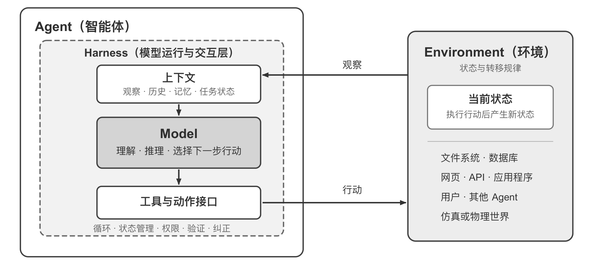
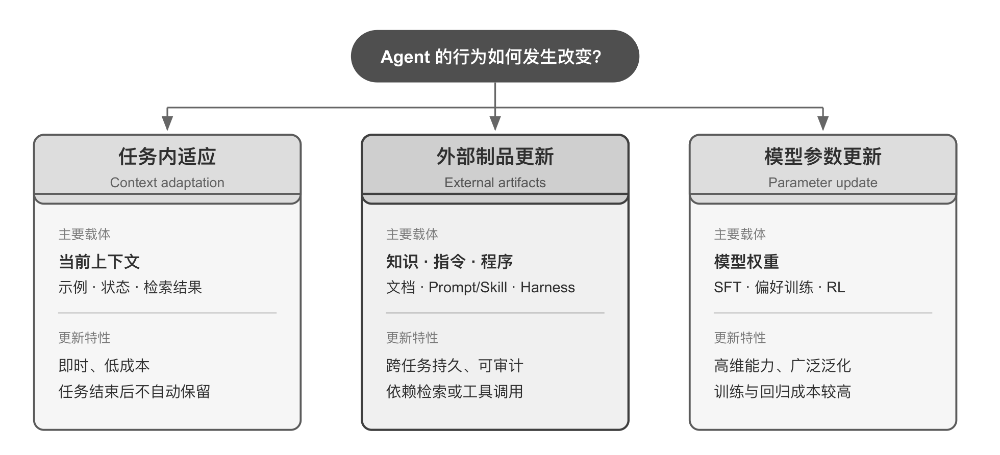
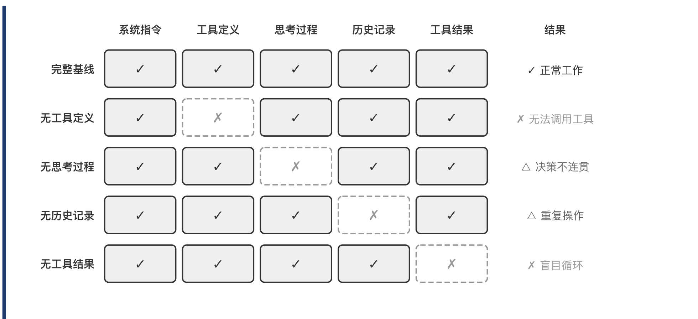
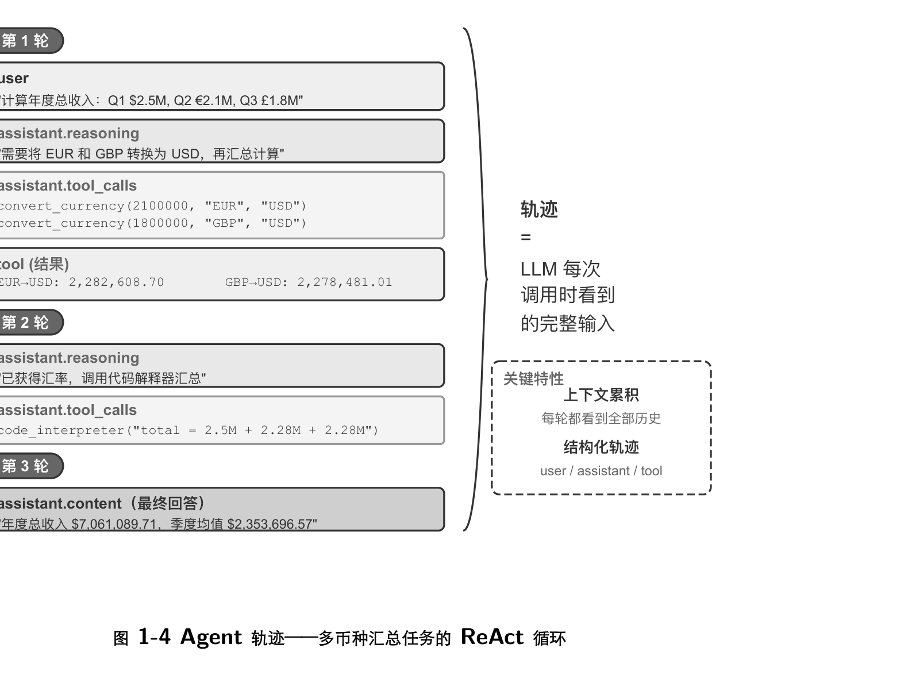
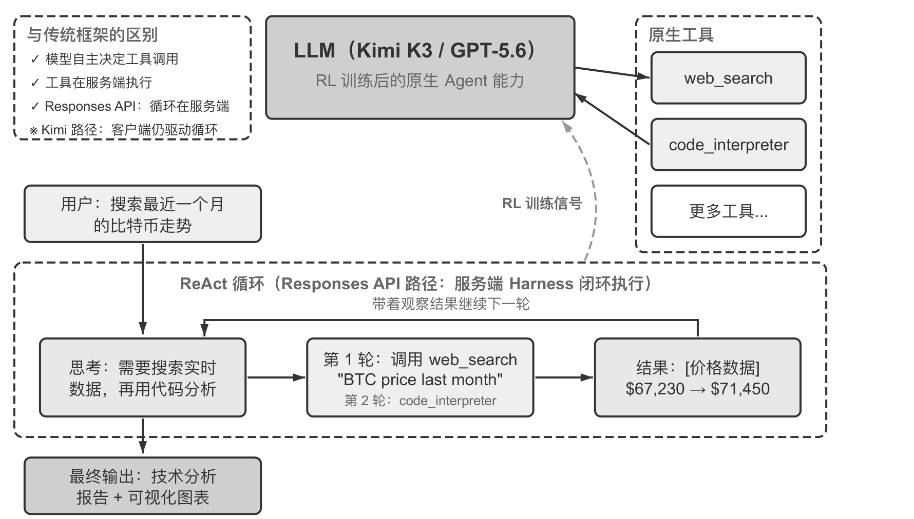
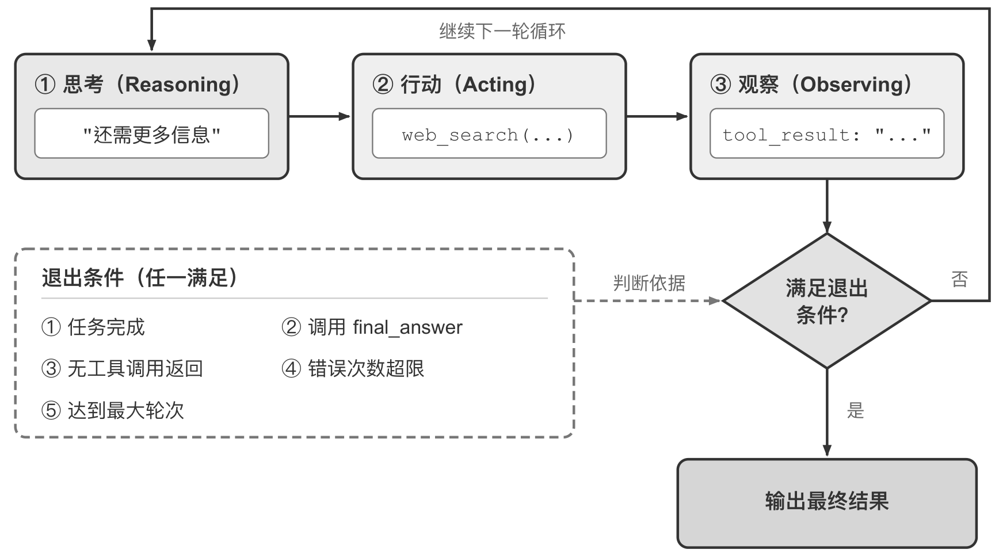

用 Cursor 搜索代码库、编辑多个文件、反复运行测试直到通过，用 Deep Research 调研课题并整理出报告，让手机助手订票发消息——这些产品形态各异，共同点是它们不再停留在"你问一句、它答一句"，而是自己规划步骤、调用工具、根据结果调整策略。这种系统的工程实现可以压缩成一个很短的公式：

$$
\text{Agent} = \text{LLM} + \text{上下文} + \text{工具}.
$$

公式里的加号表示工程组件的组合，不是强化学习中的形式化定义，而且它只描述 Agent 边界之内的实现，不包含 Agent 与之交互的环境（Environment）。三个词都需要做广义但边界清楚的理解：LLM 是大脑，不只是一组权重，而是包括预训练积累的世界知识与后训练固化的决策策略在内的整个决策内核；上下文是眼睛，指每个决策点收到并保留的信息表示，包括环境观察、用户记忆、领域知识和任务进展；工具是手脚，指 Agent 用来感知或改变外部世界的接口，涵盖工具定义、调用协议和适配器。

## Agent 与环境的边界

在控制论的视角下，Agent 与环境是闭环交互的两方，而不是彼此的组成部分。环境向 Agent 返回当前观察，Agent 根据已有上下文选择下一步行动，行动改变环境状态，新状态再产生下一次观察。这个循环是理解所有 Agent 交互的最小结构。



*图 1：外层是 Agent 与 Environment 通过观察、行动两类接口构成的闭环；内层是 Agent 边界内的 Model–Harness 结构。*

图 1 同时给出两个抽象层次。外层是交互关系，环境包含文件系统、数据库、网页、API、用户、其他 Agent 以及物理或仿真世界，Agent 只能通过观察和行动接口与它交互。内层是 Model–Harness 结构：Model 负责策略决策，Harness 是 Agent 边界内环绕模型的运行与治理层，负责构造上下文、暴露工具接口、维护循环和状态，并实施权限、验证与纠正。Harness 可以创建、隔离或代理一个环境，却不因此包含环境自身的状态与转移规律。

按这个划分，原公式可以重新展开：LLM 对应 Model，"上下文 + 工具"构成最小 Harness，生产系统还会在 Harness 中加入约束、验证和纠正。这个映射与强化学习的概念并不严格一一对应——上下文是具体观察和历史在 Agent 内部的表示，不等于整个观察空间；工具定义 Agent 可使用的观察与行动接口，工具背后的对象仍属于环境。

| 直觉理解 | 实现组件 | 学术概念 | 含义 |
| --- | --- | --- | --- |
| 大脑 | LLM | 策略（Policy） | 面对当前信息，从可选行动中挑出最合适的一个 |
| 眼睛 | 上下文构造 | 观察与历史 | 把环境观察与已有历史组织成当前决策所需的信息 |
| 手脚 | 工具与适配器 | 观察/行动接口 | 规定可以读取哪些观察、发出哪些行动、接口用什么格式 |

一段信息如果没有通过观察通道进入上下文，对模型来说就像不存在；一个操作如果没有被动作接口允许，模型即使知道该怎么做也只能停留在文字建议上。因此在底层模型固定时，提升任务表现最主要的系统工程手段往往就是重新定义或扩展观察空间与动作空间，也就是扩展上下文和工具。不少看起来需要"更聪明模型"的问题，其实只是接口问题。

Manus 是这条思路的一个明显例子。在它出现之前，生产级 Agent 大多沿 Deep Research、Coding 和 Computer Use 三条相对独立的路线发展，Manus 率先把三者放进同一个有广泛影响力的产品：虚拟浏览器扩大了观察空间，文件系统、代码执行与命令行执行扩大了动作空间。它取的是三类 Agent 观察空间与动作空间的并集，而不是靠替换一个更强的模型。OpenClaw 又向外推进了一层，通过 WhatsApp、Telegram、Slack、Discord 等用户已在使用的消息渠道接收任务和返回结果，并用本地 Gateway 连接云应用与本地文件系统，让分散在不同账号和设备中的数字文件在用户授权后进入同一个观察空间。Manus 后来补齐 Google Drive 连接器与桌面端本地访问，方向一致。

## 工具的分类与设计取舍

工具是 Agent 与外部世界交互的桥梁。感知类工具承载环境到 Agent 的观察，执行类工具承载 Agent 到环境的行动。按互动的方向可以分为五类。

感知工具让 Agent 访问信息，搜索引擎提供实时网络数据，文件系统读取本地文档，API 和数据库对接外部服务与企业核心数据。执行工具让 Agent 改变世界，包括代码执行、文件操作、系统命令和外部 API 调用。协作工具让 Agent 与其他 Agent 分工，包括委托子 Agent、在关键决策点请求人类确认，以及在多 Agent 系统中协调行动。用户沟通工具是 Agent 主动与用户建立连接、传递进展的渠道，通过文字消息、语音通话、邮件等方式完成，它改变的是信息传递而非外部世界。事件触发工具与前四类在调用方式上有本质区别：它不是 Agent 主动调用的，而是作为外部输入驱动 Agent 开始执行任务，比如收到新邮件、到达预定时间点、或另一个系统发出 Webhook 回调。事件适配器同样是环境向 Agent 提供观察的通道，因此归入广义的工具体系。

工具调用（Tool Calling，也称 Function Calling）让模型以结构化方式调用外部工具，把 LLM 从文本生成器变为能够执行实际操作的系统。流程分四步：上下文里先声明有哪些工具可用，包括名称、用途和参数；模型自主判断要不要调用、调用哪个、传什么参数；工具执行完毕后结果追加到上下文；模型据此决定下一步。这个四步循环正是后文 ReAct 的基础。

在设计工具时，可以从任务所需的最窄能力起步，再随复杂度提升逐步扩展。如果任务只是四则运算，一个参数清晰的计算器就够用；当任务升级为读取表格、清洗缺失值、计算统计量并绘图时，受限的 Python 代码解释器比不断叠加专用工具更容易组合和探索。但通用性也扩大了出错和攻击面：代码必须在隔离沙盒中运行，默认不能访问网络，不能读取授权工作目录以外的文件，并对执行时间、CPU、内存和输出大小设置上限。单一日志工具适合记录一段执行过程；对于需要数小时甚至数天的长程任务，受控的虚拟工作目录可以同时保存计划、中间结果、运行日志和最终产物，让 Agent 在多次执行之间接续工作，这个目录同样要限定可读写路径、容量和文件类型并防止路径越界，而不是把宿主文件系统全部暴露出去。

通用工具并不总是优于专用工具。支付、删除数据、发送邮件和生产部署这类高风险或强业务约束操作，仍应封装为参数明确、权限受限且全程可审计的专用工具，必要时再加上预览和人工确认。设计原则可以概括为：通用基础能力用于组合与探索，专用工具用于约束高风险和强业务规则操作。

## 三条能力更新路径

LLM Agent 有一个区别于传统强化学习 Agent 的特点：它可以在采取实际行动之前先进行内部规划与推演。这个过程不改变外部环境，却能显著提升后续行动的质量。其可行性来自预训练阶段习得的能力——模型在推演时遵循的是人类知识中已经沉淀下来的逻辑规则，包括数学定律、因果关系和问题分解策略。因此今天的 LLM Agent 不是盲目的随机探索，而是在结构化知识体系上展开。

但 Agent 的行为改变不只发生在训练阶段。"模型即 Agent"（Model as Agent）这一范式通过后训练（尤其是强化学习）把工具调用的决策策略内化为原生能力：何时调用工具、调用哪个、传什么参数都由模型自己决定，无需人工编排。这并不意味着框架层变得不重要——模型自主决策的空间越大，出错时的影响面也越大，因此需要更精细的约束、验证和纠正机制。Harness 这个词原指马具，即套在马身上的缰绳与挽具，作用不是限制马的奔跑能力，而是把这种力量引导到正确的方向上。

按更新发生的位置和持续时间，Agent 的能力更新可以分成三条互补路径。



*图 2：三条路径按更新载体划分，分别对应临场适应、可控积累与能力内化，在时间尺度上互补。*

任务内的上下文适应发生在当前任务中。示例、状态和检索结果进入上下文后，模型可以立即调整行为，却不会改变下一次会话的持久状态。它的优势是快速、低成本，局限是受上下文窗口和信息组织方式约束。

要让变化跨越任务保留下来，可以更新外部制品：把事实和经验整理为知识文档，把可语言化的策略写进 Prompt 或 Skill，把确定性流程与约束写成程序和 Harness。这些产物可审计、可修订，执行时仍需通过上下文或工具接口被 Agent 使用。

当目标是医疗影像理解、自然语言风格或隐式决策策略这类高维能力时，外部规则难以完整表达，就需要通过后训练更新模型参数。参数更新的部署成本较高，却能形成自然、广泛的泛化能力。三条路径因此不是互斥分类，而是不同时间尺度上的协同机制：上下文负责临场适应，外部制品负责可控积累，参数负责内化难以显式表达的能力。本章后面给出的最小 diff + 可回滚模式，正是按可回滚程度从高到低排列的这三条路径。

模型持续变强，Harness 会不会最终被模型"吃掉"？Rich Sutton 在《苦涩的教训》中回顾了 AI 研究七十年间反复上演的一幕：研究者一次次把自己对领域的理解编码进系统，短期见效，长期却总是输给能随算力与数据规模持续扩展的通用方法。以此衡量，Harness 里的约束、验证与纠正有多少属于"人类先验"，注定会被内化？本书的立场是方向认同、节奏务实。方向上，工具调用和长程规划都曾靠外部编排，如今已是模型的原生能力；但在节奏上，这个过程远比想象中慢——训练以月计，模型也无法一次内化真实业务中所有的约束与偏好，模型此刻的能力边界就是 Harness 此刻的价值所在。Harness 工程因此不是对苦涩的教训的抵抗，而是这一教训在工程时间尺度上的实践：模型还做不稳的，Harness 先补上；模型每内化一层，Harness 就卸下一层，转而兜底新的能力前沿。

## 上下文构成与消融实验

上下文是 Agent 在每个决策点能看到的全部信息。从 API 的视角看，每次调用 LLM 时的上下文由五个部分构成：系统提示词（System Prompt）由开发者编写，在整个对话过程中保持不变，定义身份、权限和行为准则，其中还包含跨会话保存的用户记忆和动态注入的环境状态；工具定义声明可用工具的名称、功能描述和参数格式；用户消息来自用户输入，还可能包含通过 RAG（检索增强生成，Retrieval-Augmented Generation）动态检索引入的外部知识；模型回复最多包含三个部分，即思考过程（reasoning）、文本内容（content）和工具调用请求（tool_calls）；工具执行结果是 Agent 框架执行工具后返回的内容，是下一步思考的直接依据。

在一次具体的回复中，三者不一定同时出现：Agent 决定调用工具时通常只有 reasoning + tool_calls，给出最终回答时通常只有 reasoning + content。前两项构成静态前缀，后三项是随交互不断增长的动态消息历史。

要验证每个组件是否都不可或缺，最直接的方法是消融实验（Ablation Study）——逐一去掉某个组件，观察系统是否还能正常工作。实验从五个部分中选取四个进行测试，系统提示词作为基本身份定义不参与消融，因为没有它 Agent 连基本的角色认知都没有，测试没有意义。



*图 3：一组保留全部组件的完整基线，加四组各缺失一个组件的对照。*

结果揭示了各组件并不同等重要。工具定义是行动能力的基础，没有它就无法调用任何工具；但失去行动能力不等于沉默——模型照样会给出一份格式工整、语气笃定的答案，数据却来自参数记忆，与真正基于观测得出的答案排版一模一样。它是坦白拒绝还是就地编造，主要取决于模型自身的幻觉率与诚实度，提示词里"不得自行估计"这类约束只能降低编造的概率，并不能消除。工具执行结果是闭环控制的关键，缺失它会让 Agent 盲目执行，反复重试直到耗尽迭代预算。思考过程记录的是"为什么这么做"，工具执行结果记录的是"发生了什么"，当前者可以从后者重建时，把它从历史中丢掉几乎没有代价。历史消息则防止了冗余操作和重复犯同样的错误。

衡量的标准是组件承载的信息能否从别处重建。"每个组件都不可或缺"这类论断要靠实测，而且模型迭代很快，同一个消融换到新模型上完全可能得出不同的结论。对工程实践更重要的一点是："给出了回答"不等于"完成了任务"，上下文残缺时的典型失败不是报错退出，而是一个看上去毫无破绽的答案。

## ReAct 循环与轨迹

ReAct（Reasoning + Acting）是把 LLM、上下文和工具串联起来的核心机制。名字只体现了思考和行动，实际循环包含三个环节：模型先思考当前应该做什么，然后调用工具行动，再观察返回的结果并继续思考下一步。"想→做→看"不断重复，直到任务完成。

轨迹（trajectory）是 Agent 执行任务过程中不断积累的消息历史。每次调用 LLM 时，它接收的完整上下文由静态前缀和轨迹两部分组成，即

$$
\text{Agent 的上下文} = \text{静态前缀} + \text{轨迹}.
$$

静态前缀对应五个组件中的前两项，轨迹对应后三项。LLM 基于这个完整上下文生成下一步响应，响应又追加到轨迹中，供下一次调用使用。



*图 4：以多币种收入汇总为例，展示三轮迭代中 user、assistant、tool 三类消息的累积过程。*

以多币种收入汇总为例：第一轮，模型判断需要先把欧元和英镑换成美元，于是并发调用三个货币转换工具；第二轮，模型拿到汇率后调用代码解释器汇总；第三轮给出最终答案。整个过程用了 3 次迭代、4 次工具调用。在这种最基本的设计中，上下文是不断追加的，每次调用都能看到完整轨迹，因而模型清楚任务进行到了哪一步、此前尝试过什么、得到了什么结果。轨迹的结构化也让系统易于解释和调试。更进一步，分析大量轨迹可以发现行为模式、优化决策路径、改进工具设计；轨迹还可以沉淀进知识库，或用于强化学习训练更好的模型，形成从经验中学习的闭环。

最小运行骨架说明了机制如何运行：Model 只负责决定下一步，Harness 负责组装上下文、校验并执行工具，Environment 负责产生真实状态变化和观察。

```python
trajectory = [user_request]
repeat:
    context = stable_prefix + trajectory
    decision = Model(context)
    trajectory.append(decision)
    if decision has no tool call:
        return decision.answer
    for call in decision.tool_calls:
        # independent calls may run in parallel
        validated_call = Harness.validate(call)
        observation = Environment.execute(validated_call)
        trajectory.append(observation)
```

### 原生 Agent 能力的两个实例

Kimi K3 是一个约 2.8 万亿参数的混合专家（MoE, Mixture of Experts）模型。MoE 可以理解为一个专家团队：面对不同类型的问题，系统自动选择最合适的几位专家作答，而不需要所有专家同时上阵。它拥有 100 万 token 的上下文窗口、原生视觉理解和始终开启的思考模式，并通过强化学习把工具调用的决策策略内化为原生能力。值得区分的是两件事的归属：强化学习写进参数的是决策——何时该调用工具、调用哪个、传什么参数、拿到结果后是否继续、如何把几十上百次调用串联成连贯推理；工具本身及其执行仍由 Agent 框架提供，web_search、code_runner 的真实实现、代码沙盒环境、调用的发起与结果回传都在模型之外的基础设施里完成。

K3 在 Agent 任务中的一个突出优势是长链工具调用的稳定性，它能够连续执行 200 至 300 次工具调用而保持思考的一致性，远超多数模型在数十次调用后就开始退化的表现。作为开源模型，它在软件工程和 Agent 基准测试中展现了可与顶尖闭源系统比肩的性能。

第二个实例是 GPT-5.6 借助 API 内置工具在服务端形成 Deep Research 的编排闭环。它支持自由格式工具调用（Freeform Tool Calling），允许模型直接向工具发送原始文本，比如一段 Python 代码或一条 SQL 查询，省去 JSON 转义的麻烦。这是 API 参数格式的演进，而非模型架构的革新——客户端的工具调用循环逻辑保持不变，改变的只是参数从 JSON 字符串变成原始文本。配合 Responses API 的网络搜索和代码解释器，模型可以自主搜索网络并编写代码分析，实现"搜索—阅读—分析—再搜索"的迭代研究。面对"东盟 10 国首都之间最近的一对首都距离多少"这类问题，它会先搜索各国首都地理坐标，再写代码计算所有首都对之间的大圆距离。它还引入了意图澄清：收到"做比特币技术分析"的需求后不会立即执行，而是先问偏好哪个数据源、需要分析哪些指标。



*图 5：模型经强化学习获得原生工具调用能力，工具在服务端执行。图中"客户端无需手写 ReAct 循环"只对 Responses API 路径成立，Kimi 路径的循环仍由客户端代码驱动。*

编排循环并没有消失，只是决策权交给了模型，而循环本身跑在哪里取决于接入方式。在 Responses API 路径中，搜索、代码执行和多轮编排整体在服务端闭环完成；在 Kimi 路径中，服务端只负责执行搜索本身，"调用模型→追加工具结果→再次调用"的循环仍由客户端代码驱动。这一点在读到"模型即 Agent"的宣传时必须区分清楚。

## Harness 工程

前面的机制是有效的，但也暴露了明显的脆弱点：模型可能编造不存在的工具或参数、选错工具，或在遇到错误时无法自我恢复。一个能跑的 Demo 和一个可靠的产品之间还有很大距离，这些脆弱点正是 Harness 工程要解决的问题。

从 Harness 工程的视角看，可以把 LLM 抽象为核心组件 Model，把 Agent 边界内负责支撑模型运行及模型与环境交互的代码、配置和服务统称为 Harness。生产形态下的完整组成可以写成

$$
\text{Agent} = \text{Model} + \text{Harness}, \qquad
\text{Harness} = \text{上下文管理} + \text{工具接口} + \text{约束} + \text{验证} + \text{纠正}.
$$

最小 Demo 只需 Model 和能构造上下文、暴露工具的 Harness；生产系统还要在同一边界内加入约束、验证和纠正。比如退款 Agent 可以把政策放进上下文，用权限和金额规则约束调用，用数据库状态验证结果，并在超时时重试或回退。Harness 不是模型之外的一切，而是 Agent 边界内、模型之外的运行与治理层：工具定义、调用适配器、沙箱的权限与重置机制属于 Harness，沙箱内随行动变化的文件和进程、外部数据库、网页、用户及物理世界属于 Environment。物理部署位置也不能决定概念归属，即使仿真环境与 Agent 运行在同一进程中，它仍然是 Environment。

| 功能 | 职责与核心原则 | 实际例子 |
| --- | --- | --- |
| Context（上下文） | 为模型提供感知信息；信息要充分 | 系统提示词、知识库、Agent 状态栏、Sidecar 旁路查询 |
| Tools（工具接口） | 为模型提供观察与行动手段；接口要清晰 | MCP 工具、代码解释器、搜索工具 |
| Constrain（约束） | 设定行为边界；采用故障安全默认值，能力默认关闭 | 每个工具默认需要用户授权才能执行 |
| Verify（验证） | 自动判断结果对错；只看结构化数据，不看模型自由生成的文本 | Linter 检查、类型系统、工具调用结果校验 |
| Correct（纠正） | 发现问题时自动修正或回退；确认无法恢复前不暴露中间态 | 静默重试、接续生成、连续失败时熔断 |

五个功能构成一个闭环：上下文与工具让 Agent 能做事，约束预防错误、验证发现偏差、纠正使闭环得以形成，三者让 Agent 不做错事。它们不是独立于上下文和工具之外的东西，而是确保上下文和工具在生产环境中可靠运转的工程实践。而在产品成熟度曲线上，两类功能的重要性并不对称。早期框架主要关注上下文与工具，生产级系统的重心已经转向约束、验证与纠正。以 Claude Code 为例，它的 Harness 中绝大部分代码都是后者——工具本身只是很小一部分，围绕工具构建的保障机制才是核心，其中包括流程状态管理、多层上下文压缩、权限分类、熔断器（Circuit Breaker，错误连续发生时自动停止重试，类似短路时保险丝跳闸）和错误恢复机制。

### 工程范式的演进

AI 应用工程的发展有一条清晰的演进弧线。提示工程（Prompt Engineering）是第一波，通过优化输入给模型的自然语言指令提升输出质量。上下文工程（Context Engineering）是第二波，人们认识到单纯优化提示词还不够，需要系统性地管理模型能看到的所有信息。Harness 工程是第三波，把视野从"模型能看到什么"扩展到"Agent 如何组织模型运行并与环境交互"。随后的 Loop 工程（Loop Engineering）把视野从单次运行扩展到跨轮次的持续自主运转，关心谁来发现下一件该做的事、何时验证、何时才算真正完成。2026 年 7 月，业界又开始用 Graph 工程（Graph Engineering）描述一种更高层的编排视角：把 Agent 循环、确定性程序和人工审批组织成显式的执行图，节点承担具体能力，边规定路由与依赖，结构化状态沿边传递并在关键边界处持久化。

这五个阶段不是替代关系，而是层层包含的：提示工程是上下文工程的子集，上下文工程是 Harness 工程的子集，Harness 工程是 Loop 工程的子集，Loop 工程又是 Graph 工程的子集，单个 Agent 循环正是执行图中的一个节点。

当各家模型的能力越来越接近、不再是决定性的差异因素时，竞争优势就转移到模型之外的工程实践。LangChain 在 Terminal Bench 2.0（评估 Agent 在终端环境中完成复杂任务能力的基准测试）上的实践提供了一个例证：得分从 52.8% 提升到 66.5%，从排行榜 30 名开外跃升至前 5，改变的不是模型，而是 Harness，具体包括让 Agent 自动检查自己的执行结果、检测是否陷入重复循环、优化思考策略等手段。

### 构建有效 Agent 的核心原则

成功的 Agent 系统通常遵循三条原则。

保持简单。从最简单的方案开始，只在确实必要时才增加复杂度。直接的 API 调用优于复杂的框架，清晰的代码优于聪明的抽象，因为每多一层抽象都会成为以后调试时新的盲区。

保持透明。明确显示 Agent 的规划步骤、执行日志和决策轨迹。这不只是为了调试方便，也是让用户建立信任的前提，因为黑箱里的错误一旦发生，外部观察者既无法定位也无法纠正。

设计好工具接口（ACI，Agent-Computer Interface）。ACI 强调的是从 Agent 视角设计接口，让 Agent 容易理解和使用，而非传统 API 从程序员视角设计接口。工具的命名和参数要直观，容易误用的地方要从设计上让错误无法发生——SIM 卡的缺角让卡片只能从一个方向插进卡槽，微波炉门没关好就绝不加热。这种"用设计消除错误"的思路在制造业里叫防呆（Poka-yoke），源自丰田生产体系。设计不好的工具会让再强的模型也频繁出错，因为模型与工具之间唯一的沟通通道就是接口本身，模糊的接口会被模型放大成系统性的错误。

## 模型选型

模型是 Agent 的智能基座，选对模型往往比优化提示词更有效。由于模型迭代极快，选型的重点不是记住具体版本，而是明确几个判断维度。

闭源模型通常在能力上领先，但成本较高且受限于厂商的 API 策略。开源模型与闭源模型的差距在半年以内，成本显著更低，适合对成本敏感或有数据合规要求的场景，且可私有化部署、支持微调定制。需要注意的是，不同模型在工具调用方面的能力差异很大，选型前务必在具体场景中测试，不要只看排行榜。

能力之外还要考虑模型的策略边界。模型在基准测试中具备某种能力，并不意味着承载它的产品一定允许用户调用这种能力。不同厂商会对网络安全、模型蒸馏、模型提取、隐私数据和高风险操作设置不同的策略边界，同一个任务在聊天产品、Coding Agent 和 API 中也可能得到不同结果。因此选型不能只比较准确率、价格和速度，还要在自己的真实任务上测试模型是否愿意执行、接口是否暴露所需能力、服务条款是否允许这种使用方式。对于业务关键任务，还应提前准备人工接管或其他合规模型作为替代路径。

绝大多数 Agent 需要支持思考（Reasoning）的模型，因为 Agent 要进行多步思考和工具选择这类复杂决策，不带思考能力的模型在这些任务上表现往往很差。只有极少数场景例外，例如只执行单步简单任务，或在 Computer Use 中仅需点击固定位置的简单 GUI 操作。另外两个容易被忽视的维度是输出 token 速度和多模态能力：Agent 往往需要多轮推理，每轮都要等待模型输出完成才能执行下一步，如果任务需要 20 轮推理，每轮慢 2 秒就意味着总共多等 40 秒；如果 Agent 需要理解图片、音频或视频，多模态就是硬性要求，不同模型在这方面的差异很大。

## 编排模式

编排模式决定上下文如何在 LLM 调用之间流动、工具如何被调度，以及执行路径是预先设定还是动态生成。构建 LLM 应用时应遵循从简单到复杂的原则：首先考虑单个 LLM 调用，如果通过优化提示词和上下文示例就能解决问题，就不要引入 Agent 系统；当需要多步骤处理时，对于可以清晰分解为固定子任务的场景考虑使用工作流；只有当需要动态决策和灵活的执行路径时，才使用自主 Agent。Agent 系统通常会用延迟和成本换取更好的任务性能，应该谨慎权衡这种交换是否值得。

一个常见的反面做法是一开始就构建一个非常复杂的工作流或多 Agent 系统。例如为"从百万条聊天记录中提炼个人记忆"设计 Agent，很容易迅速画出一条看似严谨的流水线：先切分对话片段，再依次安排提取、证据核验、身份解析、记忆整理和合并复核 Agent，最后建立事实图、覆盖账本和不可变版本。每个部件单看都有道理，组合起来却非常低效且不可靠，因为复杂工作流的执行拓扑是固定的，遇到新的例外，系统很容易继续增加节点，架构越来越复杂，通用性却越来越差。模型原本可以根据上下文处理的语义判断，反而被工作流写死了。

用"Less structure, more intelligence."概括这种取舍：先给一个能力足够的 Agent 清晰的目标、必要的上下文和可组合的工具，用自然语言告诉它如何像人一样查证、比较、处理冲突；程序只固化权限、不得覆盖原始材料、原子发布等必须始终成立的边界。只有业务约束本身要求，或评估反复暴露出某类稳定失败时，才把对应步骤升级为专门的验证器、独立 Agent 或确定性流程。好的结构不是替 Agent 预演全部思考，而是守住边界，并把边界内的决策空间还给模型。

### 工作流模式

工作流（Workflow）是通过预定义的代码路径来编排 LLM 和工具的系统。它的执行路径是确定性的，由开发者预先设计好，LLM 只在每个节点内部负责理解和生成。以一个订机票 Agent 为例，工作流可以设计为四个固定节点：核实用户身份、搜索可用航班、完成付款、确认预订。每个节点内部可以使用 LLM，但节点之间的流转顺序是代码固定的——系统不会在付款完成之前去预订座位，也不会在身份核实之前开始搜索航班。

工作流模式的核心优势有两点。第一是严格的流程控制，开发者可以确保关键步骤不被跳过或乱序执行，例如"付款前不能预订"这类业务规则通过代码强制执行，不依赖 LLM 的判断。第二是安全性，由于执行路径是确定的，提示注入或模型犯错最多只能影响当前节点内部的处理，无法让 Agent 跳到不该执行的分支，攻击面被限制在单个节点内。主要局限是缺乏变通性：当出现预设流程未覆盖的情况时，比如用户在付款环节临时想改签、或航班突然取消需要推荐替代方案，固定的节点路径无法灵活应对，只能走预设的异常处理分支或将控制权交还给人类。

一个最简单的例子是文生图。用户的需求往往就是一句大白话，比如"帮我画一个 AGI 实现以后程序员的工作场景"，可 Stable Diffusion 这类文生图模型只接受特定风格的提示词——逗号分隔的英文标签、质量词、负面提示词。所以工作流要在用户和生图模型之间安排两个固定节点：提示词改写与图片生成。这个工作流里的 LLM 节点做的是翻译，把人话转成工具听得懂的输入格式，它存在的原因是文生图模型"听不懂人话"。这种专门给工具或模型的能力短板打补丁的 Harness 代码，可以称为适配层。但如果把生图工具换成具备原生图像生成能力的多模态模型，比如 Nano Banana 2、GPT-Image 2，就不再需要提示词改写了。

Harness 里那些给模型能力短板打补丁的部分，会随着模型变强被模型自己内化。仅仅在第一章里这样的事就发生了好几轮：few-shot 示例、"让我们一步一步思考"之类的提示词技巧，被指令微调和推理模型内化了；输出格式修复、JSON 解析容错，被结构化输出和原生工具调用内化了；文生图的提示词改写，被原生多模态理解与生成能力吃掉了。每一轮内化，消灭的都是"翻译"和"脚手架"这类适配层代码。

### 自主 Agent

当工作流的固定路径无法满足需求时，就需要自主 Agent（Autonomous Agent）。它与工作流的核心区别在于执行路径不是预先定义的，而是 Agent 根据环境反馈实时决定的。仍以订机票为例：自主 Agent 不需要预定义四个固定节点。用户说"帮我订下周三去上海的机票"，Agent 会自行决定先搜索航班、发现需要登录、于是先核实身份、再回来搜索、发现最便宜的航班需要转机、主动询问用户是否接受、用户说不要转机、Agent 调整搜索条件。

这意味着自主 Agent 需要具备自主规划的能力，需要能识别失败、调整策略，而不只是在出错时停下来。但自主性不等于无限制——必须设计明确的停止条件，否则容易陷入死循环或过度执行。



*图 6：思考、行动、观察三步循环，以及五类退出条件。任一条件满足即输出最终结果，否则继续下一轮。*

从实现角度看，自主 Agent 本质上就是在一个循环中使用工具的 LLM，通过持续获取环境反馈来推进任务，这正是 ReAct 循环。常见的退出条件包括：调用最终输出工具、模型返回没有任何工具调用的响应、任务完成、错误次数超限、达到最大轮数。自主 Agent 特别适用于难以预测所需步骤数量的开放式问题，典型场景包括 Coding Agent 解决 SWE-bench（评估 Agent 自动修复真实 GitHub Issue 能力的基准测试）任务、"计算机使用"（Computer Use）Agent 操作计算机界面，以及需要迭代搜索和分析的研究任务。不过自主性也带来了更高的成本和复合错误风险，部署时必须在沙盒环境中充分测试，设置适当的护栏和监控机制，并在关键决策点考虑加入人机协作的检查点。

### 混合使用与框架选型

实践中工作流和自主 Agent 并非非此即彼，很多系统会混合使用：关键的、有严格合规要求的流程用工作流确保可靠性，需要灵活决策的部分切换到自主模式。n8n 是一个成熟的工作流自动化开源框架，开发者通过可视化界面拖拽功能组件来构建 Agent，可以在同一个系统中同时使用工作流节点和自主 Agent 节点。还有一种混合方式是先由自主 Agent 把工作流写出来，再由工作流去执行：Agent 读完任务后自行决定拓扑并生成一段编排代码，代码一旦生成，执行阶段就退回工作流的确定性。这样既保留了面对未知任务的灵活性，又不必让模型在每一次调度上都参与决策。

| 框架/平台 | 核心定位 | 编排模式 | 开发方式 | 适用场景 |
| --- | --- | --- | --- | --- |
| Codex Harness | Codex 的开源运行时 | 自主 | 代码优先，可嵌入自有应用 | Coding Agent、把 Agent 嵌进自家产品 |
| Claude Agent SDK | 生产级开发框架 | 自主 | 代码优先 | 复杂自主任务、Coding Agent |
| LangChain / LangGraph | 通用 LLM 应用框架 | 工作流 + 自主 | 代码优先 | 复杂链式思考、多步骤工作流 |
| n8n | 可视化工作流自动化 | 工作流 + 自主 | 低代码 | 业务自动化、非技术团队 |
| Dify | LLM 应用开发平台 | 工作流 + 对话式 | 低代码 | 企业级 RAG、知识库应用 |
| CrewAI | 角色化多 Agent 编排 | Multi-Agent 协作 | 代码优先 | 团队式任务分解与执行 |
| OpenClaw | 开源全能个人 Agent | 自主 + 事件驱动 | 配置 + 代码（自托管） | 个人助理、多平台消息集成 |

Codex 是 OpenAI 的 Coding Agent 产品（App、CLI、IDE 扩展），Codex Harness 就是驱动这几种形态的运行时，提供三条集成路径：codex exec 适合脚本与 CI 里的一次性任务，Codex SDK 适合第三方应用启动、恢复和流式处理任务，app-server 通过 JSON-RPC 协议提供持久会话、事件流与审批回调，适合把 Agent 直接做进产品。Claude Agent SDK 与 Claude Code 也是类似的关系，区别在于 Claude 侧对外开放的是 SDK 接口，Harness 实现本身并不开源。框架发展迅速，学会某个具体框架的用法并不重要，选择时的关键考量是它能否用尽可能少的抽象层让你专注于业务逻辑。

## 护栏与安全性

护栏（Guardrails）构成保障 Agent 行为安全可控的分层防线，可用于管理数据隐私风险（例如防止系统提示泄露）或声誉风险（例如确保模型行为与品牌形象一致）。单个护栏不太可能提供足够的保护，多个专门的护栏组合使用，才能构建出更有韧性的系统。

护栏也存在另一类失败：误拒绝。为了降低危险请求被放行的概率，模型可能同时拒绝一部分合法但形式敏感的任务，例如经过授权的安全测试、模型蒸馏研究。因此护栏评估不能只测试应当拒绝的请求是否被拦截，还要测试明确允许的请求是否能够正常完成。

### 三层护栏

按防护位置可以分为上下文层、执行层、数据层。这三层不是按请求处理的先后顺序排的，而是按被绕过的难度排的——越靠下的层越不依赖模型自己的判断，因此越难被一次成功的攻击穿透。

上下文层护栏管的是模型能看到什么，在内容进入上下文之前拦截，通常包含四种机制。相关性分类器标记偏离主题的查询。安全分类器检测越狱（Jailbreak，诱导模型绕过安全限制）和提示注入（Prompt Injection，在输入中嵌入恶意指令），两者的关键区别在于：越狱是用户自己试图绕过模型的安全限制，提示注入则是攻击者通过外部数据间接操纵模型行为。内容审核标记有害或不当的输入。基于规则的保护采用确定性措施，包括黑名单、输入长度限制、正则表达式过滤器。来源标注与"指令/数据"分离也属于这一层。

一个代表性的工业实践是 Anthropic 的 Constitutional Classifiers，其核心机制有三点：用自然语言写成的规则生成合成训练数据，训练输入输出分类器；把用户提问和模型回答放在一起检查，因为有些回答单独看毫无问题，只有对照提问才能发现"食品调味料"其实是化学试剂的暗语；先用一个极轻量的探针直接读取模型内部激活检查所有对话，发现可疑之处再交给更强的分类器复审，而不是直接拒绝。这样第一级即使误报较多也不影响用户体验，成本也大大降低。但这一层有一个结构性上限：处在同一个上下文里的 Agent，很难判断自己是否已经被注入。所以上下文层只能降低攻击成功率，给不出保证，这正是必须有下面两层的原因。

执行层护栏管的是模型能做什么，在动作真正生效之前验证。其核心是工具风险评级：根据操作是否可逆、权限等级、财务影响，为每个工具标注风险等级（低/中/高），高风险操作需额外审查或人工确认。关键在于这类复核必须由上下文之外的机制完成——独立的审查进程、最小权限凭证、沙盒隔离、人在回路——否则它会和被注入的 Agent 一起沦陷。返回给用户的回复本身也是一次动作，因此输出检查同样属于这一层：PII 过滤器审查输出中的个人身份信息，输出验证则确保回复与品牌价值一致。

数据层护栏管的是世界最终能被改成什么样，把"谁能对哪条数据做什么"交给一层稳定的、经过人类审查的机制强制执行：数据库的行级安全策略、约束与校验器、受控视图与存储过程，以及由受信任运行时绑定、无法被伪造的访问上下文。这一层的价值在于它不依赖上面两层是否正确——即使提示注入得手、生成的代码完全漏写了权限判断，越权操作仍会在数据层被拒绝。

### 人工干预

人工干预（Human in the loop，又称人在回路）让 Agent 在不损害用户体验的情况下提升实际性能，在部署早期尤为重要，有助于识别失败模式、发现边缘情况并建立健壮的评估周期。实施人工干预机制，可以让 Agent 在无法完成任务时平稳地移交控制权：在客户服务中意味着将问题升级到人工客服，对于 Coding Agent 则意味着将控制权交还给开发者。

通常有两种情况会触发人工干预。一是超过失败阈值，为 Agent 的重试次数或操作次数设置上限，超过就应该升级。二是高风险操作，涉及敏感、不可逆或高风险的操作时应触发人工监督，至少在团队对 Agent 可靠性建立起足够信心之前是如此，典型的例子包括授权大额退款或付款。

## Harness 五要素与后续章节的对应

再强调一次：全书的结构骨架只有一个，就是 Agent = LLM + 上下文 + 工具。Agent = Model + Harness 不是与它并列的另一套划分，而是同一事物在生产形态下的展开——它把"上下文"和"工具"两项细分为上下文管理、工具接口、约束、验证、纠正五项职责，是构建部分内部的一个观察视角。

| Harness 要素 | 对应章节 | 核心内容 | 安全关注点 |
| --- | --- | --- | --- |
| 上下文管理 | 第二章 | 提示工程、Agent 状态栏、上下文压缩、Agent Skills | 提示注入、上下文污染 |
| 上下文管理（跨会话） | 第三章 | 用户记忆、RAG、结构化索引、智能体化 RAG | 敏感信息暴露、隐私保护 |
| 工具接口与约束 | 第四章 | 工具分类、权限控制、MCP 标准、主动工具发现 | 误操作、未授权访问、不可逆操作 |
| 验证与纠正 | 第五章 | Coding Agent 的 Harness、测试驱动、代码化规则 | 身份冒用、责任归属 |

第六章讨论交互，不属于五要素中的任何一项，它扩展的是观察与动作空间本身的模态与时机；第七至九章讨论的是怎么知道 Harness 建对了、以及怎么让它持续变好；第十章把单个 Agent 的 Harness 换成多个 Agent 的协作结构。安全同样不按章划分，它是贯穿全书的横切关注点（Cross-cutting Concern），按三层护栏组织，上表的"安全关注点"一列给出的是每一章在这三层里最主要的落点。

## 贯穿全书的设计模式

后面章节会反复用到同一批设计模式，在这里一次性命名并给出规范定义。

提议者—审核者（Proposer-Reviewer）：产出与评判由两个不共享上下文的角色分别承担，评判方看到的是产物本身——渲染结果、测试输出、结构化的调用参数——而不是产出方的推理过程。它成立的前提是自审不可靠：同一个上下文中的模型难以发现自己的认知盲区，也很难判断自己是否已被注入。第四章用它做工具调用的事前审批与事后验证；Sidecar 是它的一个只读变体。

渐进式披露（Progressive Disclosure）：不把全部信息一次性放进上下文，而是先给一份可检索的目录，再按需加载细节。它同时优化上下文预算与选择精度，第二章的 Agent Skills 是最典型的形态，即元数据常驻、正文按需加载；第三章的分层检索、第四章的主动工具发现与分页截断都是它的变体。

只增不改（Append-only）：状态以追加的方式演进，已经写下的内容不再回头修改，换来的是可缓存、可重放、可审计。第二章的 KV Cache 前缀稳定性是它的性能形态——改动越靠前，作废的缓存越多；第三章的事件式记忆、第四章把新工具的 schema 追加到轨迹末尾而不是插回前缀，都是同一条纪律。

边界集 + 保留集（Boundary Set + Retention Set）：任何一次修改都要同时在"它应当改变的那批样本"和"它不应当影响的那批样本"上验证。只测前者会把过拟合当成进步，只测后者会把无效修改当成安全。

最小 diff + 可回滚：每次修改尽量小、带来源、可单独回滚，而不是整体重写。它让归因成为可能——出了问题能定位到具体哪一次改动。前面给出的三条更新路径（上下文内适应、外部制品更新、参数更新），正是按可回滚程度从高到低排列的。

## 本章要点

Agent = 大脑 + 眼睛 + 手脚：LLM 是决策核心，上下文决定它能看到什么，工具决定它能做什么。三者缺一不可。在模型固定时，扩展上下文和工具往往能直接把原本不可解的任务变为可解，这种扩大必须按需进行，并配合权限控制和验证。

上下文由静态前缀（系统提示词 + 工具定义）和动态轨迹（消息历史）构成。消融实验表明各组件并不等价：去掉工具定义或工具执行结果会直接夺走行动与闭环能力，去掉另外两者的代价则取决于信息能否从当前观测重建。ReAct 循环的本质是通过不断追加轨迹来让模型持续推进任务。

Harness 是竞争力所在。模型能力正在商品化，真正的差异在于围绕上下文和工具构建的约束、验证与纠正机制。在生产级系统中，Harness 的绝大部分代码都在实现这些保障机制，而不仅仅是上下文和工具本身。

编排模式的选择有先后顺序：先优化提示词，再考虑工作流，最后才引入自主 Agent，这是降低意外风险最实用的顺序。每种模式都有其适用场景，不存在通用最优解。

安全是架构问题，从第一行代码就要考虑，而不是上线前打补丁。护栏按被绕过的难度分为上下文层、执行层与数据层三层，数据层不依赖模型自身的判断，因此最难被穿透。

## 参考资料

- 李博杰：《深入理解 AI Agent：设计原理与工程实践》，第一章。
- Anthropic. "Building effective agents", 2024. <https://www.anthropic.com/engineering/building-effective-agents>
- Sutton, Rich. "The Bitter Lesson", 2019. <http://www.incompleteideas.net/IncIdeas/BitterLesson.html>
- Anthropic. "Next-generation Constitutional Classifiers", 2026. <https://www.anthropic.com/research/next-generation-constitutional-classifiers>
- Manus. "Less structure, more intelligence." <https://manus.im/>
