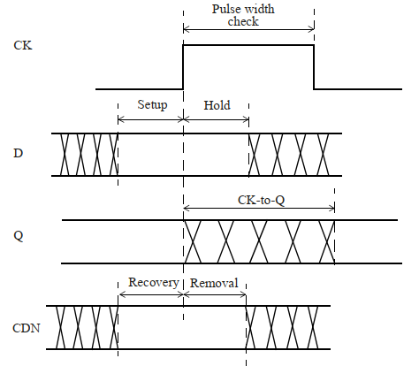
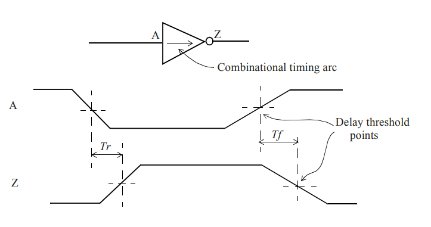
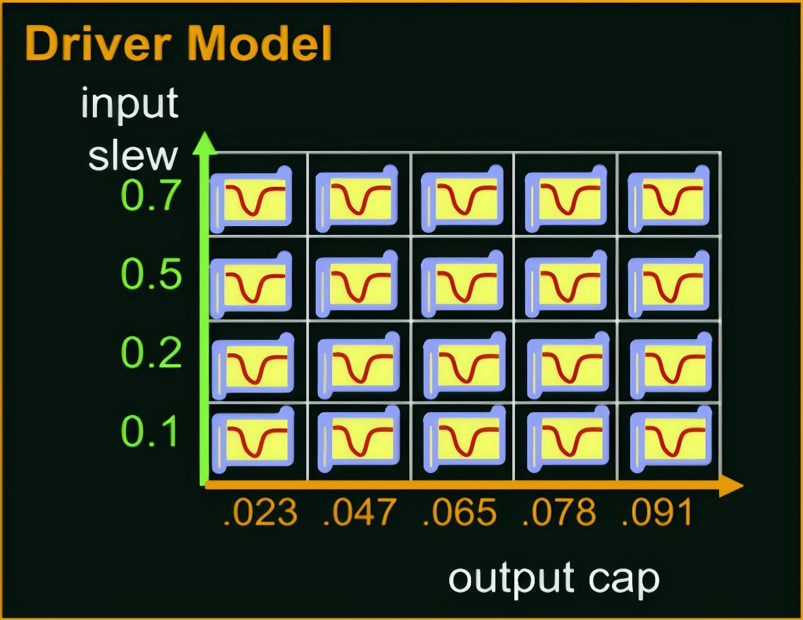
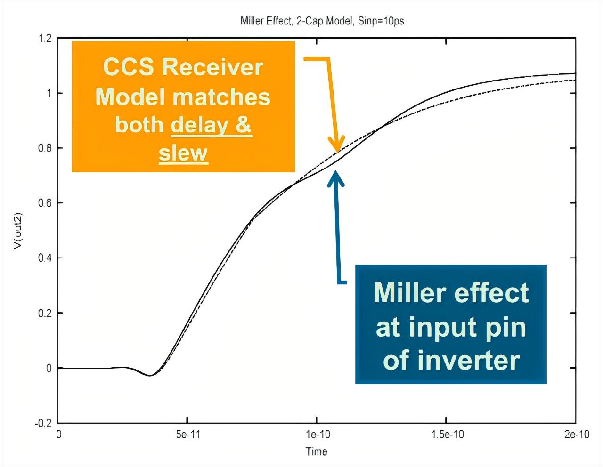
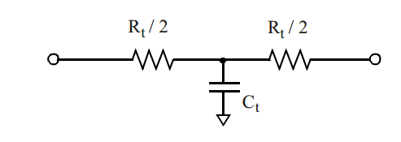
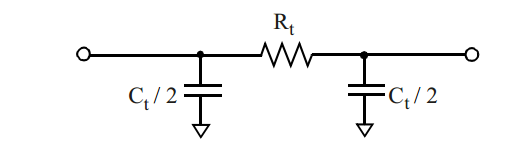
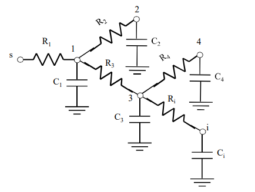

数字电路中的逻辑关系给出了输出应该取什么值，而晶体管和互连的充放电过程决定了这个值何时到达。即使组合逻辑的功能完全正确，数据若在寄存器采样前还未稳定，或者在采样后过早变化，电路仍然可能出错。时序分析研究的就是信号传播时间与采样要求之间的关系。

一条数据路径通常交替经过标准单元和互连线。单元内部存在非线性的晶体管开关过程，互连线则包含分布的电阻、电容，必要时还包含电感。为了高效计算整条路径，时序分析分别建立单元模型与互连模型，再沿路径传播信号的到达时间和转换时间。

## 静态时序分析与设计流程

动态时序分析（Dynamic Timing Analysis，DTA）给电路施加输入激励，通过电路或带延迟的逻辑仿真，观察信号随时间的变化。晶体管级仿真可以直接求解电压、电流，但一次仿真只覆盖激励实际触发的行为。随着电路规模和输入组合数增加，覆盖足够多的路径会消耗大量时间。

静态时序分析（Static Timing Analysis，STA）从网表、单元库、互连寄生参数和时序约束出发，把电路组织成时序图。图中的节点表示引脚，边表示单元内部或引脚之间的时序关系。分析器沿图计算最早、最晚到达时间，再与端点的时序要求比较，无需逐组枚举输入激励。

| 比较项 | 动态时序分析 | 静态时序分析 |
| --- | --- | --- |
| 输入条件 | 具体的激励序列 | 网表、时序模型和约束 |
| 覆盖方式 | 检查激励触发的路径与状态 | 遍历模型和约束所覆盖的时序路径 |
| 计算内容 | 随时间变化的逻辑或电气响应 | 路径延迟、到达时间与时序裕量 |
| 主要代价 | 仿真规模与激励覆盖 | 时序图规模与模型复杂度 |

同步电路的寄存器提供了规则的采样边界，因而很适合采用 STA。异步握手、反馈回路等行为还包含状态与事件先后关系，单纯累加路径延迟不能完整描述这些行为。即使在同步设计中，STA 检查的范围也受时钟、输入输出延迟以及路径例外等约束影响；功能正确性仍由功能验证承担。

STA 贯穿综合、布局和布线。综合阶段借助单元库及互连估计选择逻辑结构与驱动强度；布局以后，单元位置使线长估计更具体；布线完成后，再用提取出的寄生参数计算互连延迟。不同阶段使用的互连信息逐渐精细，同一条逻辑路径的延迟结果也会随之变化。

工艺、电源电压和温度会改变单元的驱动能力。常规分析在若干工作条件下计算时序，统计静态时序分析（Statistical Static Timing Analysis，SSTA）则进一步把工艺参数及延迟表示为随机量，研究输出延迟的分布与违例概率。两者都依赖底层模型对单元和互连的描述。

## 单元库中的引脚与时序弧

标准单元库把一个逻辑单元封装成可重复使用的模型。对时序分析而言，库中除了逻辑功能，还包含引脚电容、时序弧、延迟与转换时间，以及时序单元的采样约束。Liberty 是描述这些信息的一种常见文本格式。

### 引脚电容与输出负载

一个单元的输出连接到后级输入时，前级驱动器会为后级输入引脚和互连寄生电容充放电。输入引脚电容（Pin Capacitance）因此是计算前级负载的基础。一个输入引脚可以给出统一的电容，也可以分别给出上升、下降转换对应的电容及其范围，例如：

```liberty
pin (INP1) {
    direction : input;
    capacitance : 0.5;
    rise_capacitance : 0.5;
    rise_capacitance_range (0.48, 0.52);
    fall_capacitance : 0.45;
    fall_capacitance_range (0.435, 0.46);
}
```

这里的数值使用库头部定义的电容单位；若单位为 pF，`capacitance : 0.5` 就表示 0.5 pF。上升与下降对应的等效电容可以不同，因为两种转换过程中器件的导通状态和内部节点变化不同。

将负载作集总处理时，驱动单元 $G_1$ 的总负载可写为

$$
C_L=C_{\mathrm{out},G_1}
+\sum_j C_{\mathrm{in},G_j}
+\sum_k C_{\mathrm{wire},k}.
$$

其中，$C_{\mathrm{in},G_j}$ 是各后级输入引脚电容，$C_{\mathrm{wire},k}$ 是互连寄生电容，$C_{\mathrm{out},G_1}$ 表示模型中单独列出的输出引脚电容。单元内部已经包含在特征化结果中的寄生电容不再重复累加。输入扇出增加或互连变长，通常都会增大驱动器承担的负载。

### 时序弧与转换方向

时序弧（Timing Arc）描述两个引脚之间的时序关系。组合单元中，能够影响某一输出的输入与该输出之间存在传播弧；单元之间的连线形成互连传播弧。时序单元还包含时钟到输出的传播弧，以及数据相对于时钟的约束关系。

组合弧的时序敏感性（Timing Sense）描述输入跳变与输出跳变的方向关系。

| 类型 | 输入与输出的变化关系 | 例子 |
| --- | --- | --- |
| 正单边（positive unate） | 输入上升时，输出上升或保持；输入下降时，输出下降或保持 | 缓冲器、与门的输入到输出 |
| 负单边（negative unate） | 输入上升时，输出下降或保持；输入下降时，输出上升或保持 | 反相器、与非门的输入到输出 |
| 非单边（non-unate） | 输出跳变方向随其他输入状态改变 | 异或门的输入到输出 |

以异或门 $Y=A\oplus B$ 为例，$B=0$ 时有 $Y=A$，$A$ 上升引起 $Y$ 上升；$B=1$ 时有 $Y=\overline A$，同样的输入上升会引起输出下降。因此，$A$ 到 $Y$ 的弧属于非单边弧。

组合弧的信息写在输出引脚的 `timing` 组中：

```liberty
pin (OUT) {
    direction : output;
    max_transition : 1.0;
    timing () {
        related_pin : "INP";
        timing_sense : negative_unate;
        /* cell_rise、cell_fall 存放传播延迟表 */
        /* rise_transition、fall_transition 存放输出转换时间表 */
    }
}
```

`related_pin` 指出这条弧关联的输入，`timing_sense` 给出转换方向，`max_transition` 则限制输出引脚允许的最大转换时间。上升、下降表中的名称指输出转换方向：对于反相器，查询输出上升延迟时，使用的是输入下降转换时间。

### 时序逻辑单元的建立、保持与传播延迟

寄存器在时钟有效边沿附近完成采样。建立时间（Setup Time）$t_{\mathrm{setup}}$ 是有效边沿之前数据保持稳定的最短时间；保持时间（Hold Time）$t_{\mathrm{hold}}$ 是有效边沿之后数据继续保持稳定的最短时间。若有效边沿发生在 $t_c$，在常见的正建立、正保持时间情形下，数据稳定区间为

$$
[t_c-t_{\mathrm{setup}},\ t_c+t_{\mathrm{hold}}].
$$

时钟到输出的传播延迟（Clock-to-Q Delay）$t_{\mathrm{cq}}$ 描述时钟经过阈值点后，输出 Q 经过相应阈值点所需的时间。它参与后续数据路径的传播；建立、保持时间则参与捕获端的时序检查。



*D 在时钟有效边沿附近保持稳定，Q 在时钟边沿之后经过 Clock-to-Q 延迟发生变化。图中还标出了时钟脉宽，以及异步控制端 CDN 的恢复、移除检查。*

恢复时间（Recovery Time）和移除时间（Removal Time）约束异步复位等控制信号撤销相对于时钟边沿的间隔，分别对应边沿前与边沿后的稳定要求。最小脉宽检查则防止时钟或控制脉冲短到无法完成内部状态切换。

在 Liberty 中，建立、保持约束通常写在数据引脚下，并用 `related_pin` 关联时钟：

```liberty
pin (D) {
    direction : input;
    timing () {
        related_pin : "CK";
        timing_type : setup_rising;
        /* rise_constraint、fall_constraint：数据上升、下降的建立约束 */
    }
    timing () {
        related_pin : "CK";
        timing_type : hold_rising;
        /* rise_constraint、fall_constraint：数据上升、下降的保持约束 */
    }
}
```

`setup_rising` 和 `hold_rising` 中的 `rising` 表示参考时钟的上升沿。约束表中的 `rise_constraint`、`fall_constraint` 分别表示数据上升与下降。建立、保持时间的表格通常以数据转换时间和时钟转换时间为索引；Clock-to-Q 传播表则通常以时钟转换时间和输出负载为索引。

## 单元延迟与转换时间

### 延迟阈值与压摆

传播延迟是输入经过规定阈值点到输出经过规定阈值点的时间差。若输入、输出延迟阈值都为 $50\%V_{DD}$，反相器的输出上升延迟为

$$
t_{\mathrm{rise}}
=t_{\mathrm{out},\uparrow}(50\%V_{DD})
-t_{\mathrm{in},\downarrow}(50\%V_{DD}),
$$

输出下降延迟为

$$
t_{\mathrm{fall}}
=t_{\mathrm{out},\downarrow}(50\%V_{DD})
-t_{\mathrm{in},\uparrow}(50\%V_{DD}).
$$



*输入下降对应输出上升延迟 $T_r$，输入上升对应输出下降延迟 $T_f$；两者均从输入阈值交点计时至输出阈值交点。*

转换时间（Transition Time）描述同一条波形从一个电平阈值变化到另一个阈值所花的时间，STA 中也常称为压摆（Slew）。例如，若库将转换阈值设为 $30\%V_{DD}$ 与 $70\%V_{DD}$，上升转换时间就是输出由 30% 上升至 70% 的时间。这里的 Slew 使用时间单位，数值越大，边沿越缓。

单元延迟主要受到输入转换时间 $S_{\mathrm{in}}$ 与输出负载电容 $C_L$ 的影响。负载增加意味着充放电的电荷量增加，通常使延迟和输出转换时间增大。输入变化较慢会改变内部晶体管导通及内部节点充放电过程，多数情况下也会增加延迟，但这种关系并非对所有时序弧都严格单调。

输出转换时间会继续影响后级。前级输出波形经过互连后成为后级输入波形，因此路径计算除了累加延迟，还要持续传播转换时间。

### 线性延迟模型

线性延迟模型（Linear Delay Model，LDM）把延迟近似写成输入转换时间与负载电容的线性函数：

$$
D=D_0+D_1S_{\mathrm{in}}+D_2C_L.
$$

$D_0$ 是常数项，$D_1$ 表示输入转换时间的影响，$D_2$ 表示负载电容的影响。若 $D$、$S_{\mathrm{in}}$ 使用 ns，$C_L$ 使用 pF，则 $D_0$ 的单位为 ns，$D_1$ 无量纲，$D_2$ 的单位为 ns/pF。不同弧和不同输出转换方向可以具有不同的系数。

输出转换时间也可以作类似拟合：

$$
S_{\mathrm{out}}=S_0+S_1S_{\mathrm{in}}+S_2C_L.
$$

这些系数来自对单元详细电路的特征化。线性模型计算简单，但晶体管的电流与端电压之间存在非线性，输入边沿与负载的影响也不总能分成两个独立的线性项。用同一组系数覆盖较宽的转换时间和负载范围时，误差会增大。

### 非线性延迟模型与四类表格

非线性延迟模型（Non-Linear Delay Model，NLDM）在多个输入转换时间和负载电容组合下进行特征化，将结果保存在查找表（Look-Up Table，LUT）中：

$$
D=f(S_{\mathrm{in}},C_L),\qquad
S_{\mathrm{out}}=g(S_{\mathrm{in}},C_L).
$$

对一条普通的单边组合弧，延迟和输出转换时间各分上升、下降两类，因而通常包含四张表。

| Liberty 表名 | 表中数值 |
| --- | --- |
| `cell_rise` | 输出上升传播延迟 |
| `cell_fall` | 输出下降传播延迟 |
| `rise_transition` | 输出上升转换时间 |
| `fall_transition` | 输出下降转换时间 |

若一个具有 $N$ 个输入、$M$ 个输出的组合单元中，每个输入都影响每个输出，每对引脚只有一个单边弧组，则共有 $NM$ 个弧组，四类表合计 $4NM$ 张。逻辑上无影响的输入输出对不形成这种弧组，条件弧或非单边关系则可能增加表格数量。

例如，反相器的一张输出上升延迟表可写为下表。此例将时间单位取为 ns、电容单位取为 pF，行索引是输入下降转换时间，列索引是输出负载。

| $S_{\mathrm{in}}$ / ns | $C_L=0.16$ pF | $C_L=0.35$ pF | $C_L=1.43$ pF |
| --- | --- | --- | --- |
| 0.1 | 0.0513 | 0.1537 | 0.5280 |
| 0.3 | 0.1018 | 0.2327 | 0.6476 |
| 0.7 | 0.1334 | 0.2973 | 0.7252 |

NLDM 用表格覆盖非线性关系，在相邻采样点之间再进行插值。它在网格内部使用线性插值，并不表示整个延迟函数随输入转换时间或负载呈线性变化。

### 双线性插值

设目标点 $(S,C)$ 落在 $S_a\leq S\leq S_b$、$C_a\leq C\leq C_b$ 的网格内，四个顶点的延迟分别为 $D_{aa}$、$D_{ab}$、$D_{ba}$、$D_{bb}$，下标依次表示转换时间与电容的位置。定义归一化距离

$$
\alpha=\frac{S-S_a}{S_b-S_a},\qquad
\beta=\frac{C-C_a}{C_b-C_a}.
$$

先在电容方向插值，得到两条转换时间边界上的值：

$$
D_a=(1-\beta)D_{aa}+\beta D_{ab},\qquad
D_b=(1-\beta)D_{ba}+\beta D_{bb}.
$$

再沿转换时间方向插值：

$$
\begin{aligned}
D(S,C)
&=(1-\alpha)D_a+\alpha D_b\\
&=(1-\alpha)(1-\beta)D_{aa}
+(1-\alpha)\beta D_{ab}\\
&\quad+\alpha(1-\beta)D_{ba}
+\alpha\beta D_{bb}.
\end{aligned}
$$

这四个权重之和为 1。以上表为例，若输入下降转换时间为 0.2 ns，输出负载为 0.255 pF，则

$$
\alpha=\frac{0.2-0.1}{0.3-0.1}=\frac12,\qquad
\beta=\frac{0.255-0.16}{0.35-0.16}=\frac12.
$$

目标点位于网格中心，四个顶点的权重均为 $1/4$，因此

$$
D=\frac{0.0513+0.1537+0.1018+0.2327}{4}
=0.134875\ \mathrm{ns}
\approx134.9\ \mathrm{ps}.
$$

这个结果是该工作点的输出上升传播延迟。输出上升转换时间要在 `rise_transition` 表中另作一次查询。若沿边界趋势估计超出索引范围的工作点，计算就变成外推，目标点周围缺少采样值来约束估计结果。

## 电流源模型与波形信息

### NLDM 的信息压缩与米勒效应

NLDM 将输入波形压缩成一个转换时间，将输出负载压缩成一个电容。两条波形可以具有相同的转换时间，却在延迟阈值附近具有不同的斜率和弯曲程度；集总电容与分布式 RC 网络也可能具有相同的总电容，却表现出不同的充放电过程。这些差异不能仅靠两个索引完整表达。

当互连阻抗相对于驱动器阻抗明显增大时，线电阻会使近端、远端电容在不同时间参与充放电。把整个负载等效为一个电容，再配合简单电压源和等效输出电阻传播波形，可能产生较大的误差。较小的互连阻抗下，接收端自身的动态电容又可能成为重要误差来源。

米勒效应（Miller Effect）体现了输入与输出之间耦合电容的影响。设输入与输出之间存在电容 $C_{gd}$，其输入侧电流为

$$
i=C_{gd}\frac{\mathrm d(v_{\mathrm{in}}-v_{\mathrm{out}})}{\mathrm dt}.
$$

若在一段变化过程中，反相增益近似为 $v_{\mathrm{out}}=-K v_{\mathrm{in}}$，其中 $K>0$，就有

$$
i\approx C_{gd}(1+K)\frac{\mathrm dv_{\mathrm{in}}}{\mathrm dt}.
$$

因此，该耦合电容等效到输入侧的贡献约为 $(1+K)C_{gd}$。数字单元切换时，增益和内部节点状态随时间变化，输入端等效电容也会变化。用一个固定引脚电容描述整个边沿，会丢失这种变化。

### CCS 的驱动器模型

复合电流源模型（Composite Current Source，CCS）用更丰富的波形信息描述单元，并分别建立驱动器模型与接收器模型。驱动器部分按照输入转换时间、输出负载等特征化条件，保存输出电流随时间变化的波形信息，计算时再与负载网络联立求解。



*每个特征化工作点保存一条输出电流波形，使模型能够描述一次转换期间驱动电流的变化。*

对于最简单的集总电容，电流与输出电压满足

$$
C_L\frac{\mathrm dv_{\mathrm{out}}}{\mathrm dt}=i_{\mathrm{out}}(t),
$$

因而

$$
v_{\mathrm{out}}(t)
=v_{\mathrm{out}}(0)
+\frac{1}{C_L}\int_0^t i_{\mathrm{out}}(\xi)\,\mathrm d\xi.
$$

对于分布式 RC 负载，电流同时为多个节点充放电，分析器求解各节点电压，再从波形阈值交点提取延迟与转换时间。电流源形式能够表达随时间和端电压变化的驱动行为，减少固定输出电阻近似造成的信息损失。模型仍然来自特征化，保存和计算的波形信息也比 NLDM 更多。

### CCS 的接收器模型

CCS 接收器用两个等效电容 $C_1$、$C_2$ 描述输入边沿不同阶段的负载。以 30%—70% 的上升转换范围和 50% 延迟阈值为例，30%—50% 段使用 $C_1$，50%—70% 段使用 $C_2$。这两个数值分别表示阈值前后两个阶段的等效负载。

$C_1$、$C_2$ 也可以通过输入转换时间和接收单元的输出负载索引。接收单元的输出负载会改变其输出波形，进而经输入输出耦合电容影响输入侧电流，因此输入电容会与输出端的工作状态发生联系。



*输入端受米勒耦合影响的波形存在局部弯曲，分阶段的等效电容用于改善对延迟阈值和转换时间的共同描述。*

### ECSM 的电压波形表征

有效电流源模型（Effective Current Source Model，ECSM）同样以更完整的波形信息描述单元驱动行为。与 CCS 保存输出电流波形的方式相比，ECSM 的特征化表示侧重输出电压波形，再利用负载和电压变化恢复等效驱动信息。

对纯电容负载，二者之间的联系就是 $i(t)=C\,\mathrm dv(t)/\mathrm dt$。已知电流可积分得到电压，已知电压及负载也可求得电流，但离散采样、插值和模型拟合会带来误差，因此两种表征之间的转换可能损失精度。CCS 和 ECSM 都比单一延迟与转换时间数值保留了更多波形信息。

| 模型 | 主要保存的信息 | 计算方式 |
| --- | --- | --- |
| LDM | 延迟与转换时间的线性系数 | 代入输入转换时间、负载电容 |
| NLDM | 各工作点的延迟和输出转换时间 | 二维查表与插值 |
| CCS | 驱动电流波形及分阶段接收电容 | 与负载网络共同求解波形 |
| ECSM | 输出电压波形等驱动信息 | 恢复等效驱动行为并传播波形 |

## 互连的集总与分布模型

### 门延迟与互连延迟

从驱动单元输入到接收单元输入的传播过程，可以分为驱动门延迟与互连延迟。前者从驱动器输入阈值交点计时到驱动器输出阈值交点，后者从驱动器输出阈值交点计时到接收端输入阈值交点。

$$
t_{\mathrm{stage}}=t_{\mathrm{cell}}+t_{\mathrm{net}}.
$$

这种分解保留了清楚的测量边界，但门延迟仍受互连负载影响。换一张负载网络，驱动器输出的波形和阈值到达时刻也会改变。

互连具有电阻 $R$、电容 $C$ 和电感 $L$，可以建立 RLC 模型。以下延迟推导采用 RC 近似，分析线电阻与对地电容共同造成的充放电过程。

### T 型与 π 型网络

集总电容模型把线电容相加并挂在驱动端，忽略电容沿互连的空间分布。加入线电阻以后，可以用 T 型或 π 型网络近似一段互连。设总电阻为 $R_t$、总电容为 $C_t$。

T 型网络将电阻分为两段，各为 $R_t/2$，在中间节点接入 $C_t$：



π 型网络则保留中间的 $R_t$，在两端各接入 $C_t/2$：



将互连划分为 $N$ 段后，每段包含 $R_t/N$ 的电阻和 $C_t/N$ 的电容。采用 π 型分段时，每段两端各分配一半电容，相邻段相接后，内部节点的电容相加，端点则保留半段电容。增加分段数可以更细致地描述电压沿互连的变化，也会增加求解规模。

## Elmore 延迟与共享路径电阻

### 单个 RC 电路的 50% 延迟

先考虑理想电压阶跃通过电阻 $R$ 为电容 $C$ 充电。电容初始电压为零，输入在 $t=0$ 时由 0 跳变为 $V_0$。由

$$
\frac{V_0-v(t)}{R}=C\frac{\mathrm dv(t)}{\mathrm dt}
$$

可得

$$
v(t)=V_0\left(1-e^{-t/(RC)}\right).
$$

令 $v(t_{50})=V_0/2$，则

$$
e^{-t_{50}/(RC)}=\frac12,\qquad
t_{50}=RC\ln2\approx0.693RC.
$$

$RC=\tau$ 是时间常数，单位为秒。单极点电路在 $t=\tau$ 时达到最终值的约 63.2%，达到 50% 则只需 $\tau\ln2$。

### RC 树的拓扑与路径电阻

实际互连通常包含分支。Elmore 模型的树形表达式适用于只有一个源节点、各电容均连接到地、且没有电阻环路的 RC 树。树中从源点到任意节点只有一条电阻路径，因此可以定义两个节点路径的公共部分。



设源节点为 $s$，观察节点为 $i$，电容 $C_k$ 位于节点 $k$。共享路径电阻定义为

$$
R_{ik}=\sum_{e\in P(s,i)\cap P(s,k)}R_e,
$$

其中 $P(s,i)$ 与 $P(s,k)$ 分别表示从源点到这两个节点的路径。$R_{ii}$ 就是从源点到节点 $i$ 的全部路径电阻。

对于图中的网络，

$$
R_{44}=R_1+R_3+R_4,\qquad
R_{i4}=R_1+R_3,\qquad
R_{i2}=R_1.
$$

节点 4 的电容虽不在通往节点 $i$ 的最后一条支路上，它的充电电流仍经过 $R_1$ 和 $R_3$。这些共享电阻上的压降会影响节点 $i$，所以其他分支的电容也参与该节点的延迟计算。

### Elmore 时间常数及其等效单极点延迟

节点 $i$ 的 Elmore 时间常数为

$$
\tau_{E,i}=\sum_{k=1}^{N}R_{ik}C_k.
$$

将它作为一个等效单极点的时间常数，得到 50% 延迟估计

$$
t_{50,E,i}\approx\ln2\,\tau_{E,i}
\approx0.693\sum_{k=1}^{N}R_{ik}C_k.
$$

这里用 $\tau_E$ 表示未乘 0.693 的一阶矩时间常数，用 $t_{50,E}$ 表示据此得到的阈值延迟。单个 RC 电路的 50% 延迟恰好等于后一表达式，多节点网络的响应包含多个极点，后一表达式是近似值。

对图中的节点 $i$，逐项展开有

$$
\begin{aligned}
\tau_{E,i}
&=R_1C_1+R_1C_2+(R_1+R_3)C_3\\
&\quad +(R_1+R_3)C_4+(R_1+R_3+R_i)C_i\\
&=R_1(C_1+C_2+C_3+C_4+C_i)\\
&\quad+R_3(C_3+C_4+C_i)+R_iC_i.
\end{aligned}
$$

最后一行给出了另一种计算方式：沿源点到观察节点的路径，把每个电阻乘以它下游的全部电容，再将各项相加。$R_1$ 承担所有电容的充电电流，$R_3$ 只承担节点 3、4、$i$ 的电容电流，$R_i$ 只承担 $C_i$ 的电流。

这种形式也便于计算灵敏度。例如，

$$
\frac{\partial\tau_{E,i}}{\partial R_1}
=C_1+C_2+C_3+C_4+C_i,\qquad
\frac{\partial\tau_{E,i}}{\partial C_4}=R_1+R_3.
$$

这些导数描述了某个电阻或电容变化对延迟估计的影响，可以服务于线宽调整、缓冲器插入等优化。

Elmore 模型只保留一个时间常数，不能完整刻画波形。特别是较大线电阻将远端电容与近端节点隔开时，远端电容在边沿初期参与充放电的程度较小，形成电阻屏蔽效应。上式中，节点 $i$ 的估计不含旁支电阻 $R_2$、$R_4$；改变这些电阻仍会改变真实瞬态响应。这部分差异可以通过更高阶的信息补充。

## 矩匹配、Padé 近似与 D2M

### 传递函数的矩

设节点 $i$ 的电压传递函数为 $H_i(s)=V_i(s)/V_{\mathrm{in}}(s)$。对直流增益为 1 的 RC 网络，在 $s=0$ 附近展开：

$$
H_i(s)=m_0^{(i)}+m_1^{(i)}s+m_2^{(i)}s^2+\cdots,
\qquad m_0^{(i)}=1.
$$

这里将泰勒系数称为矩。若 $h_i(t)$ 是冲激响应，则

$$
m_j^{(i)}=\frac{(-1)^j}{j!}
\int_0^\infty t^j h_i(t)\,\mathrm dt.
$$

因此，$m_1$ 是带负号的一阶时间矩，$m_2$ 是原始二阶时间矩的一半；它们的单位分别为 s、s²。采用这种系数定义，可以直接把矩与传递函数的极点、留数联系起来。

对 RC 树，各节点的系数满足递推式

$$
m_j^{(i)}=-\sum_{k=1}^{N}R_{ik}C_km_{j-1}^{(k)},
\qquad j\geq1.
$$

由于所有节点的 $m_0^{(k)}=1$，一阶系数为

$$
m_1^{(i)}=-\sum_{k=1}^{N}R_{ik}C_k=-\tau_{E,i}.
$$

二阶系数则为

$$
m_2^{(i)}=-\sum_{k=1}^{N}R_{ik}C_km_1^{(k)}.
$$

二阶递推中使用的是每个节点 $k$ 自己的一阶系数，因此它比只对电容加权的一阶表达式保留了更多网络分布信息。

### Padé 有理近似与极点表示

只截断泰勒级数会得到一个多项式，而 RC 网络的自然响应由衰减指数构成。帕德近似（Padé Approximant）用有理函数匹配传递函数在展开点附近的系数：

$$
\widehat H_{p,q}(s)
=\frac{b_0+b_1s+\cdots+b_ps^p}
{1+a_1s+\cdots+a_qs^q}.
$$

将分母乘到等式两边，再比较相同次幂的系数，就可以建立关于 $a_j$、$b_j$ 的方程。当分子阶数低于分母、极点互异时，还可以写成部分分式：

$$
\widehat H_q(s)=\sum_{\ell=1}^{q}\frac{k_\ell}{s-p_\ell},
$$

其中 $p_\ell$ 是极点，$k_\ell$ 是对应留数。稳定 RC 网络的真实极点位于负实轴，$p_\ell$ 的单位为 $\mathrm{s^{-1}}$。

在 $s=0$ 附近展开每一项，

$$
\frac{k_\ell}{s-p_\ell}
=-\frac{k_\ell}{p_\ell}
\left(1+\frac{s}{p_\ell}+\frac{s^2}{p_\ell^2}+\cdots\right),
$$

即可得到矩匹配关系

$$
m_j=-\sum_{\ell=1}^{q}\frac{k_\ell}{p_\ell^{j+1}}.
$$

原网络的矩可以从 RC 参数递推计算，近似模型的矩可以用极点和留数表示；令二者相等，就能求解近似模型。$q$ 个极点与 $q$ 个留数共有 $2q$ 个未知量，一般可用 $m_0$ 至 $m_{2q-1}$ 建立匹配方程。

### 从单极点匹配得到 Elmore 近似

对单位阶跃输入，输出的拉普拉斯变换为 $\widehat H_q(s)/s$。利用 $m_0=1$ 作逆变换，得到

$$
v(t)=1+\sum_{\ell=1}^{q}\frac{k_\ell}{p_\ell}e^{p_\ell t}.
$$

如果某个最靠近零的负极点占主导，其他指数项衰减更快，可以用主导项近似波形。进一步构造只有一个极点的模型，并匹配 $m_0$、$m_1$，则

$$
-\frac{k_1}{p_1}=1,\qquad
-\frac{k_1}{p_1^2}=m_1.
$$

第一式给出 $k_1=-p_1$，代入第二式可得

$$
p_1=\frac1{m_1},\qquad
k_1=-\frac1{m_1}.
$$

因为 $m_1<0$，这个极点为负，单位阶跃响应为

$$
v(t)=1-e^{t/m_1}.
$$

令 $v(t)=0.5$，有

$$
t_{50,E}=-m_1\ln2=\tau_E\ln2.
$$

这就把前面的 RC 树求和式与一阶矩匹配联系起来：先通过所有电阻、电容求得 $m_1$，再用一个具有相同一阶系数的单极点响应估算阈值延迟。

### D2M 的两矩延迟表达式

增加匹配阶数可以保留更多波形信息，但求解多个极点、留数以及阈值交点也会增加计算量。两矩延迟模型 D2M（Delay with 2 Moments）直接用前两阶系数构造一个经验延迟指标：[^d2m]

$$
D_{2M}=\frac{m_1^2}{\sqrt{m_2}}\ln2
=(-m_1\ln2)\sqrt{\frac{m_1^2}{m_2}}.
$$

它是在单极点 50% 延迟估计上乘以一个含二阶系数的修正因子。分子 $m_1^2$ 的单位为 s²，分母 $\sqrt{m_2}$ 的单位为 s，所以结果具有时间量纲。

对单个 RC 电路，令 $\tau=RC$，则

$$
H(s)=\frac1{1+s\tau}
=1-\tau s+\tau^2s^2-\cdots.
$$

此时 $m_1=-\tau$、$m_2=\tau^2$，代入可得

$$
D_{2M}=\frac{\tau^2}{\sqrt{\tau^2}}\ln2
=\tau\ln2.
$$

因此它在单 RC 情形下恢复精确的 50% 延迟。多节点网络中的 $m_2$ 带入了各节点充放电时间的差异，可以修正只使用 $m_1$ 的估计；这一经验公式通常能改善 RC 互连的延迟估计，但仍不等于求解完整波形。

### 两段 RC 链的计算例子

考虑源点经 $R_1$ 到节点 1，再经 $R_2$ 到节点 2，两节点分别通过 $C_1$、$C_2$ 接地。取

$$
R_1=R_2=1\ \mathrm{k\Omega},\qquad
C_1=C_2=1\ \mathrm{pF}.
$$

因为 $1\ \mathrm{k\Omega}\times1\ \mathrm{pF}=1\ \mathrm{ns}$，两个节点的一阶系数为

$$
\begin{aligned}
m_1^{(1)}&=-R_1(C_1+C_2)=-2\ \mathrm{ns},\\
m_1^{(2)}&=-[R_1C_1+(R_1+R_2)C_2]=-3\ \mathrm{ns}.
\end{aligned}
$$

节点 2 的二阶系数为

$$
\begin{aligned}
m_2^{(2)}
&=-[R_1C_1m_1^{(1)}+(R_1+R_2)C_2m_1^{(2)}]\\
&=-[(1\ \mathrm{ns})(-2\ \mathrm{ns})
+(2\ \mathrm{ns})(-3\ \mathrm{ns})]\\
&=8\ \mathrm{ns^2}.
\end{aligned}
$$

因此，节点 2 的未缩放 Elmore 时间常数为 3 ns，等效单极点的 50% 延迟估计为

$$
t_{50,E}=3\ln2\ \mathrm{ns}\approx2.079\ \mathrm{ns},
$$

而 D2M 给出

$$
D_{2M}=\frac{(-3)^2}{\sqrt8}\ln2\ \mathrm{ns}
\approx2.206\ \mathrm{ns}.
$$

两种估计使用相同的一阶系数，D2M 还使用了二阶系数。修正方向取决于 $m_1^2/m_2$ 的大小，本例的修正因子为 $\sqrt{9/8}>1$，因此 D2M 大于乘过 $\ln2$ 的一阶估计。

[^d2m]: Charles J. Alpert、Anirudh Devgan、Chandramouli Kashyap，[A Two Moment RC Delay Metric for Performance Optimization](https://cecs.uci.edu/~papers/compendium94-03/papers/2000/ispd00/pdffiles/3_5.pdf)，ISPD 2000。本文的 $m_j$ 使用传递函数泰勒系数定义。
