单元库给出引脚之间的延迟表，互连模型给出线网延迟，把这些数值放回电路拓扑，静态时序分析就有了完整的计算对象。剩下的问题是如何在几十亿个结点上快速算出每条路径的时间关系，以及当制造偏差让延迟不再是一个确定值时，分析结果如何仍然可信。

## 时序图与三个基本量

### 从电路到有向无环图

组合电路的结构可以直接写成一张带权有向图。结点是单元和端口，边是互连，边上标注延时；主输入（Primary Input，PI）作为源点，主输出（Primary Output，PO）作为汇点。

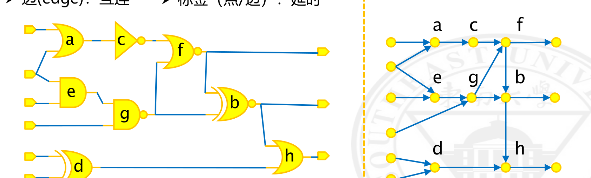

*左侧组合电路的每个单元在右侧成为一个结点，a~h 为单元，端口处的圆点为 PI 与 PO，箭头方向为信号传播方向。*

图中不能出现环路。寄存器把组合逻辑切成段，段与段之间通过时钟沿衔接，因此单个组合块内部的信号只沿一个方向流动。锁存器在透明窗口内会形成跨越两个阶段的通路，组合反馈回路本身就是一个环，这两种情况要在建图时按透明区间或用户指定的断点把环切开，否则拓扑排序无法进行。

### 到达时间

到达时间（Arrival Time，AT）是信号从参考时刻出发、经过若干级单元与线网后到达某个结点所花的时间。结点 $v$ 的到达时间取它全部前驱结点 $u\in \mathrm{FI}(v)$（fanin）送来的时间中的最大值：

$$
AT(v)=\max_{u\in \mathrm{FI}(v)}\left[AT(u)+T_{u\to v}\right],
$$

其中 $T_{u\to v}$ 是这条边对应的传播延迟，单位与 AT 相同。取最大值是因为只有最晚的那一路到达时间才能决定后级何时稳定，更早到达的分支不会推迟后级翻转。

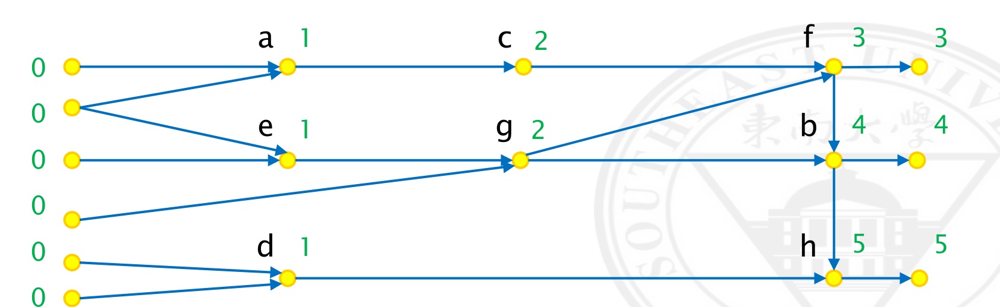

*各 PI 在 0 时刻出发，每个单元延时为 1、端口连线延时为 0 时，各结点取前驱路径的最大值。*

以图中的 $f$ 结点为例，它的两个前驱 $c$ 与 $g$ 都给出 $2+1=3$，因此 $AT(f)=3$。$b$ 结点从 $g$ 过来是 $2+1=3$，从 $f$ 过来是 $3+1=4$，于是 $AT(b)=4$。$h$ 结点同理取 $b$ 支路的 $5$，而 $d$ 支路只有 $1+1=2$。整个电路的最长路径长为 5，经过 $a\to c\to f\to b\to h$。

这个递推只保留了每个结点的一个数值。当两条路径在同一结点汇合时，较慢的那条覆盖了较快的那条，较快的路径信息在后续计算中不再出现。AT 的定义只关心最坏情况，这样的丢弃在纯延迟累加下不会造成错误；一旦延迟本身依赖于信号如何到达，情况就变了。

### 所需时间

所需时间（Required Arrival Time，RAT）从另一端出发：为了让数据在时钟沿之前稳定，信号最晚可以何时到达该结点。设时钟周期为 $T_{\mathrm{cycle}}$，结点的后继集合为 $\mathrm{FO}(v)$（fanout），则

$$
RAT(v)=\min_{u\in \mathrm{FO}(v)}\left[RAT(u)-T_{v\to u}\right].
$$

取最小值的原因与 AT 取最大值对称：任何一个后继的时限被突破都构成违例，因此最紧的那一条约束了整个结点。汇点 PO 的 RAT 由时钟周期减去这段路径允许的输出延时得到；源点 PI 的 RAT 则由外部输入延时给出。

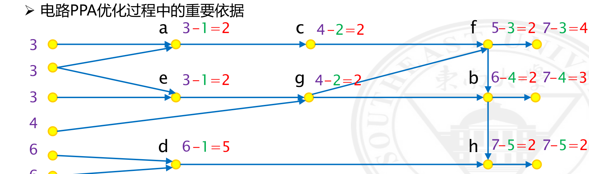

*同一张图在 $T_{\mathrm{cycle}}=7$、端口延时为 0 的分析条件下得到的 RAT 与两点之差。*

$b$ 结点的后继有两个：直接到 PO 的通路给出 $7-0=7$，经 $h$ 的通路给出 $7-1=6$，因此 $RAT(b)=6$。$f$ 结点的后继是 PO 与 $b$，分别给出 7 与 $6-1=5$，于是 $RAT(f)=5$。沿着 $f\to c\to a$ 回溯，每一级减 1，得到 $c$ 的 4 与 $a$ 的 3。

### 时序裕量

时序裕量（Slack）是两者之差：

$$
Slack(v)=RAT(v)-AT(v).
$$

它表示在不违反约束的前提下，信号还能推迟多久到达该结点。裕量为负说明已经违例，为正说明还有余量。图中每个结点旁边的两个算式就是这个差值，例如 $a$ 为 $3-1=2$，$b$ 为 $6-4=2$，$h$ 为 $7-5=2$。所有结点中最小的是 2，恰好等于 $T_{\mathrm{cycle}}$ 与最长路径长 5 之差，这个最小值决定了整条路径能否在周期内完成。

裕量是布局布线阶段做优化的依据。负裕量指出哪一段的延迟超出了可用时间，正裕量指出哪些地方可以拿余量去换面积或功耗，插入缓冲器、增大驱动、换用更快的单元都围绕这个差值展开。

### 关键路径方法

上面三个递推要按依赖顺序求值，这张图无环，因此可以按拓扑序一次扫描完成。关键路径方法（Critical Path Method，CPM）就是这样做的：从 PI 出发按拓扑序推进，每个结点取前驱的最大值，同时记录取得最大值的那个前驱，供回溯路径使用。

```text
按拓扑序遍历结点 v：
    AT(v) = max over u in FI(v) of ( AT(u) + T(u->v) )
    pred(v) = argmax over u in FI(v) of ( AT(u) + T(u->v) )
```

反向再扫描一次得到 RAT 与裕量，沿 $pred$ 从最紧的汇点回溯就得到关键路径。每个结点只被访问常数次，总代价与图的规模成正比，这也是 STA 能处理全芯片的原因。

## 图基分析与路径基分析

### 压摆汇合处的分歧

上面的递推假设每条边的延迟是一个固定数。实际的单元延迟由输入压摆与输出负载查表得到，而压摆本身也要逐级传播，于是两条路径在同一结点汇合时，除了到达时间要取最大，压摆也要选一个。

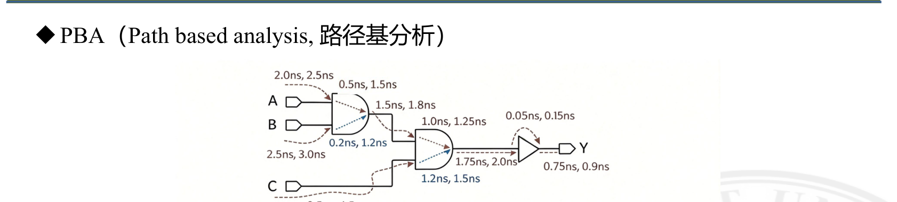

*单元 g 的两个输入分别带有不同的到达时间、输入压摆和弧延迟。*

设 $g/A$ 的到达时间为 400 ps、输入压摆 20 ps、弧延迟 100 ps、输出压摆 30 ps；$g/B$ 的到达时间为 200 ps、输入压摆 50 ps、弧延迟 200 ps、输出压摆 60 ps。到达时间取最大：

$$
AT(g/Z)=\max\{400+100,\ 200+200\}=500\ \mathrm{ps},
$$

确定的路径是 $g/A\to g/Z$。输出压摆却有两种取法：取这条实际路径对应的 30 ps，或者取两个输入弧中较大的 60 ps。前一种取法属于路径基分析（Path Based Analysis，PBA），后一种属于图基分析（Graph Based Analysis，GBA）。

这个差别会继续向后传播。压摆越大，后级单元内部充放电越慢，查表得到的延迟越大。GBA 在每个汇合点都取最坏压摆，这个被放大的压摆带着前面选出的最大到达时间一起进入下一级，悲观就在每一级累积。

### 单元弧延迟的选取方式

同一个单元对不同输入弧的延迟本来就不同，GBA 与 PBA 在这一层的差别更直接。

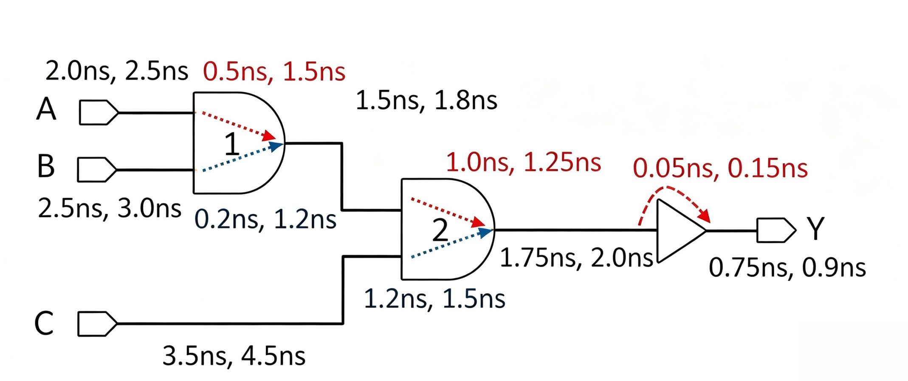

*每条弧标注了两个数值，分别为该弧的最小与最大延迟；虚线路径是分析器搜索到的关键路径。*

从 $A$ 到 $Y$ 的路径依次经过 NAND、NAND、缓冲器，图中每段标注的两个数值就是该段延迟的最小值与最大值。GBA 逐段取极值相加：

$$
D_{\max}=2.5+1.5+1.8+1.5+2.0+0.15+0.90=10.35\ \mathrm{ns}.
$$

其中第四个加数 1.5 ns 是第二个 NAND 的最慢输入弧。但这条路径是从 $A$ 侧进入第二个 NAND 的，而 $A$ 侧的弧延迟最大值只有 1.25 ns，1.5 ns 属于另一个输入端。为了保守，GBA 把这个不属于本路径的弧也算了进去。PBA 沿实际路径重算每一级的弧延迟：

$$
D_{\max}=2.5+1.5+1.8+1.25+2.0+0.15+0.90=10.1\ \mathrm{ns}.
$$

两个结果相差 0.25 ns，全部来自这一个弧。同样地，$B$ 到 $Y$ 的 GBA 最大延迟为 10.85 ns，PBA 为 10.3 ns。

最小值方向上的关系相反。GBA 的最小延迟取各段最小值之和，$A\to Y$ 为 7.25 ns；PBA 在重算时用到的是实际路径上的最小弧延迟，得到 7.55 ns。一般地，对同一设计和同一套弧模型，

$$
D_{\min}^{\mathrm{GBA}}\le D_{\min}^{\mathrm{PBA}},\qquad
D_{\max}^{\mathrm{GBA}}\ge D_{\max}^{\mathrm{PBA}}.
$$

GBA 的区间把 PBA 的区间包在里面，多出来的部分就是悲观量。

### 计算代价

PBA 需要沿真实路径逐级重算，代价与路径数成正比。一个每级有两个分支的 $n$ 级电路有 $2^n$ 条路径，逐条枚举在几十级的规模上就不可行。工程上的做法是只在最后签核时对少数关键路径运行 PBA。

| 比较项 | GBA | PBA |
| --- | --- | --- |
| 分析范围 | 一次覆盖整个设计的全部路径 | 一次一条或一小组指定路径 |
| 延迟依据 | 每个结点取最差弧与最大压摆 | 沿真实路径逐级重算弧延迟 |
| 悲观程度 | 高，最坏组合未必同时发生 | 低，消除了大部分由组合造成的悲观 |
| 计算时间 | 与图规模成正比，全芯片可运行 | 比 GBA 慢几个数量级 |
| 使用阶段 | 综合、布局、布线、优化全流程 | 最终签核的关键路径复核 |

流程上先用 GBA 把设计做到全芯片无违例，再从报告里挑出裕量最紧、或反复优化仍不收敛的路径交给 PBA。PBA 给出正裕量说明这条路径实际安全，可以从违例清单中豁免；PBA 仍然为负则确认违例真实存在，只能回电路上改。

### 悲观量的来源

GBA 的悲观来自两个假设：结点上最差的弧会被经过它的每条路径使用，相邻结点的最差取值会同时出现在同一条路径上。前一个假设忽略了弧与路径的对应关系，后一个假设忽略了不同单元偏差之间的独立性。工艺越先进，单元延迟对压摆越敏感，这两个假设造成的偏差越大，PBA 复核的必要性也越强。

## 伪路径

### 全路径可激活的假设

时序图只描述拓扑，不管功能。AT 的递推沿每一条边传播，等于假设每条拓扑路径都存在一组输入使信号真的经过它。多数情况下这个假设成立，但也存在拓扑上连通、在任何输入组合下都不会被激活的路径，称为伪路径（False Path）。

### 进位旁路加法器中的互斥条件

进位旁路加法器（Carry Bypass Adder）是这类结构的典型例子。

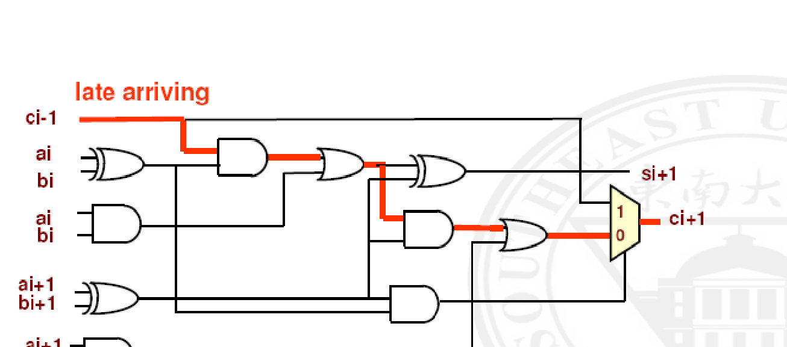

*红色标出的是按拓扑算出的关键路径，它从 $c_{i-1}$ 出发，经第 $i$ 位的进位逻辑进入第 $i+1$ 位，最后到达 MUX 的一个输入端。*

这条路径从 $c_{i-1}$ 出发，穿过第 $i$ 位的传播门与产生门，再进入第 $i+1$ 位的进位逻辑，最后到达 $c_{i+1}$ 的 MUX 输入端。

这条路径的激活要求第 $i$ 位处于传播状态，即 $a_i\oplus b_i=1$，否则与门不会把 $c_{i-1}$ 放行。它同时要求第 $i+1$ 位也处于传播状态，即 $a_{i+1}\oplus b_{i+1}=1$。而第 $i+1$ 位一旦处于传播状态，MUX 就选择旁路输入，$c_{i+1}$ 直接由 $c_{i-1}$ 经过旁路通路得到，不再经过那条长的进位链。真正被激活的是一条更短的路径，按拓扑算出的最长路径不会出现在输出波形上。

这个例子里，两条路径的激活条件由同一个选择信号互斥地控制。多路选择器的各输入端、译码器的互斥输出都会造成同类结构。

### 跨时钟域路径

另一类常见情形是两个异步时钟域之间的数据通路。若 CLK_A 与 CLK_B 来自不同源、彼此没有固定相位关系，数据在这两个域之间就不存在"一个周期内保持稳定"的关系。STA 会按两者的边沿组合计算最紧的一组收发沿，报出一条在这组边沿下无法满足的路径。

这类路径通常用同步器处理，时序上作为伪路径或最大延迟约束处理，功能正确性交给跨时钟域验证。

### 标记伪路径的代价

把一条路径标为伪路径后，工具不再分析它，因此

- 虚假违例从报告中消失，工程师可以专注于真实的时序问题；
- 工具不会为不存在的违例插入缓冲器或增大驱动，面积与功耗不被浪费；
- 需要分析的路径变少，运行时间下降。

风险同样明确。标错一条真实路径，工具就完全不再检查它，芯片回来后这条路径上的时序故障不会被任何报告指出。大型设计的伪路径列表往往有上千条，逐条给功能论证本身就是一项需要维护的工作。

## 时序约束与检查

### 单元的时序模型

时序单元在 STA 中由三个量描述：时钟到输出的传播延迟 $T_{\mathrm{ck2q}}$、建立时间 $T_{\mathrm{setup}}$ 与保持时间 $T_{\mathrm{hold}}$。$T_{\mathrm{ck2q}}$ 参与数据路径的传播，另外两个参与捕获端的检查。

分析前要给被分析设计（Design Under Analysis，DUA）配置一组条件：时钟周期、各输入引脚的驱动能力、各输出引脚的负载电容，以及例外路径。这些条件用 SDC（Synopsys Design Constraints）描述，语法基于 Tcl（Tool Command Language）。Tcl 是解释型脚本语言，不需要编译，EDA 工具普遍把它作为命令接口，约束文件直接由命令序列构成。

### 时钟约束

时钟由 `create_clock` 定义，至少要给出周期和作用端口：

```tcl
create_clock -name CLK -period 10 [get_port CLKB]
```

默认波形是 0 时刻上升、半周期处下降。占空比不是 50% 时用 `-waveform` 指定两个边沿时刻，例如 `-waveform {3 5}` 表示 3 ns 上升、5 ns 下降，高电平只持续 2 ns。

分频、倍频、反相和门控时钟由 `create_generated_clock` 从源时钟派生：

```tcl
create_generated_clock -name CLK2 -source SRC/CLK -divide_by 2 [get_pins DIV/CLK]
create_generated_clock -name CLK2 -source [get_ports CLK1] -multiply_by 2 [get_pins MULT/CLK]
create_generated_clock -divide_by 1 -combinational -invert -source CLK1 [get_pins G1/Z]
```

`-divide_by 2` 让派生时钟周期变为源时钟的两倍，`-multiply_by 2` 变为一半，`-invert` 把上升沿移到源时钟的下降沿，`-combinational` 说明这条路径上的单元是组合逻辑。`-edges` 直接引用源时钟的边沿序号，序号从 1 开始，奇数指源时钟的上升沿、偶数指下降沿：

```tcl
create_generated_clock -name CLK1 -edges {3 4 7} -source DCLK [get_pins G1/Z]
```

不确定度描述时钟边沿相对理想位置的偏移，来源是时钟树上的偏斜与振荡器的抖动：

$$
\Delta_{\mathrm{unc}}=\Delta_{\mathrm{skew}}+\Delta_{\mathrm{jitter}}.
$$

它分成建立与保持两组分别施加，前者收窄可用周期，后者推迟保持检查的参考点：

```tcl
set_clock_uncertainty -setup 0.4 [get_clocks CLKB]
set_clock_uncertainty -hold 0.04 [get_clocks CLKB]
```

时钟延迟分成源延迟与网络延迟。源延迟是从时钟源到设计输入端口的传播时间，在时钟产生电路不在本设计内时使用；网络延迟是时钟在设计内部到达各个寄存器的传播时间。两者可以分别设置，也可以给出最小值与最大值：

```tcl
set_clock_latency 0.8 -source [get_clocks CLK]
set_clock_latency 0.7 -source -min [get_clocks CLK]
set_clock_latency 0.3 -source -max [get_clocks CLK]
```

派生时钟的总延迟由主时钟的源延迟、派生时钟自身的源延迟与网络延迟相加得到。时钟树综合之前延迟只是一个估计值，综合之后由实际提取的时钟树取代。

### 输入输出与外部条件约束

与外部电路相接的端口没有内部参考点，延迟要以外部器件的时序为界。`set_input_delay` 给出外部电路把数据送到本设计输入端口所花的时间，`-max` 与 `-min` 分别对应用最长与最短的外部路径：

```tcl
set_input_delay -clock CLKP -max 6.7 [get_ports INPA]
set_input_delay -clock CLKP -min 3.0 [get_ports INPA]
```

最大值决定建立检查，最小值决定保持检查。输出方向同理使用 `set_output_delay`。

外部属性约束描述驱动与负载。输入端的驱动能力用 `set_driving_cell` 引用一个实际单元，输入转换时间用 `set_input_transition` 直接给出，输出端的负载用 `set_load` 给出。这些数值影响端口处的延迟与压摆，进而影响整条路径的计算结果。

设计规则约束限制物理上不允许出现的状态：`set_max_transition` 限制压摆，`set_max_capacitance` 限制负载电容。压摆过大会使后级延迟显著增加并使短路功耗上升，容性负载过大则可能超出驱动器的能力。

### 四类时序路径

按起点与终点的类型，时序路径分为四类：PI 到寄存器、寄存器到寄存器、寄存器到 PO、PI 到 PO。

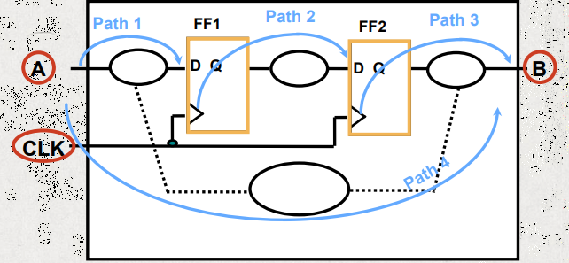

*Path 1 由输入端口经组合逻辑到 FF1，Path 2 由 FF1 到 FF2，Path 3 由 FF2 到输出端口，Path 4 由输入端口经组合逻辑直接到输出端口。*

前两类由时钟沿限定起点与终点，检查方式相同；后两类中只有一端受寄存器约束，另一端的时间要求由输入输出延时给出。

### 建立时间检查

建立检查约束数据路径中最长的一条：信号要在捕获时钟沿到来前至少 $T_{\mathrm{setup}}$ 就已稳定。设发射寄存器的时钟到达时刻为 $T_{\mathrm{launch}}$，捕获寄存器为 $T_{\mathrm{capture}}$，两者都包含各自的时钟延迟，则

$$
T_{\mathrm{launch}}+T_{\mathrm{ck2q}}+T_{\mathrm{dp}}+T_{\mathrm{setup}}
\le T_{\mathrm{capture}}+T_{\mathrm{cycle}},
$$

其中 $T_{\mathrm{dp}}$ 是数据路径延迟。移项得到建立裕量：

$$
Slack_{\mathrm{setup}}
=\left(T_{\mathrm{capture}}+T_{\mathrm{cycle}}\right)
-\left(T_{\mathrm{launch}}+T_{\mathrm{ck2q}}+T_{\mathrm{dp}}+T_{\mathrm{setup}}\right).
$$

$Slack_{\mathrm{setup}}\ge 0$ 表示满足。这个式子里只有 $T_{\mathrm{dp}}$ 是路径最长的取值，$T_{\mathrm{ck2q}}$ 与 $T_{\mathrm{setup}}$ 也取最坏值。

时钟偏斜定义为

$$
T_{\mathrm{skew}}=T_{\mathrm{capture}}-T_{\mathrm{launch}}.
$$

$T_{\mathrm{skew}}>0$ 时捕获时钟晚到，周期被放宽，对建立检查有利；$T_{\mathrm{skew}}<0$ 时相反。时钟树综合会有意制造少量正偏斜来缓解个别紧张路径，这种用法称为有用偏斜（useful skew）。

建立违例的修复手段按作用位置分几类：

- 架构级：把长组合路径切成多级流水，或者改变算法减少级数；
- 逻辑级：重组关键路径的逻辑、复制高扇出网络以减小负载、在工艺映射时换用更快的单元、用移位代替乘法；
- 物理级：把相关单元放近以减少线长、在长线上插入缓冲器改善压摆、增大驱动管的尺寸；
- 时钟：调整偏斜、减少时钟路径上的逻辑深度、换用低延迟的时钟缓冲单元；
- 约束与库：在性能允许的范围内降低时钟频率，对确实无法单周期完成的路径设置多周期约束，或换用 $T_{\mathrm{setup}}$ 更小的触发器。

修复的代价不同。流水线改变微架构，要连带重做验证；逻辑重组与单元替换会带来面积与功耗的变化；插缓冲器集中在版图上做，是布局布线阶段最常用的手段。

### 保持时间检查

保持检查约束数据路径中最短的一条：信号在捕获沿之后还要稳定至少 $T_{\mathrm{hold}}$，否则同一个沿会把新旧两个值混在一起。条件是

$$
T_{\mathrm{launch}}+T_{\mathrm{ck2q}}+T_{\mathrm{dp}}
> T_{\mathrm{capture}}+T_{\mathrm{hold}},
$$

对应的保持裕量为

$$
Slack_{\mathrm{hold}}
=\left(T_{\mathrm{launch}}+T_{\mathrm{ck2q}}+T_{\mathrm{dp}}\right)
-\left(T_{\mathrm{capture}}+T_{\mathrm{hold}}\right).
$$

这里 $T_{\mathrm{dp}}$ 取路径最短的取值。与建立检查相比，周期项消失了，因此缩短周期不会直接造成保持违例。

偏斜的符号在保持检查里反过来：$T_{\mathrm{skew}}>0$ 使捕获沿晚到，数据需要保持更久，对保持不利；$T_{\mathrm{skew}}<0$ 对保持有利。

保持违例的修复思路是增加延迟或改变时钟关系：

- 在数据路径上插入缓冲器、延迟单元或偶数级反相器，直接增加 $T_{\mathrm{dp}}$；
- 在版图上绕线、换用驱动能力更弱的单元、适当增加扇出负载；
- 让发射时钟晚于捕获时钟，即制造负偏斜，在发射路径上加缓冲、在捕获路径上减缓冲；
- 换用 $T_{\mathrm{hold}}$ 更小或 $T_{\mathrm{ck2q}}$ 更大的触发器。

保持违例通常在布线之后才暴露，此时可调整的空间已经很小，修复往往意味着改动已经收敛的版图。

### 多周期路径

有些路径在设计上就允许跨多个周期完成，例如多周期完成的乘法器、流水线中跨阶段的组合逻辑、被多路复用的共享运算单元。对这类路径设置

```tcl
set_multicycle_path 3 -setup -from [get_pins UFF0/Q] -to [get_pins UFF1/D]
```

建立检查的捕获沿从第 1 个边沿移到第 3 个边沿，上式中的 $T_{\mathrm{cycle}}$ 被替换为 $T_{\mathrm{cycle}}\times 3$，约束放宽了两个周期。

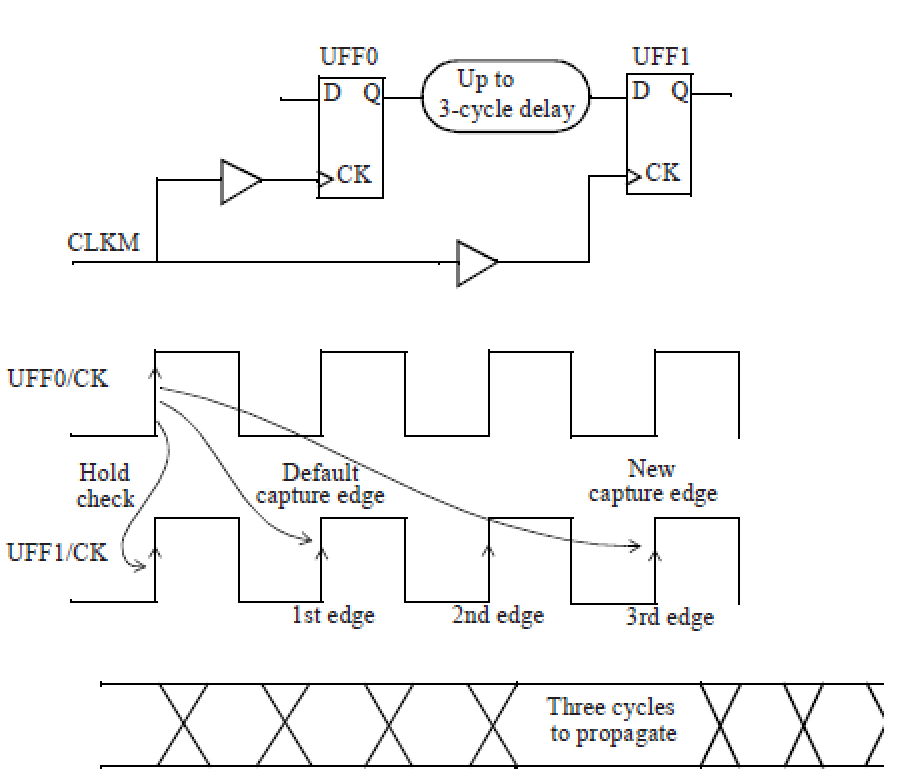

*建立检查的捕获沿从默认的第 1 个边沿移到第 3 个边沿，数据有 3 个周期传播。*

保持检查的行为需要单独处理。设置多周期建立约束后，若不加其他约束，保持检查仍然停在与原来相同的边沿上，也就是比新的建立检查提前整整一个周期。这个位置要求数据在发射沿之后的整整一个周期内都不能变化，把组合逻辑的最小延迟抬高到一个周期的量级，设计被限制死。

```tcl
set_multicycle_path N-1 -hold -from A -to B
```

把保持检查一起前移 $N-1$ 个边沿，让它重新贴着建立检查窗口的前沿，最小延迟的要求回到一个周期以内。多周期的本意是允许数据在第 2 到第 $N$ 个周期之间任意变化，只要在应当被采样的那个沿之前稳定即可；只设建立不设保持，等于把这个自由重新剥夺了。

### 半周期路径

发射沿与捕获沿取在相邻的两个不同极性边沿上时，可用时间只有一个半周期。

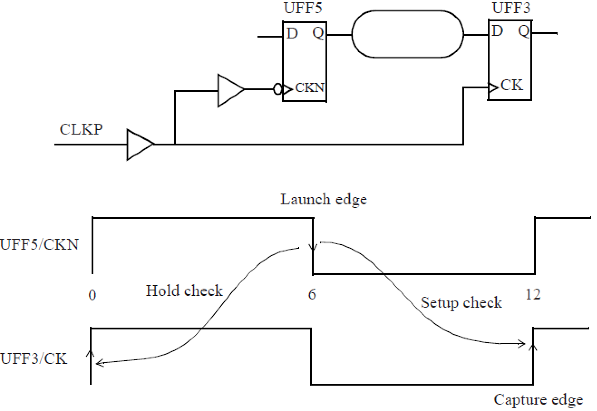

*UFF5 由时钟的下降沿触发，UFF3 由上升沿触发，建立检查的捕获沿落在下一个上升沿，保持检查落在同一个下降沿。*

图中的时钟周期为 12 ns，发射沿在 6 ns 的下降沿，建立检查的捕获沿在 12 ns 的上升沿，两沿之间只有 6 ns 而不是 12 ns。保持检查落在 0 ns 的上升沿上，对应的是前一个周期。工具报告中，数据在 6.31 ns 到达，扣除不确定度与建立时间后的所需时刻为 11.74 ns，建立裕量 5.43 ns。

半周期约束不需要额外的 SDC 命令，触发器上的边沿属性已经决定了检查位置。

### 跨时钟域路径

两个时钟频率不同时，捕获沿落在发射沿之后的第几个周期由周期比与 `-start`、`-end` 的选择给出。

慢时钟到快时钟时，数据从一个慢域寄存器送到一个快域寄存器，按 4 个快时钟周期计算：

```tcl
set_multicycle_path 4 -setup -from [get_clocks CLKM] -to [get_clocks CLKP] -end
```

`-end` 表示以捕获时钟的周期为单位计数，$N$ 个周期就是 $N$ 个 CLKP 周期。报告里发射沿在 0，捕获沿在 20 ns（4 个 5 ns 周期），数据到达 0.29 ns，扣除不确定度与建立时间后所需时刻为 19.72 ns，裕量 19.44 ns。

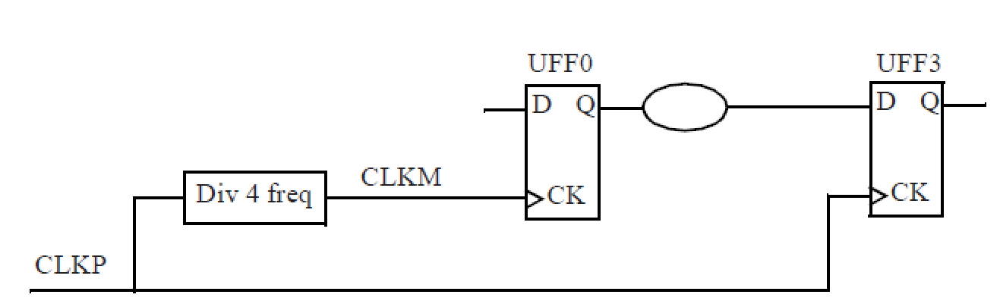

*CLKM 为 CLKP 的 4 分频，建立检查的捕获沿取 4 个 CLKP 周期之后。*

快时钟到慢时钟的方向上，`-start` 把计数基准放在发射时钟一侧：

```tcl
set_multicycle_path 2 -setup -from [get_clocks CLKP] -to [get_clocks CLKM] -start
```

CLKP 周期 5 ns，CLKM 是它的 4 分频，周期 20 ns。`-start` 以发射时钟为参照，把发射沿移到第 2 个 CLKP 上升沿（10 ns），捕获沿取它之后最近的 CLKM 上升沿（20 ns），两者相距 10 ns 即 2 个 CLKP 周期。数据在 10.32 ns 到达，扣除不确定度与建立时间后所需时刻为 19.78 ns，裕量 9.46 ns。`-start` 与上面的 `-end` 对应两种参照系：快时钟到慢时钟的路径以发射时钟计数，慢时钟到快时钟的路径以捕获时钟计数，两者选的是同一个物理时刻。

保持检查的默认位置同样需要跟着调整。快时钟到慢时钟的路径若只设建立多周期，保持检查会停在发射沿，要求数据在一个完整的慢周期内保持不变，这在物理上过强，通常在建立约束之外再设 `set_multicycle_path N-1 -hold -start`，把保持沿前移。

## 波动分析

### 波动的来源

制造出来的晶体管不会完全等于设计值。沟道长度、阈值电压、氧化层厚度、互连的宽度与厚度都会偏离标称值，这些偏离统称工艺波动。按照是否与版图相关，波动分成两类。

系统性波动由工艺本身固有的、可预测的物理效应引起，大小与方向取决于图形的密度、间距、形状和朝向。

- 光学邻近效应：光刻时衍射与干涉使掩膜图形在硅片上发生畸变，线条拐角变圆，密集线与孤立线的成像尺寸出现差异。设计中用光学邻近校正（Optical Proximity Correction，OPC）在掩膜上预先做反向畸变来补偿，补偿后仍有残差。
- 化学机械抛光：不同图形密度区域的抛光速率不同，金属密度高的区域被磨掉更多，金属层更薄。设计上用金属填充平衡密度，填充本身又引入额外寄生电容。
- 阱邻近效应：离子注入时靠近阱边界的晶体管受到散射，阈值电压与阱中央的器件不同。

非系统性波动来自原子尺度的随机性，与版图没有确定关系，只能用概率分布描述。

- 随机掺杂波动（Random Doping Fluctuation，RDF）：纳米级晶体管的沟道里只有几十个掺杂原子，它们的具体位置完全随机，阈值电压因此随机起伏。这是非系统性波动的主要来源。
- 线边缘粗糙度（Line Edge Roughness，LER）：光刻胶分子的随机性与刻蚀过程的随机性使线条边缘呈锯齿状，有效沟道长度与线宽随之波动。
- 氧化层厚度波动：栅氧只有几个原子层厚，界面粗糙度与原子层数的离散性使厚度在局部随机变化，栅电容与栅控能力随之改变。

按空间尺度还能分成全局波动与局部波动。全局波动是批次之间、晶圆之间、芯片之间的整体偏移，同一颗芯片上的所有器件朝同一个方向偏；局部波动是同一颗芯片内部不同器件的偏移各不相同，有的偏大有的偏小。工艺演进使局部波动的占比不断上升，在先进节点上它已经与全局波动相当。

环境因素同样改变延迟：电源电压降低使驱动电流减小，温度升高改变载流子迁移率与阈值电压。这两项与工艺一起构成 PVT 三个维度。

### PVT 工艺角

传统做法是把工艺、电压、温度的组合穷举成若干个角（corner），在每个角上分别运行一次确定性的 STA。

- 工艺角 3 到 5 个：TT、SS、FF、FS、SF，两个字母分别表示 NMOS 与 PMOS 的快慢；
- 电压点 5 到 10 个：标称值附近取若干点，SS 角取标称值 $-10\%$，FF 角取 $+10\%$，标称角常在 0.6 到 1.0 V 之间；
- 温度点 3 到 5 个：$-25\,^\circ\mathrm{C}$、$0\,^\circ\mathrm{C}$、$25\,^\circ\mathrm{C}$、$75\,^\circ\mathrm{C}$、$125\,^\circ\mathrm{C}$。

三个维度组合起来就是几十个场景，每个场景都要跑完整的时序分析，签核时间与场景数成正比。

延迟对三个参数的依赖并不单调一致。工艺越快延迟越小，电压越高延迟越小，温度的影响则可能出现反转。

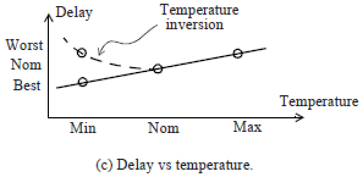

*温度较低时延迟反而更大，曲线在某个温度处出现极小值，低温端成为最坏角。*

温度反转（temperature inversion）在低电压下更明显：电压降低后器件的驱动电流减小，延迟对温度的敏感性改变，原本在高温出现的延迟峰值移到了低温。这种情况下按"高温最慢"的直觉选取角会漏掉真正的违例。

### OCV 与增减因子

工艺角只覆盖全局偏移，同一颗芯片内部器件之间的差异要用片上波动（On-Chip Variation，OCV）描述。OCV 的做法是给延迟乘一个增减因子（derate），按最坏方向放大或缩小各段延迟。

设 derate 为 $d$，建立检查按数据路径变慢、发射时钟变慢、捕获时钟变快来算：

$$
T_{\mathrm{arrive}}=\left(T_{\mathrm{launch}}+T_{\mathrm{ck2q}}+T_{\mathrm{dp}}\right)(1+d),
\qquad
T_{\mathrm{require}}=\left(T_{\mathrm{capture}}\right)(1-d)+T_{\mathrm{cycle}}.
$$

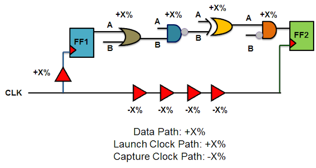

*数据路径与发射时钟路径乘 $+x\%$，捕获时钟路径乘 $-x\%$。*

保持检查的方向相反：数据路径与发射时钟取 $-x\%$，捕获时钟取 $+x\%$，让数据尽早到达、捕获沿尽量晚到。

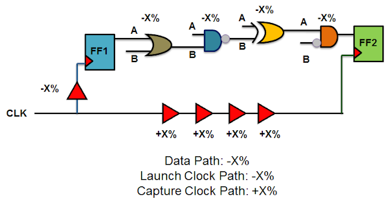

*数据路径与发射时钟路径乘 $-x\%$，捕获时钟路径乘 $+x\%$。*

固定 derate 的问题在于它与路径长度无关。真实的偏差沿路径累积，路径越长，各段偏差相互抵消的比例越高，等效的相对偏差越小；固定 derate 对所有路径施加同一个百分比，短路径被过度悲观，长路径反而不足。

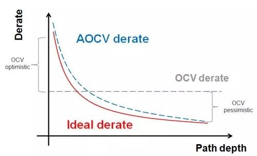

*理想 derate 随路径级数增加而下降，固定 OCV 只用一条水平线近似。*

### AOCV 与 POCV

进阶 OCV（Advanced OCV，AOCV）把 derate 改成随路径深度与空间距离变化的表。路径深度越大，derate 越小；同一路径上器件之间的物理距离越远，偏差的相关性越弱，derate 也按距离分档。

| 路径深度 | 10 µm | 20 µm | 30 µm | 40 µm |
| --- | --- | --- | --- | --- |
| 2 级 | 1.10 | 1.12 | 1.14 | 1.16 |
| 4 级 | 1.08 | 1.10 | 1.12 | 1.15 |
| 6 级 | 1.06 | 1.08 | 1.11 | 1.14 |
| 8 级 | 1.04 | 1.05 | 1.09 | 1.13 |

表中数值随深度增加而减小，随距离增加而增大。距离越远，两颗器件落在同一个系统性梯度上的可能性越低，独立性越强，按最坏叠加处理时需要的余量就越大。

参数化 OCV（Parametric OCV，POCV）进一步把每个单元的延迟写成随机变量，用均值与标准差描述，再沿路径累加。若各级延迟相互独立，路径的均值与方差分别为

$$
\mu_{\mathrm{path}}=\sum_i \mu_i,\qquad
\sigma_{\mathrm{path}}^2=\sum_i \sigma_i^2 .
$$

路径延迟的标准差按平方和相加，而不是线性相加，这正是长路径上正负偏差相互抵消的定量表达。裕量按给定的 $k\sigma$ 计算：

$$
Slack_{k\sigma}=\left(\mu_{\mathrm{RAT}}-k\sigma_{\mathrm{RAT}}\right)
-\left(\mu_{\mathrm{AT}}+k\sigma_{\mathrm{AT}}\right).
$$

$k$ 取 3 时单侧累积概率约为 $99.87\%$，高可靠性设计常取 4 到 6。POCV 给出的是违例概率，而不只是一个通过或失败的判定。

### LVF 与矩

Liberty 变化格式（Liberty Variation Format，LVF）把波动信息写进单元库，按矩的形式给出三个量：均值偏移、标准差与偏度。

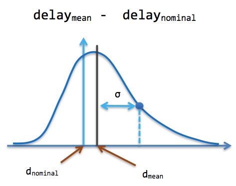

*分布均值相对标称延迟的偏移量，$\sigma$ 为分布的标准差。*

均值偏移定义为

$$
\Delta\mu=\mu_{\mathrm{delay}}-\mathrm{delay}_{\mathrm{nominal}},
$$

它描述非系统性偏差的整体趋势，比如某些版图环境下延迟系统性偏大。标准差为

$$
\sigma=\left\{\mathrm{E}\left[(d-\mu)^2\right]\right\}^{1/2},
$$

偏度为

$$
\gamma=\left\{\mathrm{E}\left[(d-\mu)^3\right]\right\}^{1/3},
$$

它刻画分布的不对称性。

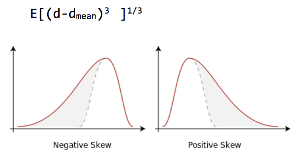

*偏度为负时分布的长尾在左侧，为正时在右侧。*

延迟分布偏离高斯形态时，仅用均值与标准差计算出的 $k\sigma$ 分位点会有偏差，偏度用来修正这个分位点。库中给出的这三个量随输入压摆与输出负载变化，分析器在查表时一并插值，得到的路径延迟分布比只用 derate 更接近实际。

从工艺角到 OCV、AOCV、POCV，波动描述从"几个确定的场景"逐步过渡到"每级延迟的概率分布"，每一次过渡都减少了悲观量，代价是模型规模与计算量的增加。
