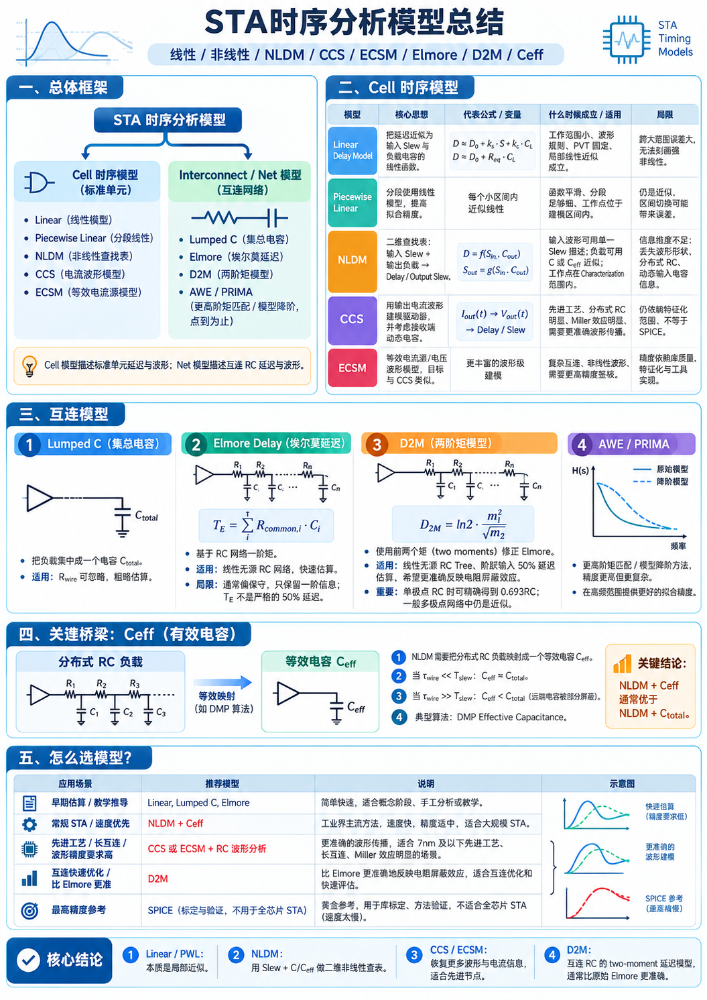

一张 STA 报告上的数字，背后站着一个模型。模型的假设一旦不成立，数字本身没变，结论却已经错了。所以比记住 "NLDM 快、CCS 准" 更有用的，是知道每个模型的延迟公式是怎么推出来的、在哪一步做了近似。

STA 里要算的东西分两类：信号穿过一个标准单元要多久，信号沿一根互连线爬过去要多久。这两件事物理机制不同，建模方式也就分成了两套。

## 总体框架

STA 时序分析模型分成两条支路。

**Cell 时序模型（标准单元）**

- Linear（线性模型）
- Piecewise Linear（分段线性）
- NLDM（非线性查找表）
- CCS（电流波形模型）
- ECSM（等效电流源模型）

**Interconnect / Net 模型（互连网络）**

- Lumped C（集总电容）
- Elmore（埃尔莫延迟）
- D2M（两阶矩模型）
- AWE / PRIMA（更高阶矩匹配 / 模型降阶，点到为止）

一句话区分两者：**Cell 模型描述标准单元延迟与波形；Net 模型描述互连 RC 延迟与波形。**

这条分界线不是随意的。标准单元的输出级可以近似看成一个受输入波形控制的非线性电流源，它输出的是一段带形状的波形；而互连线是一张无源 RC 网络，它本身不产生能量，只负责把输入波形低通滤波、延迟、展宽。把这两件事分开建模，才有可能在同一个 STA 引擎里既保证速度又保证精度。

## Cell 时序模型

### 从 RC 到线性延迟模型

先把单元输出级看成理想电压源加一个等效电阻 $R_{eq}$，负载看成集总电容 $C_L$。这是一个一阶 RC 电路，阶跃输入的响应是

$$V_{out}(t) = V_{DD}\left(1 - e^{-t/(R_{eq}C_L)}\right)$$

门延迟通常定义为输出从 0 跨到 50% $V_{DD}$ 的时间。代入 $V_{out} = 0.5V_{DD}$，解得 $t = R_{eq}C_L \ln 2$，也就是

$$D \approx 0.69 R_{eq} C_L$$

再把输入跳变不是理想阶跃这件事补进来：输入本身的 Slew 会通过米勒效应等路径影响输出，于是把常数项和 Slew 项一起线性化，得到常见的经验式

$$D \approx D_0 + k_s \cdot S + k_c \cdot C_L$$

$D_0$ 是本征延迟，$k_s$ 是输入转换时间系数，$k_c$ 是负载系数。这三个数由 SPICE 特征化出来后写进库。

这个式子的来历本身就说明了它的边界：**一阶 RC 加线性化**。只要单元工作在小范围内、波形规则、PVT 固定在特征化点上，它就是准的；一旦负载或 Slew 跑到特征化范围之外，线性外推就变成瞎猜。

### Piecewise Linear：把一根直线掰成很多段

Linear 模型的误差主要来自「用一根直线拟合一条曲线」。既然单点切线不行，那就多取几个点，在每两个相邻工作点之间用直线连接，这就是 Piecewise Linear。

它没有改变模型的物理假设，只是把 $D(C_L)$ 这条曲线用更细的分段代替。代价是区间边界处导数不连续，如果工作点正好落在两个区间交接处，切换时会有跳变。工程上通常保证分段足够密、工作点落在建模区间内部来规避。

### NLDM：把线性函数换成二维查找表

Linear 和 PWL 都是一维的：只认负载。但输出延迟实际上同时受输入 Slew 影响，而且这个影响不是简单可加的。NLDM 的处理方式是干脆不拟合解析式，直接建表：

$$D = f(S_{in}, C_{out}), \qquad S_{out} = g(S_{in}, C_{out})$$

$S_{in}$、$C_{out}$ 是索引轴，表里存特征化得到的延迟和输出 Slew。查询时在网格里做双线性插值。注意 NLDM 输出的是**两个量**：延迟和输出 Slew —— 因为下游单元的输入 Slew 就是当前单元的输出 Slew，这条链是串联传递的。

NLDM 的信息丢失在哪？它把输入波形压缩成一个标量 $S_{in}$，把负载压缩成一个标量 $C_{out}$。于是「波形长什么样」「负载是分布式的还是集总的」「接收端的动态电容有多大」这三类信息全都不在表里。在 0.18µm 时代这些丢失无关痛痒；到了先进节点，它们成了主要误差源。

### CCS：不再描述波形，直接描述电流

CCS 换了个思路。它承认驱动器是非线性的，于是不描述输出电压波形，而是描述驱动器输出的**电流波形** $I_{out}(t)$，同时把接收端门电容当成随电压变化的动态电容来算：

$$I_{out}(t) \rightarrow V_{out}(t) \rightarrow \text{Delay / Slew}$$

输出电压由电流对负载网络积分得到。这样波形形状、非线性、Miller 效应都被保留下来，代价是库体积和计算量都明显上升。它是特征化的结果，不是 SPICE —— 落在特征化条件之外时同样会失准。

### ECSM：等效电流源的另一种写法

ECSM 的目标和 CCS 一致：用波形级信息取代标量描述。差别在于参数化方式 —— 它把驱动能力等效成电流源加一组电压波形来表征。对使用者的实际影响是：精度更依赖库的质量与特征化流程，工具链的支持度也不完全一致。

### Cell 模型对照

| 模型               | 核心思想                                               | 代表公式 / 变量                                                                   | 什么时候成立 / 适用                                                                    | 局限                                                    |
| ------------------ | ------------------------------------------------------ | --------------------------------------------------------------------------------- | -------------------------------------------------------------------------------------- | ------------------------------------------------------- |
| Linear Delay Model | 把延迟近似为输入 Slew 与负载电容的线性函数             | $D \approx D_0 + k_s \cdot S + k_c \cdot C_L$；$D \approx D_0 + R_{eq} \cdot C_L$ | 工作范围小、波形规则、PVT 固定、局部线性近似成立                                       | 跨大范围误差大，无法刻画强非线性                        |
| Piecewise Linear   | 分段使用线性模型，提高拟合精度                         | 每个小区间内近似线性                                                              | 函数平滑、分段足够细、工作点位于建模区间内                                             | 仍是近似，区间切换可能带来误差                          |
| NLDM               | 二维查找表：输入 Slew + 输出负载 → Delay / Output Slew | $D = f(S_{in}, C_{out})$；$S_{out} = g(S_{in}, C_{out})$                          | 输入波形可用单一 Slew 描述；负载可用 C 或 C_eff 近似；工作点在 Characterization 范围内 | 信息维度不足：丢失波形形状、分布式 RC、动态输入电容信息 |
| CCS                | 用输出电流波形建模驱动器并考虑接收端动态电容           | $I_{out}(t) \rightarrow V_{out}(t) \rightarrow$ Delay / Slew                      | 先进工艺、分布式 RC 明显、Miller 效应明显、需要更准确波形传播                          | 仍依赖特征化范围、不等于 SPICE                          |
| ECSM               | 等效电流源 / 电压波形模型，目标与 CCS 类似             | 更丰富的波形级建模                                                                | 复杂互连、非线性波形、需要更高精度签核                                                 | 精度依赖库质量、特征化与工具实现                        |

## 互连模型

互连线不是导线，是 RC 网络。教科书式的处理是把一条线切成无数小段 R 和 C 交替，写成分布参数传输线方程；但 STA 里没时间解偏微分方程，于是每一代都在做同一件事：**用尽量少的矩信息去逼近这个网络的阶跃响应。**

### Lumped C（集总电容）

最粗暴的做法：把整条线的分布电容全加起来，当成一个电容挂在驱动器输出上。

$$C_{total} = \sum_i C_i$$

这等价于假设导线电阻为零、信号瞬间在整个网络上建立起来。什么时候成立？线很短、$R_{wire}$ 相对驱动器输出电阻可以忽略时。一旦线变长，这个假设就崩了 —— 而且崩的方向很危险：它总是低估延迟，因为忽略了 RC 分布带来的额外拖慢。

### Elmore Delay：一阶矩

Elmore 延迟是 RC 树阶跃响应的**一阶矩**，也是精确的 50% 延迟的一阶近似。对树形网络（每条电容有唯一的前驱路径），它的表达式可以写成非常干净的形式：

$$T_E = \sum_i R_{common,i} \cdot C_i$$

其中 $R_{common,i}$ 是从源点到电容 $C_i$ 的公共路径上所有电阻之和。为什么是「公共路径」？把每个电容的影响拆开看：$C_i$ 充放电时，电流必须经过从源点到它的那条路径，所以那条路径上的电阻都在拖它。这也是这个公式能做手工估算的原因 —— 沿着树走一遍，把每个节点上游的电阻加起来乘该点的电容即可。

它的性质值得记住几点：

- 对 RC 树是一阶矩的解析结果，计算复杂度是线性扫描，极快。
- 对单极点网络，$T_E$ 就是时间常数，50% 延迟等于 $0.69 T_E$。
- 对一般网络，$T_E$ 恒大于等于真实 50% 延迟（偏保守），而且随网络阶数升高，偏差变大。
- 它只用到一阶矩，因此完全丢失了波形的「形状」，只给出一个时间数字。

Elmore 还有一个隐含前提常被忽略：树的拓扑。一旦网络里有环路（比如网格时钟树、带反馈的互连），"公共路径" 的定义就不再唯一，公式需要扩展成一般的形式。

### D2M：用二阶矩修正一阶矩

Elmore 用一阶矩，那就补上二阶矩。把网络的冲激响应 $h(t)$ 写成矩的形式，前两阶矩为

$$m_1 = \int_0^\infty t\,h(t)\,dt, \qquad m_2 = \int_0^\infty t^2 h(t)\,dt$$

Elmore 延迟对应的是 $m_1$。D2M 拿两个矩构造一个修正后的延迟估计：

$$D_{2M} = \ln 2 \cdot \frac{m_1^2}{m_2}$$

这个因子的直觉是这样的。若网络退化成单极点，冲激响应是 $h(t) = \frac{1}{\tau}e^{-t/\tau}$，此时 $m_1 = \tau$，$m_2 = 2\tau^2$，代入得 $D_{2M} = \ln 2 \cdot \frac{\tau^2}{2\tau^2} \cdot 2 = \tau \ln 2 = 0.693\tau$ —— 正是单极点网络的精确 50% 延迟。

换句话说，D2M 把 Elmore 的 $m_1$ 按 $m_1/m_2$ 的比例重新缩放，使它在单极点极限下严格精确，在多极点时则比 Elmore 更接近真实值。$m_2$ 比 $m_1$ 多携带了「能量在时间上如何铺开」的信息，这正是 Elmore 缺的那一维。

修正带来的实际收益集中在**电阻屏蔽效应**（resistive shielding）上：当驱动器输出电阻远小于互连电阻时，远端电容被近端电阻"挡住"，对延迟的贡献被高估；只认一阶矩的 Elmore 反映不出这一点，D2M 因为带了二阶信息，能给出更合理的估计。

需要说清楚的是它仍然是近似：一般多极点网络下 $D_{2M}$ 并不等于精确的 50% 延迟，只是误差比 Elmore 小。它适合做互连优化里的快速评估 —— 比 Elmore 准，又远比 SPICE 快。

### AWE / PRIMA：更高阶矩与模型降阶

再往上走就是矩匹配方法的领域。AWE（Asymptotic Waveform Evaluation）用更高阶的矩去匹配网络的响应，PRIMA 之类的工作则从保结构的模型降阶角度出发，把一个成千上万阶的 RC 网络压缩成几十阶但仍保持无源性的小系统。

它们在高频、宽频带场景下拟合明显更好，代价是数值复杂度和潜在的稳定性问题（高阶矩匹配可能引入不稳定极点，PRIMA 用投影保无源来规避）。STA 里通常只在需要极高精度的小规模分析中用到，不作为全芯片默认。

## 关键桥梁：Ceff（有效电容）

到这里出现了一个结构性矛盾。

Cell 侧的 NLDM 只会查表，它要的是**一个**负载电容；Net 侧刚说了，真实负载是一张分布 RC 网络。直接把 $C_{total}$ 塞给 NLDM 会怎样？会显著高估延迟 —— 因为 $C_{total}$ 假设所有电容都挂在驱动器输出端，瞬间全部需要被驱动，而实际上远端电容被线电阻屏蔽了一部分，驱动器感受到的等效负载要小。

解决办法是构造一个等效电容 $C_{eff}$，使得「驱动器驱动 $C_{eff}$」和「驱动器驱动真实 RC 网络」在 50% 延迟上等价：

$$\text{Delay}(C_{eff}) = \text{Delay}(RC\ \text{network})$$

这一步通过迭代求解完成，典型算法是 DMP（D2M-based Effective Capacitance，把 D2M 的矩信息用在映射上）。求解出的 $C_{eff}$ 再喂给 NLDM 查表，就得到了一个既保持 NLDM 速度、又把互连屏蔽效应纳入考虑的延迟。

$C_{eff}$ 与 $C_{total}$ 的关系取决于互连延迟与输入转换时间两个时间尺度的比值：

- 当 $t_{wire} \ll T_{slew}$：信号沿线的传播相对输入跳变来说很快，可以近似认为整条线同时被充上，此时 $C_{eff} \approx C_{total}$。
- 当 $t_{wire} \gg T_{slew}$：输入已经跳变完毕，远端还来不及响应，驱动器只"看得到"近端那部分电容，$C_{eff} < C_{total}$，远端电容被部分屏蔽。线越长、驱动越强，这个差距越大。

**关键结论：NLDM + Ceff 通常优于 NLDM + C_total。** 它把 Net 模型的信息通过一个标量桥接回了 Cell 模型，是整个 STA 流程里成本收益比最高的一处近似。

## 怎么选模型？

选型不是"越准越好"，而是在精度预算和运行时间之间取平衡。全芯片动辄上千万个门，模型复杂度每提高一档，签核时间可能按倍增长。

| 应用场景                           | 推荐模型                              | 说明                                                                     |
| ---------------------------------- | ------------------------------------- | ------------------------------------------------------------------------ |
| 早期估算 / 教学推导                | Linear, Lumped C, Elmore              | 简单快速，适合概念阶段、手工分析或教学                                   |
| 常规 STA / 速度优先                | NLDM + Ceff                           | 工业界主流方法，速度快，精度适中，适合大规模 STA                         |
| 先进工艺 / 长互连 / 波形精度要求高 | CCS 或 ECSM + RC 波形分析             | 更准确的波形传播，适合 7nm 及以下先进工艺、长互连、Miller 效应明显的场景 |
| 互连快速优化 / 比 Elmore 更准      | D2M                                   | 比 Elmore 更准确地反映电阻屏蔽效应，适合互连优化和快速评估               |
| 最高精度参考                       | SPICE（标定与验证，不用于全芯片 STA） | 黄金参考，用于库标定、方法验证，不适合全芯片 STA（速度太慢）             |

## 核心结论

1. **Linear / PWL**：本质是局部近似。前者拟合一条切线，后者把曲线掰成多段直线；都只认负载，不认波形形状。
2. **NLDM**：用 Slew + C/Ceff 做二维非线性查表。它把输入波形和负载各压成一个标量，这就是它的速度来源，也是它的精度上限。
3. **CCS / ECSM**：恢复更多波形与电流信息，代价是库体积和运行时间，适合先进节点与 Miller 效应明显的场景。
4. **D2M**：互连 RC 的 two-moment 延迟模型。因为在单极点极限下严格等于 $0.693\tau$，通常比原始 Elmore 更准确，尤其体现在电阻屏蔽效应上。
