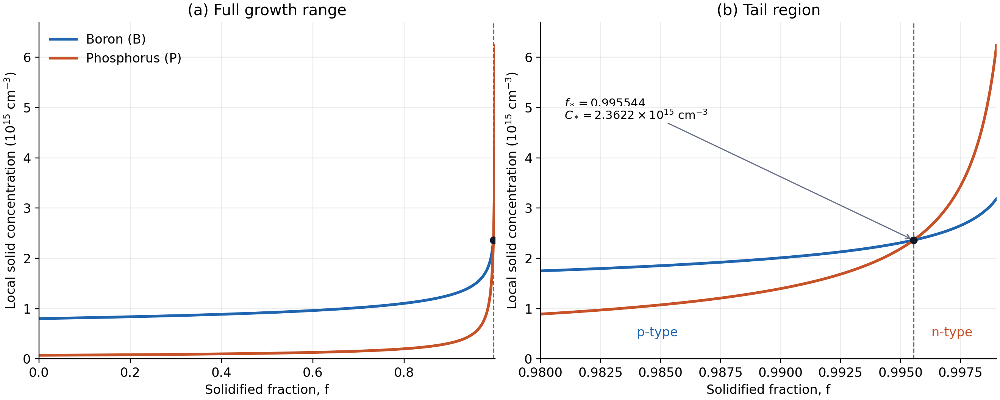
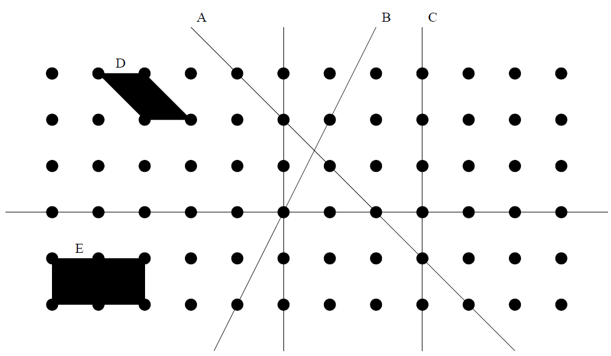
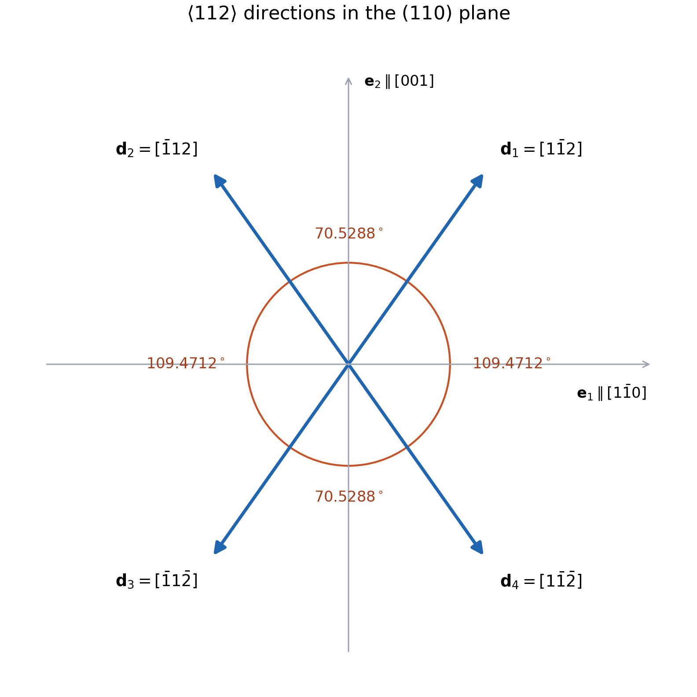

本文按作业的四道题逐项解答。第一题中的 $k>1$ 是尺寸缩放因子；第二题中的 $k_{\mathrm B}$、$k_{\mathrm P}$ 是杂质偏析系数，二者含义不同。第一题用 $f_{\max}$ 表示最高工作频率，第二题的 $f$ 则表示已经结晶的熔体比例。

提交时需填写姓名和学号，并在下一次上课时提交；原作业规定迟交扣该次作业总分的 10%，缺少姓名或学号扣 5%。

## 1. Dennard 恒电场微缩

题设要求金属—氧化物—半导体场效应晶体管（Metal–Oxide–Semiconductor Field-Effect Transistor，MOSFET）[^mosfet]的横向、纵向尺寸以及电源电压、阈值电压都缩小为原来的 $1/k$。恒电场微缩（constant-field scaling）[^dennard]的关键是让电压和距离按相同比例变化，使器件内部的典型电场保持不变。

以下用带撇号的符号表示微缩后的量。设沟道长度为 $L$、沟道宽度为 $W$、栅氧化层厚度为 $t_{\mathrm{ox}}$，则

$$
L'=\frac Lk,\qquad W'=\frac Wk,\qquad
t_{\mathrm{ox}}'=\frac{t_{\mathrm{ox}}}{k},
$$

$$
V_{\mathrm{DD}}'=\frac{V_{\mathrm{DD}}}{k},\qquad
V_{\mathrm{th}}'=\frac{V_{\mathrm{th}}}{k}.
$$

其中 $V_{\mathrm{DD}}$ 是电源电压，$V_{\mathrm{th}}$ 是阈值电压[^threshold]。若导通时 $V_{\mathrm{GS}}\approx V_{\mathrm{DD}}$，过驱动电压 $V_{\mathrm{ov}}=V_{\mathrm{GS}}-V_{\mathrm{th}}$ 也变为原来的 $1/k$。

例如，沟道方向的典型电场为 $E\sim V_{\mathrm{DS}}/L$，因此

$$
E'\sim\frac{V_{\mathrm{DS}}/k}{L/k}=E.
$$

栅氧化层方向的电场也有同样的缩放关系。下面采用理想长沟道模型[^long-channel]：介电常数和载流子迁移率[^mobility]保持不变，忽略漏电与互连造成的额外限制，电路拓扑、扇出及活动因子保持不变，负载电容随器件一起缩小。题设直接给出了阈值电压的缩放关系，以下将它作为已知条件。

### (a) 栅极电容、导通电流、延迟与最高频率

**栅极电容。** 单位面积栅氧化层电容为

$$
C_{\mathrm{ox}}=\frac{\varepsilon_{\mathrm{ox}}}{t_{\mathrm{ox}}},
$$

其中 $\varepsilon_{\mathrm{ox}}$ 为栅氧化层介电常数，$C_{\mathrm{ox}}$ 的单位为 $\mathrm{F/m^2}$。由于氧化层变薄，微缩后 $C_{\mathrm{ox}}'=kC_{\mathrm{ox}}$。而单个器件的栅面积变为 $WL/k^2$，所以总栅极电容[^gate-capacitance]满足

$$
C_g\approx C_{\mathrm{ox}}WL,
\qquad
C_g'=kC_{\mathrm{ox}}\frac Wk\frac Lk
=\boxed{\frac{C_g}{k}}.
$$

总栅极电容减小的原因是：面积缩小为 $1/k^2$，其影响超过了单位面积电容增大为 $k$ 的影响。

**导通电流。** 以处于强反型、饱和区的 nMOS 为例，长沟道平方律给出

$$
I_D\approx\frac12\mu_n C_{\mathrm{ox}}\frac WL
(V_{\mathrm{GS}}-V_{\mathrm{th}})^2,
$$

其中 $\mu_n$ 为电子迁移率，$I_D$ 为漏极导通电流[^on-current]。代入微缩后的各量：

$$
\begin{aligned}
I_D'
&=\frac12\mu_n(kC_{\mathrm{ox}})
\frac{W/k}{L/k}
\left(\frac{V_{\mathrm{GS}}-V_{\mathrm{th}}}{k}\right)^2\\
&=\boxed{\frac{I_D}{k}}.
\end{aligned}
$$

这里 $W/L$ 不变，单位面积电容贡献一个 $k$，过驱动电压的平方贡献一个 $1/k^2$，最终得到 $1/k$。

**电路延迟。** 将器件驱动的有效负载电容写为 $C_L$。在扇出不变、负载随器件一起缩放的条件下，$C_L'=C_L/k$。节点电压变化约为 $V_{\mathrm{DD}}$ 时，需要转移的电荷约为 $Q=C_LV_{\mathrm{DD}}$。由电流等于单位时间内转移的电荷，延迟时间[^delay-frequency]近似为

$$
t_d\sim\frac{C_LV_{\mathrm{DD}}}{I_D}.
$$

因而

$$
t_d'\sim
\frac{(C_L/k)(V_{\mathrm{DD}}/k)}{I_D/k}
=\boxed{\frac{t_d}{k}}.
$$

虽然导通电流减小，但完成一次电压转换所需的电荷减小得更多：$Q'=Q/k^2$，所以转换更快。

**最高工作频率。** 在逻辑级数等因素不变、临界路径延迟按相同比例缩放时，$f_{\max}\propto1/t_d$，于是

$$
\boxed{f_{\max}'=kf_{\max}}.
$$

这里讨论的是理想器件与相应电路的速度缩放；实际系统还会受到互连、时钟和存储器等因素限制。

### (b) 单次开关能量与单个器件动态功耗

电容充到 $V_{\mathrm{DD}}$ 时储存的能量为 $\tfrac12C_LV_{\mathrm{DD}}^2$。在理想 CMOS 电路中，一次完整的充电、放电循环[^switching-energy]从电源取得的能量为 $C_LV_{\mathrm{DD}}^2$，最后都以热的形式耗散。若把“单次开关”定义为单个边沿，表达式可能含有 $1/2$；这些常数约定不影响缩放指数。统一写为

$$
E_{\mathrm{SW}}\propto C_LV_{\mathrm{DD}}^2.
$$

因此

$$
\frac{E_{\mathrm{SW}}'}{E_{\mathrm{SW}}}
=\frac1k\left(\frac1k\right)^2
=\boxed{\frac1{k^3}}.
$$

单个器件或相应逻辑节点的动态功耗[^dynamic-power]可表示为

$$
P_{\mathrm{dyn}}=\alpha C_LV_{\mathrm{DD}}^2f_{\mathrm{op}},
$$

其中 $f_{\mathrm{op}}$ 是实际工作频率，$\alpha$ 是每个周期发生充电事件的平均次数，即活动因子。按本题的速度提升运行，取 $f_{\mathrm{op}}'=kf_{\mathrm{op}}$，并保持 $\alpha$ 不变，得到

$$
\frac{P_{\mathrm{dyn}}'}{P_{\mathrm{dyn}}}
=\frac1k\frac1{k^2}k
=\boxed{\frac1{k^2}}.
$$

也就是说，单次开关能量减小到 $1/k^3$，每秒开关次数增加为 $k$，单个器件的动态功耗仍减小到 $1/k^2$。如果实际工作频率保持不变，则动态功耗会减小到 $1/k^3$；这是另一种运行条件。

### (c) 晶体管数量密度与芯片功率密度

在理想布局中，单个晶体管占据的面积 $A_T$ 随横向尺寸变化：

$$
A_T'=\frac{A_T}{k^2}.
$$

因而单位芯片面积内的晶体管数量[^density] $n_T$ 满足

$$
\boxed{n_T'=k^2n_T}.
$$

对于面积保持不变的芯片，可集成的晶体管总数也增加为原来的 $k^2$。若维持相同的平均活动因子，并按提升后的频率运行，芯片动态功率密度为

$$
p_A=n_TP_{\mathrm{dyn}},
$$

所以

$$
p_A'=k^2n_T\frac{P_{\mathrm{dyn}}}{k^2}
=\boxed{p_A}.
$$

在这些理想条件下，芯片面积不变时总动态功耗也不变，而芯片能够容纳更多晶体管，并以更高频率工作。若频率保持不变，功率密度则变为原来的 $1/k$。

各量的结果汇总如下，表中动态功耗与功率密度采用工作频率提高到原来的 $k$ 倍的条件：

| 物理量 | 微缩后 / 微缩前 |
| --- | --- |
| 横向、纵向尺寸 | $1/k$ |
| 电源电压、阈值电压、过驱动电压 | $1/k$ |
| 典型电场 | $1$ |
| 单位面积栅氧化层电容 $C_{\mathrm{ox}}$ | $k$ |
| 总栅极电容 $C_g$ | $1/k$ |
| 导通电流 $I_D$ | $1/k$ |
| 延迟时间 $t_d$ | $1/k$ |
| 最高工作频率 $f_{\max}$ | $k$ |
| 单次开关能量 $E_{\mathrm{SW}}$ | $1/k^3$ |
| 单个器件动态功耗 $P_{\mathrm{dyn}}$ | $1/k^2$ |
| 单个晶体管占据的面积 $A_T$ | $1/k^2$ |
| 晶体管数量密度 $n_T$ | $k^2$ |
| 动态功率密度 $p_A$ | $1$ |

例如 $k=2$ 时，理想结果是延迟减半、最高频率翻倍、开关能量变为 $1/8$、单管动态功耗变为 $1/4$、晶体管数量密度增加到 4 倍，动态功率密度保持不变。

完整的经典恒电场微缩还要求适当提高掺杂浓度。用耗尽区宽度的简化关系 $x_d\propto\sqrt{V/N}$ 表示，若电势尺度 $V$ 缩小为 $1/k$、掺杂浓度 $N$ 增加为 $k$，则 $x_d$ 缩小为 $1/k$。这说明纵向电学尺寸的缩小也需要掺杂配合。[MIT 的 MOSFET 微缩讲义](https://ocw.mit.edu/courses/6-720j-integrated-microelectronic-devices-spring-2007/resources/lecture32/)介绍了这一经典框架。

### (d) Dennard 微缩失效的原因

最关键的限制是电源电压和阈值电压难以继续随几何尺寸同比例下降。对于常规、由热发射控制的 MOSFET，亚阈值区[^subthreshold]的漏极电流近似满足

$$
I_D\propto
\exp\left(\frac{V_{\mathrm{GS}}-V_{\mathrm{th}}}{nU_T}\right),
\qquad U_T=\frac{k_{\mathrm B}^{\mathrm{Boltz}}T}{q},
$$

其中 $U_T$ 是热电压，$n\ge1$ 是亚阈值斜率因子，$k_{\mathrm B}^{\mathrm{Boltz}}$ 是玻尔兹曼常数，和第二题硼的偏析系数无关。降低阈值电压会使 $V_{\mathrm{GS}}=0$ 时的关断电流指数增大。

亚阈值摆幅定义为电流变化一个数量级所需的栅电压变化，表达式为

$$
S=\frac{dV_{\mathrm{GS}}}{d\log_{10}I_D}
=n\ln10\frac{k_{\mathrm B}^{\mathrm{Boltz}}T}{q}.
$$

在约 300 K、理想 $n=1$ 的条件下，$S$ 约为 $60\ \mathrm{mV/dec}$。这个电压尺度由温度决定，不随器件几何尺寸同比例减小。因此，阈值电压继续降低时，器件越来越难保持足够小的关断电流。其结果是静态功耗 $P_{\mathrm{leak}}=V_{\mathrm{DD}}I_{\mathrm{off}}$ 增加；而为了维持导通电流与噪声裕量，电源电压的下降也受到限制。[MIT 的亚阈值区讲义](https://ocw.mit.edu/courses/6-720j-integrated-microelectronic-devices-spring-2007/25a7af5d5af20dc54c3416d31a78bcf7_lecture29.pdf)给出了上述摆幅关系。

此外，沟道变短后，漏极对沟道势垒的影响增强，出现短沟道效应[^short-channel]；氧化层过薄会增加栅极隧穿漏电[^tunneling]；迁移率、载流子输运、接触电阻和互连延迟也逐渐偏离简单的长沟道缩放模型。这些因素使实际电容、电流和延迟无法始终遵循上面的理想比例。

当器件尺寸继续缩小，而电源电压下降变慢、漏电又增大时，单管功耗的降低不足以抵消晶体管数量密度的增加。于是功率密度与散热成为限制，原先“更密、更快且功率密度不变”的条件失效。几何尺寸的缩小仍可继续，但经典恒电场微缩的整套比例关系已难以同时满足。

## 2. 直拉法单晶硅生长中的杂质偏析

直拉法（Czochralski，CZ）[^cz]从硅熔体中逐渐拉出单晶硅[^single-crystal]。题目给出的初始杂质浓度为

$$
C_{0,\mathrm P}=2\times10^{14}\ \mathrm{cm^{-3}},
\qquad
C_{0,\mathrm B}=1\times10^{15}\ \mathrm{cm^{-3}},
$$

平衡偏析系数[^segregation]为

$$
k_{\mathrm P}=0.35,\qquad k_{\mathrm B}=0.80,
\qquad k=\frac{C_s}{C_m}.
$$

这里 $C_s$ 是固液界面[^interface]处刚形成的晶体中的杂质浓度，$C_m$ 是界面处熔体浓度。熔体充分混合时，$C_m$ 也等于整个剩余熔体的均匀浓度。对于两种杂质，$k<1$，因此它们都会较多地留在熔体中。

### (a) 浓度关系的推导与曲线

先考虑一种杂质。设初始熔体体积为 $V_0$，已经结晶的比例[^fraction]为 $f$，剩余熔体体积为 $V_0(1-f)$。这里采用固、液体积差可忽略的常用近似；等价地，也可以用硅的物质量分数写守恒关系。

熔体中剩余的杂质总数为

$$
N_m=C_mV_0(1-f).
$$

当结晶比例增加 $df$ 时，新形成的固体体积为 $V_0df$，其带走的杂质数为 $C_sV_0df$。由杂质守恒，

$$
d\left[C_mV_0(1-f)\right]=-C_sV_0df.
$$

约去 $V_0$，展开微分并代入 $C_s=kC_m$：

$$
(1-f)dC_m-C_mdf=-kC_mdf,
$$

$$
(1-f)dC_m=(1-k)C_mdf.
$$

由 $f=0$ 时 $C_m=C_0$，积分得

$$
\int_{C_0}^{C_m}\frac{dC_m}{C_m}
=(1-k)\int_0^f\frac{df}{1-f},
$$

$$
\ln\frac{C_m}{C_0}=-(1-k)\ln(1-f).
$$

因此

$$
\boxed{C_m(f)=C_0(1-f)^{k-1}},
$$

$$
\boxed{C_s(f)=kC_0(1-f)^{k-1}},\qquad 0\le f<1.
$$

这就是题设条件下的 Scheil 关系[^scheil]：熔体充分混合，固体中的杂质扩散[^diffusion]可忽略，界面满足固定的偏析系数，并且没有额外的杂质加入或损失。该关系也可见于[剑桥大学的凝固讲义](https://www.phase-trans.msm.cam.ac.uk/abstracts/L3-5.pdf)。

$C_s(f)$ 表示在结晶比例为 $f$ 时新长出的那一小段晶体的局部浓度。由于先长出的晶体不再通过扩散重新分布杂质，这个随生长过程变化的浓度就保存在晶锭的轴向不同位置上。若晶锭横截面恒定，且忽略头尾形状与体积差，$f$ 也可看作相对于全部初始熔体可形成晶体长度的归一化轴向位置。

分别代入硼、磷的数据，得到

$$
\boxed{C_{s,\mathrm B}(f)=8.0\times10^{14}(1-f)^{-0.20}
\ \mathrm{cm^{-3}}},
$$

$$
\boxed{C_{s,\mathrm P}(f)=7.0\times10^{13}(1-f)^{-0.65}
\ \mathrm{cm^{-3}}}.
$$

两种浓度都随 $f$ 增加而上升。磷的偏析系数更小，早期进入晶体的比例更低，因而在剩余熔体中积累得更明显，其尾部浓度上升得更快。下图左侧显示整体变化，右侧放大晶锭尾部。

*图 1：蓝线为硼，橙线为磷；纵轴以 $10^{15}\ \mathrm{cm^{-3}}$ 为单位。虚线和黑点标出两者浓度相等的位置。曲线画至 $f=0.999$，未取模型的奇点 $f=1$。*

部分数值如下，表中浓度单位均为 $\mathrm{cm^{-3}}$：

| 已结晶比例 $f$ | 硼浓度 $C_{s,\mathrm B}$ | 磷浓度 $C_{s,\mathrm P}$ |
| --- | --- | --- |
| $0$ | $8.000\times10^{14}$ | $7.000\times10^{13}$ |
| $0.25$ | $8.474\times10^{14}$ | $8.439\times10^{13}$ |
| $0.50$ | $9.190\times10^{14}$ | $1.098\times10^{14}$ |
| $0.75$ | $1.056\times10^{15}$ | $1.724\times10^{14}$ |
| $0.90$ | $1.268\times10^{15}$ | $3.127\times10^{14}$ |
| $0.95$ | $1.456\times10^{15}$ | $4.906\times10^{14}$ |
| $0.99$ | $2.010\times10^{15}$ | $1.397\times10^{15}$ |
| $0.995544$ | $2.362\times10^{15}$ | $2.362\times10^{15}$ |
| $0.999$ | $3.185\times10^{15}$ | $6.239\times10^{15}$ |

在 $f\to1^-$ 时，这个理想模型会给出越来越大的局部浓度，原因是剩余熔体体积趋近于零。真实生长末端会受到有限固溶度、混合状况和生长条件等限制，因此不能将这一发散外推为实际无限浓度。

作为局部浓度与整体平均浓度的区别，已经形成的全部晶体的平均杂质浓度可由积分求出：

$$
\overline C_s(f)=\frac1f\int_0^f C_s(x)\,dx
=\frac{C_0\left[1-(1-f)^k\right]}{f},\qquad f>0.
$$

本题判断晶锭某一位置的导电类型，应使用该位置的局部浓度 $C_s(f)$。

### (b) 磷、硼浓度相等时的结晶比例

令 $f_*$ 为两种局部浓度相等时的结晶比例，则

$$
7.0\times10^{13}(1-f_*)^{-0.65}
=8.0\times10^{14}(1-f_*)^{-0.20}.
$$

整理得到

$$
(1-f_*)^{0.45}
=\frac{7.0\times10^{13}}{8.0\times10^{14}}
=0.0875.
$$

因此

$$
1-f_*=0.0875^{1/0.45}\approx0.004455606,
$$

$$
\boxed{f_*\approx0.995544394\approx99.5544\%}.
$$

也就是说，约 99.5544% 的初始熔体已经结晶时，两种杂质在新形成晶体中的浓度相等。此时剩余熔体约占初始熔体的 $0.44556\%$。将 $f_*$ 代回任一浓度公式，得到

$$
\boxed{C_{s,\mathrm P}(f_*)=C_{s,\mathrm B}(f_*)
\approx2.3622\times10^{15}\ \mathrm{cm^{-3}}}.
$$

### (c) 导电类型由 p 型转为 n 型

在硅中，磷是施主杂质，硼是受主杂质[^donor-acceptor]。按常温、杂质充分电离且无其他重要电活性杂质的近似，记

$$
N_D\approx C_{s,\mathrm P},\qquad
N_A\approx C_{s,\mathrm B},
$$

净掺杂浓度为

$$
N_{\mathrm{net}}=N_D-N_A.
$$

两种浓度之比为

$$
\frac{C_{s,\mathrm P}}{C_{s,\mathrm B}}
=0.0875(1-f)^{-0.45}.
$$

这个比值随 $f$ 单调增加。于是沿晶体生长方向：

| 晶锭位置 | 局部浓度关系 | 导电类型 |
| --- | --- | --- |
| $0\le f<f_*$ | $C_{s,\mathrm B}>C_{s,\mathrm P}$，即 $N_A>N_D$ | p 型，空穴为多数载流子 |
| $f=f_*$ | $N_A=N_D$ | 理想完全补偿点 |
| $f_*<f<1$ | $C_{s,\mathrm P}>C_{s,\mathrm B}$，即 $N_D>N_A$ | n 型，电子为多数载流子 |

在浓度相等的位置，施主与受主的电荷贡献相互补偿[^compensation]。若采用完全电离的理想模型，电中性条件给出 $n-p=N_D-N_A=0$，再结合热平衡关系 $np=n_i^2$，得到 $n=p=n_i$。这里的杂质浓度仍然很高，只是净掺杂为零，且电导率仍然有限。

因此，本题的结论是：**晶锭的大部分为 p 型，接近尾部时经过补偿点，最后一小段转为 n 型。** 这种变化来自磷、硼不同的偏析行为：磷起始浓度较低，却因偏析系数更小而在熔体中积累得更快，最终在尾部形成的晶体中超过硼。[基尔大学关于硅晶体生长的教材](https://www.tf.uni-kiel.de/matwis/amat/elmat_en/kap_6/backbone/r6_1_2.html)说明了偏析造成的轴向杂质分布变化。

## 3. 二维晶格中的晶向与原胞

下图为题目给出的二维晶格[^lattice]。取穿过中间格点的两条坐标线的交点为原点，水平方向向右为 $+x$，竖直方向向上为 $+y$，相邻格点间距分别为 $a$、$b$。

*图 2：原题二维晶格图。A、B、C 未标箭头，以下明确选取各自的一种有向表示。*

### (a) 三条直线的晶向指数

晶向[^direction]由两个格点之间的位移决定。先将位移写成晶格基矢的倍数，再化成互质的最小整数比，记为 $[uv]$。若将该二维图嵌入 $xy$ 平面，也可以写成 $[uv0]$。负指数用上划线表示。

题目称其为“晶向的米勒指数”，下面按晶向指数 $[uvw]$ 求解；晶面的米勒指数通常使用 $(hkl)$，两者的记号和计算方法不同[^miller]。

**直线 A。** 沿 A 向右下方，选相邻两个格点，可以看到水平向右移动一个格距、竖直向下移动一个格距：

$$
\frac{\Delta x}{a}=1,\qquad
\frac{\Delta y}{b}=-1.
$$

因此

$$
\boxed{A:[1\bar1]\quad\text{或三维写法 }[1\bar10]}.
$$

例如，图中 A 上的格点 $(0,2)$ 与 $(1,1)$ 之差为 $(1,-1)$。向左上方取向时，指数为 $[\bar110]$。

**直线 B。** 沿 B 从原点向右上方，到下一个格点时，水平移动一个格距，竖直移动两个格距：

$$
\frac{\Delta x}{a}=1,\qquad
\frac{\Delta y}{b}=2.
$$

因此

$$
\boxed{B:[12]\quad\text{或三维写法 }[120]}.
$$

向左下方取向时，指数为 $[\bar1\bar20]$。

**直线 C。** C 平行于竖直坐标轴。向上取向，两个相邻格点的位移为 $(0,b)$，所以

$$
\boxed{C:[01]\quad\text{或三维写法 }[010]}.
$$

向下取向时，指数为 $[0\bar10]$。

汇总如下：

| 直线 | 本文选定的正向 | 二维指数 | 三维指数 | 反向的三维指数 |
| --- | --- | --- | --- | --- |
| A | 右下 | $[1\bar1]$ | $[1\bar10]$ | $[\bar110]$ |
| B | 右上 | $[12]$ | $[120]$ | $[\bar1\bar20]$ |
| C | 向上 | $[01]$ | $[010]$ | $[0\bar10]$ |

由于原图只有直线而没有箭头，正、反两种指数都可用来表示这条直线的两个取向；作答时给出明确的取向约定即可。

### (b) D 是原胞，E 不是原胞

晶胞[^cell]通过晶格平移重复后构成整个晶格。原胞（primitive cell）[^primitive]的有效格点数为 1，面积等于这个二维晶格的最小平移单元面积。[剑桥大学 DoITPoMS 的晶胞说明](https://www.doitpoms.ac.uk/tlplib/crystallography3/unit_cell.php)采用同样的有效格点判据。

在二维平行四边形中，一个顶点由四个相邻晶胞共享，贡献 $1/4$ 个格点；位于边上且不在顶点的格点由两个晶胞共享，贡献 $1/2$；内部格点贡献 1。

**晶胞 D。** D 是一个倾斜的平行四边形，只有四个顶点处有格点，边上和内部没有其他格点。因此

$$
N_D^{\mathrm{lattice}}=4\times\frac14=\boxed{1}.
$$

也可以将 D 的两条边写成

$$
\boldsymbol a_1=(a,0),\qquad
\boldsymbol a_2=(a,-b).
$$

它们张成的面积为

$$
S_D=\left|\det
\begin{pmatrix}a&a\\0&-b\end{pmatrix}\right|
=ab.
$$

因此 **D 是原胞**。原胞可以倾斜，其形状不必与通常选择的矩形晶胞相同。

**晶胞 E。** E 是宽 $2a$、高 $b$ 的矩形。除四个顶点外，上、下两条边各有一个额外格点，内部没有格点。因此

$$
N_E^{\mathrm{lattice}}
=4\times\frac14+2\times\frac12
=\boxed{2}.
$$

其面积为 $S_E=2ab=2S_D$，可以分成两个面积为 $ab$ 的矩形原胞。所以 **E 是非原胞晶胞**。

这里的计数针对晶格点；若一个晶格点对应由多个原子构成的基元，原胞中的原子数还需要乘以基元中的原子数。

## 4. 简单立方晶格的 $(110)$ 晶面内的 $\langle112\rangle$ 晶向

简单立方晶格（simple cubic lattice）[^simple-cubic]的三条晶轴互相垂直，晶格常数均为 $a$。在立方晶系中，$(hkl)$ 晶面的法向平行于 $[hkl]$。因此，$(110)$ 晶面[^plane]的法向可写为

$$
\boldsymbol n\parallel(1,1,0).
$$

### (a) 晶面内共有四个等价有向晶向

一个 $[uvw]$ 晶向平行于 $(110)$ 晶面，需要它与法向垂直，即满足晶带定律[^zone-law]：

$$
\boldsymbol n\cdot(u,v,w)=u+v=0.
$$

所以 $v=-u$。$\langle112\rangle$ 晶向族[^direction-family]由 $[112]$ 的指标排列及正负号变化组成，每个方向的三个指标绝对值都是 $1,1,2$。

由于 $u$ 和 $v$ 必须大小相等、符号相反，而三个指标中只有两个 1、一个 2，所以只能取

$$
|u|=|v|=1,\qquad |w|=2.
$$

$u$ 有正、负两种选择，$w$ 也有正、负两种选择，$v$ 由 $u$ 决定。因此共有

$$
\boxed{2\times2=4\text{ 个有向晶向}}.
$$

若将一对相反方向合并为一条无向晶向轴，则对应两条轴；本题按 $[uvw]$ 的有向表示列出四个晶向。

### (b) 四个晶向的指数

将四个方向按在晶面内逆时针排列的顺序记为

$$
\boxed{
\begin{aligned}
\boldsymbol d_1&=[1\bar12],\\
\boldsymbol d_2&=[\bar112],\\
\boldsymbol d_3&=[\bar11\bar2],\\
\boldsymbol d_4&=[1\bar1\bar2].
\end{aligned}}
$$

它们分别对应坐标向量 $(1,-1,2)$、$(-1,1,2)$、$(-1,1,-2)$、$(1,-1,-2)$。每个向量都满足 $u+v=0$，且其绝对值组合均为 $(1,1,2)$。

### (c) 相邻夹角与平面示意图

立方晶系中，可直接用晶向指数计算夹角：

$$
\cos\theta=
\frac{u_1u_2+v_1v_2+w_1w_2}
{\sqrt{u_1^2+v_1^2+w_1^2}\,
\sqrt{u_2^2+v_2^2+w_2^2}}.
$$

四个方向向量的长度都为 $\sqrt6$。先计算 $\boldsymbol d_1$ 与 $\boldsymbol d_2$：

$$
\cos\theta_{12}
=\frac{1(-1)+(-1)(1)+2(2)}{6}
=\frac13,
$$

$$
\boxed{\theta_{12}=\arccos\frac13\approx70.5288^\circ}.
$$

再计算 $\boldsymbol d_2$ 与 $\boldsymbol d_3$：

$$
\cos\theta_{23}
=\frac{(-1)(-1)+1(1)+2(-2)}{6}
=-\frac13,
$$

$$
\boxed{\theta_{23}=\arccos\left(-\frac13\right)
\approx109.4712^\circ}.
$$

由对称性，$\theta_{34}=\theta_{12}$，$\theta_{41}=\theta_{23}$。因此，围绕共同起点一周，相邻夹角依次为

$$
\boxed{70.5288^\circ,\quad109.4712^\circ,\quad
70.5288^\circ,\quad109.4712^\circ}.
$$

它们的总和为 $360^\circ$。另外，$\boldsymbol d_3=-\boldsymbol d_1$、$\boldsymbol d_4=-\boldsymbol d_2$，两对相反方向之间的夹角均为 $180^\circ$。

为了画出保持真实夹角的二维图，在 $(110)$ 晶面内选取一组正交单位基矢：

$$
\boldsymbol e_1=\frac{(1,-1,0)}{\sqrt2},\qquad
\boldsymbol e_2=(0,0,1).
$$

两者互相垂直，也都与 $(1,1,0)$ 垂直。将 $\boldsymbol e_1$ 作为图中向右的方向，$\boldsymbol e_2$ 作为向上的方向，各晶向在这组基矢下的坐标为

$$
\begin{array}{c|cc}
 & \boldsymbol e_1\text{ 分量} & \boldsymbol e_2\text{ 分量}\\\hline
\boldsymbol d_1 & \sqrt2 & 2\\
\boldsymbol d_2 & -\sqrt2 & 2\\
\boldsymbol d_3 & -\sqrt2 & -2\\
\boldsymbol d_4 & \sqrt2 & -2
\end{array}
$$

图中将四个向量的起点平移到同一点，水平与竖直使用相同尺度。

*图 3：正视 $(110)$ 晶面。横轴平行于 $[1\bar10]$，纵轴平行于 $[001]$；四个箭头属于 $\langle112\rangle$ 晶向族，相邻夹角交替为 $70.5288^\circ$ 与 $109.4712^\circ$。*

## 术语脚注

[^mosfet]: **MOSFET**：利用栅极电压控制半导体表面沟道电导的场效应晶体管。主要端子为栅极 G、源极 S、漏极 D 和体端 B；$V_{\mathrm{GS}}$ 为栅源电压，$V_{\mathrm{DS}}$ 为漏源电压。栅极与沟道之间由绝缘层隔开。

[^dennard]: **Dennard 微缩、恒电场微缩、缩放因子**：Dennard 等人提出的一套理想器件缩放规则。将特征尺寸与电压都乘以 $1/k$，其中 $k>1$，使典型电场 $E\sim V/\ell$ 保持不变。特征尺寸包括沟道长度、宽度、氧化层厚度和结深等几何尺度。

[^threshold]: **阈值电压、过驱动电压**：阈值电压 $V_{\mathrm{th}}$ 描述形成强反型沟道所需的栅电压尺度；它不是电流从严格零值突然变为非零的分界。过驱动电压 $V_{\mathrm{ov}}=V_{\mathrm{GS}}-V_{\mathrm{th}}$ 衡量导通时栅电压超过阈值的程度。

[^long-channel]: **长沟道模型、强反型、饱和区**：长沟道模型忽略显著的短沟道效应，并常用渐变沟道近似。强反型指栅极使半导体表面形成足够多的与体内多数载流子相反的载流子；长沟道 nMOS 在 $V_{\mathrm{DS}}\ge V_{\mathrm{GS}}-V_{\mathrm{th}}$ 时进入饱和区，理想模型下漏电流主要由栅电压决定。

[^mobility]: **载流子、迁移率**：电子和空穴是半导体中输运电荷的载流子。迁移率 $\mu$ 表示低电场下漂移速度对电场的响应，$v_{\mathrm{drift}}=\mu E$，常用单位为 $\mathrm{cm^2/(V\cdot s)}$。它受温度、掺杂和散射等因素影响。

[^gate-capacitance]: **栅极电容**：栅极与沟道等区域之间储存电荷的能力，单位为法拉 F。$C_{\mathrm{ox}}$ 是单位面积电容，$C_g$ 是整个器件的电容；二者相差面积因子。实际 $C_g$ 还随工作区变化，并可能含重叠、边缘等电容。

[^on-current]: **导通电流**：晶体管在指定导通偏置下流过的漏极电流，决定它给负载电容充放电的能力。关断电流 $I_{\mathrm{off}}$ 则是指定关断偏置下仍然存在的漏电流。

[^delay-frequency]: **延迟时间、最高工作频率、扇出**：延迟时间描述输入改变到输出完成相应变化所需的时间；最高工作频率受最长逻辑路径及相关时序约束限制。扇出是一个输出驱动的后级输入数量，它会改变有效负载电容。

[^switching-energy]: **单次开关能量**：一次逻辑状态转换或一次完整充放电循环消耗的能量，单位为焦耳 J。需说明采用哪种事件定义；在这里的理想电容模型中，两种定义都按 $CV^2$ 缩放。

[^dynamic-power]: **动态功耗、活动因子、静态功耗**：动态功耗来自开关活动，主要包括电容充放电以及转换期间的短路电流；本文用 $\alpha CV^2f$ 计算电容充放电部分。活动因子 $\alpha$ 描述节点的开关活跃程度。静态功耗是在逻辑状态保持不变时仍因漏电等原因消耗的功率。

[^density]: **集成密度、功率密度**：集成密度在本题中指单位芯片面积内的晶体管数量，常以个/$\mathrm{mm^2}$ 表示。功率密度是单位面积耗散的功率，常用 $\mathrm{W/cm^2}$ 或 $\mathrm{W/mm^2}$；它直接关系到散热需求。

[^subthreshold]: **亚阈值区、亚阈值摆幅**：当栅源电压低于阈值电压时，仍可存在主要由扩散控制的电流，这一工作范围称为亚阈值区。亚阈值摆幅 $S$ 表示漏极电流增大 10 倍需要增加多少栅电压；单位 $\mathrm{mV/dec}$ 中的 dec 表示一个十进制数量级。

[^short-channel]: **短沟道效应**：沟道缩短后，源、漏的电势对沟道的控制增强，偏离仅由栅极控制的长沟道模型。典型现象包括阈值电压变化、漏致势垒降低（DIBL）和更严重的关断漏电。

[^tunneling]: **隧穿漏电**：载流子依据量子力学穿过经典模型下难以越过的势垒形成的电流。极薄栅绝缘层中的直接隧穿是限制其继续减薄的重要因素之一。

[^cz]: **直拉法 CZ**：将籽晶接触熔融硅，通过受控的提拉、旋转和温度条件，使熔体沿籽晶的晶体取向凝固成单晶的生长方法。所得柱状晶体称为晶锭，之后可切割成硅片。

[^single-crystal]: **单晶硅、熔体、杂质浓度**：单晶硅在宏观范围内具有连续一致的晶格取向；熔体是处于液态的硅。杂质包括用于控制电学性质的掺杂元素，也包括非期望的污染元素。浓度 $\mathrm{cm^{-3}}$ 表示每立方厘米中的杂质原子数。

[^segregation]: **杂质偏析、平衡偏析系数**：偏析是杂质在凝固过程中不均匀分配到固、液两相的现象。平衡偏析系数 $k=C_s/C_m$ 是界面局部平衡时固相与液相杂质浓度之比；$k<1$ 表示固相浓度低于相邻液相浓度。实际有限生长速度和混合状况可能改变有效偏析行为。

[^interface]: **固液界面**：固体晶体与液态熔体相接的边界。新晶体在这里形成，偏析系数关联的是界面两侧的浓度；熔体充分混合的假设使界面液相浓度等于剩余熔体的平均浓度。

[^fraction]: **结晶比例**：初始熔体中已经转变为晶体的部分所占的比例，$f=0$ 对应开始生长，$f$ 越接近 1 表示越接近生长末端。它是无量纲量，与第一题的频率不同。

[^scheil]: **Scheil 关系**：在液相完全混合、固相无显著扩散且界面局部平衡的理想条件下，描述逐步凝固所造成的局部固相浓度分布的关系。它涉及各段晶体在形成时的浓度，已形成的固体通常不再与当前熔体整体保持平衡。

[^diffusion]: **扩散**：原子或载流子由微观热运动造成的输运过程，浓度梯度可产生净扩散通量。本题忽略固体中的杂质扩散，意味着先形成晶体中的杂质不会在生长过程中显著重新分布。

[^donor-acceptor]: **施主、受主、n 型、p 型**：在硅中，磷等施主电离后向导带提供电子，并形成正的离化杂质电荷；硼等受主接受电子，并形成负的离化杂质电荷及相应空穴。电子占多数的半导体称为 n 型，空穴占多数的称为 p 型。

[^compensation]: **补偿、净掺杂、本征载流子浓度**：施主与受主同时存在时，电离电荷可部分抵消，称为补偿。净掺杂常取 $N_D-N_A$；完全补偿表示其为零。本征载流子浓度 $n_i$ 是相应温度下理想本征半导体中电子和空穴的平衡浓度。完全补偿不意味着材料无杂质。

[^lattice]: **晶格、格点、基矢、基元**：晶格是由平移规律生成的周期性格点集合，每个格点代表等价位置。基矢用来表达平移和位置，例如二维中的 $(a,0)$、$(0,b)$。给每个格点配置相同的一组原子，这组原子称为基元；晶格与基元共同描述晶体结构。

[^direction]: **晶向、晶向指数**：晶向是晶体中的空间方向。$[uvw]$ 表示平行于 $u\boldsymbol a+v\boldsymbol b+w\boldsymbol c$ 的有向方向，通常约为最小整数比；上划线表示负数，例如 $\bar1=-1$。所有指标同时变号会得到相反方向。

[^miller]: **米勒指数及括号约定**：晶面的米勒指数 $(hkl)$ 可由晶面在晶轴上的截距取倒数并化成最小整数比得到；平行于某轴时，该轴对应指标为 0。晶向用 $[uvw]$，晶向族用 $\langle uvw\rangle$，晶面用 $(hkl)$，晶面族用 $\{hkl\}$。

[^cell]: **晶胞**：通过晶格平移能够重复构成整个晶格的单元，二维中通常取平行四边形，三维中通常取平行六面体。不同的晶胞选择可以描述同一个晶格。

[^primitive]: **原胞、非原胞**：原胞是仅含一个有效格点的晶胞，面积或体积最小，选择可以不唯一。非原胞晶胞含多个有效格点，常因形状或对称性更直观而采用。计数时要按共享比例计算边界格点。

[^simple-cubic]: **简单立方晶格、立方晶系**：简单立方晶格的常规立方晶胞仅在八个顶点有格点，有效格点数为 $8\times1/8=1$。立方晶系三条晶轴等长且两两垂直，因此晶向的点积和夹角可以直接由指数计算。

[^plane]: **晶面、法向**：晶面是晶体中具有特定取向的平面，法向是垂直于该平面的方向。在立方晶系中，$(hkl)$ 的法向平行于 $[hkl]$；$(110)$ 平面平行于第三条晶轴。

[^zone-law]: **晶带定律、晶向位于晶面内**：晶向 $[uvw]$ 平行于晶面 $(hkl)$ 的条件为 $hu+kv+lw=0$，称为晶带定律。在立方晶系中，可直接由晶面法向与晶向向量的点积为零得到。晶向可以平移到晶面上的任一点而不改变方向。

[^direction-family]: **晶向族、等价晶向**：由晶体对称操作相互变换的一组晶向称为晶向族，用尖括号表示。在立方晶系中，$\langle112\rangle$ 包括三个指标绝对值为 $1,1,2$ 的排列和正负号组合，共有 24 个有向晶向；本题从中选出平行于 $(110)$ 的四个。
