硅既能通过掺杂形成电阻，也能被加工成梁、弹簧和可运动的质量块。电阻通电后产生热量，梁受力后产生位移，带有质量的梁还会振动。微机电系统（Microelectromechanical Systems，MEMS）的许多器件，正是利用这些电学量与机械量之间的联系完成驱动和测量。

计算薄膜电阻，要把载流子运动与导电层的尺寸联系起来；计算微梁位移，则要从外力进入材料内部，依次分析应力、应变和弯曲。

## 半导体的电导率与薄膜电阻

### 从载流子运动到电导率

硅中的电子和空穴都能在电场作用下定向运动，形成电流。迁移率描述载流子漂移速度随电场增加的快慢。在低电场下，电子和空穴对电流密度的贡献分别为

$$
J_n=qn\mu_n\mathcal E,\qquad J_p=qp\mu_p\mathcal E.
$$

这里 $\mathcal E$ 是电场强度，$q$ 为元电荷，$n,p$ 是电子和空穴浓度，$\mu_n,\mu_p$ 是相应迁移率。电子带负电，其运动方向与电场相反，形成的常规电流仍沿电场方向，因此两类载流子的电流贡献相加：

$$
J=J_n+J_p=q(n\mu_n+p\mu_p)\mathcal E.
$$

电导率是电流密度与电场强度之比，电阻率则是其倒数：

$$
\sigma_e=q(n\mu_n+p\mu_p),\qquad
\rho_e=\frac{1}{\sigma_e}.
$$

电学量加下标 e。若浓度使用 $\mathrm{cm^{-3}}$、迁移率使用 $\mathrm{cm^2/(V\cdot s)}$，则 $\sigma_e$ 的单位为 S/cm，$\rho_e$ 的单位为 $\Omega\cdot\mathrm{cm}$。

向硅中掺入磷等施主杂质，可以增加电子浓度；掺入硼等受主杂质，则可以增加空穴浓度。室温时，磷原子提供的额外电子大多可以参与导电。若没有足以抵消它们的受主掺杂，且施主浓度 $N_D$ 远大于本征载流子浓度 $n_i$，则多数载流子浓度近似为 $n\approx N_D$。在本例的热平衡计算中，用 $np\approx n_i^2$ 估算少数载流子浓度：

$$
p\approx\frac{n_i^2}{N_D}.
$$

取 $n_i=1.5\times10^{10}\ \mathrm{cm^{-3}}$、$N_D=10^{18}\ \mathrm{cm^{-3}}$，便得到

$$
n\approx10^{18}\ \mathrm{cm^{-3}},\qquad
p\approx\frac{(1.5\times10^{10})^2}{10^{18}}
=225\ \mathrm{cm^{-3}}.
$$

用 $\mu_n=1350\ \mathrm{cm^2/(V\cdot s)}$、$\mu_p=480\ \mathrm{cm^2/(V\cdot s)}$ 计算：

$$
\sigma_e\approx1.6\times10^{-19}
(1350\times10^{18}+480\times225)
\approx216\ \mathrm{S/cm},
$$

$$
\rho_e\approx4.63\times10^{-3}\ \Omega\cdot\mathrm{cm}.
$$

空穴项远小于电子项，这块 n 型硅的导电主要来自电子。本例把迁移率作为给定常数；较高掺杂还会增强杂质散射、降低迁移率，因此电导率随掺杂增加的趋势并非始终保持简单正比。

### 方块电阻与几何尺寸

设均匀导电层长为 $L$、宽为 $w$、厚为 $t$，电流沿长度方向流动。导电截面积为 $wt$，电阻为

$$
R=\rho_e\frac{L}{wt}
=\left(\frac{\rho_e}{t}\right)\frac{L}{w}.
$$

把材料和厚度合在一起，定义方块电阻

$$
R_\square=\frac{\rho_e}{t},\qquad
R=R_\square N_\square,\qquad N_\square=\frac{L}{w}.
$$

$R_\square$ 的单位写作 $\Omega/\square$。当 $L=w$ 时，电阻就是 $R_\square$；正方形的边长增大，电流路径变长，但导电截面也按相同比例变宽，两者抵消。对等宽直条，可以沿长度划分出 $L/w$ 个正方形，每个方块相当于一个串联的电阻。

若上例中的掺杂层厚度为 $1\ \mathrm{\mu m}=10^{-4}\ \mathrm{cm}$，则

$$
R_\square=\frac{0.00463}{10^{-4}}
\approx46.3\ \Omega/\square.
$$

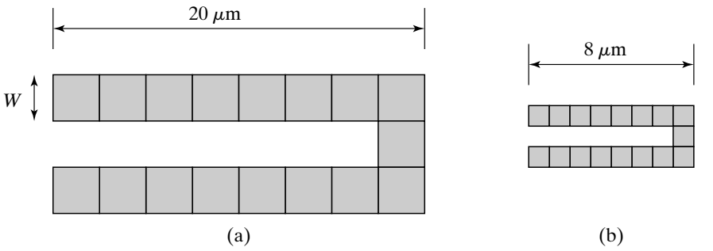

图中电阻的直线部分共包含 15 个方块，电阻贡献约为

$$
R_{\mathrm{straight}}=15\times46.3\approx694\ \Omega.
$$

拐角处的电流可以沿内侧较短的路径流过，因此一个转弯方块的电阻小于一个直线方块。对图中的直角形状，用每个拐角约 $0.56$ 方估算，两个拐角使有效方块数变为

$$
N_{\square,\mathrm{eff}}\approx15+2\times0.56=16.12,
$$

$$
R\approx46.3\times16.12\approx746\ \Omega.
$$

两个图形的横向尺寸虽然不同，长度与宽度的比例相同，厚度也相同，因而具有相同的方块数和近似阻值。当电流为 $1\ \mathrm{mA}$ 时，这个电阻的加热功率为

$$
P=I^2R=(10^{-3})^2\times746\approx0.746\ \mathrm{mW}.
$$

功率表示单位时间产生的热量；电流保持 $\Delta t$ 时间，产生的热量为 $P\Delta t$。

## 晶面与晶向

### 方向和平面的记号

单晶硅中的原子周期排列。描述梁在晶体中的朝向，可以从晶胞的三个坐标轴出发，把沿各轴的方向分量化成最小整数比，写成晶向 $[uvw]$。例如 $[100]$ 沿 $x$ 轴，$[110]$ 沿 $x,y$ 分量相等的面对角线，$[111]$ 沿体对角线。

晶面的米勒指数采用截距的倒数。以晶胞边长为单位，若一个平面在三个轴上的截距为 $1,1,\infty$，取倒数后得到 $1,1,0$，这就是 $(110)$ 面。无穷截距表示平面与该轴平行，负截距则写成带上划线的负指数。

| 记号 | 表示的对象 | 示例 |
| --- | --- | --- |
| $[uvw]$ | 一个具体晶向 | $[100]$、$[110]$ |
| $\langle uvw\rangle$ | 一族对称等价晶向 | $\langle100\rangle$ 包括沿三个晶轴的正、反方向 |
| $(hkl)$ | 一个具体晶面取向 | $(100)$、$(111)$ |
| $\{hkl\}$ | 一族对称等价晶面 | $\{100\}$ 包括与立方体各面平行的晶面 |

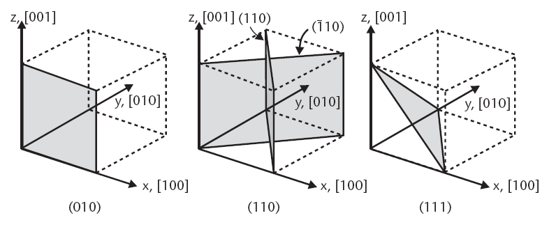

在硅这样的立方晶体中，$[hkl]$ 垂直于 $(hkl)$ 面。一个方向 $[uvw]$ 位于 $(hkl)$ 面内，意味着方向向量与面法向量垂直，点积为零：

$$
hu+kv+lw=0.
$$

例如，$(001)$ 面的法向沿 $z$ 轴，面内方向满足 $w=0$，因此 $[100]$、$[010]$ 和 $[110]$ 都位于这个面内。$(110)$ 面内的方向满足 $u+v=0$，例如 $[001]$ 和 $[1\bar10]$。

晶圆表面取向只给出了表面平行于哪个晶面；同一表面内仍有多个晶向。沿不同晶向加工出的硅梁，其原子排列相对于受力方向不同，弹性响应也会不同。

## 应力与应变

### 从外力到截面内力

一根杆的一端固定在墙上，另一端受到向右的拉力 $F$，杆仍然静止。静力平衡要求合力为零，因此墙对杆施加大小为 $F$、方向向左的支撑力。对一般静止结构，平衡条件还包括合力矩为零：

$$
\sum\mathbf F=0,\qquad \sum\mathbf M=0.
$$

这两个条件也适用于从结构中取出的任意一部分。把物体单独画出，并用力和力矩代替周围物体对它的作用，得到的就是自由体图。

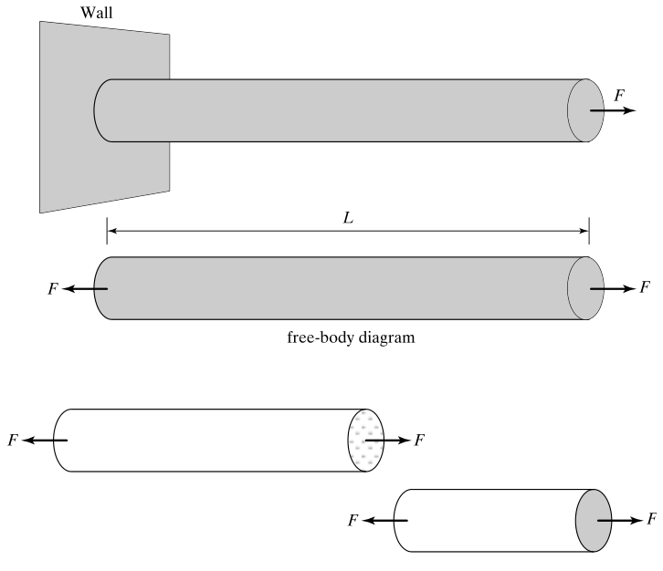

在杆的中间想象切一刀，只看右半段。它的右端受到向右的外力 $F$，切口处就有来自左半段、向左的作用力 $F$，两者平衡。左半段在同一切口受到反向作用力。这一对力原本通过材料内部传递，切开后成为两个自由体上的截面力，称为内力。

外力沿杆轴线时，截面内力中的轴向分量称为轴力。外力横向作用时，截面还会传递横向剪力和弯矩。例如长为 $L$ 的悬臂梁末端受到横向力 $F$，固定端除了提供反向的力，还提供大小为 $FL$ 的力矩。截取从位置 $x$ 到自由端的一段，其截面弯矩大小为 $F(L-x)$；越接近固定端，力臂越长，弯矩越大。

### 正应力描述内力在截面上的分布

截面上的内力分布在整个面积上。用单位面积承受的力描述这种分布，就得到应力。截面上一个很小的面积 $dA$ 承受垂直于截面的力 $dF_n$，正应力为

$$
\sigma=\frac{dF_n}{dA}.
$$

将正应力沿截面积分，便得到轴力：

$$
N=\int_A\sigma\,dA.
$$

均匀直杆承受轴向拉力、且截面应力近似均匀时，这个积分成为 $N=\sigma A$，于是

$$
\sigma=\frac{N}{A}.
$$

应力的单位是 $\mathrm{N/m^2}$，即 Pa；$1\ \mathrm{MPa}=10^6\ \mathrm{Pa}$，$1\ \mathrm{GPa}=10^9\ \mathrm{Pa}$。相同的拉力作用在较细的杆上，截面面积更小，应力就更大。应力把外力和结构尺寸联系起来，使不同粗细的试样能够进行比较。

正应力包括拉应力与压应力。拉力使杆伸长，压缩力使杆缩短；下面把拉应力记为正、压应力记为负。

### 正应变描述相对伸缩

杆的初始长度为 $L_0$，受拉后长度为 $L_0+\Delta L$。直接比较伸长量会受到原始长度影响：材料和截面相同的两根杆，承受相同拉力时，较长的杆会伸长更多。因此用相对长度变化定义工程正应变：

$$
\varepsilon=\frac{\Delta L}{L_0}.
$$

应变无量纲。$\varepsilon=10^{-3}$ 表示长度增加了原长的 $0.1\%$；压缩时 $\Delta L<0$，应变也为负。杆上的变形不均匀时，可以对很短的一段定义局部应变。若轴向位移为 $u(x)$，长度为 $dx$ 的一段伸长约为 $u(x+dx)-u(x)$，则

$$
\varepsilon_x=\lim_{dx\to0}\frac{u(x+dx)-u(x)}{dx}
=\frac{du}{dx}.
$$

应力描述截面如何传力，应变描述材料如何变形；连接二者的是材料的力学关系。

### 胡克定律、杨氏模量与杆的刚度

缓慢拉伸试样并记录应力和应变，在小变形的线弹性范围内，可以观察到近似的正比关系：

$$
\sigma=E\varepsilon.
$$

$E$ 称为杨氏模量，等于应力—应变直线的斜率，单位为 Pa。在相同应力下，$E$ 越大，应变越小。把应力和应变的定义代入，有

$$
\frac{F}{A}=E\frac{\Delta L}{L_0},
$$

$$
\Delta L=\frac{FL_0}{EA},\qquad
F=\frac{EA}{L_0}\Delta L.
$$

均匀受拉直杆因而可以看成弹簧，其轴向弹簧常数为

$$
k_{\mathrm{axial}}=\frac{EA}{L_0}.
$$

杨氏模量 $E$ 表示材料的弹性性质，弹簧常数 $k$ 表示整个结构的力—位移关系。同一种材料做成更长的杆，$E$ 不变，$k$ 却减小；截面积增大，$k$ 随之增大。

### 泊松比与横向收缩

沿 $x$ 方向拉伸一根杆时，杆通常还会沿横向变细。把轴向应变记为 $\varepsilon_x$、宽度方向应变记为 $\varepsilon_y$，泊松比定义为

$$
\nu=-\frac{\varepsilon_y}{\varepsilon_x}.
$$

对于普通的正泊松比材料，轴向拉伸时 $\varepsilon_x>0$、横向收缩时 $\varepsilon_y<0$，前面的负号使 $\nu$ 为正。横向收缩量取决于相对尺寸变化，而非直接比较宽度缩短多少和长度增加多少。

弹性性质不随方向改变的材料称为各向同性材料。对这种材料，单轴拉伸产生

$$
\varepsilon_x=\frac{\sigma_x}{E},\qquad
\varepsilon_y=\varepsilon_z=-\nu\frac{\sigma_x}{E}.
$$

例如 $\nu=0.3$、轴向应变为 $10^{-3}$ 时，横向应变为 $-3\times10^{-4}$。若原宽度为 $100\ \mathrm{\mu m}$，宽度变化就是 $-0.03\ \mathrm{\mu m}$。

### 硅棒受拉算例

一根硅棒长 $L_0=1\ \mathrm{mm}$、直径 $d=100\ \mathrm{\mu m}$，两端受到大小均为 $10\ \mathrm{mN}$、方向相反的拉力。取其中任一段作自由体，截面传递的轴力为 $10\ \mathrm{mN}$。截面积为

$$
A=\frac{\pi d^2}{4}
=\frac{\pi(100\times10^{-6})^2}{4}
\approx7.854\times10^{-9}\ \mathrm{m^2}.
$$

应力为

$$
\sigma=\frac{10\times10^{-3}}{7.854\times10^{-9}}
\approx1.273\times10^6\ \mathrm{Pa}=1.273\ \mathrm{MPa}.
$$

取沿杆轴向的杨氏模量 $E=130\ \mathrm{GPa}$，应变和伸长量分别为

$$
\varepsilon=\frac{\sigma}{E}
=\frac{1.273\times10^6}{130\times10^9}
\approx9.79\times10^{-6},
$$

$$
\Delta L=\varepsilon L_0
=9.79\times10^{-6}\times10^{-3}
\approx9.79\ \mathrm{nm}.
$$

这根棒的轴向弹簧常数约为 $1.02\times10^6\ \mathrm{N/m}$。微小拉力只产生纳米量级的伸长；把硅加工成细长的弯曲梁，可以获得更大的位移。

### 剪应力、剪应变与剪切模量

正应力垂直于截面，剪应力则平行于截面。把一个长方体底面固定，沿顶面施加横向力，顶面相对底面滑移，原本的直角发生变化，这种变形称为剪切。

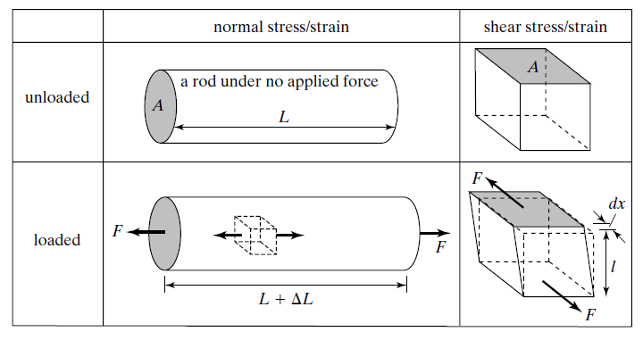

设顶面面积为 $A$、受到切向力 $F_t$，均匀剪应力为

$$
\tau=\frac{F_t}{A}.
$$

长方体高度为 $H$，顶面横移 $\Delta x$，原来竖直的侧边转过角度 $\theta$，几何关系给出 $\tan\theta=\Delta x/H$。小角度下，工程剪应变为

$$
\gamma\approx\theta\approx\frac{\Delta x}{H}.
$$

剪应变描述角度的改变，角度以 rad 表示。线弹性范围内，剪应力与工程剪应变成正比：

$$
\tau=G\gamma.
$$

$G$ 为剪切模量，单位同样是 Pa。对各向同性线弹性材料，三个弹性参数之间有

$$
G=\frac{E}{2(1+\nu)}.
$$

例如 $E=150\ \mathrm{GPa}$、$\nu=0.3$，则 $G\approx57.7\ \mathrm{GPa}$。

### 应力—应变曲线与材料失效

不断增加拉力，并将测得的力和伸长量换算成应力与应变，可以画出应力—应变曲线。曲线最初的近似直线段对应胡克定律，其斜率为 $E$。在弹性范围内卸去载荷，材料能够恢复原来的形状；进入塑性变形后，即使卸载，仍会留下永久变形。

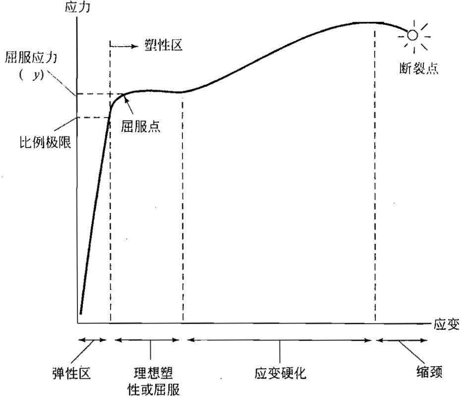

图中的比例极限表示应力与应变保持正比的范围终点。越过比例极限，曲线开始偏离直线；弹性变形还可以包含非线性部分，所以“可恢复”和“保持正比”描述的是两个性质。屈服则表示明显塑性变形的开始：材料的应变继续增加，而应力可能只小幅变化。

延性材料经过屈服后，还可能发生应变强化，继续变形所需的应力增加。接近断裂时，试样可能在局部变细，形成缩颈，最后断开。工程应力使用初始截面积计算；缩颈使局部截面积显著减小，因此曲线末端工程应力下降，并不表示局部截面承受的力密度也按同样方式下降。

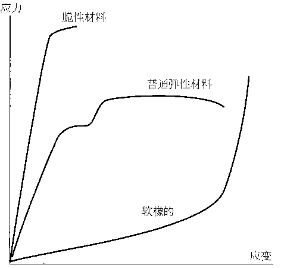

硅、多晶硅和许多氮化硅薄膜属于脆性材料，断裂前常没有明显的塑性变形。它们可以具有较大的杨氏模量，却在较小应变下断裂。杨氏模量描述弹性阶段的斜率，断裂应力描述断开时承受的应力，断裂应变描述断开前的相对变形；较大的模量并不直接意味着较高的断裂强度或较大的可变形范围。橡胶的曲线则显示出明显的非线性，不能用一条斜率固定的直线覆盖整个变形过程。

反复加载还会产生疲劳：峰值应力低于一次加载的断裂应力，结构也可能经过多次循环后失效。薄膜和微结构的表面缺陷、刻蚀形成的缺口附近，局部应力可能高于截面平均值，这称为应力集中，裂纹可能从这些位置开始扩展。一次拉伸试验的断裂应力与循环加载下的寿命，因而反映不同的失效过程。

### 三维应力与应变的分量

杆的单轴拉伸只用一个正应力就能描述，空间结构却可能从不同方向同时受力。在材料内部取一个小立方体，每个面上的作用力都可以分解为一个垂直于面的分量和两个平行于面的分量。

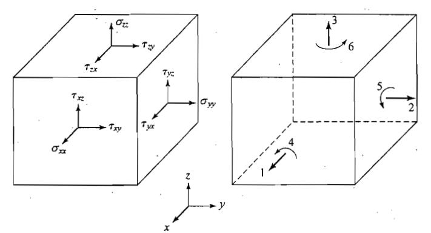

例如法向沿 $x$ 方向的面上，$\sigma_{xx}$ 为正应力，$\tau_{xy}$ 和 $\tau_{xz}$ 为沿 $y,z$ 方向的剪应力。其他两个方向的面也有各自的三个分量。这组分量描述同一点在不同截面上的传力状态，组成应力张量。

微元的转动平衡使相互配对的剪应力相等，即 $\tau_{xy}=\tau_{yx}$、$\tau_{xz}=\tau_{zx}$、$\tau_{yz}=\tau_{zy}$。所以一共只有六个独立应力分量：三个正应力和三个剪应力。

相应的变形也有六个独立分量。$\varepsilon_{xx},\varepsilon_{yy},\varepsilon_{zz}$ 分别描述沿三个轴的相对伸缩；$\gamma_{yz},\gamma_{xz},\gamma_{xy}$ 描述原本相互垂直的方向之间的夹角变化。将它们排成列向量，记为

$$
\mathbf t=
\begin{bmatrix}
\sigma_{xx}&\sigma_{yy}&\sigma_{zz}&\tau_{yz}&\tau_{xz}&\tau_{xy}
\end{bmatrix}^{\mathsf T},
$$

$$
\mathbf e=
\begin{bmatrix}
\varepsilon_{xx}&\varepsilon_{yy}&\varepsilon_{zz}&
\gamma_{yz}&\gamma_{xz}&\gamma_{xy}
\end{bmatrix}^{\mathsf T}.
$$

这里的 $\gamma_{ij}$ 是前面按角度变化定义的工程剪应变。若把应变写成对称的三维张量，非对角分量为 $\varepsilon_{ij}=\gamma_{ij}/2$；六分量列向量中使用的是 $\gamma_{ij}$。

### 从泊松效应到刚度矩阵

轴向应力不仅产生轴向应变，还通过泊松效应产生横向应变。因此，三维线弹性关系中，一个应变分量可以同时受到多个应力分量影响。

以各向同性材料为例，沿 $x$ 方向施加应力时，$x$ 向应变为 $\sigma_{xx}/E$；沿 $y$ 或 $z$ 方向施加拉应力时，又分别使 $x$ 方向收缩。在线性范围内叠加这三个贡献，得到

$$
\varepsilon_{xx}
=\frac{\sigma_{xx}-\nu\sigma_{yy}-\nu\sigma_{zz}}{E}.
$$

其他方向也有同样的关系。将六组线性关系统一写出，就是

$$
\mathbf e=\mathbf S\mathbf t,\qquad
\mathbf t=\mathbf C\mathbf e,\qquad
\mathbf S=\mathbf C^{-1}.
$$

$\mathbf C$ 称为刚度矩阵，单位为 Pa，表示给定各个应变分量后会产生哪些应力；$\mathbf S$ 称为柔度矩阵，单位为 $\mathrm{Pa^{-1}}$，表示给定应力后会产生哪些应变。矩阵中的非对角元素描述不同方向之间的耦合，泊松效应就是其中一种。

### 用硅的刚度矩阵求杨氏模量

硅具有立方对称性。当坐标轴沿 $[100]$、$[010]$、$[001]$ 时，刚度矩阵只含三个独立常数 $C_{11},C_{12},C_{44}$。采用取整数值，有

$$
\mathbf C=10^{11}
\begin{bmatrix}
1.66&0.64&0.64&0&0&0\\
0.64&1.66&0.64&0&0&0\\
0.64&0.64&1.66&0&0&0\\
0&0&0&0.80&0&0\\
0&0&0&0&0.80&0\\
0&0&0&0&0&0.80
\end{bmatrix}\ \mathrm{Pa}.
$$

沿 $x$ 方向拉伸硅棒，横向表面自由，横向没有外加应力，即 $\sigma_{yy}=\sigma_{zz}=0$。将矩阵前三行展开：

$$
\begin{aligned}
\sigma_{xx}&=C_{11}\varepsilon_{xx}
+C_{12}\varepsilon_{yy}+C_{12}\varepsilon_{zz},\\
0&=C_{12}\varepsilon_{xx}
+C_{11}\varepsilon_{yy}+C_{12}\varepsilon_{zz},\\
0&=C_{12}\varepsilon_{xx}
+C_{12}\varepsilon_{yy}+C_{11}\varepsilon_{zz}.
\end{aligned}
$$

后两式相减，得到 $\varepsilon_{yy}=\varepsilon_{zz}$；再代入其中一式，可得

$$
\varepsilon_{yy}=\varepsilon_{zz}
=-\frac{C_{12}}{C_{11}+C_{12}}\varepsilon_{xx}.
$$

横向自由收缩后，轴向应力与轴向应变的关系为

$$
\sigma_{xx}
=\left(C_{11}-\frac{2C_{12}^2}{C_{11}+C_{12}}\right)
\varepsilon_{xx}.
$$

括号中的系数就是 $[100]$ 方向的杨氏模量：

$$
E_{[100]}
=166-\frac{2\times64^2}{166+64}
\approx130.4\ \mathrm{GPa}.
$$

若横向伸缩完全被阻止，则 $\varepsilon_{yy}=\varepsilon_{zz}=0$，第一行变成 $\sigma_{xx}=C_{11}\varepsilon_{xx}$，此时轴向比例系数为 $166\ \mathrm{GPa}$。自由收缩与横向约束产生不同的横向应力，因而有不同的轴向响应。

### 晶向对弹性响应的影响

硅的刚度矩阵随坐标轴相对于晶体的朝向改变。沿不同方向拉伸，常见杨氏模量约为

$$
E_{\langle100\rangle}\approx130\ \mathrm{GPa},\qquad
E_{\langle110\rangle}\approx169\ \mathrm{GPa},\qquad
E_{\langle111\rangle}\approx188\ \mathrm{GPa}.
$$

在 $(001)$ 晶圆上，沿 $[100]$ 和 $[110]$ 加工两根尺寸相同的梁，后者沿长度方向的杨氏模量更大。在相同轴向拉力下，$\Delta L=FL/(EA)$，沿 $[110]$ 的梁伸长量约为沿 $[100]$ 的 $130/169\approx0.77$ 倍。[^silicon]

单晶硅的剪切响应同样具有方向性，前面各向同性材料的 $G=E/[2(1+\nu)]$ 不能直接描述任意硅晶向的组合。多晶硅包含许多晶粒，薄膜的有效模量受到晶粒取向和制造过程影响，常见测量范围约为 $120\sim175\ \mathrm{GPa}$，初步估算常取 $160\ \mathrm{GPa}$。

## 挠性梁的弯曲

### 支撑方式与运动自由度

梁可以通过弯曲产生位移，同时传递恢复力。相对于直接拉伸硅棒，细长梁的横向弯曲通常更容易，因此常被加工成 MEMS 弹簧。

平面弯曲中，一个截面可以发生横向平移和转动。自由度表示可独立变化的运动量，支撑则限制其中一部分。用 $y(x)$ 表示梁的横向位移，小转角下 $y'(x)$ 表示截面转角。

| 端部形式 | 允许的运动 | 弯曲模型中的关系 |
| --- | --- | --- |
| 固支端 | 横向平移和转动都被阻止 | $y=0,\ y'=0$ |
| 导向端 | 可以横向平移，转动被阻止 | $y'=0$，$y$ 可随外力改变 |
| 简支端 | 横向位移被阻止，可以转动 | $y=0$；无外加端力矩时 $M=0$ |
| 自由端 | 可以平移和转动 | 无端力矩时 $M=0$；受横向端力 $F$ 时，端部剪力大小为 $F$ |

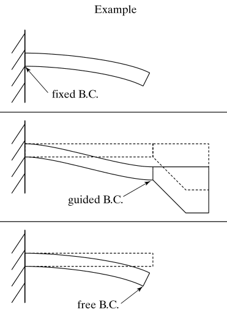

单端固支、另一端自由的梁称为悬臂梁。图中保持平行移动的运动端属于导向端，它能传递弯矩，从而阻止端部转动。与之相比，悬臂梁的自由端会随弯曲而倾斜。

### 弯曲使截面两侧产生不同的纵向应变

先考虑只受弯矩的一小段均质梁，这种状态称为纯弯曲。采用 Euler–Bernoulli 梁模型：梁细长，弯曲后横截面仍保持平面，并垂直于弯曲后的轴线。在这个模型中，截面的转动来自纵向纤维伸长和缩短，忽略横向剪切造成的额外转角。

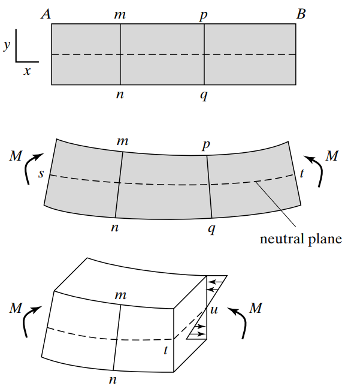

弯曲后，外侧纤维变长，内侧纤维变短；两者之间存在一层长度不变的纤维，组成中性面。中性面与横截面的交线称为中性轴。

取中性面上一小段，弯曲后的半径为 $R$、圆心角为 $d\theta$，其长度为 $R\,d\theta$。在朝向曲率中心的一侧，距中性轴为 $z$ 的纤维长度为 $(R-z)d\theta$，于是纵向应变为

$$
\varepsilon_x(z)
=\frac{(R-z)d\theta-Rd\theta}{Rd\theta}
=-\frac{z}{R}=-\kappa z,
$$

其中 $\kappa=1/R$ 是曲率。$z>0$ 的内侧受压，$z<0$ 的外侧受拉；距离中性轴越远，应变的绝对值越大。

在线弹性范围内代入胡克定律，得到

$$
\sigma_x(z)=E\varepsilon_x(z)=-E\kappa z.
$$

同一截面上的正应力沿厚度呈线性分布，在中性轴处为零，在外表面达到最大拉、压应力。

### 从截面应力积分得到弯矩

纯弯曲时，截面没有轴向合力，因此

$$
\int_A\sigma_x\,dA=-E\kappa\int_A z\,dA=0.
$$

均质梁的 $E$ 为常数，故 $\int_Az\,dA=0$，中性轴通过截面形心。对于上下对称的矩形截面，中性轴就在厚度中间。

截面微小面积 $dA$ 上的轴向力为 $\sigma_xdA$，它相对于中性轴产生力矩。取与曲率相配的正弯矩为 $M=-\int_Az\sigma_x\,dA$，代入应力分布：

$$
M=E\kappa\int_Az^2\,dA.
$$

将只与截面形状有关的积分记为截面二次矩，亦称面积惯性矩：

$$
I=\int_Az^2\,dA,\qquad M=EI\kappa.
$$

$I$ 的单位为 $\mathrm{m^4}$。积分中的 $z^2$ 表明，相同面积放在离中性轴更远的位置，对抵抗弯曲的贡献更大。$EI$ 称为抗弯刚度，表示产生单位曲率所需的弯矩，单位为 $\mathrm{N\cdot m^2}$。

消去曲率，还能得到弯曲正应力：

$$
\sigma_x(z)=-\frac{Mz}{I},\qquad
|\sigma_{\max}|=\frac{|M|c}{I},
$$

其中 $c$ 是中性轴到最外侧表面的距离。均质对称截面两侧的最大拉、压应力大小相等。纯弯曲区的弯矩恒定，最大应力也沿梁长保持不变；端部横向受力的悬臂梁则在根部具有最大的弯矩和应力。

### 矩形截面与弯曲方向

矩形梁的完整截面宽度为 $b$、厚度为 $h$。沿厚度方向弯曲时，截面小条面积为 $dA=b\,dz$，所以

$$
I=\int_{-h/2}^{h/2}z^2b\,dz
=b\left[\frac{z^3}{3}\right]_{-h/2}^{h/2}
=\frac{bh^3}{12}.
$$

沿宽度方向弯曲时，交换宽度与厚度的位置，得到 $I=hb^3/12$。一个宽而薄的梁，沿厚度方向容易弯曲；转为面内弯曲时，刚度增大为原来的 $(b/h)^2$ 倍。半径为 $r$ 的圆截面绕任一直径弯曲时，有 $I=\pi r^4/4$。

例如两根梁的截面分别为 $100\ \mathrm{\mu m}\times5\ \mathrm{\mu m}$ 和 $50\ \mathrm{\mu m}\times8\ \mathrm{\mu m}$，均以第二个尺寸为弯曲方向的厚度：

$$
I_1=\frac{100\times5^3}{12}\times10^{-24}
\approx1.042\times10^{-21}\ \mathrm{m^4},
$$

$$
I_2=\frac{50\times8^3}{12}\times10^{-24}
\approx2.133\times10^{-21}\ \mathrm{m^4}.
$$

第二根的截面积由 $500\ \mathrm{\mu m^2}$ 减为 $400\ \mathrm{\mu m^2}$，但厚度增大使截面二次矩提高到约 $2.048$ 倍。相同材料、梁长和支撑方式下，第二根梁更难弯曲。

### 从曲率积分得到悬臂梁挠度

梁的挠度 $y(x)$ 表示不同位置的横向位移。小转角下，截面转角约为 $\theta=y'$，沿梁长的转角变化率就是曲率，故 $\kappa\approx y''$。弯矩—曲率关系变成

$$
EI\frac{d^2y}{dx^2}=M(x).
$$

对长为 $L$、末端受到横向力 $F$ 的悬臂梁，取 $x=0$ 为固定端，前面的截面平衡给出 $M(x)=F(L-x)$。代入后积分两次：

$$
y'(x)=\frac{F}{EI}\left(Lx-\frac{x^2}{2}\right)+C_1,
$$

$$
y(x)=\frac{F}{EI}\left(\frac{Lx^2}{2}-\frac{x^3}{6}\right)
+C_1x+C_2.
$$

固定端既不平移也不转动，$y(0)=y'(0)=0$，所以 $C_1=C_2=0$。梁的形状和端部挠度为

$$
y(x)=\frac{Fx^2(3L-x)}{6EI},\qquad
\delta=y(L)=\frac{FL^3}{3EI}.
$$

用外力除以相应的端部位移，得到悬臂梁的横向弹簧常数：

$$
k_{\mathrm{cantilever}}=\frac{F}{\delta}
=\frac{3EI}{L^3}
=\frac{Ebh^3}{4L^3}.
$$

梁长增加一倍，横向刚度减为原来的 $1/8$；厚度增加一倍，刚度增为原来的 8 倍。与轴向刚度 $EA/L$ 相比，弯曲刚度对梁长和厚度更敏感。

根部弯矩为 $FL$，矩形截面的最外侧距离为 $h/2$，因此

$$
|\sigma_{\max}|=\frac{FL(h/2)}{bh^3/12}
=\frac{6FL}{bh^2}.
$$

在相同端力下，加长梁会增大位移，也会增大根部应力。

### 导向梁与刚性平移板

固支—导向梁的一端固定，另一端平移 $\delta$，但始终保持不转动。梁身没有连续分布的外力、只有端部载荷时，任一截面传递的剪力大小相同。截取长度为 $dx$ 的小段，剪力形成的力矩与两端弯矩之差平衡，所以剪力的大小等于 $|dM/dx|$。

剪力恒定使弯矩随 $x$ 线性变化，因而 $y''$ 是一次函数，挠度 $y$ 是三次函数。

把 $y(0)=0$、$y'(0)=0$、$y(L)=\delta$、$y'(L)=0$ 代入三次多项式，得到

$$
y(x)=\delta\left[3\left(\frac{x}{L}\right)^2
-2\left(\frac{x}{L}\right)^3\right].
$$

求二阶导数，便得到弯矩分布：

$$
M(x)=EIy''(x)
=\frac{6EI\delta}{L^2}\left(1-\frac{2x}{L}\right).
$$

弯矩从一端的 $6EI\delta/L^2$ 线性变化到另一端的 $-6EI\delta/L^2$，相应剪力的大小为 $|dM/dx|=12EI\delta/L^3$。这个剪力就是使运动端平移的外力，故

$$
F=\frac{12EI}{L^3}\delta,\qquad
k_{\mathrm{guided}}=\frac{12EI}{L^3}
=\frac{Ebh^3}{L^3}.
$$

相同尺寸下，导向梁的刚度是端部受力悬臂梁的四倍。运动端传递的弯矩限制了转动，使梁形成两端弯曲方向相反的形状。

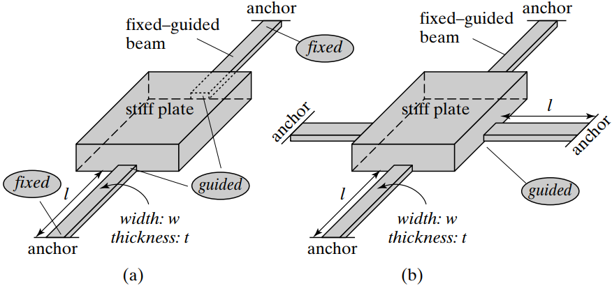

刚性板保持平移时，各支撑梁的端部位移相同，总恢复力为各梁恢复力之和。因此 $n$ 根相同导向梁并联时

$$
k_{\mathrm{total}}=n\frac{12EI}{L^3}.
$$

并联弹簧共享位移，刚度相加；串联弹簧承受相同的力，各段位移相加，从而有

$$
k_{\mathrm{parallel}}=\sum_i k_i,\qquad
\frac{1}{k_{\mathrm{series}}}=\sum_i\frac{1}{k_i}.
$$

折叠梁利用弯折的路径在较小版图面积内布置较长的柔性支撑。分析时可以沿各段传递的力与弯矩逐段计算，再叠加运动端的位移。

## 扭转变形

### 圆杆扭转中的剪应变与剪应力

绕杆轴线施加一对大小相等、方向相反的扭矩，杆的两端就会发生相对转动。这种变形称为扭转。先考虑长为 $L$、半径为 $r_0$、剪切模量为 $G$ 的各向同性圆杆，其两端相对转角为 $\phi$。

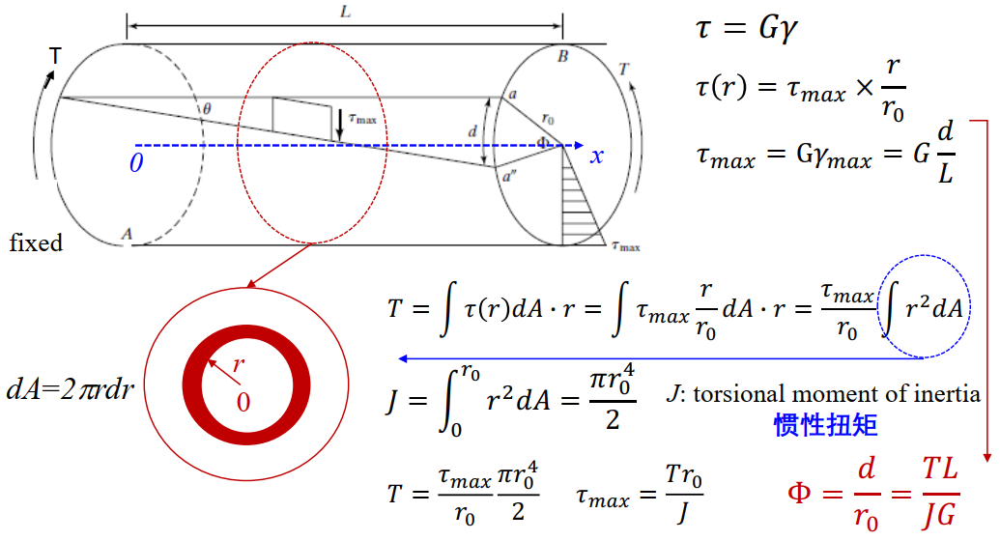

圆杆扭转后，各圆截面相对于相邻截面转动。距轴线 $r$ 的一条纵向纤维，其两端的周向相对位移约为 $r\phi$。用这一位移除以杆长，得到工程剪应变：

$$
\gamma(r)=\frac{r\phi}{L}.
$$

代入剪切的线弹性关系，得到

$$
\tau(r)=G\gamma(r)=\frac{Gr\phi}{L}.
$$

中心轴上的剪应力为零，沿半径线性增大，在外表面达到最大值。截面微元承受切向力 $\tau(r)dA$，其力臂为 $r$，所以内扭矩为

$$
\mathcal T=\int_A\tau(r)r\,dA
=\frac{G\phi}{L}\int_A r^2\,dA.
$$

对圆截面，定义极二次矩 $J=\int_A r^2dA$。取半径为 $r$、厚度为 $dr$ 的圆环，面积为 $2\pi r\,dr$，有

$$
J=\int_0^{r_0}r^2(2\pi r\,dr)
=\frac{\pi r_0^4}{2}.
$$

因此扭矩、转角和最大剪应力分别满足

$$
\mathcal T=\frac{GJ}{L}\phi,\qquad
\phi=\frac{\mathcal TL}{GJ},\qquad
\tau_{\max}=\frac{\mathcal Tr_0}{J}.
$$

将扭矩除以转角，得到扭转弹簧常数

$$
k_\theta=\frac{\mathcal T}{\phi}=\frac{GJ}{L},
$$

单位为 $\mathrm{N\cdot m/rad}$。圆杆半径增加一倍，$J$ 增大 16 倍；相同扭矩下，转角减为原来的 $1/16$。

### 矩形截面与双扭转梁

矩形截面扭转时，截面会发生翘曲，即原来同一平面上的点产生不同的轴向位移。其剪应力分布不再是圆杆中简单的径向线性分布。仍可用 $\mathcal T=GJ\phi/L$ 表示均匀扭转，但这里的 $J$ 是描述矩形截面扭转响应的扭转常数。

对于完整宽度为 $b$、完整厚度为 $h$，且 $b\ge h$ 的矩形截面，常用近似式为

$$
J\approx\frac{bh^3}{3}
\left[1-0.63\frac{h}{b}
+0.0525\left(\frac{h}{b}\right)^5\right].
$$

当 $b\gg h$ 时，括号内接近 1，有 $J\approx bh^3/3$。薄矩形梁的厚度同样以三次方影响扭转刚度。圆杆中的 $J$ 来自极二次矩积分，矩形梁的 $J$ 则还包含截面翘曲对扭转的影响。

若一块刚性摆片由两根相同、同轴的扭转梁支撑，每根梁长为 $l$，摆片转过 $\phi$ 时，两根梁都产生恢复扭矩。总扭矩为

$$
\mathcal T=2\frac{GJ}{l}\phi,\qquad
k_{\theta,\mathrm{total}}=\frac{2GJ}{l}.
$$

外力 $F$ 作用在距转轴 $a$ 的位置，小转角下的力矩为 $Fa$，端点横向位移为 $\delta\approx a\phi$。于是

$$
\phi\approx\frac{Fal}{2GJ},\qquad
\delta\approx\frac{Fa^2l}{2GJ},\qquad
k_{\mathrm{linear}}=\frac{F}{\delta}
\approx\frac{2GJ}{a^2l}.
$$

力臂增长一倍，施加同样的力会产生两倍扭矩，转角也增大一倍；转角再通过两倍长的力臂转换成位移，因此端点位移总共增大四倍。

## 薄膜本征应力与结构释放

### 没有外加载荷时也会存在应力

薄膜在沉积和生长过程中形成的缺陷、组织变化和致密化，会使薄膜倾向于收缩或伸长。薄膜黏附在衬底上时，这种面内尺寸变化受到阻止，即使没有施加外力，薄膜内部也可能保留应力。这类与材料形成过程有关的应力称为本征应力。不同材料冷却时热膨胀量不一致，还会形成热应力；这些制造后保留的应力统称为残余应力。

若薄膜想收缩却被衬底拉住，薄膜处于拉应力状态；若薄膜想伸长却受到衬底压制，则处于压应力状态。去除下面的牺牲层、使结构能够运动的过程称为释放。释放改变了约束，薄膜便会通过伸缩、弯曲或屈曲改变原来的应力状态。

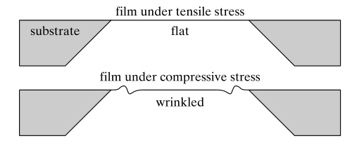

单端固定的均匀薄膜梁，可以通过自由端的轴向位移释放平均拉、压应力。两端都被锚定时，端点间距受到限制，平均轴向应力可以继续存在。压缩力足够大时，原来的直梁状态失稳，梁会弯向一侧，这称为屈曲；拉力则对横向位移提供额外恢复作用。

### 平均应力与厚度方向的应力梯度

薄膜上下位置的生长环境和材料状态可能不同，应力随厚度变化，就形成应力梯度。对宽度相同、上下对称的单层梁，把轴向初始应力写为 $\sigma_0(z)$，它的截面合力和相对于参考轴的力矩为

$$
N_0=\int_A\sigma_0(z)\,dA,\qquad
M_0=\int_A\sigma_0(z)z\,dA.
$$

均匀应力 $\sigma_0$ 在中性轴两侧的力矩贡献相互抵消，$M_0=0$，只留下轴力 $N_0=\sigma_0A$。若应力沿厚度线性变化，写成

$$
\sigma_0(z)=\bar\sigma+gz,
$$

其中 $\bar\sigma$ 是平均应力，$g$ 是应力梯度，单位为 Pa/m，则对形心轴有

$$
N_0=\bar\sigma A,\qquad M_0=gI.
$$

平均应力控制整体的伸缩倾向，应力梯度形成弯曲倾向。自由悬臂释放后，即使平均应力通过伸缩减小，厚度方向的应力差仍可能使梁翘曲。

### 多层梁的中性轴

不同材料叠在一起并完全黏结后，各层会共同弯曲。较大模量的材料在相同应变下承受更大应力，因此多层梁的中性轴通常不在几何厚度的中间。

设第 $i$ 层的杨氏模量、截面积和形心坐标分别为 $E_i,A_i,z_i$，中性轴位于 $\bar z$。纯弯曲应变为 $-\kappa(z-\bar z)$，其截面轴力为

$$
N=-\kappa\sum_i E_i\int_{A_i}(z-\bar z)\,dA
=-\kappa\sum_i E_iA_i(z_i-\bar z).
$$

令 $N=0$，解得弹性中性轴位置

$$
\bar z=\frac{\sum_iE_iA_iz_i}{\sum_iE_iA_i}.
$$

相对于这一轴的抗弯刚度为

$$
D=\sum_iE_i\int_{A_i}(z-\bar z)^2\,dA
=\sum_iE_i\left[I_i+A_i(z_i-\bar z)^2\right].
$$

$I_i$ 是每层相对于自身形心轴的截面二次矩。第二项来自该层形心与整体中性轴之间的距离；即使某层很薄，只要离整体中性轴较远，也可以贡献较大的抗弯刚度。

### 释放后的曲率与应力补偿

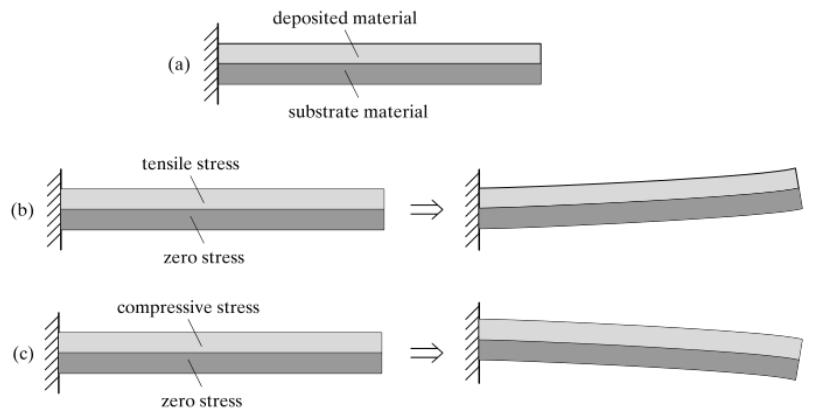

图中上层处于拉应力时，它倾向于缩短，释放后位于弯曲的内侧；上层处于压应力时，它倾向于伸长，释放后位于弯曲的外侧。两层黏结阻止了各自独立伸缩，于是形成共同的曲率。

对一维多层梁，将初始轴向应力相对于弹性中性轴的合力和力矩写为

$$
N_0=\sum_i\int_{A_i}\sigma_{0,i}(z)\,dA,\qquad
M_0=\sum_i\int_{A_i}\sigma_{0,i}(z)(z-\bar z)\,dA.
$$

释放产生的轴向伸缩和弯曲分别用 $\varepsilon_0$ 与 $\kappa$ 表示，额外应变为

$$
\varepsilon_{\mathrm{relax}}(z)
=\varepsilon_0-\kappa(z-\bar z).
$$

第 $i$ 层应力随之改变 $E_i\varepsilon_{\mathrm{relax}}$。没有外加轴力和弯矩时，最终截面合力与力矩均为零：

$$
N_0+\varepsilon_0\sum_iE_iA_i=0,\qquad
M_0-D\kappa=0.
$$

因而

$$
\varepsilon_0=-\frac{N_0}{\sum_iE_iA_i},\qquad
\kappa=\frac{M_0}{D}.
$$

这两个式子分别描述平均伸缩和弯曲。减小各层本征应力，可以减小释放变形；改变上下层的材料、厚度和应力，也可以使各层对 $M_0$ 的贡献抵消，从而减小翘曲。若只是弯矩抵消而 $N_0$ 仍较大，双端锚定的结构仍会保留明显轴向载荷。

### 用晶圆曲率测量平均薄膜应力

薄膜附着在较厚晶圆上时，薄膜的面内应力会使整片晶圆轻微弯曲。测量沉积前后的曲率变化，就能反推出平均薄膜应力。

当薄膜远薄于衬底、弯曲主要由衬底承担，且薄膜在两个面内方向的应力近似相同时，Stoney 公式为

$$
\sigma_f\approx
\frac{E_st_s^2}{6(1-\nu_s)t_f}\Delta\kappa,
\qquad
\Delta\kappa=\frac{1}{R_{\mathrm{after}}}
-\frac{1}{R_{\mathrm{before}}}.
$$

$t_s,t_f$ 分别为衬底和薄膜厚度，$E_s,\nu_s$ 为各向同性衬底近似下的杨氏模量和泊松比，$R$ 是带方向的曲率半径。沉积前晶圆可能已经有初始弯曲，因此这里使用曲率的变化量。

系数 $E_s/(1-\nu_s)$ 是等双轴加载下的面内模量：两个面内方向同时受力，泊松收缩相互耦合，产生的应变不同于单轴受力。对 $(001)$ 单晶硅，面内等双轴模量可用其刚度常数写为

$$
B_{(001)}=C_{11}+C_{12}-\frac{2C_{12}^2}{C_{11}}
\approx181\ \mathrm{GPa}.
$$

它来自 $\varepsilon_{xx}=\varepsilon_{yy}$、表面法向应力 $\sigma_{zz}=0$ 的加载状态；用刚度矩阵消去 $\varepsilon_{zz}$，即可得到 $\sigma_{xx}=B_{(001)}\varepsilon_{xx}$。在 Stoney 公式中，用这一双轴模量代替 $E_s/(1-\nu_s)$。

## 动态系统与机械谐振

### 从受力平衡到运动方程

把质量块拉离平衡位置后松手，弹簧力将它拉回。到达平衡位置时，质量块已有速度，还会继续越过平衡位置；此时弹簧力反向，开始使它减速。恢复力与惯性的交替作用形成振动。

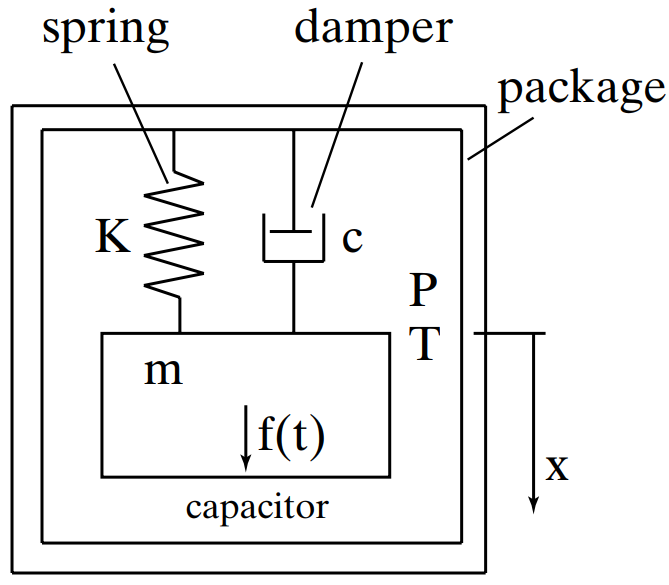

取质量块位移为 $x$，弹簧常数为 $k$，恢复力为 $-kx$。用黏性阻尼近似运动损耗，阻尼力为 $-c\dot x$，方向与速度相反。质量为 $m$ 的物体受到外力 $F(t)$ 时，牛顿第二定律给出

$$
m\ddot x=F(t)-c\dot x-kx,
$$

整理为

$$
m\ddot x+c\dot x+kx=F(t).
$$

$m$ 的单位为 kg，$k$ 为 N/m，$c$ 为 $\mathrm{N\cdot s/m}$。这个模型只用一个独立位移描述运动，称为单自由度系统。

### 固有频率与阻尼比

先去掉阻尼和外力，运动方程变为 $m\ddot x+kx=0$。试取周期运动 $x=X\cos\omega_nt$，有 $\ddot x=-\omega_n^2x$，代入得到

$$
(-m\omega_n^2+k)x=0.
$$

非零振动满足

$$
\omega_n=\sqrt{\frac{k}{m}},\qquad
f_n=\frac{\omega_n}{2\pi}.
$$

$\omega_n$ 是无阻尼固有角频率，单位为 rad/s；$f_n$ 是每秒的振动周期数，单位为 Hz。增大刚度会增强恢复作用、提高频率，增大质量则增加惯性、降低频率。

将带阻尼的运动方程除以 $m$，写为

$$
\ddot x+2\zeta\omega_n\dot x+\omega_n^2x
=\frac{F(t)}{m},
$$

其中

$$
c_{\mathrm{crit}}=2\sqrt{km},\qquad
\zeta=\frac{c}{c_{\mathrm{crit}}}.
$$

$\zeta$ 称为阻尼比，它把阻尼系数与质量、刚度带来的振动时间尺度联系起来。

### 自由响应与三种阻尼状态

撤去外力后，令自由响应具有 $e^{st}$ 的形式，代入方程得到特征方程

$$
s^2+2\zeta\omega_ns+\omega_n^2=0,
$$

根为

$$
s=-\zeta\omega_n\pm\omega_n\sqrt{\zeta^2-1}.
$$

根的形式随阻尼比变化，形成三种典型响应。

| 阻尼状态 | 特征根 | 自由响应 |
| --- | --- | --- |
| 欠阻尼，$0<\zeta<1$ | 一对实部为负的共轭复根 | 围绕平衡位置振动，振幅逐渐衰减 |
| 临界阻尼，$\zeta=1$ | 相同的负实根 | 以 $(C_1+C_2t)e^{-\omega_nt}$ 的形式恢复，没有周期振荡 |
| 过阻尼，$\zeta>1$ | 两个不同的负实根 | 两个衰减指数项叠加，没有周期振荡 |

欠阻尼时，自由响应可以写成

$$
x(t)=X_0e^{-\zeta\omega_nt}
\cos(\omega_dt+\varphi_0),\qquad
\omega_d=\omega_n\sqrt{1-\zeta^2}.
$$

$X_0,\varphi_0$ 取决于释放瞬间的位移和速度。指数项使振幅衰减，余弦项产生振荡。振幅包络衰减到原来的 $1/e$ 所需时间为

$$
\tau_A=\frac{1}{\zeta\omega_n}.
$$

当 $c=0$ 时，$\zeta=0$，理想系统中没有能量损耗，振幅保持不变。

### 正弦外力下的稳态响应

若持续施加 $F(t)=F_0\cos\omega t$，系统开始时还包含自由响应。阻尼使自由响应逐渐衰减后，留下与外力同频率的稳态运动。

设稳态位移为

$$
x(t)=a\cos\omega t+b\sin\omega t.
$$

代入运动方程，分别比较余弦项和正弦项的系数：

$$
\begin{aligned}
(k-m\omega^2)a+c\omega b&=F_0,\\
(k-m\omega^2)b-c\omega a&=0.
\end{aligned}
$$

两式平方后相加，可以消去交叉项，得到

$$
\left[(k-m\omega^2)^2+(c\omega)^2\right](a^2+b^2)=F_0^2.
$$

位移振幅为 $X=\sqrt{a^2+b^2}$，故

$$
X(\omega)=\frac{F_0}
{\sqrt{(k-m\omega^2)^2+(c\omega)^2}}
=\frac{F_0/k}
{\sqrt{(1-r^2)^2+(2\zeta r)^2}},\qquad
r=\frac{\omega}{\omega_n}.
$$

低频时惯性项和阻尼项较小，$X\approx F_0/k$，接近静态受力的位移。频率接近固有频率时，$k-m\omega^2$ 接近零，恢复力和惯性作用部分抵消，振幅增大；阻尼项使峰值保持有限。频率远高于固有频率后，惯性项占主导，振幅近似为 $F_0/(m\omega^2)$。

恒幅外力下的位移峰值对应分母的最小值。对分母平方求导，除去 $\omega=0$ 的解，有

$$
\omega_{\mathrm{peak}}=\omega_n\sqrt{1-2\zeta^2},
\qquad \zeta<\frac{1}{\sqrt2}.
$$

无阻尼固有频率 $\omega_n$、自由衰减振动频率 $\omega_d$ 和受迫位移峰值频率 $\omega_{\mathrm{peak}}$ 描述不同的运动；弱阻尼时，它们的数值很接近。

### 品质因数与每周期损耗

品质因数（Quality Factor，$Q$）描述储存的振动能量相对于每周期损失能量的大小。弱损耗周期振动中，定义

$$
Q=2\pi\frac{E_{\mathrm{stored}}}{\Delta E_{\mathrm{cycle}}}.
$$

质量块到达最大位移 $X$ 时，速度为零，振动能量储存在弹簧中：

$$
E_{\mathrm{stored}}=\frac12kX^2.
$$

阻尼力消耗能量的速率为 $c\dot x^2$。对 $x=X\cos\omega t$，一个周期内的能量损耗为

$$
\Delta E_{\mathrm{cycle}}
=\int_0^{2\pi/\omega}c\omega^2X^2\sin^2\omega t\,dt
=\pi c\omega X^2.
$$

取 $\omega\approx\omega_n$，代入品质因数定义：

$$
Q\approx\frac{k}{c\omega_n}
=\frac{m\omega_n}{c}
=\frac{\sqrt{km}}{c}
=\frac{1}{2\zeta}.
$$

在线性黏性阻尼模型中，通常直接把 $m\omega_n/c$ 记为品质因数参数。$Q$ 越大，每周期损失的能量占比越小，自由振动衰减越慢。在 $\omega=\omega_n$ 处，受迫振动的振幅为

$$
X(\omega_n)=\frac{F_0}{c\omega_n}
=Q\frac{F_0}{k}.
$$

因此高 $Q$ 谐振器可以获得远大于静态位移的振动幅度。

### 谐振带宽与衰减时间

高 $Q$ 时，峰值集中在 $\omega_n$ 附近。令 $\omega=\omega_n+\Delta\omega$，保留小量的一阶项，有

$$
k-m\omega^2\approx-2m\omega_n\Delta\omega,
\qquad c\omega\approx c\omega_n.
$$

在峰值两侧，振幅下降到峰值的 $1/\sqrt2$ 时，分母平方变为峰值处的两倍，即

$$
(2m\omega_n\Delta\omega)^2=(c\omega_n)^2.
$$

两侧频率相对于中心的偏移约为 $\pm c/(2m)$，整个角频率带宽为 $c/m$。换成 Hz 后

$$
\Delta f=f_2-f_1\approx\frac{c}{2\pi m},\qquad
Q\approx\frac{f_n}{\Delta f}.
$$

这称为半功率带宽：振幅平方下降到峰值的一半，振幅本身约为峰值的 $70.7\%$。高 $Q$ 对应较窄的谐振峰。

再将 $Q=1/(2\zeta)$ 代入自由振动的衰减时间，得到

$$
\tau_A=\frac{2Q}{\omega_n}.
$$

较小损耗带来较大的谐振增益，也使振动建立和衰减耗时更长。例如 $f_n=10\ \mathrm{kHz}$、$Q=1000$ 时，半功率带宽约为 $10\ \mathrm{Hz}$，振幅衰减时间约为 $31.8\ \mathrm{ms}$。

MEMS 中的损耗可以来自周围流体的黏性作用、气体分子碰撞和结构内部耗散。压力改变气体与运动结构之间的作用，温度改变材料和流体性质，因此器件在不同环境下会表现出不同的阻尼和品质因数。

## 梁的固有频率与主动调节

### 分布质量与等效质量

质量块由很轻的弹簧支撑时，可以把惯性集中在质量块上。梁自身也参与运动时，不同位置的位移和速度不同，不能直接把全部梁质量都当作具有相同速度的质量块。

用 $y(x,t)=q(t)\psi(x)$ 描述梁的一种振动形状。其中 $\psi(x)$ 描述各位置相对于参考点的位移比例，称为模态形状；$q(t)$ 描述这一形状随时间放大或缩小的幅度。梁的动能为

$$
T=\frac12\rho_m A\int_0^L\left(\frac{\partial y}{\partial t}\right)^2dx
=\frac12\dot q^2\rho_m A\int_0^L\psi^2(x)\,dx,
$$

$\rho_m$ 是质量密度，$A$ 为截面积。梁的单位长度弯曲储能为 $EI\kappa^2/2$，所以总弹性势能为

$$
U=\frac12EI\int_0^L\left(\frac{\partial^2y}{\partial x^2}\right)^2dx
=\frac12q^2EI\int_0^L[\psi''(x)]^2dx.
$$

与单自由度系统的 $T=m_{\mathrm{eff}}\dot q^2/2$、$U=k_{\mathrm{eff}}q^2/2$ 比较，可以读出

$$
m_{\mathrm{eff}}=\rho_m A\int_0^L\psi^2(x)\,dx,\qquad
k_{\mathrm{eff}}=EI\int_0^L[\psi''(x)]^2dx.
$$

于是

$$
\omega^2\approx\frac{k_{\mathrm{eff}}}{m_{\mathrm{eff}}}
=\frac{EI\int_0^L(\psi'')^2dx}
{\rho_m A\int_0^L\psi^2dx}.
$$

改变 $\psi$ 的整体倍数会同时改变等效质量和等效刚度，二者之比保持不变；它们共同描述所选位移坐标上的同一种运动。

### 梁的频率与尺寸

均匀、等截面、没有轴向预载的细梁，其弯曲振动频率可以写为

$$
f_n=\frac{\beta_n^2}{2\pi L^2}
\sqrt{\frac{EI}{\rho_m A}}.
$$

$\beta_n$ 是反映支撑方式和振动阶次的无量纲系数。最低阶的固有频率称为基频。悬臂梁基频的 $\beta_1\approx1.875$，双端固支梁基频的 $\beta_1\approx4.730$，后者的 $\beta_1^2\approx22.4$。

对沿厚度方向弯曲的矩形梁，代入 $I=bh^3/12$、$A=bh$，得到

$$
f_n=\frac{\beta_n^2}{2\pi\sqrt{12}}
\frac{h}{L^2}\sqrt{\frac{E}{\rho_m}}.
$$

厚度增加一倍，频率增大一倍；长度增加一倍，频率减为原来的 $1/4$。宽度同时增加抗弯刚度与分布质量，在这个模型中恰好抵消。

以双端固支 SiC 梁为例，长 $L=1.1\ \mathrm{\mu m}$、宽 $b=120\ \mathrm{nm}$、厚 $h=75\ \mathrm{nm}$，基频 $f_1=1.014\ \mathrm{GHz}$，杨氏模量 $E=700\ \mathrm{GPa}$。用无轴向预载的梁模型反推密度：

$$
f_1=\frac{22.4}{2\pi L^2}
\sqrt{\frac{Eh^2}{12\rho_m}},
$$

$$
\rho_m=
\frac{(22.4)^2Eh^2}{48\pi^2f_1^2L^4}.
$$

换成 SI 单位后代入

$$
\rho_m=
\frac{(22.4)^2(700\times10^9)(75\times10^{-9})^2}
{48\pi^2(1.014\times10^9)^2(1.1\times10^{-6})^4}
\approx2.77\times10^3\ \mathrm{kg/m^3}.
$$

### 轴向预载如何改变横向振动

一根已经绷紧的梁发生横向位移时，轴向拉力会提供额外的恢复作用。设恒定轴向拉力为 $N>0$，小斜率下梁弯曲后的长度增加量为

$$
\Delta L\approx\frac12\int_0^L(y')^2dx.
$$

这个关系来自弧长 $ds=\sqrt{1+(y')^2}\,dx\approx[1+(y')^2/2]dx$。轴向预载对应的附加势能为 $N\Delta L$。代入 $y=q\psi$ 后，得到附加刚度

$$
k_N=N\int_0^L(\psi')^2dx.
$$

将它与弯曲刚度相加，频率变为

$$
\omega^2\approx
\frac{EI\int_0^L(\psi'')^2dx+N\int_0^L(\psi')^2dx}
{\rho_m A\int_0^L\psi^2dx}.
$$

拉力使附加刚度为正，频率升高；压缩轴力记为 $N<0$，会降低横向刚度。压缩不断增加，直梁状态的恢复刚度可以降至零，出现前面讨论的屈曲。

### 通过轴向应变调节频率

对双端固支梁，取满足两端位移和转角均为零的近似振动形状

$$
\psi(x)=\left(\frac{x}{L}\right)^2
\left(1-\frac{x}{L}\right)^2.
$$

直接求导并积分，有

$$
\int_0^L(\psi')^2dx=\frac{2}{105L},\qquad
\int_0^L(\psi'')^2dx=\frac{4}{5L^3},
$$

$$
\frac{\int_0^L(\psi')^2dx}{\int_0^L(\psi'')^2dx}
=\frac{L^2}{42}.
$$

将无预载时的频率记为 $\omega_0$，在这一形状近似下

$$
\frac{\omega^2}{\omega_0^2}
=1+\frac{NL^2}{42EI}.
$$

若均匀轴向弹性应变为 $\varepsilon_s$，则 $N=EA\varepsilon_s$。对矩形截面，$A/I=12/h^2$，于是

$$
\omega\approx\omega_0
\sqrt{1+\frac{2L^2}{7h^2}\varepsilon_s}.
$$

频移较小时，对平方根作一阶展开：

$$
\frac{\Delta\omega}{\omega_0}
\approx\frac{L^2}{7h^2}\varepsilon_s.
$$

细长梁的 $L/h$ 较大，轴向应变可以产生明显频移。改变锚点间距、通过驱动结构施加轴向力，就能主动调节频率；若待测载荷通过支撑转化为梁的轴向应变，也可以测量频移来读出载荷。

温度同样会引起频移。一方面，弹性模量随温度改变，弯曲刚度随之改变；另一方面，梁与支撑材料的热膨胀差会改变轴向载荷。材料和结构的温度补偿，便是利用不同贡献的符号和大小，使总频移减小。

[^silicon]: Hopcroft, M. A.; Nix, W. D.; Kenny, T. W. [What Is the Young's Modulus of Silicon?](https://doi.org/10.1109/JMEMS.2009.2039697). *Journal of Microelectromechanical Systems*, 19(2), 229–238, 2010。另见作者的[硅弹性参数说明](https://silicon.reddogresearch.com/)。
