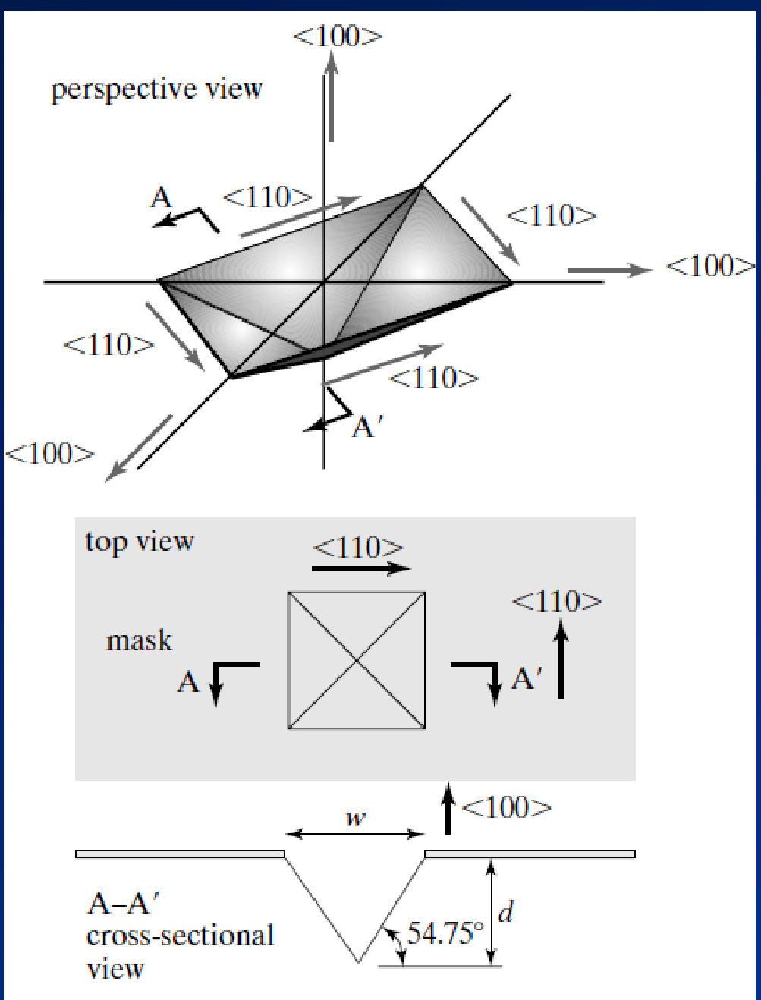
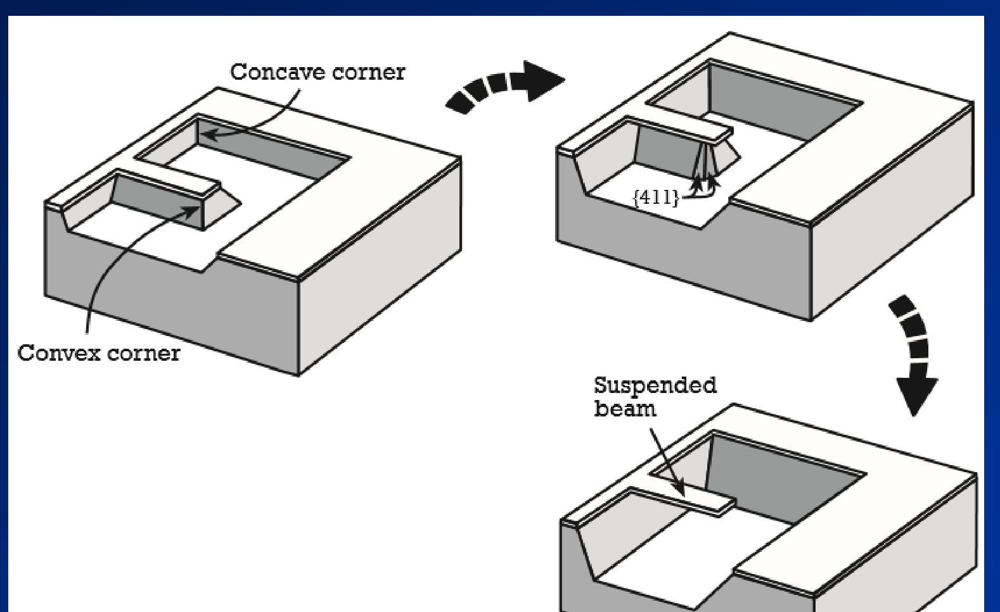
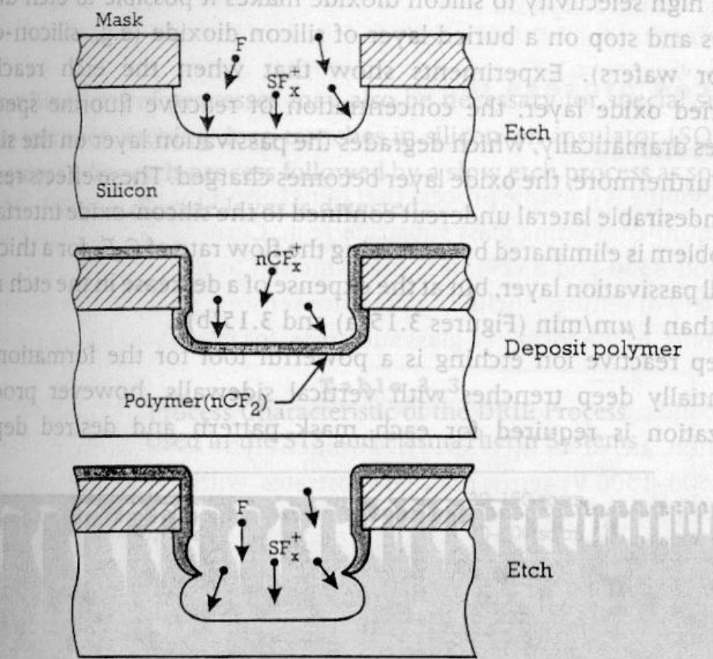
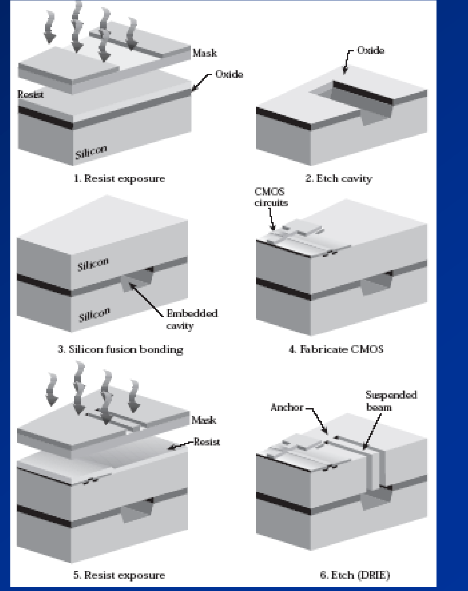

硅片是单晶体，原子按金刚石结构周期排列。不同原子面上的原子密度不同，与刻蚀液反应的速度也不同。体硅微加工（bulk micromachining）利用这一点，用化学溶液或等离子体从硅片内部去除材料，把衬底本身加工成凹槽、孔腔、悬臂梁和薄膜。

与在衬底上堆叠薄膜、再用牺牲层释放结构的表面微加工相比，体硅结构由整块单晶硅构成，没有薄膜的残余应力和晶界，机械性能稳定。加工对象以硅为主，也包括其他晶体材料。

去除材料的方式分湿法与干法两类。湿法把硅片浸入化学溶液，靠溶液与硅的化学反应溶解材料；干法在低压气体中产生等离子体，用活性粒子或离子轰击去除材料。两条路线都能做到各向同性或各向异性，控制形状的机制不同。

## 刻蚀的方向性

各向同性腐蚀在所有方向上速率相同。横向腐蚀速率与垂直速率相当，腐蚀速率也几乎不受掩膜图形的形状和方向影响。刻进去的坑在各个方向等速长大，掩膜边缘下方会被掏空，侧壁呈圆弧状。

各向异性腐蚀的速率与晶面有关。硅在碱性溶液中的溶解速率在 (111) 面上最低，比 (100) 面低一到两个数量级，于是刻蚀会自动停在由 {111} 面围成的形状上。横向速率可以远大于或远小于垂直速率，取决于掩膜边缘与晶轴的夹角，掩膜边的方向和掩膜图形因此决定了最终的腐蚀形状。

带精确斜面的凹槽、尖角和悬空结构都能在单晶硅里直接刻出来，不需要额外的牺牲层和释放步骤。掩膜边偏离 <110> 方向时，侧壁不再是单一的 {111} 面，形状随刻蚀时间持续变化，最终结果与版图上的图形相差很远。

几种常用体硅刻蚀手段的主要参数如下。

| 方法 | 类型 | 方向性 | (100) 硅速率 | 对重掺硅 | 成本 |
|---|---|---|---|---|---|
| EDP | 湿法 | 各向异性 | 0.3–1.25 μm/min | 变慢 | 中 |
| KOH、NaOH | 湿法 | 各向异性 | 0.5–1 μm/min | 变慢 | 低 |
| TMAH | 湿法 | 各向异性 | 0.3–1 μm/min | 变慢 | 低到中 |
| 气相刻蚀 | 干法 | 各向同性 | 1–10 μm/周期 | 不敏感 | 中到高 |
| 等离子体刻蚀 | 干法 | 各向同性或异性 | 0.5–2.5 μm/min | 不敏感 | 中到高 |
| HNA | 湿法 | 各向同性 | 0.5–1 μm/min | 变快 | 低 |

表里“对重掺硅”一列值得先看。EDP、KOH、TMAH 在重掺硼处速率骤降，这个性质被用来做刻蚀停止；HNA 相反，掺杂越重刻得越快。氮化硅在三种碱性溶液中几乎不动，适合当掩膜。

## 各向异性湿法刻蚀

硅的各向异性湿法刻蚀已经有五十年历史，能做出凹槽、凸起结构和悬浮结构，在压力传感器、加速度传感器、神经探针和扫描隧道显微镜探头上都有商用产品。深反应离子刻蚀能加工高深宽比、侧壁垂直的结构，材料选择性也好，在很多场合取代了湿法。湿法保留下来，靠的是它能在单晶硅里直接做出由晶面限定的三维形状，而且成本低。

### 速率差异的来源

各向异性来自不同晶面上硅的溶解速率不同。宏观上可以把它看成两步：硅表面先被氧化，氧化物再被溶液溶解。各晶面的氧化速率不同，整个刻蚀速率就跟着不同。

微观原因在表面原子的悬挂键数目。(111) 面是原子排列最密的面，每个表面原子只朝外伸出一个悬挂键；(100) 面每个原子有两个。悬挂键少的表面与氧化剂结合的机会少，氧化得慢，随后的溶解也慢。这就是 (100) 面比 (111) 面快一到两个数量级的来源。

### 矩形窗口的刻蚀几何

掩膜图形通常按 <110> 方向对齐。在 (100) 硅片上开一个宽为 $w$ 的矩形窗口，刻蚀会形成由四个 {111} 侧面和一个 (100) 底面围成的凹槽。侧面从窗口边缘向内倾斜，刻得越深，底面越小。

侧壁与表面的夹角由两个晶面的法线夹角给出。用密勒指数计算 (111) 面法线与 (100) 面法线的夹角：

$$
\cos\theta=\frac{|1\times1+1\times0+1\times0|}{\sqrt{3}\cdot\sqrt{1}}=\frac{1}{\sqrt{3}},
\qquad
\theta=54.74^\circ.
$$

侧壁与竖直方向的夹角是这个角的余角，为 35.26°。$\tan 54.74^\circ=\sqrt{2}\approx1.414$，所以深度每增加 1 μm，底面每边缩进约 0.71 μm，宽度共减少约 1.41 μm。设垂直深度为 $d$，底面宽度为

$$
w_{\text{bottom}}=w-\frac{2d}{\tan 54.74^\circ}=w-\sqrt{2}\,d .
$$

令底面宽度为零，得到四壁相交时的深度：

$$
d=\frac{w}{2}\tan 54.74^\circ=\frac{w}{\sqrt2}\approx0.707\,w .
$$

正方形窗口的四壁交于一点，长方形窗口的四壁交于一条线。此后由 {111} 面围成的形状不再变化，刻蚀时间继续延长也不会改变它。

### 三种刻蚀图形

只由 {111} 面围成的三维图形称为自限制稳定图形（self-limiting stable profile，SLSP）。{111} 面的溶解速率极低，四壁一旦形成，形状就固定下来，多刻的时间不会明显改变结构，这就是“自限制”的含义。

形成 SLSP 之前的刻蚀图形还在演化，称为过渡图形。只由 {100}、{110} 和 {111} 三种低指数面组成的过渡图形称为稳定过渡图形（stable transitional profile，STP）；含有 {211}、{411} 这类刻蚀很快的高指数面的过渡图形称为不稳定过渡图形（unstable transitional profile，UTP）。

UTP 出现在掩膜边没有沿 <110> 对齐，或者掩膜上有凸角的时候。快刻蚀面迅速把形状改变，图形随时间剧烈变化，很难从版图预测结果。STP 和 SLSP 都只由低指数面组成，形状相对可预测，也有一定的抗过腐蚀能力，其中 SLSP 最可靠。

把刻蚀时间 $T$、片厚 $t$ 和 (100) 面速率 $r$ 放在一起，可以判断最终落到哪一种图形。四壁相交的深度 $0.707w$ 比片厚 $t$ 小，空腔在片内封闭；比片厚大，刻蚀从背面穿出。

| 条件 | 图形 | 深度与底部 |
|---|---|---|
| $T<\min(t,\,0.707w)/r$ | STP | $d=rT$，底面仍是 (100) 面 |
| $0.707w<t$ 且 $T\ge0.707w/r$ | SLSP | 自限制于 $d'=0.707w$，底部闭合于一点或一条线 |
| $0.707w>t$ 且 $T\ge t/r$ | 穿透孔 | 背面开口宽 $w-\sqrt2\,t$ |

第二行的条件 $0.707w<t$ 就是 $w<1.414t$，等价于 $w<2t/\tan54.74^\circ$：窗口较窄时四壁先相遇，空腔在到达背面之前就封闭。第三行的窗口较宽，四壁来不及相遇，刻蚀从背面穿出。

STP 的底面是平整的 (100) 面，深度随刻蚀时间线性增加，可以用来加工指定厚度的硅膜。SLSP 的深度只与窗口宽度有关，与时间无关，所以它对过腐蚀不敏感。穿透孔则用于做流体通道和通孔互连。

### 正方形窗口刻蚀 300 分钟的结果

边长 $w=1\ \mathrm{mm}$ 的方形窗口开在厚 $t=500\ \mathrm{\mu m}$ 的 (100) 硅片上，(100) 面的刻蚀速率 $r=2\ \mathrm{\mu m/min}$，忽略 {111} 面的速率，刻蚀 300 分钟。

先算垂直深度和到底时刻。$d=rT=2\times300=600\ \mathrm{\mu m}$ 已经超过片厚，垂直方向走完 500 μm 需要

$$
T_{\text{through}}=\frac{t}{r}=\frac{500}{2}=250\ \mathrm{min}.
$$

再判断四壁是否在穿通之前相遇。四壁相交发生在深度 $0.707w=707\ \mathrm{\mu m}$ 处，比片厚 500 μm 更深，底面还没缩到一点，刻蚀就从背面穿出了。背面开口的宽度为

$$
w-\sqrt2\,t=1000-1.414\times500\approx293\ \mathrm{\mu m}.
$$

结果是一个梯形通孔：正面开口 1000 μm，背面开口约 293 μm，侧壁为 {111} 面，与表面成 54.74°。300 分钟比穿通时刻多出的 50 分钟没有改变形状，因为穿通之后起限制作用的只有 {111} 面。

把时间换成 200 分钟，情况就不同。此时 $d=400\ \mathrm{\mu m}<500\ \mathrm{\mu m}$，底面仍然存在，宽度为 $1000-\sqrt2\times400\approx434\ \mathrm{\mu m}$，属于 STP。刻蚀深度与时间成正比，底面随深度收窄。

### 横向钻蚀

忽略 {111} 面的速率是理想化处理。实际上 {111} 面也在缓慢溶解，掩膜边缘会被逐渐掏空。设 {111} 面的法向速率为 $r_{111}$，经过时间 $T$ 该面沿法线移动 $r_{111}T$。这个位移投影到水平方向要除以 $\sin54.74^\circ$：

$$
u=\frac{r_{111}T}{\sin 54.74^\circ}\approx1.225\,r_{111}T .
$$

KOH 中 (111) 面的速率约为 (100) 面的百分之一。取 $r_{111}=0.02\ \mathrm{\mu m/min}$、$T=300\ \mathrm{min}$，得 $u\approx7.4\ \mathrm{\mu m}$。相对于 1 mm 的窗口可以忽略；窗口缩到几十微米时，几微米的钻蚀就会明显改变结构尺寸，掩膜的每条边都要按这个量向里收。

## 凸角、凹角与掩膜图形

两个形状完全不同的掩膜窗口，经过足够长时间后能得到非常一致的三维结果：边缘沿 <110> 方向对齐的闭合空腔，只由低指数晶面围成。原因是刻蚀最终被 {111} 面约束，而 {111} 面从掩膜沿 <110> 的边开始向内倾斜，其余形状细节都被快刻蚀面抹掉了。

### 凸角与凹角

角点处的行为用掩膜覆盖区的立体角区分。覆盖区立体角小于 180° 的地方是凸角，例如矩形掩膜岛的四个角；大于 180° 的地方是凹角，例如 L 形掩膜的内拐角。

凹角处相邻两条边各自的 {111} 侧面相交，把角固定住。刻蚀由速率最慢的晶面主导，角保持尖锐，位置也不随刻蚀时间移动。

凸角处没有 {111} 面约束。刻蚀由速率最快的晶面主导，掩膜角下方的硅被逐层掏空，角上出现 {411} 这类面，俯视看到的尖角变成圆角，并且随刻蚀继续不断后退。

### 用凸角钻蚀做悬空梁

凸角的钻蚀可以直接利用。掩膜做成 U 形，两条臂之间留一条窄硅条，这条硅条的两侧都是凸角，从两侧同时被掏空。刻蚀进行到一定深度后，硅条下方的硅被吃穿，它就悬在空腔上方成为梁，两端仍然连在衬底上。

梁的宽度等于掩膜中硅条的宽度，梁下方的空隙等于钻蚀深度。刻蚀时间要控制到刚好把硅条底部掏空、又不足以把梁本身吃掉。

### 凸角补偿

既要深腔又要保留尖角时，可以在掩膜的凸角处向外延伸细梁。钻蚀先吃掉细梁，等细梁被吃穿时，主掩膜的角才开始变圆，同样的刻蚀时间下就能留下尖角台面。细梁的宽度和长度按钻蚀速率和刻蚀时间设计：留得太短起不到作用，太长会在角上留下毛刺。

### 自限制孔腔覆盖区

对给定的掩膜，最终 SLSP 空腔在表面的开口是一块沿 <110> 对齐的区域。把空腔与衬底表面的交线找出来，过最左、最右点画垂直于 <110> 的直线，过最前、最后点画平行于 <110> 的直线，四条直线围成的矩形称为自限制孔腔覆盖区（final self-limiting cavity covering region，FSLC）。

FSLC 给出了这个掩膜最多能刻出多大的开口。版图上相邻结构之间的间距要按 FSLC 预留，只按掩膜图形留间距会让两个空腔连在一起。

### 相邻窗口的相互作用

两个窗口距离较远时各自独立发展，互不影响，都不会穿通。距离相近时，两个空腔的 {111} 侧壁先合并，中间的隔墙被完全刻掉，最终形成一个自限制稳定孔腔，尺寸与一个大窗口刻出来的接近。

所以相邻开口的最小间距不只看光刻分辨率，还要看刻蚀时间对应的横向扩展量。

## 刻蚀剂

常用的碱性各向异性刻蚀液有 EDP、KOH 和 TMAH 三种。选择时看四件事：对掩膜材料（氮化硅、二氧化硅、铝）的侵蚀、与 CMOS 工艺的兼容性、速率与表面质量、以及安全条件。

### EDP

乙二胺邻苯二酚（ethylenediamine-pyrocatechol，EDP）由乙二胺、邻苯二酚、吡嗪和水配制。典型配方是 1 L 乙二胺、160 g 邻苯二酚、6 g 吡嗪和 133 mL 水。

(100) 与 (111) 的速率比高达 35:1，(100) 面速率约 0.3–1.25 μm/min。氮化硅和二氧化硅的速率可忽略，只有 1–2 Å/min。对 Au、Cr、Ag、Cu 和 Ta 几乎不刻蚀，对铝有侵蚀。刻蚀前要去除硅表面的本征氧化层。

溶液在 90–100 ℃ 使用，有挥发性和毒性，需要通风橱；为防止挥发改变成分，还要配回流系统。上述配方的速率随温度升高而增加：

| 温度 | 速率 |
|---|---|
| 70 ℃ | 14 μm/h（0.23 μm/min） |
| 80 ℃ | 20 μm/h（0.33 μm/min） |
| 90 ℃ | 30 μm/h（0.50 μm/min） |
| 97 ℃ | 36 μm/h（0.60 μm/min） |

### KOH

氢氧化钾廉价，KOH 粉末与水混合即可，制备过程简单。刻蚀特性与溶液浓度（20–40 wt%）和温度有关。

以 (111) 面速率为 1，(100) 面为 100–200，这个比值高于 EDP。80 ℃ 下 (100) 面速率约 1 μm/min，氮化硅约 1.4 nm/h（可忽略），二氧化硅约 2 nm/min（14 Å/min），并随温度升高而增加。经典配方是 250 g KOH、200 g 异丙醇和 800 g 水；异丙醇提高 (100) 相对 (111) 的选择性，刻出的侧壁比较光滑。

设备只需要热板和搅拌器，加盖或用回流冷凝器防止异丙醇挥发。溶液较安全、毒性低，腐蚀性非常强。碱金属离子（K、Na 等）的存在使这个工艺与 MOS 或 CMOS 工艺完全不兼容，因此 KOH 刻蚀不能放在有源器件之后。

### TMAH

四甲基氢氧化铵（tetramethylammonium hydroxide，TMAH）不含碱金属，与 MOS/CMOS 工艺兼容，也不明显刻蚀二氧化硅和铝。这是它相对 KOH 的主要优势。

(111) 与 (100) 的速率比约 1:10 到 1:35。典型配方是 250 mL TMAH（25%）、375 mL 水和 22 g 溶入溶液的硅粉，90 ℃ 使用，速率约 1 μm/min。

缺点是选择比不如 KOH 和 EDP，刻完的表面粗糙度一般也比 EDP 差。TMAH 的毒性比 KOH 大。

### 三种刻蚀剂的对比

| | EDP | KOH | TMAH |
|---|---|---|---|
| (100):(111) | 35:1 | 100–200:1 | 10–35:1 |
| (100) 速率 | 0.3–1.25 μm/min | ~1 μm/min（80 ℃） | ~1 μm/min（90 ℃） |
| 氮化硅 | 1–2 Å/min | ~1.4 nm/h | 1–10 nm/min |
| 二氧化硅 | 可忽略 | ~2 nm/min | 低 |
| 铝 | 有侵蚀 | 明显刻蚀 | 基本不刻蚀 |
| 碱金属 | 无 | 有，与 CMOS 不兼容 | 无，与 CMOS 兼容 |
| 使用温度 | 90–100 ℃ | 80 ℃ | 90 ℃ |

选择比最高的是 KOH，代价是不能用于含铝互连或已完成 CMOS 的圆片。EDP 的速率和表面质量都不错，对铝以外的材料侵蚀很小，但溶液有毒、易挥发、需要回流。TMAH 与 CMOS 兼容，适合在器件之后刻蚀，速率和表面质量都略逊。

## 刻蚀停止

湿法刻蚀的深度靠时间控制。圆片上各处的溶液流动、温度和浓度都不完全一致，同一片硅片上不同位置的刻蚀深度并不相同。刻蚀停止层的作用是在到达指定深度后把反应速率降下来，让时间的余量不再明显改变深度。

最常用的停止层是重掺硼的硅。硼在硅中的固溶度有限，掺杂浓度最多到 $5\times10^{20}\ \mathrm{cm^{-3}}$ 量级，而碱性溶液对硅的溶解速率在这个浓度附近急剧下降：

| 溶液 | 硼浓度阈值 | 速率下降 |
|---|---|---|
| KOH | $>10^{20}\ \mathrm{cm^{-3}}$ | 20 倍 |
| NaOH | $>3\times10^{20}\ \mathrm{cm^{-3}}$ | 10 倍 |
| EDP | $>7\times10^{19}\ \mathrm{cm^{-3}}$ | 50 倍 |
| TMAH | $>10^{20}\ \mathrm{cm^{-3}}$ | 10 倍（$2\times10^{20}$ 时约 40 倍） |

EDP 的阈值最低、减速倍数最大，对停止层浓度的要求最宽松。HNA 的方向相反，掺杂越重刻得越快，不能用来做停止。

重掺硼层通常用扩散形成，深度随扩散时间的平方根增长，因此停止层能做的厚度有限。需要更薄、更精确的膜时，改用 SOI 圆片，让埋氧层直接终止刻蚀。

## 干法刻蚀与等离子体

干法刻蚀在气相中去除反应物，可以是化学过程（等离子体，各向同性），也可以是物理过程（离子轰击，定向，与衬底方向有关）。

它的优点包括：不需要操作危险溶剂，只用少量物质；各向同性和各向异性的剖面都能做；能忠实转移光刻胶图形；分辨率和洁净度高；钻蚀少；工艺控制好；易于自动化，例如片盒装卸。缺点是部分气体有毒且有腐蚀性，不挥发的化合物会再沉积到表面，设备昂贵。

### 等离子体的产生

等离子体是部分电离的气体，正离子数与电子数相等，中性分子的数目则不同。离子—电子对由电离不断产生，由复合不断消失。

产生过程分几步：腔体抽真空，充入气体，在电极对上加射频功率。电子被电场加速，动能升高，与中性气体分子碰撞产生离子和更多电子。电离与复合达到平衡时，形成稳定的等离子体。射频功率驱动反应，等离子体本身提供了高温或强腐蚀性化学品才能达到的活性，所以衬底不必加热到高温。

### 溅射刻蚀

溅射刻蚀基于离子或原子对表面的物理轰击。它与离子注入相似，但离子能量低得多，以避免注入损伤。

轰击是定向的，所以溅射刻蚀高度各向异性。多数材料的溅射速率相近，因此几乎没有掩膜选择性。氩是最常用的离子源。被轰击出来的材料可能再沉积到侧壁和掩膜上。

### 化学等离子刻蚀

等离子体把分子气体解离成化学活性物种：原子、自由基和离子。整个过程分六步：

1. 产生活性物种，如自由基
2. 活性物种扩散到表面
3. 在表面吸附
4. 发生化学反应
5. 产物脱附
6. 产物扩散回气相

第六步要求产物有足够的挥发性。产物不挥发就会留在表面，把刻蚀挡住。

### 反应离子刻蚀

反应离子刻蚀（reactive ion etching，RIE）让化学刻蚀和离子轰击同时进行。轰击在表面产生反应区域，把化学刻蚀限制在受轰击的地方。

离子轰击带来几个后果：侧壁不受轰击，因此没有钻蚀；速率大幅提高；同时造成结构损伤，并使选择性下降。

### 深反应离子刻蚀

深反应离子刻蚀（deep reactive ion etching，DRIE）在 RIE 系统上加电子回旋共振（electron cyclotron resonance，ECR）源，把 2.45 GHz 的微波功率耦合进 ECR 腔，用磁场把微波能量转移给共振电子。DRIE 使用的离子能量较低，损伤小、选择性高，等离子体维持在 0.5–3 mTorr。

垂直深槽靠交替循环实现。一个周期先用 SF6 刻蚀，再用 C4F8 沉积碳氟聚合物。聚合物覆盖所有表面，下一个刻蚀周期里离子垂直轰击把底面的聚合物打掉，侧壁上的聚合物保留下来，侧壁因此不被刻蚀。循环重复，槽就垂直向下生长。

Bosch 工艺在电感耦合等离子体（ICP）RIE 设备上实现，典型指标：速率约 6 μm/min；对正胶掩膜的选择性大于 75:1；对氧化物掩膜的选择性 150:1；可刻到 500 μm 以上，包括穿透整片；侧壁垂直，各向异性好。传统 RIE 的速率只有 0.1–0.5 μm/min。

### 刻蚀剂化学

不同材料需要不同的气体，选择依据是能否生成挥发性产物。

| 材料 | 气体 | 产物 | 掩膜 |
|---|---|---|---|
| 有机膜 | O2 等离子体 | CO、CO2、H2O | Si、SiO2、Al、Ti |
| 氧化硅、氮化硅 | 含氟等离子体，如 CF4 | SiF4 | 光刻胶 |
| 硅 | CF4 或 SF6；Cl2；Cl2 与 SF6 混合 | SiF4、SiCl4 | 光刻胶、氧化物 |

刻蚀有机膜时加含氟气体能显著提高速率，但会生成 HF，选择性随之下降。刻蚀氧化硅和氮化硅时加 O2 能提高速率。硅可以用氟基、氯基或两者混合的等离子体，氯基对硅的选择性更好，但产物腐蚀性更强。

## 各向同性湿法刻蚀

各向同性湿法刻蚀的原理与各向异性相同：先把材料氧化，再让氧化物溶解。区别在溶液不区分晶面，氧化在表面各处均匀发生，因此各方向速率相同，横向速率与垂直速率相当，速率也不依赖掩膜边的方向。

常用的是 HNA，即 HF、HNO3 和 CH3COOH 的混合液。HNO3 把硅氧化，HF 溶解生成的氧化物，乙酸调节配比和润湿。总反应可以写成

$$
\mathrm{Si}+\mathrm{HNO_3}+6\,\mathrm{HF}\rightarrow \mathrm{H_2SiF_6}+\mathrm{HNO_2}+\mathrm{H_2O}+\mathrm{H_2}.
$$

硅表面随机成为氧化点和还原点，氧化还原反应与 HF 溶解氧化物交替进行。

HNA 的速率从 1 μm/min 到几十 μm/min，最高可达 50 μm/min。室温或略高于室温（低于 50 ℃）即可使用，过程受扩散限制。对氮化硅的刻蚀非常慢，氮化硅可以作掩膜；对二氧化硅的速率中等，但二氧化硅制备简单，实际常被用作掩膜。钻蚀掩膜很严重，掩膜边缘下方会被吃掉与刻蚀深度相当的横向距离，这是 HNA 最难控制的地方。

重掺杂（$\ge10^{17}\ \mathrm{cm^{-3}}$）的硅在 HNA 中刻蚀更快，与碱性溶液中的行为相反。

## 本征氧化层

硅片在室温空气中会不可避免地长出一层很薄的二氧化硅。这层氧化层只有一两纳米，无法直接测量，可以用亲水性判断：干净的硅表面是疏水的，水滴会聚成珠，倾斜时容易滚落；表面有氧化层时水滴铺展开来。

本征氧化层会严重阻碍刻蚀剂对硅的刻蚀，尤其是碱性溶液中的溶解反应。刻蚀前通常用稀 HF 把它去掉，去完后尽快进入刻蚀液，避免它在空气中重新长起来。

## SOI 圆片

SOI（silicon on insulator）圆片是两层单晶硅中间夹一层绝缘层，绝缘层通常是二氧化硅。

硅的湿法或干法刻蚀遇到埋氧层就停下来，绝缘层因此是一个自停止层：刻蚀深度等于顶层硅的厚度，与时间无关。顶层单晶硅可以制作高质量的压阻、掺杂导电层和集成电路；单晶硅没有晶界，也没有多晶硅薄膜那样的内应力。

## 键合与减薄

### 阳极键合

阳极键合（anodic bonding）把玻璃与硅或金属键合在一起，中间是二氧化硅层。玻璃和硅片叠放在热板上，加热到 500 ℃ 以下，在玻璃一侧加高电压。玻璃中的碱金属离子向阴极迁移，在键合界面留下负电荷，硅一侧感应出正电荷，两者之间的强静电场把表面拉到一起，界面发生化学反应形成键合。

这个过程不需要外力，靠的是高压产生的静电力。玻璃选 Pyrex 7740，它的热膨胀系数与硅接近，冷却时不会因为收缩量不同而开裂。

### 熔硅键合

熔硅键合（silicon fusion bonding）直接键合两片硅，靠表面化学键在升温过程中逐步转变：

- 预键合水化：表面的悬挂硅键与水反应
- 加热到 200 ℃：OH 基团之间形成氢键桥
- 300 ℃ 以上：氢键被 Si-O-Si 键取代
- 400 ℃ 以上：Si-O-Si 键被 Si-Si 键取代

键合前两片表面要足够平整和洁净。颗粒会在界面留下未键合的空隙，抛光面的粗糙度直接影响键合面积。

### 磨抛与化学机械抛光

键合后通常要把一片硅减薄到几微米到几十微米。机械磨削去量大，但留下损伤层；抛光去除损伤层；化学机械抛光（chemical mechanical polishing，CMP）让化学腐蚀和机械摩擦共同作用，得到平整无损伤的表面。

### 溶胶凝胶、电镀与模铸

溶胶凝胶沉积（sol-gel deposition）从溶液出发，经水解和缩聚形成氧化物网络，再干燥烧结成膜。

电镀和模铸可以把 Au、Cu、Ni、坡莫合金（Ni-Fe）、Pt、Al 镀到硅片上。LIGA 或光学光刻先做出模具，再在模具里电镀出结构，模具去掉后留下金属结构。

## 组合工艺

单一手段各有局限，实际工艺常把刻蚀和键合组合起来。

### 多晶硅表面加工

多晶硅表面加工工艺简单，结构由沉积的多晶硅层构成。释放后的结构容易在干燥时被表面张力拉到底面粘住（stiction）。减少粘附的办法有超临界干燥、在结构下方做 dimple、粗化表面，以及用低表面能涂层。

### 熔硅键合与 DRIE 结合

先用 DRIE 在一片硅上刻出空腔，再与另一片硅熔硅键合，把空腔封在内部。键合后的顶面可以做 CMOS 电路，最后用 DRIE 从顶面刻穿到空腔，释放出悬空梁和锚点。空腔在键合时就已经封闭，所以后续的刻蚀和高温工艺不会污染它。

### SCREAM

SCREAM（single crystal reactive etching and metallization）用单晶硅做表面微机械结构。单晶硅的强度比多晶硅高几个数量级，应力问题也少，能做出很高的深宽比结构，因此可以产生较大的力和较高频率的运动。

流程分七步：

1. 用标准光刻图形化光刻胶，再用 RIE 图形化热氧化层掩膜
2. 用硅 DRIE（Bosch 工艺）深刻，结构从单晶衬底中突出出来
3. 侧壁钝化：热氧化或 PECVD 沉积约 100–200 nm 二氧化硅，保护侧壁
4. 底面清胶：用 RIE 去掉结构之间底面上的二氧化硅；加厚顶部的氧化层帽，防止掩膜被一起打掉
5. 底面延伸：再深刻一步，露出硅侧壁，为释放做准备
6. 用 SF6 等离子体各向同性刻蚀露出的硅，把结构释放出来
7. 溅射或蒸发金属，做电学接触

## 基本工艺手段

体硅工艺依赖一套共用的基础工艺，包括外延、氧化、溅射、蒸发、化学气相沉积、旋涂和光刻。

### 外延

外延生长在单晶衬底上生长一层与衬底晶向相同的单晶层，相当于原晶体向外延伸了一段。厚度 1–100 μm，温度高于 800 ℃，气体用 SiH4、SiH2Cl2 或 SiCl4，沉积速率 0.2–1.5 μm/min。掺杂气体用 AsH3、PH3、B2H6。在蓝宝石（Al2O3）上生长硅属于异质外延，即 silicon on sapphire。

### 氧化

氧化在硅表面形成二氧化硅，工艺温度 900–1200 ℃。两个主要过程是

$$
\mathrm{Si}+\mathrm{O_2}\rightarrow\mathrm{SiO_2}\quad(\text{干氧，1 atm，1000 ℃}),
$$

$$
\mathrm{Si}+2\,\mathrm{H_2O}\rightarrow\mathrm{SiO_2}+2\,\mathrm{H_2}.
$$

干氧生长的膜质量比湿氧好，湿氧的速率快。

生长过程中硅被消耗。按硅原子数守恒，消耗的硅厚度 $X_{\mathrm{si}}$ 与生长的氧化层厚度 $X_{\mathrm{ox}}$ 满足 $X_{\mathrm{si}}N_{\mathrm{si}}=X_{\mathrm{ox}}N_{\mathrm{ox}}$，其中 $N_{\mathrm{si}}$ 和 $N_{\mathrm{ox}}$ 是两者的原子数密度。取 $N_{\mathrm{si}}=5.0\times10^{22}\ \mathrm{cm^{-3}}$、$N_{\mathrm{ox}}=2.27\times10^{22}\ \mathrm{cm^{-3}}$，得

$$
X_{\mathrm{si}}=\frac{N_{\mathrm{ox}}}{N_{\mathrm{si}}}X_{\mathrm{ox}}\approx0.46\,X_{\mathrm{ox}}.
$$

长 1 μm 氧化层要消耗约 0.46 μm 的硅，所以氧化层的表面比原始硅表面高出约 0.54 μm。氧化膜处于压应力状态，原因是二氧化硅分子的体积比硅原子大，而且两者的热膨胀系数不同。

### 溅射

溅射是物理轰击过程，有三种方式：直流辉光放电、平面射频和磁控溅射。衬底温度低（低于 150 ℃），台阶覆盖好，薄膜应力可以从压应力过渡到拉应力。

### 蒸发

蒸发把靶材加热到较高温度产生蒸汽，在衬底上沉积。适用于金属、玻璃、氧化铝和硅，通常在高真空（约 $5\times10^{-7}$ torr）下进行。

局限性是非原位清洁效果差，台阶覆盖性也较差。拉应力会提高材料的熔点；应力过高时薄膜容易卷曲或剥离，加热基板可以降低应力。

### 化学气相沉积

化学气相沉积（chemical vapor deposition，CVD）在真空中靠化学反应成膜，温度高于 300 ℃，适用于多晶硅、二氧化硅、氮化硅、钨、钛、钽、铜和低介电常数材料。按压力分常压 CVD、低压 CVD 和等离子增强 CVD。

多晶硅用 SiH4，在 550–700 ℃ 的 LPCVD 中沉积，速率从 630 ℃ 的 10 nm/min 到 700 ℃ 的 70 nm/min。高于 600 ℃ 得到多晶状态，低于 600 ℃ 得到无定形状态。台阶覆盖性好，可原位掺杂（AsH3 或 PH3 掺 n 型，B2H6 掺 p 型）。沉积后的本征应力较大，可以在 900 ℃ 退火释放。

二氧化硅用硅烷和氧气沉积，形态有磷硅玻璃（PSG）、硼磷硅玻璃（BPSG）和低温氧化物（LTO）。沉积后可以回流，使表面平整。其他气体包括正硅酸四乙酯（TEOS），以及 SiCl2H2 与 N2O。速率随温度升高而加快，APCVD 的 LTO 在 450 ℃ 时约 150 nm/min，TEOS 氧化物在 5–50 nm/min 之间。膜层需要致密化。

氮化硅是刻蚀硅时有效的掩膜，尤其对 KOH。气体用 SiH4 与 NH3（APCVD）或 SiCl2H2 与 NH3（LPCVD），沉积温度 700–900 ℃。集成电路中的厚度低于 300 nm，低应力氮化硅可以超过 1 μm。PECVD 可以在 400 ℃ 以下沉积，等离子体激励频率取高频时得到拉应力，取低频时得到压应力。

金属沉积中，钨用 WF6 与 H2 反应（$\mathrm{WF_6}+3\,\mathrm{H_2}\rightarrow\mathrm{W}+6\,\mathrm{HF}$），约 300 ℃，冷壁系统，可以做到选择性沉积；对二氧化硅的附着较差，常用 TiN 改善附着，但这会延长沉积开始前的孕育时间。钨常用于填充高深宽比的接触通孔。铝用三异丁基铝（TIBA）在 LPCVD 中沉积，200–300 ℃，速率几十 nm/min。铜用 Cu β-二酮盐，100–200 ℃。

### 旋涂

旋涂非常简单，用于有机材料和电介质绝缘体，转速越高膜越薄。

### 光刻

光刻把设计好的图形转移到光学掩膜上，再转到圆片表面：在整个圆片表面涂约 1 μm 厚的光刻胶，透过光学掩膜曝光 1–5 秒，用化学处理去掉曝光（或未曝光）区域的光刻胶，图形就从掩膜转移到圆片。随后进行刻蚀，工艺全部完成后用化学方法去掉所有光刻胶。

### 厚胶

厚胶用于深刻蚀、电镀金属和图形化微结构。胶越厚，能分辨的最小特征尺寸越大，最小特征尺寸大于胶厚的三分之一。衬底上的形貌起伏还会让胶厚不均匀，凸起处胶薄、凹处胶厚，曝光和显影的结果随之改变。

### 双面光刻

需要在圆片两面都做图形时用双面光刻，这要求双面抛光片。对准时用红外光透过硅片观察背面的标记。

## 工艺路线之间的取舍

湿法各向异性刻蚀给出由 {111} 面限定的斜面，侧壁与表面成 54.74°，因此一个深 $d$ 的腔要在版图上额外占用约 $1.41d$ 的横向尺寸。刻蚀时间足够长时，结果属于封闭空腔还是通孔，只看 $w/t$ 是否超过 1.414；比值小于 1.414 时空腔在片内闭合，大于 1.414 时刻穿背面。这个几何关系在设计阶段就能算出来，不必靠试片。

干法 DRIE 的侧壁垂直，同样深度的腔几乎不额外占面积，深宽比可以做得很高，代价是设备昂贵、速率受循环周期限制、侧壁会留下扇贝状的起伏。它适合做高密度阵列和穿透硅通孔。

各向同性湿法刻蚀速率最高、成本最低，但钻蚀与刻蚀深度同量级，只能用于对尺寸精度要求不高的减薄和释放。

把刻蚀与键合组合起来，可以在单晶硅里做出封闭空腔和悬空结构，同时保持单晶硅的机械性能。这条路线在压力传感器、加速度计和微镜上用得最多。
