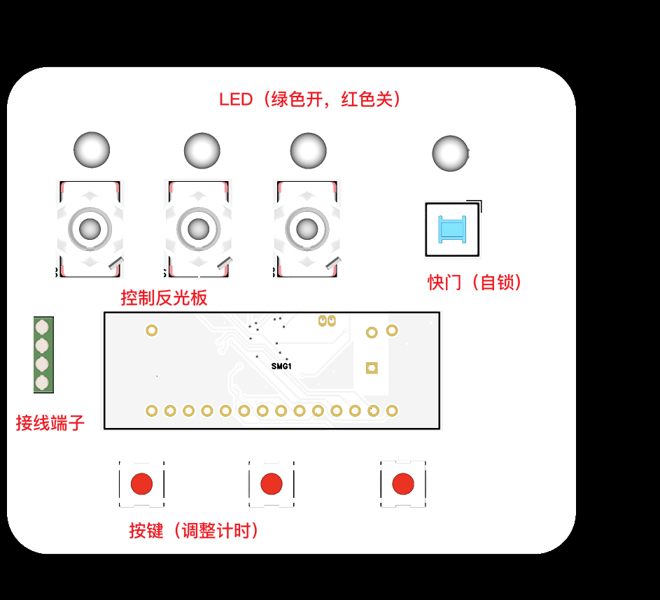
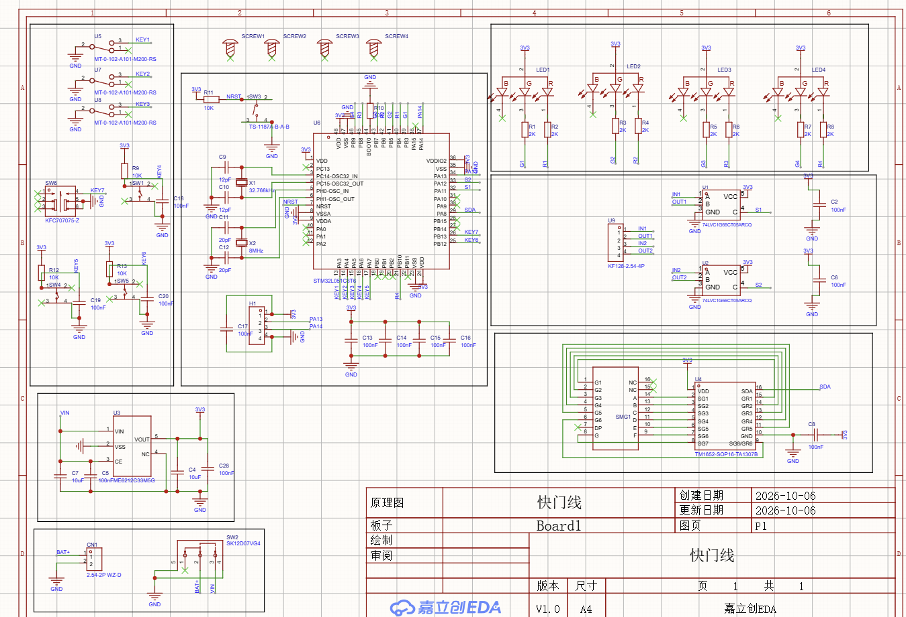
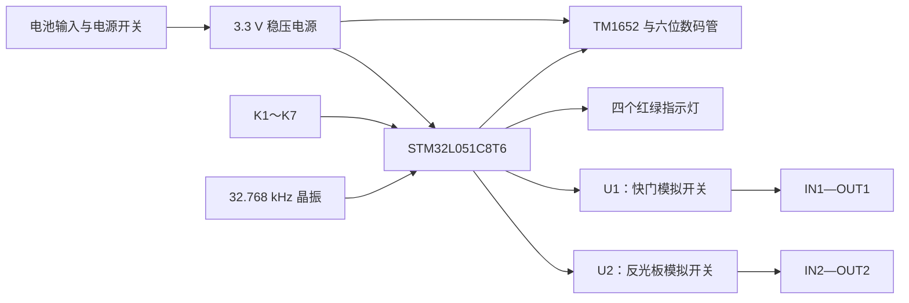
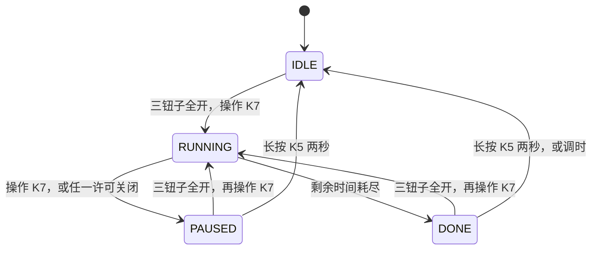

# 用 STM32L051 做一条会计时的快门线：从开关、数码管到低功耗固件

> 项目：ShutterWire · 主控：STM32L051C8T6 · 记录日期：2026 年 10 月 9 日  
> 本文依据项目原理图、外壳正面图、TM1652 手册及当前固件撰写。软件已完成编译和主机状态机测试，硬件尚未上板验证，文中的功耗分析不代表实测结果。

做长曝光时，一条快门线承担的工作并不复杂：让控制接点保持接通，再在合适的时候断开。如果想把时间调节、反光板通道、暂停与继续、开关指示都放进一个小盒子，真正需要仔细处理的地方就多了起来。

按键会抖动，自锁按钮会一直保持电平，相机接口有自己的电气条件，数码管也会持续耗电。倒计时程序能跑起来，只是这个项目的第一步。

这篇文章从已有硬件出发，记录这条快门线的设计：面板上的每一个开关如何对应到电路，软件怎样把这些输入变成可预测的动作，以及一块低功耗 MCU 能为整机省下多少电、又有哪些电流是它关不掉的。

## 1. 先确定面板上的操作关系

外壳把操作区分成了三层。上方是三个钮子开关和一个自锁快门按钮，中间是六位数码管，下方是三个调时按键。四个双色指示灯与上方四个控制件对应。



*图 1：已有外壳正面图。本文按最终确认的 K1～K7 分工解释面板；图片不是实物装配测试记录。*

编号和功能需要先说清楚，否则后面的引脚、程序和操作说明很容易错位。

| 控制件 | 类型 | 用途 |
| --- | --- | --- |
| K1 | 钮子开关 | 控制反光板通道，同时参与快门许可 |
| K2、K3 | 钮子开关 | 与 K1 一起构成快门许可条件 |
| K4 | 瞬时按键 | 增加选中单位的时间 |
| K5 | 瞬时按键 | 确认当前调整，切换时、分、秒；长按用于退出暂停 |
| K6 | 瞬时按键 | 减少选中单位的时间 |
| K7 | 自锁按钮 | 启动、暂停和继续计时 |

所有输入都是接地有效。在本文中，“按下”或“开”表示对应接点闭合，MCU 读到低电平。钮子开关装到外壳后，哪个方向表示“开”，需要与实际接线保持一致。

快门许可只有一个条件：

```text
允许快门 = K1 开 AND K2 开 AND K3 开
```

三个开关全开只是允许操作，快门仍然需要 K7 的一次新操作才能启动。K1 对反光板通道的控制则独立存在，不要求 K2、K3 同时打开。

四个 LED 显示对应控制件的物理状态：**未按下为红，按下为绿**。LED1～3 对应 K1～3，LED4 对应 K7。这里要特别留意自锁按钮：倒计时结束后，快门输出已经断开，但 K7 可能还锁在按下的位置，所以 LED4 此时仍为绿色。剩余时间和计时状态需要结合数码管判断。

当前低功耗策略还保留了一条规则：非计时状态下，15 秒没有操作，数码管和四个 LED 一起熄灭；再次操作时唤醒。红绿规则适用于指示灯点亮期间。

## 2. 硬件：围绕两路接点控制展开

整张原理图可以按电源、MCU 最小系统、人机交互和输出接口四部分理解。



*图 2：项目提供的原理图。PCB 走线、实物焊接以及输出接口兼容性仍需单独验证。*



### 主控与时钟：让处理器和计时各做各的事

STM32L051C8T6 提供 Cortex-M0+ 内核、64 KB Flash 和 8 KB SRAM，也具备 RTC 与低功耗模式。对于这个项目，存储资源足以容纳按键处理、显示驱动和控制状态机，RTC 则让处理器休眠时仍然能够计时。[ST 官方产品资料](https://www.st.com/en/microcontrollers-microprocessors/stm32l051c8.html)

原理图放置了两颗晶振：X1 为 32.768 kHz，接到 PC14/PC15；X2 为 8 MHz，接到 PH0/PH1。当前固件只使用 X1 作为 RTC 的时间基准，CPU 工作时使用内部 MSI，频率约为 2.097 MHz，X2 不启用。

CPU 只需要短暂处理输入、计算剩余时间和发送显示数据，没有必要为了这些操作一直运行在较高频率。把曝光计时交给 RTC 后，处理器可以在等待期间进入 STOP，醒来后再读取实际流逝的时间。

最小系统还包括 NRST 上拉与复位按钮、BOOT0 下拉、各电源脚的去耦，以及 PA13/PA14 的 SWD 接口。固件保留 SWD，便于后续下载和调试。测量功耗时则应脱离调试器，避免调试连接影响读数。

### 电源：3.3 V 电源轨之外，还要考虑电池条件

原理图由电池接口经过电源开关送到 VIN，再由 U3 稳压得到 3.3 V。MCU、TM1652 和两路模拟开关都使用这条电源轨。输入、输出两侧设置了储能和旁路电容。

目前提供的资料没有明确电池种类和容量，因此不能直接据此写出输入电压范围或续航天数。选电池时，需要核对 U3 的允许输入电压、压差、静态电流，以及数码管点亮时的负载条件。电池电压下降后，3.3 V 电源是否仍然稳定，也应通过实际测试确认。

### 输入：外部 RC 滤波与软件消抖配合

K4、K5、K6 使用外部 10 kΩ 上拉，并各自配有 100 nF 对地电容。对应 RC 时间常数为：

```text
τ = R × C = 10 kΩ × 100 nF = 1 ms
```

这个 RC 网络可以缓和快速扰动，但机械接点的抖动时间不一定只有 1 ms，所以软件仍然要判断输入是否稳定。

K1、K2、K3 和 K7 在原理图中没有独立的外部上拉，固件为它们启用内部上拉。K4～K6 已经有外部上拉，便不再并联内部上拉。

| 网络 | GPIO | 功能 |
| --- | --- | --- |
| KEY1 | PA3 | K1，反光板与许可 |
| KEY2 | PA4 | K2，许可 |
| KEY3 | PA5 | K3，许可 |
| KEY4 | PA6 | K4，加 |
| KEY5 | PA7 | K5，确认/切换 |
| KEY6 | PB12 | K6，减 |
| KEY7 | PB13 | K7，自锁快门 |
| S1 | PA11 | 快门输出控制 |
| S2 | PA12 | 反光板输出控制 |
| SDA | PA9 | USART1_TX，数码管数据 |

### 输出：模拟开关如何实现接通与断开

U1、U2 是 74LVC1G66 系列双向模拟开关。MCU 通过控制端 C 决定 A、B 两端是否导通。在本项目中，PA11 拉高使 IN1–OUT1 接通，PA12 拉高使 IN2–OUT2 接通；拉低则断开对应通道。

这让控制电路不必通过机械继电器完成每次动作，但模拟开关的信号端有允许电压范围，也存在导通电阻和漏电流。接相机前，需要按实际采购厂商和完整型号的数据手册核对这些条件，不能把它当成任意电压、任意接法都适用的隔离接点。

此外，当前原理图没有给 S1、S2 配置外部下拉。MCU 在复位或下载期间，控制脚可能处于高阻态。固件会在初始化时先写入低电平，再切换为输出模式，但软件开始执行前的状态仍需要硬件约束。建议两路控制端分别增加约 100 kΩ 对地下拉，具体阻值再结合器件漏电流和输入阈值核对。

本文把第二路沿用为“反光板通道”。当前固件完成的是 K1 与 IN2–OUT2 通断的对应关系，没有实现相机专用的预升时序，也没有增加预升后等待若干秒的步骤。相机能否按预期执行反光板动作，仍取决于接口定义、线序和机内设置。

## 3. 显示：TM1652 的 SDA 实际上传输串口数据

六位数码管用来显示 `HHMMSS`，两位小时、两位分钟、两位秒。默认时间是 `000010`，也就是 10 秒，允许设置的范围为 1 秒到 99 小时 59 分 59 秒。

原理图中数码管的 A～G 接到 TM1652 的 SG1～SG7，前五个位选接 GR1～GR5，第六个位选使用 SG8/GR6 复用脚。因此固件需要选择 **7 段 × 6 位模式**。DP 引脚没有接入，当前显示不能使用小数点分隔时、分、秒。

TM1652 的数据脚虽然命名为 SDA，协议却是异步串口。按所给手册，通信格式为 19200 baud、8 位数据、奇校验、1 位停止位，即常写的 `8O1`。数据帧结束后，线路还需要保持高电平超过 3 ms，芯片才把接收到的内容提交到对应寄存器。协议和命令依据见[项目所附 TM1652 手册，第 4～7 页](./C52186_数码管驱动_TM1652_规格书_数码管驱动_TM1652_中文规格书.PDF)。

本项目直接使用 PA9 上的 USART1_TX 发送数据。在 STM32 的串口配置里，字长包含校验位，所以为了发送 8 位有效数据和 1 位奇校验，需要选择包含校验在内的 9 位字长。

驱动主要使用三组内容：

| 内容 | 当前设置 |
| --- | --- |
| 起始显示地址命令 | `0x08` |
| 显示控制命令 | `0x18` |
| 点亮控制字 | `0x49`：7 段 6 位，位占空比 2/16，段电流 2/8 |

初始化时，程序先把显示 RAM 清空，再配置显示状态，避免未初始化数据直接出现在数码管上。后续只有字形发生变化时才发送显示内容。TM1652 自己完成动态扫描，MCU 无须为了维持数字显示持续刷新每一位。

当前驱动仍采用短时同步发送，并等待帧间间隔。这个实现比较直接，发送完成后便进入下一轮事件调度；若后续要进一步缩短 CPU 活动时间，可以再考虑中断发送或 DMA。

## 4. 指示灯：看清接点状态，也看清软件状态

四个指示灯都采用共阳连接，公共端接 3.3 V，红、绿两路各经过 2 kΩ 电阻连接 MCU。GPIO 拉低时，对应颜色点亮；拉高时熄灭。蓝色通道没有使用。

| LED | 绿灯 GPIO | 红灯 GPIO | 对应控制件 |
| --- | --- | --- | --- |
| LED1 | PB3 | PB4 | K1 |
| LED2 | PB5 | PB6 | K2 |
| LED3 | PB7 | PB8 | K3 |
| LED4 | PB9 | PB10 | K7 |

红绿切换使用消抖后的稳定输入，避免接点抖动时颜色来回跳变。程序每次只点亮同一个 LED 的一种颜色。

这里有两个需要分开理解的状态：按钮是否按下，以及快门输出是否接通。前三个钮子开关的物理位置比较直观；K7 则是自锁按钮，它的位置会保持，但快门输出还受到计时结束、暂停和许可条件的控制。

例如，K7 按下后 LED4 变绿，开始倒计时。到时程序断开 IN1–OUT1，数码管显示零；只要 K7 仍锁定，LED4 就保持绿色。这正是“灯跟随按钮状态”的要求。程序中的快门输出判断单独由状态机负责。

## 5. 软件：用四个状态描述一次操作

当前固件使用官方 CMSIS 头文件与启动文件，通过寄存器配置外设，没有引入 STM32Cube HAL。程序按职责分成三个主要模块。

| 文件 | 职责 |
| --- | --- |
| `app.c` | 状态机、逐输入消抖、调时、长按、剩余时间、下一次唤醒计算 |
| `board.c` | GPIO、RTC、USART、EXTI、STOP 进出和故障输出关闭 |
| `display.c` | 数字字形、时分秒显示、闪烁和 TM1652 命令 |
| `main.c` | 读取输入，调用状态机，更新输出与显示，再安排睡眠 |
| `config.h` | 时间范围、消抖时间、连调参数和显示超时等配置 |

主循环的工作顺序可以概括为：

```text
读取 RTC 和输入
    ↓
更新消抖、剩余时间和控制状态
    ↓
更新快门、反光板输出
    ↓
更新红绿灯和数码管
    ↓
计算下一件需要处理的事，进入 STOP 等待
```

把输出处理放在显示之前，是为了让到时断开和许可失效先得到处理。发送数码管数据需要时间，不能让已经确认的关断动作排在显示刷新后面。

状态机只有四种状态：待机 `IDLE`、运行 `RUNNING`、暂停 `PAUSED` 和完成 `DONE`。



运行期间，快门输出接通并扣减剩余时间。暂停期间，快门输出断开，剩余时间保持不变。完成状态保留零时间，等待用户下一次操作，而不会因为自锁键仍然保持低电平就自行开始下一轮。

如果计时中关闭任意许可钮子，程序在消抖确认后进入暂停。把三个钮子重新打开也不会自动继续，必须再次操作 K7。在许可未满足时发生的 K7 操作会被消耗掉，不留到之后补触发。

## 6. 自锁按钮为什么要看两种边沿

普通瞬时按钮通常按下变低、松开变高，一次按压就能产生完整的低电平脉冲。自锁按钮不同：第一次按下后保持低电平，第二次按下才弹起并回到高电平。

如果只检测下降沿，第二次操作就不会被识别，暂停功能也就丢了一半。当前程序把消抖后的每一次稳定电平翻转视为一次操作：

```text
高 → 低：一次操作
低 → 高：又一次操作
电平持续不变：没有新操作
```

动作由当前软件状态决定。同一次物理操作，在待机时表示开始，在运行时表示暂停，在暂停时表示继续。

上电时还需要处理一个容易遗漏的情况：用户可能早已把 K7 按下。程序把启动时读取到的输入作为初始状态，不把它当成刚发生的边沿。因此，即使三个钮子全开、K7 已锁定，上电也不会自动接通快门，必须再操作一次 K7。

每路输入都有自己的候选电平和候选开始时间。新的电平保持约 31.25 ms 后，才被接受为稳定状态。中途发生反跳，就重新开始计算。这种处理也使一个按键的抖动不会重置另一个按键的消抖过程。

## 7. 暂停保存的，是带小数部分的剩余时间

倒计时如果只保存整数秒，每暂停一次就可能丢掉一段不足一秒的余量。为了让暂停和继续尽量保持原来的累计时间，程序以 RTC 的亚秒节拍保存剩余时长。

RTC 使用 32.768 kHz 晶振，预分频设置为：

```text
异步分频：127 + 1 = 128
同步分频：255 + 1 = 256

32768 ÷ 128 ÷ 256 = 1 Hz
亚秒计数分辨率：1 / 256 秒 ≈ 3.906 ms
```

例如设置 10 秒，应用保存的初始余量就是 2560 个节拍。每次处理运行状态时，程序读取 RTC，计算距上次处理实际经过了多少节拍，再从余量中扣除。CPU 休眠、显示发送和正常程序执行所花的时间，都计入这段流逝时间。

如果运行约 2.3 秒后暂停，程序保留的余量仍然接近 7.7 秒，而不会截断成 7 秒或回到 8 秒。继续时再从这个余量开始扣减。

数码管只能显示整秒，因此显示值采用向上取整：还剩 0.2 秒时显示 1，余量真正归零后才显示 0。RTC 时间读取还处理了读数跨秒和午夜回绕，应用使用无符号时间差处理 32 位计数翻转。

3.906 ms 是内部时间单位的分辨率。实际输出关断还会受到晶振频差、唤醒时间和程序执行延迟影响，需要用示波器验证，不能直接把它写成整机曝光误差。

还有一个与相机行为有关的边界：此处的“暂停”按需求断开快门接点，保存的是控制器剩余时间。对于常见的按住保持曝光、松开结束曝光的 Bulb 模式，断开接点会结束当前这次曝光；再次接通可能开始另一张。因此，控制器恢复倒计时并不代表相机能在同一张照片上恢复曝光。这个判断来自 Bulb 的释放行为，仍需按目标相机确认。[Canon EOS R7 官方 Bulb 操作说明](https://cam.start.canon/en/C005/manual/html/UG-03_CustomShooting_0070.html)

## 8. 低功耗：下一次什么时候醒来，比每秒醒多少次更重要

这个项目在多数时候都处于等待：等待下一次按键、下一次数字变化，或倒计时结束。等待期间，CPU 可以休眠。

当前选择 STOP，并启用低功耗稳压器。GPIO 输出和 RAM 在该模式下保持，RTC 继续计时。程序进入 STOP 前停掉 SysTick，避免每毫秒的系统节拍把处理器叫醒；输入通过 EXTI 唤醒，定时事件通过 RTC Wakeup Timer 唤醒。外设与低功耗模式配置依据为 [ST RM0377 参考手册](https://www.st.com/resource/en/reference_manual/dm00108282.pdf)。

程序每轮计算下一件到期的事：可能是消抖确认，可能是长按连调，也可能是选中字段闪烁、秒数更新或快门到时。把这些事件中最早的一个交给 RTC，CPU 就可以睡到它发生。

Wakeup Timer 使用 LSE/16，即 2048 Hz。16 位重装计数允许本配置下最长约 32 秒的单次等待。因此在关屏且无操作时，程序仍每 32 秒短暂醒来一次，维护时间基准。

进入休眠前还要防止一个竞态：如果用户恰好在最后一次输入检查之后操作了开关，程序不能漏掉事件后继续睡。当前实现结合中断设置的软件标志、EXTI 待处理位和睡眠前的原子检查，保留这个临近休眠的事件。

未使用的 GPIO 配置为模拟模式，SWD 引脚保留；运行时不启用 8 MHz HSE 和 PLL。TM1652 的低亮度设置、空闲熄屏和熄灯，则减少显示相关的耗电。

### 关掉 CPU 之后，整机仍有哪些电流

整机电流可以按下面的关系理解：

```text
整机电流 ≈ MCU 电流 + 显示驱动电流 + 数码管电流
         + 指示灯电流 + 上拉/下拉电流 + 稳压器静态电流
         + 输出器件及其他漏电流
```

这些电流的变化方式不同。数码管和 LED 可以熄灭，但闭合接点上的上拉电阻仍然有电流。以 3.3 V 和 10 kΩ 为例，按键闭合时上拉支路电流约为 330 μA。K4～K6 一般只在操作时短暂闭合，钮子和自锁按钮则可能长时间保持，因此它们的内部上拉电流也要计入长期待机预算。

TM1652 还需要特别关注。所附手册第 4 页给出的“无负载、显示关”动态电流最大值为 5 mA，测试条件为 VDD=5 V。这个数值不等于本板在 3.3 V 下的实测电流，但手册也没有给出能够据此保证微安级关屏电流的指标。

所以，当前固件完成了 MCU 休眠和显示熄灭，整机待机电流还需要测量。如果显示驱动成为主要耗电来源，可以在下一版硬件上增加独立的显示电源控制。届时还需处理 SDA 向未供电芯片反向供电的问题，并在重新上电后恢复显示 RAM 和控制寄存器。

续航应在测得不同工作状态电流、确定各状态占比后估算。电池容量、显示常亮时间和使用频率都尚未确定，现阶段不写未经测量的续航数字。

## 9. 一次实际操作可以怎样走完

假设需要设定 1 分 30 秒。上电后，屏幕默认显示 10 秒，秒字段处于选中状态。K5 在“秒 → 时 → 分 → 秒”之间循环切换，K4、K6 按当前单位加减。加减按住约 600 ms 后开始连调，之后约每 100 ms 调整一次，设定值限制在 1 秒到 99:59:59 之间。

完成设定后打开 K1、K2、K3，对应三个 LED 变绿，K1 同时接通第二路通道。此时操作 K7，第一路快门通道接通，屏幕开始倒计时，LED4 根据 K7 的物理位置显示颜色。

计时中再次操作 K7，快门断开，剩余时间保留，整个时间显示闪烁。三个钮子仍全开时，再操作 K7 就恢复计时；如果有许可钮子关闭，就先恢复许可，再操作 K7。

运行和暂停期间，调时加减被禁用，防止改写正在使用的余量。暂停后若想放弃这次计时，可以长按 K5 两秒回到设定状态。倒计时结束则显示零，并等待下一次新的 K7 操作。

设定时间和暂停状态目前保存在 RAM，断电后恢复默认 10 秒。固件没有在每次调时后写入 EEPROM；如果后续需要记忆设定，可以增加延时保存或明确的保存操作。

## 10. 异常处理：时间基准出问题时先关闭输出

曝光时间依赖 LSE。当前固件在 LSE 启动超时后进入故障状态，关闭两路输出，并在显示通信正常时显示 `E 0001`，没有自动改用未经校准的 LSI 继续计时。

运行中启用 LSE Clock Security System。检测到晶振故障时，中断处理先关闭输出，再锁定故障状态。串口等待超时以及已接管的异常入口也会进入输出关闭处理，等待复位排查。

这些是当前代码包含的故障路径，故障检测、GPIO 实际关断以及显示行为仍需上板验证。程序中的关闭动作也不能代替前面提到的硬件默认下拉：复位前后的控制端电平，需要电路和软件共同约束。

