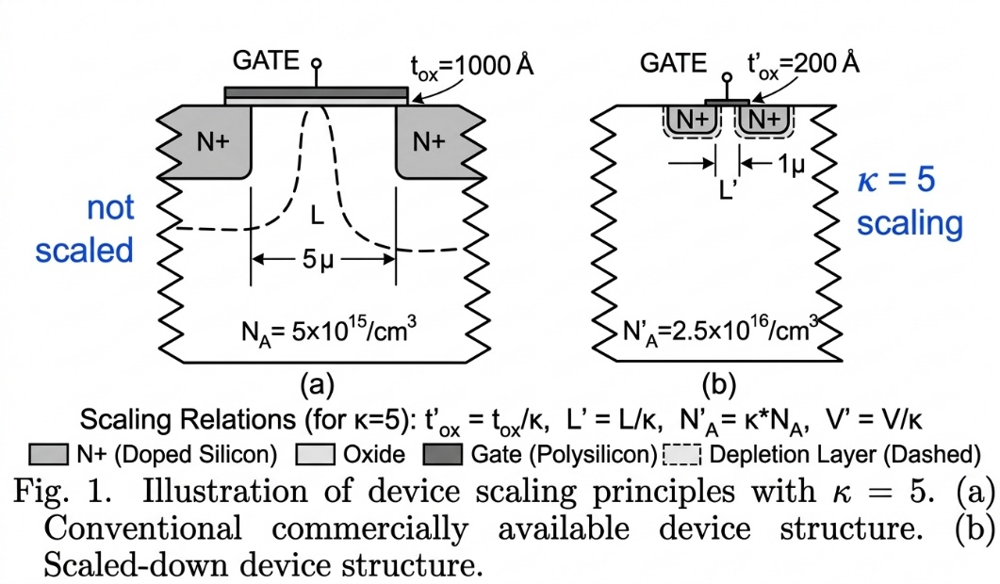
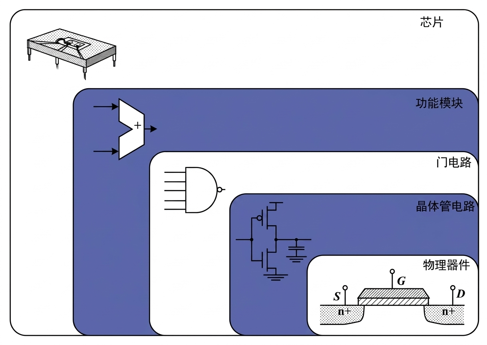
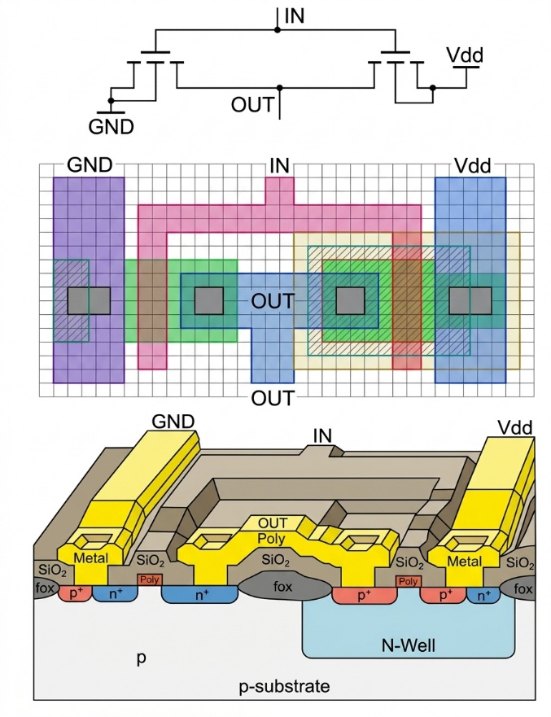
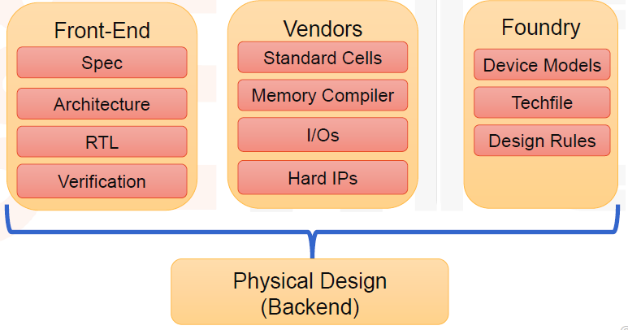
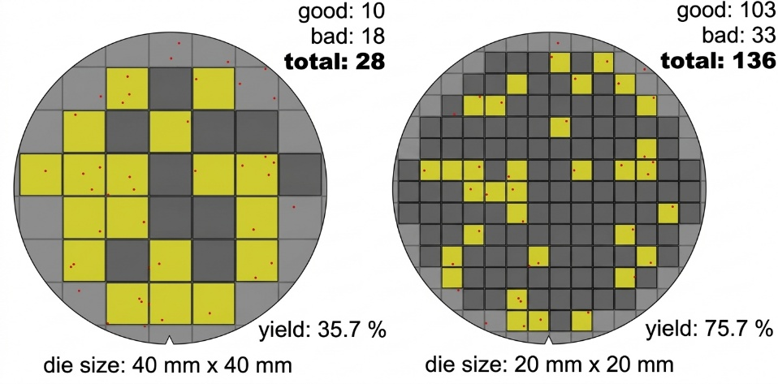
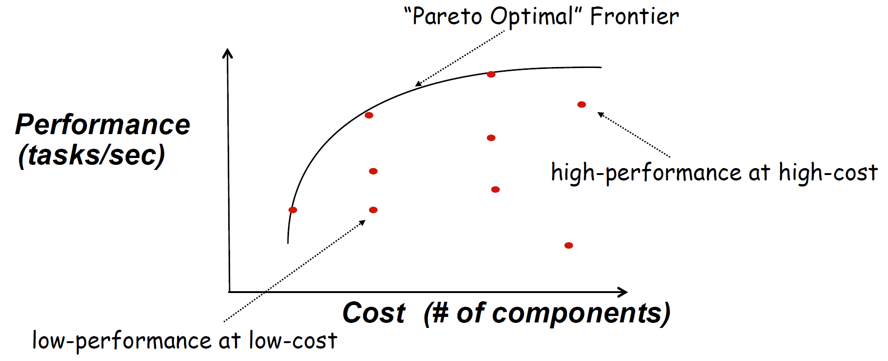

数字电路用有限个逻辑状态表示信息，但实现这些状态的电压、电流仍然连续变化。一个逻辑门能否正确工作，既取决于逻辑关系，也取决于晶体管能否及时完成节点充放电，以及输出电压能否被下一级可靠识别。因此，数字集成电路设计需要同时处理功能、时序、功耗和物理实现。

超大规模集成（Very-Large-Scale Integration，VLSI）将大量器件和互连集成在同一芯片上。互补金属氧化物半导体（Complementary Metal-Oxide-Semiconductor，CMOS）电路利用 N 沟道与 P 沟道 MOS 晶体管，分别简称 NMOS 与 PMOS，构成逻辑门，再由门电路组成寄存器、运算单元和存储器。学习数字集成电路，就是从这些基本器件和单元出发，理解一个系统如何在面积、速度和能耗约束下实现。

## 集成密度与器件微缩

从电子管计算机到晶体管电路，再到集成电路，计算系统的尺寸不断缩小。集成制造使大量器件能够在同一片半导体上批量形成，也缩短了器件之间的连接距离。随后，器件尺寸的微缩进一步提高了单位面积内可容纳的晶体管数量。

摩尔定律描述了集成电路发展中的经验趋势：在一定的技术与经济条件下，芯片可经济集成的晶体管数量随时间近似指数增长，常用的概括是每隔约一至两年翻倍。它体现了工艺进步与制造成本之间的关系，倍增周期和适用范围会随发展阶段变化。单位晶体管成本下降，也不意味着每颗芯片的总成本必然下降；更复杂的设计、更昂贵的工艺和更大的芯片面积都可能增加总成本。

若器件的横向尺寸都缩小到原来的 $1/k$，其中 $k>1$，其占用面积理想情况下变为原来的 $1/k^2$，同样面积可容纳的器件数量便增加到 $k^2$ 倍。例如，横向尺寸变为原来的约 0.7 倍，面积约变为 0.49 倍，集成密度约增加一倍。实际芯片还受到布线、供电、存储器和输入输出接口占用面积的限制。

密度提高之后，还需要回答器件速度和功耗如何变化。登纳德缩放（Dennard scaling）给出了一个理想模型：同时缩小尺寸和电压，使器件内部的电场强度基本不变。这种方法也称恒电场微缩。

### 恒电场微缩的基本条件

设微缩前的沟道长度为 $L$、宽度为 $W$、栅氧化层厚度为 $t_{ox}$，微缩后的量用撇号表示。理想恒电场微缩要求

$$
L'=\frac{L}{k},\qquad
W'=\frac{W}{k},\qquad
t_{ox}'=\frac{t_{ox}}{k}.
$$

结深等纵向尺寸也按相同比例缩小，各端偏置电压和阈值电压则满足

$$
V'=\frac{V}{k},\qquad V_T'=\frac{V_T}{k}.
$$

由于电场强度可近似写为电压与距离的比值，尺寸和电压同时缩小 $k$ 倍，就有

$$
\mathcal{E}'\sim\frac{V/k}{L/k}=\frac{V}{L}\sim\mathcal{E}.
$$

这里用 $\mathcal{E}$ 表示电场强度，以便与后文的能量区分。为了使耗尽区的尺寸也相应缩小，衬底掺杂浓度 $N_A$ 要提高 $k$ 倍。由耗尽层宽度的简化关系 $x_d\propto\sqrt{V/N_A}$ 可知，电压变为 $1/k$、掺杂浓度变为 $k$ 倍时，$x_d$ 变为原来的 $1/k$。



*图 1：$k=5$ 时，沟道长度由 5 μm 缩小为 1 μm，氧化层厚度由 1000 Å 缩小为 200 Å，掺杂浓度提高五倍；偏置电压也应缩小为原来的五分之一。*

### 电容、电流与延迟的缩放

单位面积的栅氧化层电容为

$$
C_{ox}=\frac{\varepsilon_{ox}}{t_{ox}},
$$

其中 $\varepsilon_{ox}$ 是氧化层的介电常数，$C_{ox}$ 的单位可以取 $\mathrm{F/m^2}$。氧化层变薄后，$C_{ox}'=kC_{ox}$。但整个晶体管的栅电容还包含栅面积：

$$
C_g\approx C_{ox}WL,\qquad
C_g'=kC_{ox}\frac{W}{k}\frac{L}{k}=\frac{C_g}{k}.
$$

这里忽略了重叠电容和边缘电容。单位面积电容增大，而单个器件的总电容减小，是两个不同量的变化。

在长沟道、强反型、忽略沟道长度调制且迁移率近似不变的模型中，NMOS 的饱和电流为

$$
I_D=\frac{1}{2}\mu_n C_{ox}\frac{W}{L}(V_{GS}-V_T)^2.
$$

其中 $\mu_n$ 为电子迁移率，$V_{GS}$ 为栅源电压，$V_{GS}-V_T$ 为过驱动电压。微缩后 $W/L$ 不变，$C_{ox}$ 增大 $k$ 倍，过驱动电压缩小到 $1/k$，因而

$$
I_D'=k\cdot\frac{1}{k^2}I_D=\frac{I_D}{k}.
$$

用驱动电流为负载电容充放电，门延迟可以粗略估计为

$$
t_d\sim\frac{C_LV_{DD}}{I_{\mathrm{drive}}}.
$$

若负载主要来自同时微缩的门电容，$C_L$ 也缩小到 $1/k$，则

$$
t_d'\sim
\frac{(C_L/k)(V_{DD}/k)}{I_{\mathrm{drive}}/k}
=\frac{t_d}{k}.
$$

虽然单个器件的电流减小了，但需要搬运的电荷 $Q=C_LV_{DD}$ 减少得更快，所以延迟缩短。对于逻辑级数不变、主要由门延迟决定的路径，可支持的频率理想情况下提高到 $k$ 倍。长互连、大型片外负载和时钟分配网络不一定遵循这一缩放关系。

### 能量、功耗与功率密度

电容从 0 充到 $V_{DD}$ 后，储存的能量为 $C_LV_{DD}^2/2$。在通常的非能量回收 CMOS 充放电过程中，一次完整的充电、放电周期从电源取得的能量为

$$
E_{\mathrm{cycle}}=C_LV_{DD}^2.
$$

能量单位为 J。恒电场微缩下，电容变为 $1/k$、电压变为 $1/k$，所以

$$
E_{\mathrm{cycle}}'=\frac{E_{\mathrm{cycle}}}{k^3}.
$$

若 $\alpha$ 表示每个时钟周期内节点发生 $0\to1$ 充电的平均次数，$f$ 为时钟频率，则动态功耗为

$$
P_{\mathrm{dyn}}=\alpha C_LV_{DD}^2f.
$$

在 $\alpha$ 不变、工作频率提高到 $kf$ 时，单个门的动态功耗变为

$$
P_{\mathrm{dyn}}'=\frac{1}{k}\cdot\frac{1}{k^2}\cdot kP_{\mathrm{dyn}}
=\frac{P_{\mathrm{dyn}}}{k^2}.
$$

单个器件的面积也缩小到 $1/k^2$，因此理想动态功率密度保持不变。同样面积内若放入 $k^2$ 倍的器件，并使它们以相同活动因子、提高后的频率工作，总动态功耗仍近似不变。如果功能和器件数量保持不变，则缩小后的芯片总动态功耗降低为原来的 $1/k^2$。

| 参数 | 微缩后与微缩前的比值 | 成立条件或含义 |
| --- | --- | --- |
| $L,W,t_{ox}$、结深 | $1/k$ | 横向、纵向尺寸一起微缩 |
| 偏置电压、$V_T$ | $1/k$ | 保持电场强度近似不变 |
| 掺杂浓度 $N_A$ | $k$ | 配合耗尽层尺寸微缩 |
| 单位面积栅电容 $C_{ox}$ | $k$ | 介电常数保持不变 |
| 单管栅电容 $C_g$ | $1/k$ | 栅面积缩小到 $1/k^2$ |
| 单管电流 $I_D$ | $1/k$ | 理想器件模型 |
| 门延迟 $t_d$ | $1/k$ | 负载随器件一起微缩 |
| 可支持频率 $f$ | $k$ | 路径逻辑级数不变 |
| 完整充放电周期能量 | $1/k^3$ | 电容与电压同时微缩 |
| 单门动态功耗 | $1/k^2$ | 频率提高 $k$ 倍、活动因子不变 |
| 理想器件密度 | $k^2$ | 单管占用面积缩小到 $1/k^2$ |
| 动态功率密度 | $1$ | 同时满足上述条件 |

例如，取 $k=5$，单管电流与电容都变为原来的五分之一，门延迟变为五分之一，完整充放电周期的能量变为 $1/125$。若频率提高五倍，单门动态功耗变为 $1/25$；同样面积集成二十五倍的门时，总动态功耗近似不变。这些比例来自同一组理想条件，实际设计不能只缩小尺寸而直接套用全部结论。

## 理想微缩的限制与改进方向

恒电场微缩要求电源电压和阈值电压持续下降。实际器件中，阈值电压降低会增加亚阈值漏电；栅介质过薄也会带来隧穿漏电和可靠性问题。沟道缩短后，漏端电场对沟道的影响增强，栅极对关断状态的控制更困难。电压、介质厚度和器件尺寸因此难以始终按同一比例缩小。

当电源电压不能同步下降时，$C_LV_{DD}^2$ 中的电压平方项便无法按理想比例减小。即使器件密度继续增长，提高频率和让更多电路同时工作也会增加散热压力。集成密度提高与时钟频率提高，逐渐需要分别通过工艺、架构和电路设计来实现。

器件结构的改进主要服务于栅极控制能力。例如，鳍式场效应晶体管（Fin Field-Effect Transistor，FinFET）使栅极从多个侧面控制沟道；纳米线、纳米片等全环绕栅结构进一步增强对沟道的静电控制。这些结构可以改善短沟道条件下的性能和漏电，但具体收益仍取决于器件、工艺和电路的共同设计。

设计与工艺协同优化（Design-Technology Co-Optimization，DTCO）把器件结构、设计规则、标准单元和互连一起考虑。例如，某种器件结构能提高单管驱动电流，但若接触和布线占用过多面积，最终单元密度未必提高。设计端需要评价能实际布局布线的单元，而不是只比较孤立器件的尺寸。

“深度摩尔”（More Moore）侧重继续提高数字逻辑与存储的集成密度；“超越摩尔”（More than Moore）侧重增加系统功能，如射频、传感、功率管理和异构集成。后者可以通过不同工艺的裸片与先进封装实现，适合把需要先进工艺的计算模块与适合成熟工艺的接口、模拟或传感模块组合起来。更高的系统性能也可以来自并行计算、专用运算单元和更合理的存储组织，而不只来自单个晶体管变小。

## 层次化设计与实现方式

芯片规模扩大后，逐个晶体管处理整个系统的功能与连接关系会使设计工作量难以控制。层次化设计把系统拆成模块，为每层规定接口和可使用的模型：系统层关注功能与数据流，模块层关注运算和存储，逻辑层关注门和寄存器，电路层关注晶体管与节点，物理层关注器件和互连的几何实现。



*图 2：功能模块逐层分解为门电路、晶体管电路与物理器件。*

抽象模型应保留当前层次需要的信息。例如，描述加法器功能时，可以先写出输入与输出的数值关系；分析其时序时，要考虑逻辑路径和寄存器；确定某个门的驱动能力时，则需要晶体管尺寸、负载电容和工作电压。上一层给出要求，下一层实现这些要求，再将延迟、功耗和面积反馈给上一层。

同一个电路还可以用不同视图描述。行为描述给出电路做什么，结构描述给出模块或器件如何连接，物理描述给出这些连接如何在芯片上制造。对于 CMOS 反相器，逻辑关系为 $Y=\overline{A}$；晶体管结构由一个上拉 PMOS 和一个下拉 NMOS 组成；版图则需要实现阱区、扩散区、栅、接触孔和金属连线。



*图 3：同一反相器的连接关系、平面版图与三维结构。*

芯片互连也承担不同任务。本地信号连接相邻单元，全局信号跨越较大区域；时钟网络需要控制到达时间差，供电网络需要维持足够稳定的电压。不同金属层通过通孔（via）连接，芯片与外部电路则通过焊盘（pad）及封装互连连接。互连的电阻和电容会影响功能之外的性能，不能只在逻辑图上确认连通。

### 定制程度与灵活性

实现方式的差别之一，是功能在什么时候被固定。越早根据目标应用确定器件和连接，通常越有机会优化面积、延迟和能耗；越晚确定功能，通常越容易修改和复用，但要付出可编程结构的开销。

| 实现方式 | 功能确定方式 | 主要特点 |
| --- | --- | --- |
| 全定制（Full-custom） | 针对应用设计晶体管电路与版图 | 优化空间大，设计和验证投入高 |
| 标准单元（Standard-cell） | 用预先表征的门、触发器等单元综合并布局布线 | 自动化程度高，广泛用于专用集成电路 |
| 门阵列（Gate-array） | 在预制器件阵列上定制部分金属层或通孔 | 减少部分制造定制工作，结构受预制阵列限制 |
| 现场可编程门阵列（Field-Programmable Gate Array，FPGA） | 制造后配置逻辑资源和可编程互连 | 便于原型验证和修改，存在配置与互连开销 |
| 处理器（Processor） | 用软件组织指令执行 | 灵活性高，需承担取指、译码等通用执行开销 |

专用集成电路（Application-Specific Integrated Circuit，ASIC）描述的是芯片面向特定应用的用途，不要求所有电路都采用全定制设计。一个 ASIC 可以以标准单元为主体，同时集成全定制的存储器、时钟或接口模块。

## 从规格到流片的设计流程

设计流程从可核对的规格开始，逐步形成 RTL、门级网表和物理版图。各阶段都需要检查当前实现是否满足功能与性能要求。发现问题后，可能需要调整单元尺寸、逻辑结构、模块划分，甚至修改架构，因此流程中存在多次反馈与迭代。



*图 4：物理设计同时依赖前端设计结果、单元与模块库，以及晶圆厂提供的器件模型和设计规则。*

### 规格与架构

市场需求首先转化为芯片规格，包括要完成的功能、接口协议、处理能力、存储容量、工作频率、供电电压、功耗预算和工作环境。架构设计随后确定硬件与软件的分工、功能模块划分、总线连接和存储组织。

架构阶段需要用模型估计带宽、延迟和功耗。例如，增加运算单元只有在存储与接口能提供足够数据时才可能提高吞吐量。芯片面积、封装引脚、电路板接口，以及工艺和晶圆厂的选择也会限制实现方式，需要尽早纳入规格。

### RTL 设计、IP 复用与功能验证

寄存器传输级（Register-Transfer Level，RTL）描述寄存器保存的状态，以及时钟周期之间的数据传输和组合运算。硬件描述语言写出的 RTL 最终要对应电路：一个运算表达式可能综合为组合逻辑，一个时钟触发的状态更新可能综合为触发器。

下面是一个带低有效异步复位的 D 触发器描述：

```verilog
module dff_async_reset (
    input  wire clk,
    input  wire rst_n,
    input  wire d,
    output reg  q
);
    always @(posedge clk or negedge rst_n) begin
        if (!rst_n)
            q <= 1'b0;
        else
            q <= d;
    end
endmodule
```

`rst_n` 拉低时，不必等待时钟边沿，`q` 就复位为 0；正常工作时，`q` 在时钟上升沿采样 `d`。代码规定了状态更新行为，具体用哪个触发器单元实现，则由目标库和综合过程决定。

设计中可以复用知识产权模块（Intellectual Property，IP）。软 IP 通常以 RTL 等可综合描述交付，使用者可面向目标工艺重新综合；硬 IP 通常交付已经完成物理实现的模块，并附带时序模型、行为模型和物理摘要等信息，使用时受工艺及接口条件约束。复用减少了重复开发，但仍需要验证连接、协议、时钟和复位是否匹配。

RTL 静态检查（lint）用于发现编码和结构问题。功能验证则分别在单元、子系统和片上系统（System-on-Chip，SoC）层次核对行为，形式验证可以检查规定的性质或实现之间的等价性。对于大型设计，FPGA 原型和硬件仿真器可加速较长的运行场景验证，但它们仍需配合具体的验证目标和覆盖范围。

### 逻辑综合与门级检查

综合工具读取 RTL、目标单元库和设计约束，将行为转换为逻辑网络，映射到库中的标准单元，再进行优化。约束包括时钟周期、输入输出时序、负载和相关设计限制；可测试性设计（Design for Testability，DFT）的要求也需要纳入实现流程。

综合结果是门级网表（netlist），其中列出单元实例与连接关系。相同的 RTL 在不同库和约束下可能得到不同的实现：更严格的时序目标可能需要驱动能力更强的单元或不同逻辑结构，从而改变面积和功耗。

综合后需要检查逻辑等价性，进行静态时序分析（Static Timing Analysis，STA），并估计功耗与面积。门级仿真也可以用于核对综合后的行为。STA 根据时序模型和路径约束计算到达时间，不需要逐个仿真所有输入组合，但其结论依赖正确的约束与模型。

### 物理设计

物理设计把网表转换为器件和互连的几何布局，主要包括以下步骤。

1. **芯片规划（Floorplan）**：确定核心区、硬宏、输入输出区域及主要通道的位置，使面积、连接和布线资源相互匹配。
2. **供电规划（Power Plan）**：建立电源和地网络，考虑电流分布、压降和金属电流承载能力。
3. **布局（Placement）**：放置标准单元，兼顾时序、拥塞、面积和功耗。
4. **时钟树综合（Clock Tree Synthesis，CTS）**：构造时钟分配网络，控制时钟延迟、偏斜和转换时间。
5. **布线（Routing）**：在允许的金属层与通孔上实现信号连接，并修复时序、拥塞和设计规则问题。

布线之前，工具主要依据估计的互连参数判断延迟；布线之后，则可从实际几何结构中提取寄生电阻和电容。如果寄生效应使关键路径超出时序预算，就需要继续优化。逻辑功能正确和物理实现满足速度要求，需要分别核对。

### 签核、流片与测试

签核（Signoff）是按既定工艺条件、工作条件和检查标准确认设计能够交付制造。不同检查覆盖不同问题。

| 检查项目 | 主要核对内容 |
| --- | --- |
| 寄生参数提取（Parasitic Extraction） | 实际版图中的互连电阻、电容等寄生参数 |
| 考虑信号完整性的 STA | 寄生和串扰影响下的时序裕量 |
| 设计规则检查（Design Rule Check，DRC） | 线宽、间距、包围等几何关系是否符合工艺规则 |
| 版图与原理图一致性检查（Layout Versus Schematic，LVS） | 版图提取出的器件及连接是否与目标电路一致 |
| 电气规则检查（Electrical Rule Check，ERC） | 电气连接及使用方式是否符合规定 |
| 可制造性设计检查（Design for Manufacturability，DFM） | 影响制造稳健性和良率的版图问题 |
| 天线效应与电迁移检查 | 制造过程中的电荷积累风险、工作时的金属可靠性 |
| 功耗、供电与逻辑等价性检查 | 功耗和供电是否满足要求，优化后是否保持逻辑行为 |
| 布线后门级仿真与 DFT 检查 | 相关场景的时序行为，以及设计是否便于制造测试 |

流片（Tape-out）把最终设计数据交付制造，随后经历晶圆制造、晶圆测试、切割、封装和成品测试。DFT 通常需要在设计早期规划，例如引入扫描结构，使制造后能更容易控制和观察内部状态。设计阶段的功能验证核对电路设计，制造测试则检查实际芯片是否存在缺陷，以及是否达到规定的电气指标。

项目进度也应围绕这些依赖安排。规格、模型、子模块、顶层整合、物理实现和测试方案需要相互衔接；某个模块单独设计完成，并不代表接口、时序、供电和测试已经满足整芯片要求。

## 成本、良率与面积

芯片成本可以分为非重复性工程费用（Non-Recurring Engineering，NRE）和随产量发生的费用。前者包括设计人力、工具、掩模等项目投入；后者包括晶圆制造、封装和测试。若生产并交付 $N$ 颗合格芯片，平均成本可以粗略写为

$$
C_{\mathrm{unit}}\approx\frac{C_{\mathrm{NRE}}}{N}+C_{\mathrm{recurring}},
$$

其中 $C_{\mathrm{recurring}}$ 表示已经考虑制造损耗的单颗重复性费用。产量增大能摊薄 NRE，而面积和良率则直接影响每颗合格裸片的制造成本。

裸片（die）是从晶圆（wafer）上切割下来的单个芯片。设每片晶圆成本为 $C_{\mathrm{wafer}}$，可切出的完整裸片数量为 $N_{\mathrm{die}}$，裸片良率为 $Y$，则合格裸片的平均制造成本近似为

$$
C_{\mathrm{good\ die}}\approx
\frac{C_{\mathrm{wafer}}}{N_{\mathrm{die}}Y}.
$$

减小裸片面积，一方面可以增加完整裸片的数量，另一方面，在相同缺陷密度和相近制造条件下，可以降低单颗裸片被缺陷影响的概率。晶圆边缘不能切出完整矩形裸片，也会造成面积损失。



*图 5：相同缺陷分布下，较小裸片可以减少被单个缺陷影响的电路面积，并增加可获得的合格裸片数量。*

图中，大裸片方案有 28 颗完整裸片，其中 10 颗合格，良率为

$$
Y_{\mathrm{large}}=\frac{10}{28}\approx35.7\%.
$$

小裸片方案有 136 颗完整裸片，其中 103 颗合格，良率为

$$
Y_{\mathrm{small}}=\frac{103}{136}\approx75.7\%.
$$

这里的合格裸片数量同时受到划分数量和良率影响。该图用于说明面积与缺陷的关系，并不意味着同样功能必然能在更小面积内实现。实际良率还受缺陷分布、工艺成熟度、设计规则、冗余修复和测试判定条件影响；增大晶圆直径也不能单独保证良率提高。

## 性能、功耗与能耗评价

数字设计常用功耗、性能和面积（Power, Performance and Area，PPA）作为评价指标，成本、良率和可靠性则进一步约束可选方案。比较之前，需要确定相同的功能、负载、工作条件和评价口径。

### 延迟与吞吐量

门电路的传播延迟通常以输入和输出经过各自摆幅 50% 的时刻之差定义。输出从高到低的延迟记为 $t_{pHL}$，从低到高的延迟记为 $t_{pLH}$，常用平均传播延迟为

$$
t_p=\frac{t_{pHL}+t_{pLH}}{2}.
$$

寄存器之间的组合逻辑路径限制了时钟周期。以同一时钟域中的简单路径为例，其约束可写为

$$
T_{\mathrm{clk}}\ge
t_{\mathrm{clk\to Q}}+t_{\mathrm{comb,max}}+t_{\mathrm{setup}}+t_{\mathrm{margin}},
$$

其中依次为发送寄存器的时钟到输出延迟、组合路径最大延迟、接收寄存器的建立时间和预留时序裕量。$t_{\mathrm{margin}}$ 在这里概括不利时钟偏斜、抖动等因素；实际 STA 会按具体路径和约束计算。最高时钟频率由最严格的相关路径约束决定。

系统性能还需要区分延迟和吞吐量。延迟是一个任务从输入到结果所需的时间，吞吐量是单位时间内能完成的任务数量。流水线可以缩短每一级的逻辑路径并提高吞吐量，但单个任务仍需经过多级。多核和专用运算单元也只有在任务能够利用它们时，才会转化为应用性能。

### 动态功耗与静态功耗

CMOS 电路的平均功耗可以粗略分为

$$
P_{\mathrm{total}}=
P_{\mathrm{switching}}+P_{\mathrm{short\ circuit}}+P_{\mathrm{leakage}}.
$$

开关功耗来自节点充放电，短路功耗来自输入转换期间上拉、下拉网络同时导通，漏电功耗则在电路没有逻辑翻转时也可能存在。理想静态 CMOS 在稳定逻辑状态下没有电源到地的直接导通路径，但实际器件仍有漏电。

对于多个节点，开关功耗可估计为

$$
P_{\mathrm{switching}}\approx
\sum_i\alpha_i C_iV_{DD}^2f,
\qquad
P_{\mathrm{leakage}}\approx V_{DD}I_{\mathrm{leak,total}}.
$$

$\alpha_i$ 是节点 $i$ 每个周期的平均充电次数，$C_i$ 是其有效负载电容。由此可以看出，降低电压、减少不必要的翻转和降低有效电容都有助于减小开关功耗。增大晶体管尺寸可能提高驱动能力，同时也会增大负载电容、面积和部分漏电，因此需要结合整条路径评价。

### 单位任务能量与综合指标

功耗是单位时间消耗的能量，单位为 W；能耗是完成任务消耗的总能量，单位为 J。对持续时间为 $T$ 的任务，

$$
E_{\mathrm{task}}=\int_0^T P(t)\,\mathrm{d}t
\approx P_{\mathrm{avg}}T.
$$

在连续完成相同任务的稳态条件下，若吞吐量为 $R$，平均单位任务能量还可以写为 $E_{\mathrm{task}}\approx P_{\mathrm{avg}}/R$。降低瞬时功耗可能延长运行时间，因此不能仅根据功耗大小判断能效。

例如，在相同任务边界内，方案 A 以平均 2 W 运行 1 ms，方案 B 以平均 1.5 W 运行 2 ms，则

$$
E_A=2\ \mathrm{W}\times1\ \mathrm{ms}=2\ \mathrm{mJ},
\qquad
E_B=1.5\ \mathrm{W}\times2\ \mathrm{ms}=3\ \mathrm{mJ}.
$$

方案 B 的平均功耗更低，但完成一次任务消耗的能量更多。比较时还应保持外围电路和待机能量的统计边界一致。

功耗延迟积（Power-Delay Product，PDP）与能量延迟积（Energy-Delay Product，EDP）常用来联合评价速度和消耗：

$$
\mathrm{PDP}=P_{\mathrm{avg}}t_d,\qquad
\mathrm{EDP}=E_{\mathrm{op}}t_d.
$$

其中 $E_{\mathrm{op}}$ 为单次操作能量，$t_d$ 为所比较的操作延迟。PDP 的单位为 J，EDP 的单位为 J·s。若 $P_{\mathrm{avg}}$ 正是在时间 $t_d$ 内完成一次操作的平均功耗，PDP 就等于该操作的能量；其他活动因子或测量频率下，需要按实际操作次数换算。EDP 同时考虑能量与延迟，但它仍是特定评价指标，不能代替应用对峰值功耗或响应时间的硬性要求。

### 多目标设计与帕累托前沿

面积、速度和功耗往往相互影响。例如，加大驱动器可能缩短输出充放电时间，但会增加自身面积和前级负载；增加并行单元可能提高吞吐量，但也增加面积和供电需求。设计时需要先排除功能、时序和可靠性不合格的方案，再在满足要求的方案之间比较。



*图 6：成本希望降低、性能希望提高时，前沿上的方案构成不同取舍。*

若某个方案相对于另一个方案成本更高、性能更低，它就被后者支配。帕累托最优（Pareto optimal）方案则不存在另一方案能在所有比较指标上都不更差，并至少在一个指标上更好。前沿上的各点没有统一的最优排序，需要根据产品的成本、功耗和性能预算选择。

## 本章知识关系

器件与制造工艺决定可用的晶体管、互连和设计规则；反相器把器件特性转换为逻辑电平、延迟和功耗；组合逻辑与时序逻辑进一步组成运算和存储模块。层次化设计、模块复用和电子设计自动化（Electronic Design Automation，EDA）工具，则使这些模块能够形成可验证、可制造的完整芯片。

后续分析门电路时，需要同时关注它实现的逻辑功能、驱动的负载和实际工作条件。评价优化结果时，再将变化落实到路径延迟、开关与漏电功耗、面积以及制造成本上。

## 参考资料

- 数字集成电路课程资料，第一章“概述”，存于项目 `.files/数集/Full course - 1.pptx`；文中配图直接提取自该资料。
- Jan M. Rabaey、Anantha Chandrakasan、Borivoje Nikolić：《数字集成电路——电路、系统与设计》，第二版，清华大学出版社。
