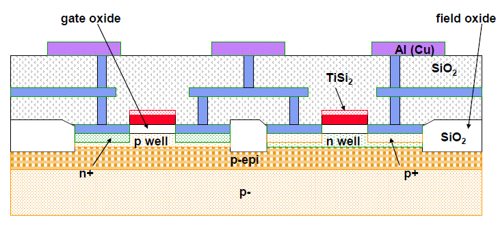
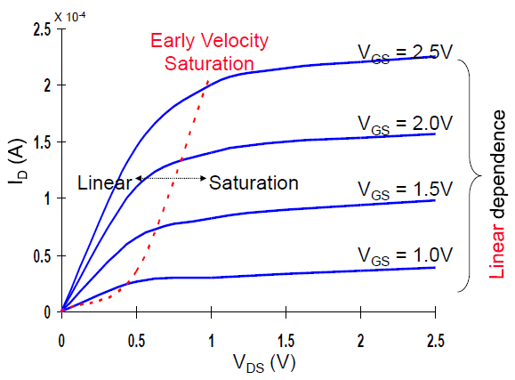
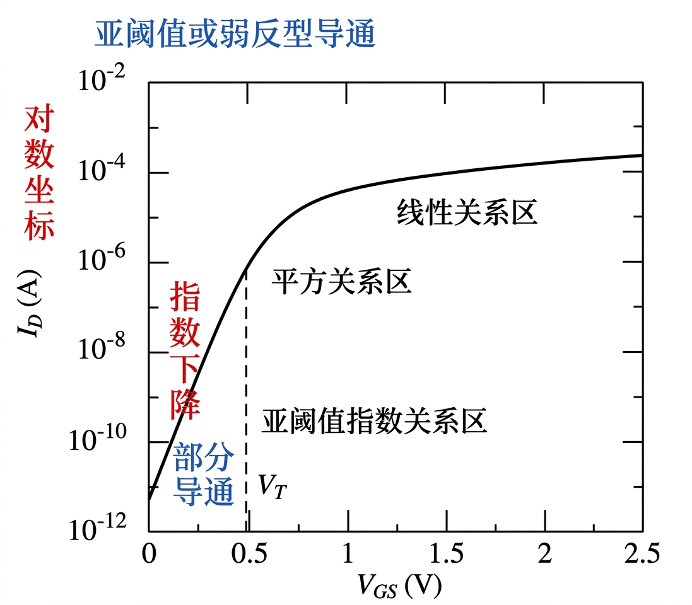
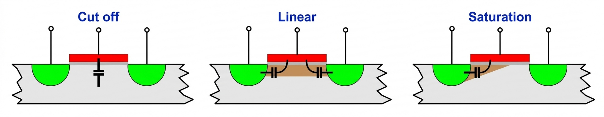
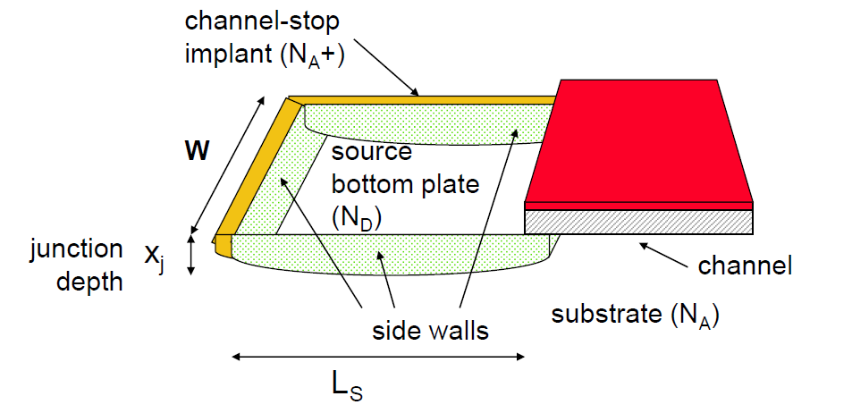

数字电路中的晶体管需要控制节点与电源、地或其他信号之间的连接。理想开关在关断时没有电流，在导通时没有电压降，而且能瞬间切换。实际 MOS 晶体管存在有限的驱动电流、关断漏电和寄生电容，因此器件模型既要说明什么时候导通，也要说明导通后的电流以及切换时需要搬运的电荷。

金属氧化物半导体场效应晶体管（Metal-Oxide-Semiconductor Field-Effect Transistor，MOSFET）通过栅极电场控制沟道。下文先用长沟道模型建立电压与电流的关系，再加入数字电路手工分析中需要的修正。这里的结构和参数都应与实际制造工艺对应，工艺尺寸、掺杂、介质和扩散区形状会同时影响电流与电容。

## MOS 结构与反型沟道

### 四个端子与电压约定

MOS 晶体管有栅极（Gate，G）、源极（Source，S）、漏极（Drain，D）和体端（Body，B）四个端子。栅极与半导体之间隔着介质，正常工作时主要通过电场控制沟道，而不依赖持续流入栅极的直流电流。

以 NMOS 为例，源、漏通常是重掺杂的 $n^+$ 区，沟道位于 P 型体区表面。PMOS 则使用重掺杂的 $p^+$ 源漏与 N 型体区。P 型材料以空穴为多数载流子，N 型材料以电子为多数载流子；这些命名描述掺杂后载流子的相对浓度。



*图 1：NMOS 与 PMOS 分别形成在适合的体区中，接触和金属层把器件连接为电路。*

体区可以由衬底或阱区提供，具体结构取决于工艺。常见体硅 CMOS 电路中，NMOS 体端接低电位、PMOS 体端接高电位，使源漏与体区形成的 PN 结保持零偏或反向偏置。若结被明显正向偏置，就会出现额外结电流，原先只考虑栅控沟道的模型不再充分。

本文对 NMOS 使用

$$
V_{GS}=V_G-V_S,\qquad
V_{DS}=V_D-V_S,\qquad
V_{SB}=V_S-V_B,
$$

并取 $V_{DS}\ge0$、漏电流 $I_D$ 的正方向为流入漏端。分析 PMOS 时改用正的幅值 $V_{SG}=V_S-V_G$、$V_{SD}=V_S-V_D$ 和 $|V_{Tp}|$，避免把符号约定混入工作区判断。

### 从积累、耗尽到反型

在 P 型体区上，较负的栅压会吸引空穴聚集在表面，形成积累。提高栅压后，表面空穴被排斥，留下带负电的离化受主，形成耗尽区。继续提高栅压，表面电子浓度增大，逐渐形成能够连接源漏的反型层。

这些状态对应的是相对于平带条件的栅压变化。栅与半导体的功函数差、介质中的电荷都会改变平带电压，因此不能仅用外加栅压是否为零判断表面一定处于哪一种状态。

进入强反型后，NMOS 表面的电子浓度可达到与体区多数载流子浓度相当的量级。此时表面形成 N 型导电沟道，源漏之间施加电压便能驱动电流。阈值电压 $V_T$ 用来标记这一转变，但实际电流随栅压连续变化，不会在 $V_{GS}=V_T$ 处突然从零跳为非零。

## 阈值电压与体效应

阈值电压不仅取决于栅介质和掺杂，还取决于源极相对于体端的电压。对于常规体硅 NMOS，在适用的反向体偏置范围内，可以写为

$$
V_T=V_{T0}+\gamma
\left(\sqrt{2\phi_F+V_{SB}}-\sqrt{2\phi_F}\right).
$$

这里把 P 型体区的费米势幅值 $\phi_F$ 取为正数；$V_{T0}$ 是 $V_{SB}=0$ 时的阈值电压，$\gamma$ 是体效应系数，单位为 $\mathrm{V^{1/2}}$。在简化模型中，

$$
\gamma=\frac{\sqrt{2q\varepsilon_{si}N_A}}{C_{ox}},
\qquad
C_{ox}=\frac{\varepsilon_{ox}}{t_{ox}},
$$

其中 $q$ 是元电荷，$N_A$ 是受主浓度，$\varepsilon_{si}$ 与 $\varepsilon_{ox}$ 分别为硅和栅介质的介电常数，$C_{ox}$ 是单位面积氧化层电容。

$V_{SB}$ 增大时，源体结的反向偏置增大，耗尽区需要由栅极平衡的电荷增加。因此，达到相同反型条件需要更高栅压，$V_T$ 提高。在串联 NMOS 中，上方器件的源极可能高于地电位，既使 $V_{GS}$ 减小，又使体效应提高 $V_T$，共同削弱导通能力。

例如，设

$$
V_{T0}=0.43\ \mathrm{V},\quad
\gamma=0.4\ \mathrm{V^{1/2}},\quad
2\phi_F=0.6\ \mathrm{V},\quad
V_{SB}=0.5\ \mathrm{V},
$$

则

$$
V_T=0.43+0.4(\sqrt{1.1}-\sqrt{0.6})
\approx0.540\ \mathrm{V}.
$$

阈值电压提高约 0.110 V。若 $V_{GS}$ 保持不变，过驱动电压 $V_{GS}-V_T$ 随之减小，导通电流降低。

体偏置也可以用于调整性能与漏电。在工艺允许的范围内，正向体偏置（Forward Body Bias，FBB）通常用于降低阈值电压、提高驱动能力，反向体偏置（Reverse Body Bias，RBB）则用于提高阈值电压、降低漏电。全耗尽绝缘体上硅（Fully Depleted Silicon-on-Insulator，FD-SOI）通过薄硅体和埋氧层改变体区结构，可以利用背栅调节沟道。其背栅控制关系需采用对应工艺模型，不能直接把体硅公式作为所有 SOI 器件的精确关系。

## 长沟道电流方程

### 沟道电荷与漂移电流

先考虑强反型、渐变沟道近似、迁移率恒定，并忽略速度饱和和沟道长度调制。设沿沟道从源端到漏端的坐标为 $x$，局部电势为 $V(x)$，源端为零。NMOS 单位面积的反型电荷近似为

$$
Q_i(x)=-C_{ox}[V_{GS}-V_T-V(x)].
$$

负号表示沟道载流子是电子。沿沟道越靠近漏端，局部电势越高，栅极相对于沟道的有效电压越小，反型电荷量也越少。

漂移速度在低电场下与电场成正比。用电流幅值表达，可以写成

$$
I_D=\mu_n WC_{ox}[V_{GS}-V_T-V(x)]\frac{\mathrm{d}V}{\mathrm{d}x}.
$$

对沟道全长积分：

$$
I_DL=\mu_n WC_{ox}
\int_0^{V_{DS}}(V_{GS}-V_T-V)\,\mathrm{d}V,
$$

得到

$$
I_D=\mu_n C_{ox}\frac{W}{L}
\left[(V_{GS}-V_T)V_{DS}-\frac{V_{DS}^2}{2}\right].
$$

定义工艺跨导参数 $k_n'=\mu_n C_{ox}$，以及包含尺寸的参数 $\beta_n=k_n'W/L$，两者单位均为 $\mathrm{A/V^2}$。下文用 $V_{ov}=V_{GS}-V_T$ 表示过驱动电压。

### 工作区与导通电阻

| 工作区 | NMOS 的条件 | 长沟道简化电流 |
| --- | --- | --- |
| 截止区 | $V_{GS}\le V_T$ | $I_D\approx0$，暂时忽略漏电 |
| 线性区 | $V_{GS}>V_T$，$0\le V_{DS}<V_{ov}$ | $I_D=\beta_n(V_{ov}V_{DS}-V_{DS}^2/2)$ |
| 饱和区 | $V_{GS}>V_T$，$V_{DS}\ge V_{ov}$ | $I_D=\beta_nV_{ov}^2/2$ |

线性区中，反型层从源端延伸到漏端。只有当 $V_{DS}\ll V_{ov}$ 时，二次项才可忽略，电流近似正比于 $V_{DS}$，等效导通电阻为

$$
R_{on}\approx\frac{1}{\beta_nV_{ov}}
=\frac{L}{\mu_n C_{ox}WV_{ov}}.
$$

器件加宽或增加过驱动电压，可以降低这个低漏压近似下的导通电阻。但晶体管在输出充放电过程中会经过不同工作点，延迟分析使用的有效电阻需要在相关电压范围内平均，不能始终用某一个工作点的 $R_{on}$。

当 $V_{DS}$ 增大到 $V_{ov}$，漏端的反型电荷在模型中降为零，出现沟道夹断。继续增加漏压，源端注入的载流子仍可经过夹断附近的高场区到达漏端，所以夹断后仍有电流。理想长沟道模型用 $V_{DS}=V_{ov}$ 的电流作为饱和值，此时电流对过驱动电压呈平方关系。

PMOS 的工作区判断相同，只需使用 $V_{SG}$、$V_{SD}$、$|V_{Tp}|$ 与正的 $k_p'$、$\beta_p$，电流取幅值。

## 沟道长度调制与速度饱和

### 饱和电流的漏压依赖

进入夹断饱和后，漏压继续提高会使夹断区域向源端延伸，有效沟道长度减小，电流略有增加。这称为沟道长度调制（Channel-Length Modulation）。常见的一阶饱和区修正是

$$
I_D\approx\frac{\beta_n}{2}V_{ov}^2(1+\lambda V_{DS}),
$$

其中 $\lambda$ 的单位为 $\mathrm{V^{-1}}$。在该模型中，小信号输出电阻可近似为

$$
r_o=\left(\frac{\partial I_D}{\partial V_{DS}}\right)^{-1}
\approx\frac{1}{\lambda I_D},
$$

最后一个近似忽略了修正因子与 1 的差别。实际饱和区电流曲线具有斜率，电压控制电流源也就具有有限输出电阻。

### 高横向电场下的速度限制

低电场关系 $v=\mu_n\mathcal{E}$ 在高横向电场下不再成立，载流子速度会逐渐接近饱和值 $v_{sat}$。沟道较短时，较小的漏压也可能产生很高的横向电场，因此电流可能在达到长沟道夹断条件之前就进入饱和。



*图 2：高场速度饱和使电流提前趋于饱和；在速度饱和主导的偏置范围内，饱和电流对栅压的依赖更接近线性。*

在速度饱和主导的粗略模型中，电流由沟道电荷和接近饱和的载流子速度决定，因而有

$$
I_{D,sat}\sim WC_{ox}V_{ov}v_{sat}.
$$

这说明电流对 $V_{ov}$ 的依赖可以从平方关系趋向线性，但具体形式仍受沟道电荷分布和有效迁移率影响。物理饱和电压一般也依赖栅压和器件结构；将其取为常数，是有限偏置范围内的手工近似。

### 统一手工模型与计算例题

用一个经验饱和电压 $V_{DSAT}$，可以把线性、夹断饱和和速度饱和写入统一模型。对 NMOS 定义

$$
V_{min}=\min(V_{ov},V_{DS},V_{DSAT}),
$$

则强反型时取

$$
I_D\approx k_n'\frac{W}{L}
\left(V_{ov}V_{min}-\frac{V_{min}^2}{2}\right)
(1+\lambda V_{DS}).
$$

当 $V_{ov}\le0$，该手工模型仍近似令 $I_D=0$。$V_{min}=V_{DS}$ 时对应非饱和区，$V_{min}=V_{ov}$ 时对应夹断饱和，$V_{min}=V_{DSAT}$ 时对应速度饱和。这里把 $(1+\lambda V_{DS})$ 作为统一的经验修正，有利于保持表达式衔接；它不表示线性区也具有与夹断饱和区相同的物理机制。

一组用于教学计算的参数如下。PMOS 一栏全部采用幅值约定；实际工艺应使用对应模型文件。

| 参数 | NMOS | PMOS 幅值 | 单位 |
| --- | --- | --- | --- |
| 零体偏阈值 | 0.43 | 0.40 | V |
| 体效应系数 | 0.40 | 0.40 | $\mathrm{V^{1/2}}$ |
| 经验速度饱和电压 | 0.63 | 1.00 | V |
| $k'$ | 115 | 30 | $\mathrm{\mu A/V^2}$ |
| $\lambda$ | 0.06 | 0.10 | $\mathrm{V^{-1}}$ |

例如，取 NMOS 的 $W/L=2$、$V_{GS}=1.5$ V、$V_{DS}=1$ V，并采用前面例题的 $V_{SB}=0.5$ V 和 $2\phi_F=0.6$ V。先计算体效应，得 $V_T\approx0.5397$ V，再计算

$$
V_{ov}\approx0.9603\ \mathrm{V},\qquad
V_{min}=\min(0.9603,1,0.63)=0.63\ \mathrm{V}.
$$

因此，器件处于该模型的速度饱和区，电流为

$$
\begin{aligned}
I_D&\approx115\times2
\left(0.9603\times0.63-\frac{0.63^2}{2}\right)
(1+0.06\times1)\ \mathrm{\mu A}\\
&\approx99.1\ \mathrm{\mu A}.
\end{aligned}
$$

若源体电压改为零，而 $V_{GS}$ 和 $V_{DS}$ 保持不变，则 $V_T=0.43$ V，电流约为 116.0 μA。这个比较只改变体偏置，因而可以单独观察体效应对驱动能力的影响。

## 亚阈值电流与低功耗工作

### 关断状态的连续过渡

$V_{GS}<V_T$ 时仍可能存在从源到漏的亚阈值电流。对常规 MOS 器件，在适用的弱反型范围内可写成

$$
I_D\approx I_0
\exp\left(\frac{V_{GS}-V_T}{nU_T}\right)
\left[1-\exp\left(-\frac{V_{DS}}{U_T}\right)\right],
\qquad U_T=\frac{k_BT}{q}.
$$

$I_0$ 为与器件及偏置有关的电流系数，$n$ 为亚阈值斜率因子，$U_T$ 为热电压，$k_B$ 为玻尔兹曼常数，$T$ 为绝对温度。这里的 $U_T$ 与阈值电压 $V_T$ 是不同的量。漏压相对于热电压足够大时，方括号项接近 1，电流主要随栅压呈指数变化。



*图 3：纵轴采用对数坐标，弱反型中的指数关系表现为近似直线。*

亚阈值摆幅（Subthreshold Swing，SS）定义为电流改变一个数量级所需的栅压变化：

$$
SS=\frac{\mathrm{d}V_{GS}}{\mathrm{d}\log_{10}I_D}
=nU_T\ln10.
$$

其单位为 mV/dec。在约 300 K 下，常规热激发 MOS 模型的理想 $n=1$ 极限约为 60 mV/dec；$n=1.5$ 时则约为 90 mV/dec。降低阈值电压能增加驱动电流，也会指数性提高亚阈值漏电。

### 漏电机制与工艺依赖

除亚阈值电流外，源漏与体区的反偏结电流、栅介质隧穿和高场效应也可能贡献漏电。隧穿场效应晶体管（Tunnel Field-Effect Transistor，TFET）利用不同的载流子注入机制，不能直接用常规 MOS 的亚阈值模型评价。

| 效应 | 物理影响 | 对数字电路的意义 |
| --- | --- | --- |
| 漏致势垒降低（Drain-Induced Barrier Lowering，DIBL） | 漏端电场降低源端注入势垒，使阈值随漏压变化 | 关断电流和工作点更依赖漏压 |
| 源漏穿通（Punch-through） | 源漏耗尽区相互接近，体区势垒控制变弱 | 出现额外漏电路径 |
| 栅致漏极漏电（Gate-Induced Drain Leakage，GIDL） | 栅漏附近高场引起载流子产生 | 特定关断偏置下漏电增加 |
| 栅介质隧穿 | 载流子穿过栅介质 | 栅极也可能出现直流漏电 |
| 热载流子效应 | 高场载流子可能注入介质或形成陷阱 | 器件参数随工作应力变化 |
| 寄生串联电阻、窄沟道效应 | 改变有效端电压、阈值和驱动能力 | 尺寸变化不能只用理想 $W/L$ 比描述 |

这些机制有不同的偏置和结构条件。模型中某个“截止”开关仍可能具有多条微小电流路径，系统待机功耗需要把它们累计起来。

### 电压降低与系统能量

降低电源电压可以减小动态功耗中的 $V_{DD}^2$，但也会降低导通电流。接近阈值时，延迟增大，对工艺、温度和电压变化更加敏感；亚阈值工作则进一步利用弱反型电流完成计算，适合速度要求允许的低能耗场景。

以下是一组单元比较数据，展示标准单元与可选低电压的双轨单元之间的取舍。功耗是该比较条件下的平均单元功耗，不能当作整个处理器的功耗。

| 单元方案 | 电源电压 / V | 平均功耗 / nW | 延迟 / ns |
| --- | --- | --- | --- |
| 标准单元 | 0.6 | 0.5502 | 0.0913 |
| 双轨单元的低压库 | 0.6 | 0.5554 | 0.0925 |
| 双轨单元的低压库 | 0.5 | 0.3672 | 0.1956 |
| 双轨单元的低压库 | 0.4 | 0.2242 | 0.7927 |

相对于表中的标准单元，0.4 V 方案的平均功耗降低约 59.3%，但延迟增加到约 8.68 倍。是否降低一次任务的能量，还要结合任务运行时间、活动因子及外围功耗分析。

双轨设计增加电源布线，也可能增加单元高度。例如，高度由 0.7 μm 增大到 0.9 μm，宽度不变时单元面积增加约 28.6%。如果只有原系统面积的 31% 采用这些单元，而占 69% 的存储器面积保持不变，则总面积开销约为

$$
0.31\left(\frac{0.9}{0.7}-1\right)\approx8.9\%.
$$

物联网设备还需要区分活动和休眠阶段。若活动时间占比为 $d$，平均功耗可写为

$$
P_{avg}=dP_{active}+(1-d)P_{sleep}.
$$

即使休眠功耗远低于活动功耗，长时间休眠也可能使休眠能量成为主要部分；判断条件是 $(1-d)P_{sleep}>dP_{active}$。优化时需要同时考虑动态消耗、待机漏电和任务完成时间。

## 寄生电容与动态特性

### 栅沟道电容与重叠电容

栅压变化时，不仅沟道电流变化，栅极和其他端子之间的电荷也会变化。栅沟道电容与工作区有关，在常见长沟道手工近似中，可按下表分配。

| 工作区 | 栅体沟道电容 $C_{gcb}$ | 栅源沟道电容 $C_{gcs}$ | 栅漏沟道电容 $C_{gcd}$ |
| --- | --- | --- | --- |
| 截止 | 约 $C_{ox}WL$ | 约 0 | 约 0 |
| 线性，小漏压 | 约 0 | 约 $C_{ox}WL/2$ | 约 $C_{ox}WL/2$ |
| 饱和 | 约 0 | 约 $2C_{ox}WL/3$ | 约 0 |

截止区的栅体项是粗略等效值，实际还与积累、耗尽及串联耗尽层电容有关。表中只列沟道电容，未包含重叠和边缘电容；小漏压线性区的对半分配也不能直接推广到任意偏置。



*图 4：沟道屏蔽与夹断改变了栅电荷对源、漏、体端的分配。*

栅与源漏扩散区的重叠部分还形成电容。在固定工艺中可近似写为

$$
C_{gso}=C_{ov,s}W,\qquad C_{gdo}=C_{ov,d}W,
$$

其中 $C_{ov,s}$、$C_{ov,d}$ 是单位宽度重叠电容，单位可取 $\mathrm{fF/\mu m}$。所以饱和区的沟道栅漏电容近似为零，也不代表总栅漏电容为零。

### 扩散区结电容

源漏与体区之间的 PN 结形成结电容，包含底板和侧壁贡献：

$$
C_{diff}(V_R)=C_j(V_R)A+C_{jsw}(V_R)P,
$$

其中 $A$ 为扩散区面积，$P$ 为模型计入的侧壁周长，$V_R$ 为反向结偏置。$C_j$ 是单位面积电容，$C_{jsw}$ 是单位长度侧壁电容。



*图 5：扩散区面积与有效侧壁长度共同决定结电容。*

反偏增大时，耗尽层变宽，结电容通常减小。常见模型分别用类似

$$
C_j(V_R)=\frac{C_{j0}}{(1+V_R/\Phi_j)^{m_j}}
$$

的关系描述，其中 $\Phi_j$ 是结势相关参数，$m_j$ 是结梯度系数。侧壁项可以有另一组参数。

若一个矩形扩散区沿沟道外侧延伸 $L_s$、宽度为 $W$，并按三条非栅边计算侧壁，则 $A=WL_s$、$P=W+2L_s$。实际工艺可能把栅边侧壁单独建模，因此应使用模型规定的面积和周长定义。

例如，取 $W=1$ μm、$L_s=0.2$ μm、对应偏置下 $C_j=1$ fF/μm²、$C_{jsw}=0.2$ fF/μm，则

$$
C_{diff}=1\times0.2+0.2\times1.4=0.48\ \mathrm{fF}.
$$

减小输出端扩散区面积、共享合适的扩散区和缩短互连，都可以减少负载。但若因此增大接触电阻或布线拥塞，仍需评价整个路径。

### 电容与器件频率指标

MOS 的特征频率 $f_T$ 通常以小信号短路电流增益降到 1 的频率定义。在简化共源小信号模型中，

$$
f_T\approx\frac{g_m}{2\pi(C_{gs}+C_{gd})},
\qquad
g_m=\frac{\partial I_D}{\partial V_{GS}}.
$$

长沟道饱和模型中 $g_m=\mu_n C_{ox}(W/L)V_{ov}$，忽略重叠电容并取 $C_{gs}\approx2C_{ox}WL/3$，可得

$$
f_T\approx\frac{3\mu_nV_{ov}}{4\pi L^2}.
$$

这里的 $1/L^2$ 关系要求过驱动电压和迁移率等条件保持不变。若采用恒电场微缩，$V_{ov}$ 也下降，缩放关系会改变。$f_T$ 是器件小信号指标，而数字系统的最高时钟频率还受负载、逻辑级数、互连和寄存器时序限制。

## 工艺模型与 SPICE 网表

手工模型适合解释趋势和估算尺寸。需要更准确的电流、非线性电荷、温度与短沟道行为时，应使用工艺提供的紧凑模型，如伯克利短沟道绝缘栅场效应管模型（Berkeley Short-channel IGFET Model，BSIM）或 PSP（Penn State–Philips）模型。

SPICE（Simulation Program with Integrated Circuit Emphasis）通过网表给出器件、节点、源和分析设置。MOS 实例通常按漏、栅、源、体的顺序列出端子，例如：

```spice
M1 out in 0 0 nmos W=0.5u L=0.25u
```

这条语句描述 NMOS 的漏端接 `out`，栅端接 `in`，源端和体端接地，模型名称为 `nmos`。它只是实例描述；进行仿真还需要电源、输入、负载、模型定义与分析命令。`.model`、`.lib` 或子电路可以提供模型，`.dc`、`.tran` 和 `.ac` 分别用于直流扫描、瞬态与小信号交流分析。

器件模型参数和寄生参数都具有工艺针对性。还需要选择相应工艺角、电压与温度，并在版图完成后加入提取的寄生参数。用不匹配的模型得到的波形可以说明某种数学模型的行为，却不能据此判断目标工艺芯片的性能。

本章建立的电流和电容模型将在[反相器分析](C03.md)中合并为节点充放电过程；串联器件的体效应与内部结电容，则会在[组合逻辑](C04.md)中进一步影响输入相关的延迟。

## 参考资料

- 数字集成电路课程资料，CMOS 器件部分，存于项目 `.files/数集/Full course - 1.pptx`；配图直接提取自该资料。
- Jan M. Rabaey、Anantha Chandrakasan、Borivoje Nikolić：《数字集成电路——电路、系统与设计》，第二版，清华大学出版社。
