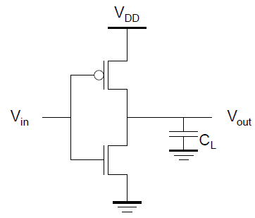
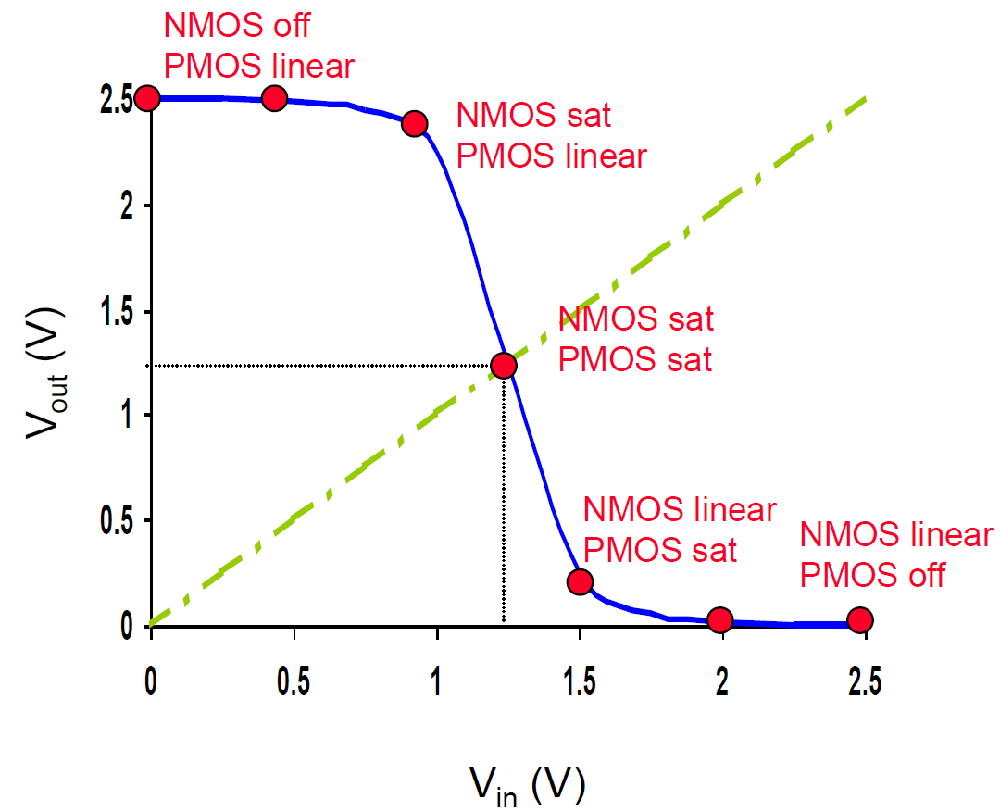
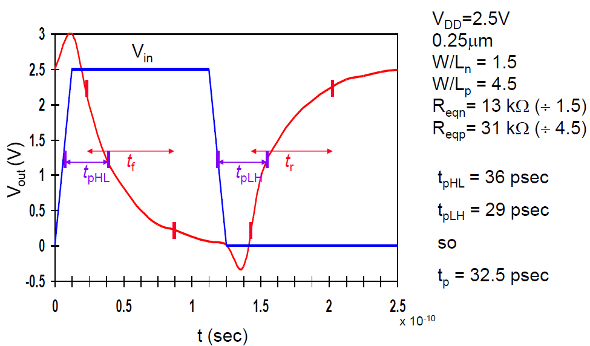
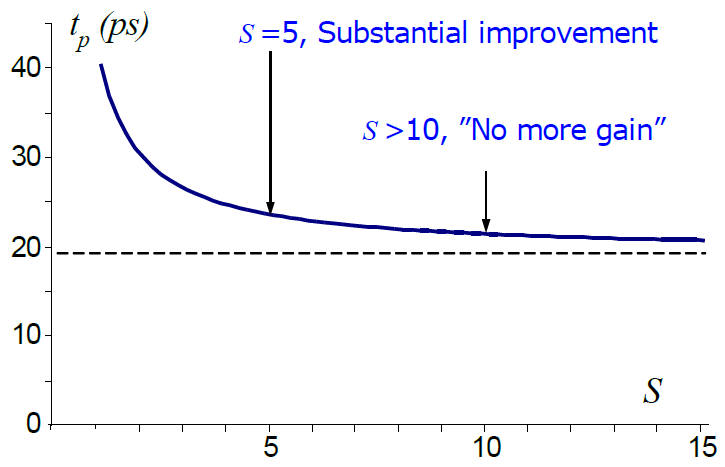
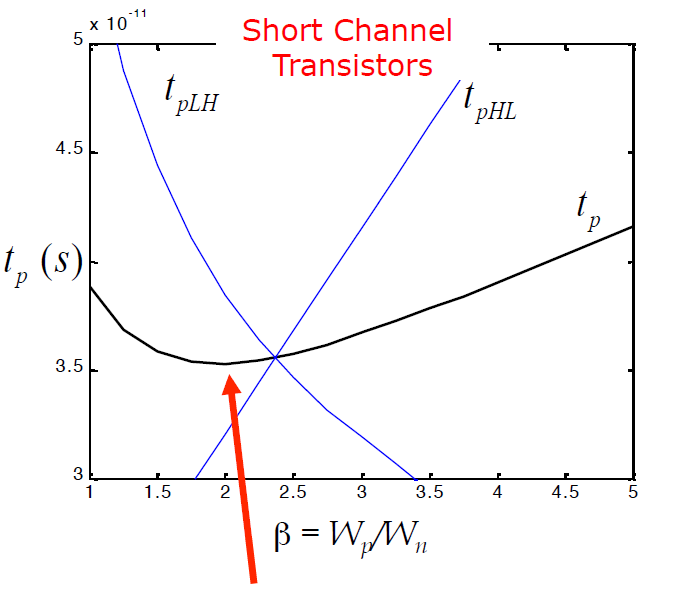
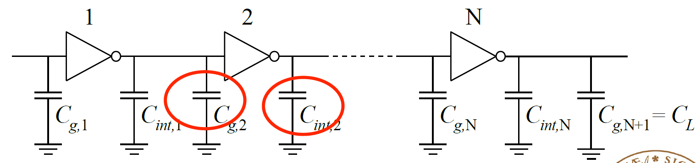

CMOS 反相器用一个上拉 PMOS 和一个下拉 NMOS 实现 $Y=\overline{A}$。它既是逻辑功能最简单的门，也是分析数字电路电气特性的基础：稳态电流决定输出电平，节点充放电决定延迟，输入和输出电容决定前后级之间的负载关系。

本章使用[器件与电学模型](C02.md)中的电流和电容关系，分别讨论稳定输入下的静态特性，以及输入切换时的动态特性。这两类分析对应不同问题：输入稳定后输出是否可靠，以及输出需要多久才能达到可用电平。

## 互补结构与稳定电平

*图 1：PMOS 将输出连接到电源，NMOS 将输出连接到地，两管栅极连接到同一输入。*

输入为低电平时，NMOS 关断、PMOS 导通，输出电容被充电到接近 $V_{DD}$。输入为高电平时，PMOS 关断、NMOS 导通，输出被放电到接近地电位。在理想稳态、无直流负载并忽略漏电的条件下，

$$
V_{OH}=V_{DD},\qquad V_{OL}=0.
$$

两种稳定状态中都有一条到电源或地的导通路径，输出不会依靠浮置电容长期保存逻辑值。由于稳态没有同时导通的上拉和下拉通路，理想模型也没有持续直通电流；实际器件仍有漏电。

静态互补 CMOS 属于无比逻辑（Ratioless Logic）：在上述理想条件下，额定高低电平不依赖 PMOS 与 NMOS 的尺寸比。尺寸比仍会影响翻转电压、噪声容限和上升下降延迟。

## 电压传输特性与工作区

### 用电流平衡确定输出

电压传输特性（Voltage Transfer Characteristic，VTC）描述静态关系 $V_{out}=F(V_{in})$。输入稳定足够长时间后，输出电容不再持续充放电，其电流为零，因此两管电流幅值相等：

$$
I_n(V_{in},V_{out})=I_p(V_{in},V_{out}).
$$

对每一个输入电压，使用以下端电压代入器件模型：

$$
\begin{aligned}
V_{GSn}&=V_{in}, & V_{DSn}&=V_{out},\\
V_{SGp}&=V_{DD}-V_{in}, & V_{SDp}&=V_{DD}-V_{out}.
\end{aligned}
$$

可以把上拉、下拉电流分别画成输出电压的函数，以交点确定稳态。这称为负载线分析。若更换电源、器件尺寸或阈值参数，两条曲线和交点都会改变。

*图 2：输入由低到高变化时，输出从高电平经过过渡区降为低电平。*

在常见强反型长沟道近似、供电足以使两管同时导通的条件下，沿 VTC 可区分以下区域。

| 输入变化阶段 | NMOS | PMOS | 输出特点 |
| --- | --- | --- | --- |
| 输入很低 | 截止 | 线性，稳态漏源压接近零 | 输出接近 $V_{DD}$ |
| 输入开始升高 | 饱和 | 线性 | 输出开始下降 |
| 翻转附近 | 饱和 | 饱和 | 对输入变化十分敏感 |
| 输入继续升高 | 线性 | 饱和 | 输出进一步下降 |
| 输入很高 | 线性，稳态漏源压接近零 | 截止 | 输出接近零 |

理想平方律模型若完全忽略沟道长度调制，两管同时饱和时电流对输出电压没有依赖，会形成非常陡甚至理想化的竖直过渡。实际器件的有限输出电阻和其他效应使过渡区具有有限斜率。低电压或短沟道情况下，需要重新按对应器件模型判断区域。

### 开关阈值与尺寸比

反相器开关阈值 $V_M$ 定义为 VTC 与 $V_{out}=V_{in}$ 的交点：

$$
V_{in}=V_{out}=V_M.
$$

它是整个门电路的翻转指标，与单个 MOS 的阈值电压 $V_T$ 不同。在零体偏、两管强反型饱和、忽略沟道长度调制的长沟道模型中，

$$
\frac{\beta_n}{2}(V_M-V_{Tn})^2
=\frac{\beta_p}{2}(V_{DD}-V_M-|V_{Tp}|)^2.
$$

取 $r=\sqrt{\beta_p/\beta_n}$，解得

$$
V_M=\frac{V_{Tn}+r(V_{DD}-|V_{Tp}|)}{1+r}.
$$

这里 $\beta_n=k_n'(W/L)_n$，$\beta_p=k_p'(W/L)_p$ 均取正值。增大 PMOS 的相对驱动能力使 $V_M$ 提高，增大 NMOS 的相对驱动能力使 $V_M$ 降低。若两管阈值幅值相等、驱动参数也相等，模型给出 $V_M=V_{DD}/2$。

采用短沟道手工模型时，应先比较过驱动电压和经验速度饱和电压，再写电流平衡。以 $V_{DD}=2.5$ V、目标 $V_M=1.25$ V、$(W/L)_n=1.5$ 为例，取

$$
\begin{aligned}
V_{Tn}&=0.43\ \mathrm{V}, & |V_{Tp}|&=0.40\ \mathrm{V},\\
k_n'&=115\ \mathrm{\mu A/V^2}, & k_p'&=30\ \mathrm{\mu A/V^2},\\
V_{DSATn}&=0.63\ \mathrm{V}, & |V_{DSATp}|&=1.00\ \mathrm{V}.
\end{aligned}
$$

这里 PMOS 的经验饱和电压取正幅值。忽略体效应与沟道长度调制，NMOS 的过驱动电压为 0.82 V，故 $V_{min,n}=0.63$ V；PMOS 的过驱动电压为 0.85 V，故 $V_{min,p}=0.85$ V。两管均处于饱和，但对应的限制不同。

于是满足电流平衡的尺寸比为

$$
\begin{aligned}
\frac{(W/L)_p}{(W/L)_n}
&=\frac{115(0.82\times0.63-0.63^2/2)}
{30(0.85\times0.85-0.85^2/2)}\\
&\approx3.38,
\end{aligned}
$$

从而 $(W/L)_p\approx5.06$。该结果对应所列模型参数和静态目标。使 $V_M$ 位于中点与使上升、下降延迟相等，是两个需要分别检查的设计目标；工程中的 $W_p\approx2W_n$ 也只是在某些工艺和负载条件下的近似选择。

## 再生特性与噪声容限

### 电平恢复的条件

在高低电平区域，VTC 的斜率幅值较小，输入电压的小偏差只引起较小的输出变化。在过渡区，斜率幅值大于 1，输入的微小差异会被放大，使输出趋向两个稳定逻辑状态之一。

偶数级反相器串联后，总逻辑极性不变。若各级有兼容的输入输出电平、稳定电平附近的增益幅值小于 1，信号可以逐级恢复到额定状态。过渡区的高增益支持这种区分能力，但输入能否可靠传递还需要用噪声容限判断。

### 输入边界与静态噪声容限

$V_{IL}$ 是仍能保证识别为低电平的最高输入电压，$V_{IH}$ 是仍能保证识别为高电平的最低输入电压。对于平滑且单调的常见反相器 VTC，通常用两处

$$
\frac{\mathrm{d}V_{out}}{\mathrm{d}V_{in}}=-1
$$

的点确定输入边界。$V_{IL}$ 与 $V_{IH}$ 之间是未保证逻辑值的过渡范围。

静态低、高电平噪声容限分别为

$$
NM_L=V_{IL}-V_{OL},\qquad
NM_H=V_{OH}-V_{IH}.
$$

前一级输出和后一级输入的规格决定了噪声还能偏移多少。例如，取 $V_{OL}=0.05$ V、$V_{OH}=2.45$ V、$V_{IL}=0.90$ V、$V_{IH}=1.50$ V，便有 $NM_L=0.85$ V、$NM_H=0.95$ V。这里是在给定电平参数下计算裕量，不代表任意 2.5 V 工艺都具有这些参数。

若用经过 $(V_M,V_M)$、斜率为 $-a$ 的直线近似过渡区，并以其与高低电平平台的交点近似输入边界，则

$$
V_{IL}\approx V_M-\frac{V_{OH}-V_M}{a},\qquad
V_{IH}\approx V_M+\frac{V_M-V_{OL}}{a}.
$$

这是分段线性估算，不是直接求导得到的精确边界。对于理想对称平台 $V_{OH}=V_{DD}$、$V_{OL}=0$、$V_M=V_{DD}/2$，该近似给出

$$
NM_L\approx NM_H\approx
\frac{V_{DD}}{2}\left(1-\frac{1}{a}\right).
$$

有限过渡区增益下，容限小于 $V_{DD}/2$；只有过渡区趋于无限陡的理想极限才接近半个电源电压。实际串扰或电源扰动还包含脉冲宽度和时序信息，静态 VTC 不能单独描述所有瞬态干扰。

### 工艺、电压与温度的影响

工艺、电压、温度（Process, Voltage and Temperature，PVT）变化会改变阈值、迁移率、驱动电流和漏电。PMOS 相对变强、NMOS 相对变弱时，VTC 倾向向更高输入电压移动，反过来则向更低输入电压移动。

降低电源电压会减小可用摆幅，减弱强反型驱动，并使延迟和容限更加依赖器件参数。极低供电时需要采用弱反型模型。温度升高通常同时影响阈值电压与迁移率，这两个变化可能对电流产生不同方向的影响，因此不能只凭阈值降低就判断速度一定提高。

## 瞬态响应与一阶 RC 延迟

### 传播延迟与边沿时间

传播延迟以输入和输出经过各自摆幅 50% 的时刻之差定义：输出从高到低为 $t_{pHL}$，从低到高为 $t_{pLH}$。平均传播延迟为

$$
t_p=\frac{t_{pHL}+t_{pLH}}{2}.
$$

上升时间 $t_r$ 通常取输出从摆幅 10% 上升到 90% 的时间，下降时间 $t_f$ 则取 90% 下降到 10% 的时间。它们描述输出边沿，传播延迟则描述输入到输出的响应，两者需要区分。

*图 3：传播延迟用 50% 电平测量，边沿时间用 10% 与 90% 电平测量；实际波形还可能出现耦合引起的过冲。*

### RC 充放电公式

在理想阶跃输入、忽略另一管的暂态竞争，并把导通管近似为恒定有效电阻的条件下，输出高到低可等效为 $R_n$ 对 $C_L$ 放电：

$$
C_L\frac{\mathrm{d}V_{out}}{\mathrm{d}t}
=-\frac{V_{out}}{R_n},
\qquad
V_{out}(t)=V_{DD}e^{-t/(R_nC_L)}.
$$

输出降至 $V_{DD}/2$ 时，

$$
t_{pHL}\approx\ln2\,R_nC_L\approx0.69R_nC_L.
$$

上升过程由 PMOS 充电，满足

$$
V_{out}(t)=V_{DD}[1-e^{-t/(R_pC_L)}],
\qquad
t_{pLH}\approx0.69R_pC_L.
$$

由 10% 与 90% 电平可进一步得到

$$
t_f\approx\ln9\,R_nC_L\approx2.20R_nC_L,\qquad
t_r\approx2.20R_pC_L.
$$

这组公式属于一阶 RC 近似。实际输入边沿有限，MOS 的电流随输出电压改变，寄生耦合也可能引起过冲，所以它不能代替所有情况下的瞬态波形分析。

更接近器件电流模型的放电时间可写为

$$
t_{pHL}\approx C_L
\int_{V_{DD}/2}^{V_{DD}}
\frac{\mathrm{d}V}{I_n(V)}.
$$

有效电阻用来把该区间的响应折算为 $0.69R_nC_L$。因此，它是对一段充放电过程的近似，而不是整个过程中的固定物理电阻。

例如，取 $R_n=8$ kΩ、$R_p=10$ kΩ、$C_L=20$ fF，则

$$
\begin{aligned}
t_{pHL}&\approx0.69\times8\times20\ \mathrm{ps}=110.4\ \mathrm{ps},\\
t_{pLH}&\approx0.69\times10\times20\ \mathrm{ps}=138.0\ \mathrm{ps},\\
t_p&\approx124.2\ \mathrm{ps}.
\end{aligned}
$$

单位换算使用 $1\ \mathrm{k\Omega}\times1\ \mathrm{fF}=1$ ps。若下降时间较短而上升时间较长，优化最坏延迟时需要先检查上拉驱动和其负载。

## 负载电容与尺寸优化

### 本征、互连与扇出负载

影响输出的电容可以分为本级寄生电容 $C_{int}$ 和外部负载 $C_{ext}$：

$$
C_L=C_{int}+C_{ext}.
$$

本级电容包括 NMOS、PMOS 的漏体结电容，以及栅漏耦合的等效贡献；外部负载包括连线电容和后级门的输入电容。扇出（Fan-out）表示本级驱动的后级负载，不能只用连接门的数量判断电容大小，因为不同门的输入尺寸不同。

栅漏电容 $C_{gd}$ 连接在输入、输出之间。若输入与输出发生幅度相等、方向相反的变化，跨电容电压变化为单端摆幅的两倍，其对该节点的等效充放电作用约相当于 $2C_{gd}$，这称为密勒效应（Miller Effect）。一般情况下，等效系数与两端波形有关，不能对任意电容都固定乘二。

在上述近似下，可以估计

$$
C_{int}\approx C_{db,n}+C_{db,p}
+2(C_{gd,n}+C_{gd,p}),
$$

再加上连线和后级输入电容。器件模型若已经包含这些电荷，使用仿真模型时要避免重复计入。

### 整体放大与自载效应

在沟道长度不变、器件比例不变且电容近似随宽度变化的条件下，将两管宽度都放大 $S$ 倍，可以近似写为

$$
R_{eq}(S)=\frac{R_{ref}}{S},\qquad
C_{int}(S)=SC_{int,ref}.
$$

驱动一个固定外部负载时，

$$
\begin{aligned}
t_p(S)&\approx0.69\frac{R_{ref}}{S}
(SC_{int,ref}+C_{ext})\\
&=0.69R_{ref}C_{int,ref}
+0.69R_{ref}\frac{C_{ext}}{S}.
\end{aligned}
$$

第一项为本征延迟 $t_{p0}$，第二项为外部负载引起的延迟。增大尺寸能减小第二项，但在这个模型中不能减小第一项。尺寸继续增大后，自身电容占据更大比例，延迟改善逐渐减少，面积、输入电容与开关消耗仍继续增加。

*图 4：固定外部负载下，延迟逐渐接近本征值；图中的尺寸分界属于该例的参数条件。*

对于图示的关系

$$
t_p(S)=19.3\left(1+\frac{1.05}{S}\right)\ \mathrm{ps},
$$

$S=1$ 时约为 39.6 ps，$S=5$ 时约为 23.4 ps，$S=10$ 时约为 21.3 ps，而极限为 19.3 ps。尺寸从 5 增大到 10，延迟只再减少约 2.0 ps。

单独放大某一级，还会增大前一级看到的输入电容，所以不能只看该级延迟。对路径进行优化时，应把前级到后级的负载传递一起考虑。

## 对称反相器与尺寸比

### 上升与下降的对称条件

对称反相器在规定的工艺、电源、负载和输入边沿条件下，使输出高到低和低到高的传播延迟相等：

$$
t_{pHL}=t_{pLH}.
$$

使用同一个有效负载 $C_L$ 的一阶 RC 模型时，这一条件就是 $R_{eq,n}=R_{eq,p}$。当一条路径既可能传递上升沿，也可能传递下降沿，设计需要同时控制两种响应；只缩短其中较快的边沿，不能改善另一方向的最坏延迟。

令两管沟道长度相同，定义宽度比 $\rho=W_p/W_n$，并令 $\kappa$ 为两管等宽时 PMOS 与 NMOS 的有效电阻之比。固定 $W_n$、只改变 $W_p$ 时，宽度近似给出

$$
R_{eq,p}(\rho)\approx\frac{\kappa}{\rho}R_{eq,n},
\qquad
\rho_{sym}\approx\kappa.
$$

在长沟道、小漏压近似中，

$$
\kappa\approx
\frac{k_n'(V_{DD}-V_{Tn})}
{k_p'(V_{DD}-|V_{Tp}|)}.
$$

若阈值幅值接近，便进一步近似为 $\rho_{sym}\approx k_n'/k_p'\approx\mu_n/\mu_p$。PMOS 的迁移率通常较小，需要较大宽度补偿驱动能力。短沟道设计则应使用相应充放电区间的有效电阻或电流模型，比例还受到速度饱和、偏置和输入边沿影响。

例如，若等宽时 $R_{eq,n}=10$ kΩ、$R_{eq,p}=20$ kΩ，则 $\kappa=2$，初始对称尺寸取 $W_p=2W_n$。这说明常见的 2:1 配置来自驱动能力匹配；它依赖具体工艺条件，而不是 CMOS 结构本身规定的固定比例。

前面求 $V_M=V_{DD}/2$ 的例题使用翻转点处的电流平衡，这里使用整个输出充放电过程的有效电阻。两者评价的工作点不同。实际对称延迟设计的 $V_M$ 可以略偏离半个电源电压，例如某些短沟道设计的 2:1 配置可同时得到较均衡的延迟和约 $0.45V_{DD}$ 的翻转点。

### 平均延迟最小与最坏延迟最小

*图中的 $\beta$ 表示 $W_p/W_n$，对应本文的 $\rho$。两种边沿延迟的交点与平均延迟的最低点可以不同。*

加宽 PMOS 一方面减小上拉电阻，另一方面增大本级输出电容和前级输入负载。因此，上升延迟和下降延迟不一定同时减小。

为单独观察尺寸比例，考虑一个自载或同结构负载占主导的简化例子：$W_n$ 固定，$R_{eq,n}=R$，$R_{eq,p}=\kappa R/\rho$，而有效负载随总管宽变化为 $C_L=C_0(1+\rho)$。则

$$
\begin{aligned}
t_{pHL}&\approx0.69RC_0(1+\rho),\\
t_{pLH}&\approx0.69RC_0\frac{\kappa(1+\rho)}{\rho},\\
t_p&\approx\frac{0.69RC_0}{2}
\left(1+\rho+\kappa+\frac{\kappa}{\rho}\right).
\end{aligned}
$$

对平均延迟求导，有

$$
\frac{\mathrm{d}t_p}{\mathrm{d}\rho}
=\frac{0.69RC_0}{2}\left(1-\frac{\kappa}{\rho^2}\right),
\qquad \rho_{avg}=\sqrt{\kappa}.
$$

而最坏延迟为 $\max(t_{pHL},t_{pLH})$，在该模型中于两条曲线相交的 $\rho_{worst}=\kappa$ 处最小。平均延迟目标允许两种边沿不相等，最坏延迟目标则优先处理较慢的边沿。

取 $R=10$ kΩ、$C_0=5$ fF、$\kappa=2$，计算结果为：

| 宽度比 $\rho$ | $t_{pHL}$ / ps | $t_{pLH}$ / ps | 平均延迟 / ps | 最坏延迟 / ps |
| --- | --- | --- | --- | --- |
| 1 | 69.0 | 138.0 | 103.5 | 138.0 |
| $\sqrt2\approx1.414$ | 83.3 | 117.8 | 100.5 | 117.8 |
| 2 | 103.5 | 103.5 | 103.5 | 103.5 |
| 3 | 138.0 | 92.0 | 115.0 | 138.0 |

对称配置的平均延迟略高于该模型的最低平均值，但它具有更小的最坏延迟。这个算例指定了 $C_L$ 随尺寸变化的方式；若外部固定负载占主导，或者限定总管宽，需按新的约束重新优化，不能沿用 $\sqrt{\kappa}$ 结论。

## 反相器延迟优化

### 电源电压与有效驱动电阻

反相器延迟近似为 $0.69R_{eq}C_L$。提高电源电压通常增大驱动电流、降低有效电阻，但短沟道速度饱和使高电压下的改善逐渐减小。

在速度饱和主导、忽略沟道长度调制，并把放电过程按有效电阻平均的手工模型中，令 $\beta_n=k_n'(W/L)_n$，有

$$
I_{DSAT,n}\approx\beta_nV_{DSAT,n}
\left(V_{DD}-V_{Tn}-\frac{V_{DSAT,n}}{2}\right),
$$

$$
R_{eq,n}\approx\frac{3}{4}\frac{V_{DD}}{I_{DSAT,n}},
\qquad
t_{pHL}\approx
\frac{0.52C_LV_{DD}}
{\beta_nV_{DSAT,n}(V_{DD}-V_{Tn}-V_{DSAT,n}/2)}.
$$

0.52 来自 $0.69\times3/4$ 的近似。这组关系适合相关放电区间主要处于速度饱和的情况；若电压降低后不再满足该工作区假设，应回到器件分区电流或弱反型模型。

当 $V_{DD}\gg V_{Tn}+V_{DSAT,n}/2$，电压比值逐渐接近 1，延迟趋近

$$
t_{pHL}\approx\frac{0.52C_L}{\beta_nV_{DSAT,n}}.
$$

所以高供电时继续提高电压的收益有限。接近阈值时，驱动电流明显降低，延迟则更敏感；与此同时，充放电能量仍随 $V_{DD}^2$ 增加，必须把时序和能量一起比较。

### 路径上的最优尺寸

固定外部负载、只观察本级时，增大尺寸 $S$ 会使延迟趋近本征值。把前级一起纳入，尺寸增大还会增加前级延迟，于是整条路径可以出现有限的最优尺寸。

设前级有效电阻为 $R_{prev}$，被优化反相器的单位输入电容为 $C_{in,ref}$、单位驱动电阻为 $R_{ref}$，它驱动固定的 $C_{ext}$。忽略布线变化，并把不随 $S$ 变化的延迟合并为 $T_0$，两级路径近似为

$$
T(S)\approx T_0+0.69R_{prev}C_{in,ref}S
+0.69R_{ref}\frac{C_{ext}}{S}.
$$

第一项尺寸相关延迟随 $S$ 增大，来自前级驱动更大的输入电容；第二项随 $S$ 减小，来自本级驱动固定外部负载。求导得

$$
S_{opt}=\sqrt{\frac{R_{ref}C_{ext}}{R_{prev}C_{in,ref}}}.
$$

例如，$R_{prev}=R_{ref}=10$ kΩ、$C_{in,ref}=2$ fF、$C_{ext}=32$ fF，则 $S_{opt}=4$。除去固定的 $T_0$，$S=1$、4、8 时的路径延迟分别约为 234.6、110.4、138.0 ps。放大到 8 倍虽然改善本级驱动，却因前级负载增加而使路径变慢。

### 减少本征与互连负载

减小输出漏区面积和有效周长，可降低漏体结电容；共享合适的扩散区、缩短连线和减少无用扇出，也能减小充放电负担。对于输入输出反向变化的栅漏耦合，还要考虑密勒效应，按端点波形折算等效电容。

优化顺序可以由当前的限制决定：外部电容大时先考虑缓冲和负载分配，自载电容大时优先减少寄生，某一种边沿明显较慢时先检查 P/N 比例。每次调整尺寸后，都需要把本级输出电容和前级输入电容同时更新。

## 扇出负载与反相器链

### 扇出数与电气扇出

扇出数表示一个输出连接了多少个后级输入端；电气扇出表示需要驱动的电容相对于自身输入电容有多大。对多个后级和互连，

$$
C_{ext}=C_{wire}+\sum_k C_{in,k},\qquad
h=\frac{C_{ext}}{C_{in,driver}}.
$$

这里 $C_{ext}$ 不包含驱动门自身的输出寄生电容。连接四个同尺寸反相器、忽略线电容时，电气扇出为 4；连接四个不同尺寸的门时，扇出数仍是 4，但 $h$ 可能不同。

例如，驱动门输入电容为 3 fF，后级为三个 3 fF 输入和一个 12 fF 输入，互连为 3 fF，则 $C_{ext}=24$ fF、电气扇出 $h=8$。延迟模型需要使用电容负载比，而不是直接把连接数量 4 代入。

### 电气扇出与逐级放大

很小的门直接驱动很大的电容，会产生很大延迟；把驱动门直接做得很大，又会使前级承受很大输入电容。反相器链用多个逐级放大的门传递驱动能力。

*图 5：每一级同时驱动自身输出寄生电容和下一级输入电容，末级驱动目标负载。*

设第 $j$ 级输入电容为 $C_{in,j}$，电气扇出定义为

$$
h_j=\frac{C_{in,j+1}}{C_{in,j}},
$$

末级把 $C_{in,N+1}$ 理解为目标外部负载。若各级结构相同、$C_{int,j}=\gamma_C C_{in,j}$，并令

$$
\tau=0.69R_{ref}C_{in,ref},
$$

则简化单级延迟为

$$
t_{p,j}\approx\tau(\gamma_C+h_j).
$$

$\gamma_C$ 是本征输出电容与输入电容的比值，与 C02 中的体效应系数 $\gamma$ 不同。对固定级数 $N$ 和总负载比

$$
F=\frac{C_{load}}{C_{in,1}}=\prod_{j=1}^{N}h_j,
$$

使各级扇出相等，可以最小化该模型中的扇出项之和：

$$
h_1=\cdots=h_N=F^{1/N},\qquad
t_{chain}\approx N\tau(\gamma_C+F^{1/N}).
$$

### 级数与极性的选择

级数太少，每一级负载比大；级数太多，则增加本征延迟。把 $N$ 暂时看作连续变量，可得到最优单级扇出满足

$$
h\ln h=h+\gamma_C.
$$

当 $\gamma_C=0$ 时，解为 $h=e$；当 $\gamma_C\approx1$ 时，解约为 3.6。考虑整数级数和实现约束，常用每级约 4 倍的负载比作为初始设计，但它不是所有工艺和路径的固定最优值。

例如，$F=64$、$\gamma_C=1$，按等扇出设计：

| 反相器级数 $N$ | 单级扇出 $h$ | 链延迟 $t_{chain}/\tau$ |
| --- | --- | --- |
| 1 | 64 | 65 |
| 2 | 8 | 18 |
| 3 | 4 | 15 |
| 4 | 约 2.83 | 约 15.31 |

三级方案的尺寸可取 $1:4:16$，末级再驱动相当于 64 个单位输入电容的负载。若要求整条链不反相，则需要偶数级，在表中应比较两级与四级方案，或结合相邻逻辑调整极性。完整设计还要考虑输入到达时间、布线和输出边沿要求。

FO4 延迟是一个参考反相器驱动四个相同反相器输入负载时的延迟，常用于比较一定条件下的工艺或电路速度。比较 FO4 时也应明确电压、工艺角、温度和输入边沿。

### 环形振荡器

将奇数级反相器首尾连接，在适合的增益和延迟条件下可以构成环形振荡器。对于常见的三级及以上奇数级环振，一个跳变传播一圈会改变极性，再传播一圈才恢复原状态，所以周期近似为

$$
T\approx2Nt_p,\qquad f_{osc}\approx\frac{1}{2Nt_p}.
$$

这里 $t_p$ 是各级在环内实际负载下的平均传播延迟。该关系可用于理解门延迟与振荡频率的联系，但供电、温度、级间负载和上升下降不对称都会影响结果。

## 功耗与能量的取舍

输出电容从 0 充到 $V_{DD}$，电源提供 $C_LV_{DD}^2$ 的能量，其中一半储存在电容中，另一半在充电路径中消耗。随后放电，储存的能量在放电路径中消耗，因此完整充放电周期消耗

$$
E_{cycle}=C_LV_{DD}^2.
$$

若 $\alpha$ 为每个时钟周期内平均 $0\to1$ 充电次数，开关功耗为

$$
P_{switching}=\alpha C_LV_{DD}^2f.
$$

例如，$C_L=100$ fF、$V_{DD}=2.5$ V、$f=100$ MHz、$\alpha=0.1$，得到 $P_{switching}=6.25$ μW。仅把电压降为 1.25 V，且其他条件仍能保持时，开关功耗变为 1.5625 μW；实际需要确认降低电压后的延迟是否仍允许该频率。

输入边沿有限时，可能存在两管同时导通的区间，从电源到地形成短路电流。短路功耗取决于输入边沿、阈值、电源及输出响应。稳定状态下还存在漏电功耗，近似为 $P_{leakage}=V_{DD}I_{leakage}$。因此，反相器总功耗应同时考虑开关、短路和漏电贡献。

功耗延迟积（Power-Delay Product，PDP）为 $P_{avg}t_d$，能量延迟积（Energy-Delay Product，EDP）为 $E_{op}t_d$。前者单位为 J，后者为 J·s。PDP 的能量解释取决于功耗的测量窗口和操作次数；评价某个任务时，应直接计算同一任务边界内的能量。

| 优化操作 | 主要收益 | 同时需要检查 |
| --- | --- | --- |
| 增大器件宽度 | 降低有效驱动电阻 | 本级寄生、前级输入负载、面积与漏电 |
| 调整 PMOS/NMOS 比例 | 改变翻转电压与边沿平衡 | 两侧噪声容限及最坏延迟 |
| 降低输出扩散区和连线电容 | 减少延迟和开关能量 | 接触、电阻和布线实现 |
| 提高供电电压 | 在适用范围内增加驱动能力 | 动态功耗和器件允许工作条件 |
| 降低供电电压 | 减少开关能量 | 延迟、容限与 PVT 敏感性 |
| 插入并配置缓冲器链 | 改善大负载路径延迟 | 总面积、能量、级数和逻辑极性 |
| 减少无用翻转 | 降低活动因子 | 控制逻辑及功能、时序要求 |

反相器优化需要针对具体负载和目标进行。接下来的[组合逻辑](C04.md)会把一对上拉、下拉器件扩展为网络；驱动电阻、寄生电容与前级负载之间的关系仍然适用，但需要额外考虑串联节点和输入变化顺序。

## 参考资料

- 数字集成电路课程资料，CMOS 反相器部分，存于项目 `.files/数集/Full course - 1.pptx`；配图直接提取自该资料。
- Jan M. Rabaey、Anantha Chandrakasan、Borivoje Nikolić：《数字集成电路——电路、系统与设计》，第二版，清华大学出版社。
