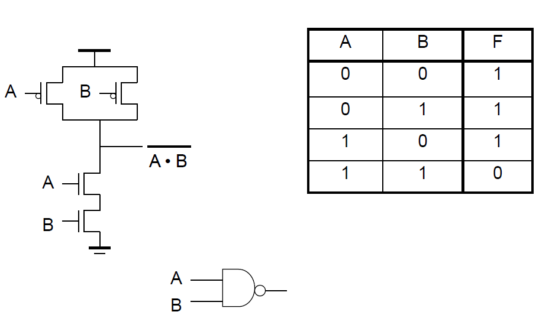
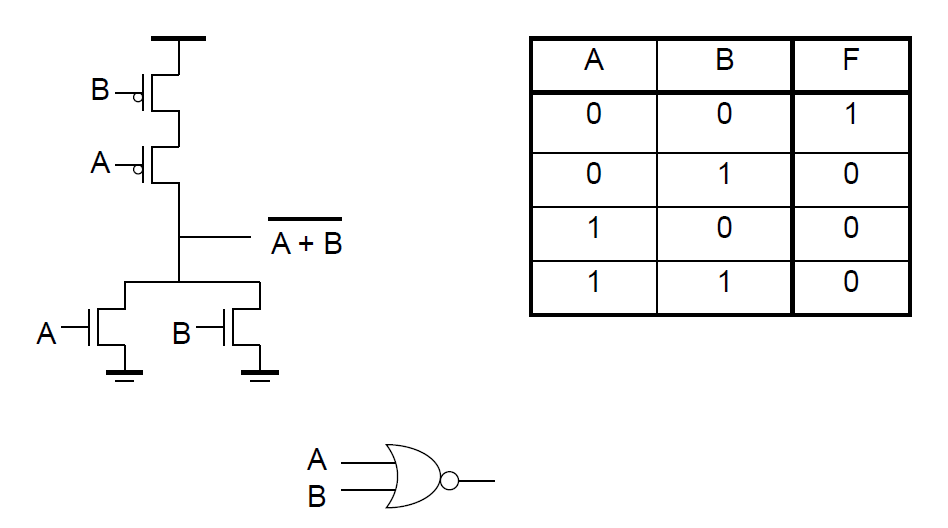
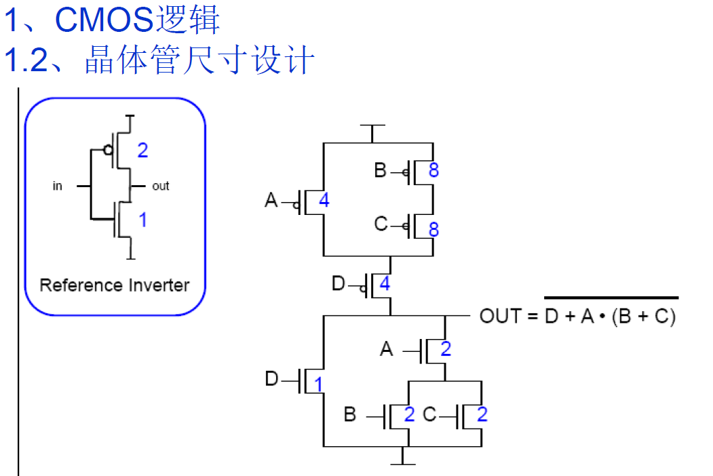
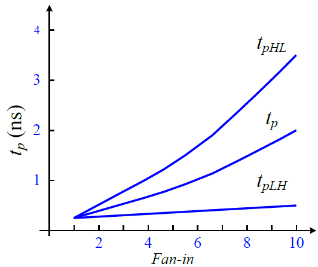
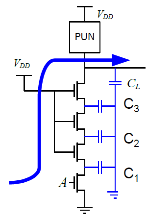
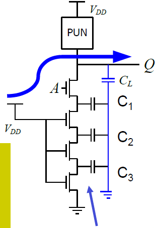
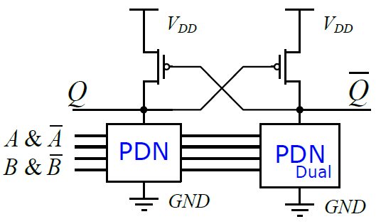
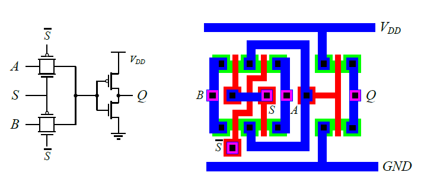
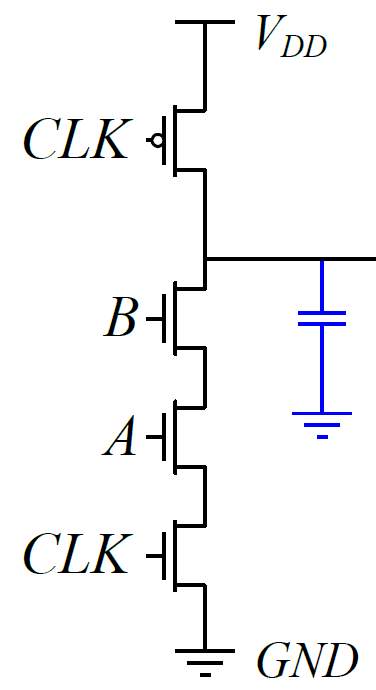
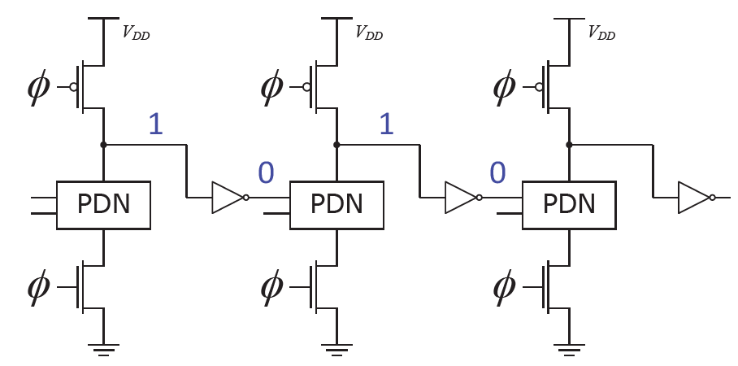

组合逻辑电路的稳态输出由当前输入决定，例如与非门、异或门和加法器中的组合运算。时序逻辑还包含状态，其行为与过去保存的信息有关。两者都需要处理电压、延迟和功耗，但组合逻辑首先要解决如何把布尔关系转换为可靠的器件连接。

[反相器](C03.md)中，一个 PMOS 上拉，一个 NMOS 下拉。扩展到多输入逻辑后，每个单管被网络替代，输出仍通过上拉或下拉路径完成充放电。此时不仅要看路径电阻，还要看内部节点电容、输入变化顺序，以及前一级需要驱动多少栅电容。

## 静态互补 CMOS 的构造

### 上拉网络与下拉网络

上拉网络（Pull-Up Network，PUN）把输出连接到电源，下拉网络（Pull-Down Network，PDN）把输出连接到地。静态互补 CMOS 通常用 PMOS 构成 PUN，用 NMOS 构成 PDN，使合法稳定输入下两个网络中恰有一个导通。

先确定输出应当为零的输入条件，再用 NMOS 构造对应的导通路径。NMOS 在栅输入为 1 时导通，串联路径要求各条件同时成立，表示与；并联路径只需任一路成立，表示或。若 PDN 的导通条件为 $G$，输出函数就是

$$
Y=\overline{G}.
$$

PUN 实现互补的导通条件，可以把 PDN 中的串联换为并联、并联换为串联，并把 NMOS 换成 PMOS，保留对应栅输入。PMOS 在栅输入为 0 时导通，因此这种对偶变换满足德摩根关系。

以二输入与非门为例，PDN 用两个 NMOS 串联，只有 $A=B=1$ 时导通；PUN 用两个 PMOS 并联，只要一个输入为 0 就上拉输出，得到 $Y=\overline{AB}$。

*图 1：串联 NMOS 实现同时成立的下拉条件，并联 PMOS 实现其互补条件。*

二输入或非门的 PDN 为并联 NMOS，PUN 为串联 PMOS，得到 $Y=\overline{A+B}$。

*图 2：任一输入为高都能下拉，只有两个输入都低时才存在上拉路径。*

仅以未取反输入驱动串并联互补网络时，单级自然得到反相的与或组合函数。实现 AND、OR 等正相函数可以在反相门之后增加反相器，或者在更大的逻辑结构中安排互补信号。

### 复杂逻辑的网络分解

考虑

$$
Y=\overline{D+A(B+C)}.
$$

PDN 的导通条件是 $D+A(B+C)$：一条路径由 D 管单独组成，另一条路径是 A 管串联 B、C 的并联组合。PUN 则为 D 管串联一个并联组合，该组合包括单独的 A 管，以及 B、C 的串联路径。

可以分情况核对连接关系。$D=1$ 时输出为 0；$D=0,A=0$ 时输出为 1；$D=0,A=1$ 时，只有 $B=C=0$ 才输出 1，其余情况输出 0。检查网络时，应把逻辑结果与实际到电源或地的路径对应起来。

### 全摆幅与稳态功耗

NMOS 适合把节点下拉到零：放电过程中源端通常保持在低电位，栅源电压仍足以使它导通。PMOS 适合把节点上拉到电源电压：其源端保持在高电位，充电接近完成时也可以维持导通条件。静态互补结构因此能获得接近 $V_{DD}$ 到 0 的全摆幅。

稳定状态下，输出有导通路径到某条电源轨，另一网络关断，理想情况下没有电源到地的直通电流。实际仍有漏电，输入切换期间也可能有两网络同时导通的短路电流。

对于每个输入在上、下拉网络中各出现一次的 N 输入 NAND 或 NOR，器件数量为 $2N$。复杂网络可能重复使用某个变量，异或结构也可能需要互补输入，所以不能把 $2N$ 当作所有 N 输入布尔函数的器件计数公式。

## 输入相关的静态与动态特性

### 不同输入端的电压传输关系

多输入门没有唯一的一条 VTC。分析某个输入时，要固定其余输入，或者规定它们如何同时变化，再求输出电压。例如，NAND2 在 $B=1$ 时扫描 A，可以观察有效翻转；若 $B=0$，输出被上拉，扫描 A 不再产生同样的翻转。

串联器件的内部源电位还可能不同，引入体效应和栅源电压差异。因此，不同引脚对应的翻转电压、噪声容限和延迟可能不同。逻辑对称的输入，不一定在物理电路中具有完全相同的特性。

### NAND2 的等效电阻

设单个 NMOS 和 PMOS 的有效电阻分别为 $R_n$、$R_p$，先忽略内部节点电容和体效应。NAND2 下拉需要两个 NMOS 同时导通，等效电阻约为 $2R_n$。上拉时，一个 PMOS 导通对应 $R_p$，两个同时导通对应 $R_p/2$。

因此，对相同输出负载 $C_L$，一阶估计为

$$
t_{pHL}\approx0.69(2R_n)C_L,
$$

$$
t_{pLH}\approx
\begin{cases}
0.69R_pC_L,&\text{单个 PMOS 上拉},\\
0.69(R_p/2)C_L,&\text{两个 PMOS 同时上拉}.
\end{cases}
$$

电阻模型能解释不同导通路径的差别，但还没有包含两只 NMOS 之间的内部节点。

### 内部电容与输入变化顺序

以 A 控制靠近输出的 NMOS、B 控制靠近地的 NMOS 为例。初始 $A=B=1$ 时，输出和内部节点都接近零。若 A 先变为 0，上方 NMOS 断开，PMOS 为输出充电，内部节点仍通过 B 管连接到地；若 B 先变为 0，上方 A 管仍导通，输出上升时还会向内部节点搬运电荷，延迟可能更长。

一组 NAND2 示例使用 $L_n=L_p=0.25$ μm、$W_n=0.5$ μm、$W_p=0.75$ μm 和 $C_L=100$ fF，得到以下输入相关延迟。数值只对应该示例模型和激励条件。

| 输入变化 | 输出方向 | 延迟 / ps |
| --- | --- | --- |
| $A=B:0\to1$ | 高到低 | 69 |
| $A=1,\ B:0\to1$ | 高到低 | 62 |
| $A:0\to1,\ B=1$ | 高到低 | 50 |
| $A=B:1\to0$ | 低到高 | 35 |
| $A=1,\ B:1\to0$ | 低到高 | 76 |
| $A:1\to0,\ B=1$ | 低到高 | 57 |

同一个逻辑门中，最慢模式与最快模式相差明显。路径分析需要考虑哪个输入变化、其他输入的逻辑状态以及内部节点的初始电荷。

## 等效反相器法确定尺寸

### 参考驱动与串并联路径

在固定沟道长度和偏置下，有效电阻可粗略看作与宽度成反比。设参考反相器的归一化宽度为

$$
w_n=1,\qquad w_p=2,
$$

并假设它们都具有有效电阻 $R$。于是任意归一化宽度的电阻可写为

$$
R_n(w)=\frac{R}{w},\qquad
R_p(w)=\frac{2R}{w}.
$$

归一化宽度以参考 NMOS 宽度为单位，所有器件使用相同沟道长度。该参考比例是假定的工艺近似，换工艺后应重新确定。

若一条必需导通的路径有 $m$ 个相同类型器件串联，把每个器件做成参考同类管的 $m$ 倍宽度，可使路径总电阻接近 $R$。并联网络按最坏的单支路导通情况配置，不能依靠其他支路一定同时导通来满足最坏驱动要求。

| 门结构 | 每个 NMOS 的归一化宽度 | 每个 PMOS 的归一化宽度 | 最坏导通路径 |
| --- | --- | --- | --- |
| 参考反相器 | 1 | 2 | 各一个器件 |
| NAND2 | 2 | 2 | 两个 NMOS 串联，或一个 PMOS 上拉 |
| NOR2 | 1 | 4 | 一个 NMOS 下拉，或两个 PMOS 串联 |
| $m$ 输入 NAND | $m$ | 2 | $m$ 个 NMOS 串联 |
| $m$ 输入 NOR | 1 | $2m$ | $m$ 个 PMOS 串联 |

匹配路径电阻只匹配了驱动能力，不保证复杂门与参考反相器具有相同延迟，因为复杂门可能有更大的输出和内部电容。

### 复杂门的非唯一尺寸方案

*图 3：数字为相对于参考 NMOS 的宽度，电路实现 $Y=\overline{D+A(B+C)}$。*

对于该 PDN，取

$$
w_{nD}=1,\qquad w_{nA}=w_{nB}=w_{nC}=2.
$$

D 单独导通的电阻为 $R$，A 与 B 或 C 串联的电阻为 $R/2+R/2=R$。若 B、C 同时导通，该路径更强，但不作为最坏情况依赖。

PUN 的一组尺寸为

$$
w_{pA}=w_{pD}=4,\qquad w_{pB}=w_{pC}=8.
$$

A、D 路径的电阻为

$$
\frac{2R}{4}+\frac{2R}{4}=R,
$$

B、C、D 路径的电阻为

$$
\frac{2R}{8}+\frac{2R}{8}+\frac{2R}{4}=R.
$$

另一组有效配置是 $w_{pA}=3$、$w_{pB}=w_{pC}=w_{pD}=6$。此时 A、D 路径为 $2R/3+2R/6=R$，B、C、D 路径也为 $R$。所以，满足最坏路径电阻的尺寸通常不唯一。

图中的 D 管直接连接输出。第一组方案的 $w_{pD}=4$，第二组为 6；若其他条件相近，第一组的该项输出扩散电容较小。但它对 B、C 输入造成更大栅负载，因此最终仍要结合关键输入和完整路径选择。

把 PUN 中串联的 D 管交换到靠近电源的位置，不改变稳态导通条件。交换后，输出可能直接连接 A、C 等器件的扩散区，改变输出电容和内部节点响应。逻辑等价只保证功能，不能保证电气性能相同。

## 扇入、扇出与内部 RC 延迟

### 输入数量与负载数量

扇入（Fan-in，FI）是一个逻辑门的输入数量，扇出数（Fan-out，FO）是一个输出连接的后级输入数量。扇入描述逻辑结构，扇出描述输出负载；计算延迟时，还需把各后级输入换算为电容。相同扇出数下，后级尺寸和结构不同，实际负载可以不同。

NAND 的扇入增加会增加串联 NMOS 的数量，也增加输出端连接的 PMOS 扩散区。前者提高下拉路径电阻，后者增大输出电容，串联内部还出现更多需要充放电的节点。因此，输入数量增加会同时改变电阻和电容。

增大扇出则主要增加后级栅电容。若驱动门的尺寸、输入边沿和互连条件固定，延迟近似随外部电容线性增加。用电气扇出 $h=C_{ext}/C_{in}$ 描述负载时，逻辑努力模型中的 $gh$ 就是对应的负载延迟项。

### Elmore 延迟估算

对于多管串联，下拉网络可近似为分布 RC 链。以四管堆叠为例，从地向输出依次定义电阻 $R_1,R_2,R_3,R_4$，三个内部节点电容为 $C_1,C_2,C_3$，输出负载为 $C_L$。在各节点初始为高电平、导通后共同放电的条件下，Elmore 时间常数为

$$
\begin{aligned}
\tau_E={}&R_1C_1+(R_1+R_2)C_2\\
&+(R_1+R_2+R_3)C_3\\
&+(R_1+R_2+R_3+R_4)C_L.
\end{aligned}
$$

常用 $t_{pHL}\approx0.69\tau_E$ 估计 50% 延迟。对于多极点 RC 网络，Elmore 时间常数与这种换算都属于工程估算，并非所有初始状态和波形下的精确结果。

如果 $n$ 个电阻都为 $R$，每个内部节点电容都为 $C$，则

$$
\tau_E=RC\frac{n(n-1)}{2}+nRC_L.
$$

内部节点项随堆叠数近似二次增长。两管情况下能否忽略内部电容，取决于它相对于输出负载的大小和初始状态；堆叠较多时，简单总电阻乘输出电容通常不足以描述延迟。

例如，四个电阻各为 5 kΩ，三个内部节点电容各为 2 fF，输出负载为 10 fF，则

$$
\begin{aligned}
\tau_E&=5\times2+10\times2+15\times2+20\times10\ \mathrm{ps}\\
&=260\ \mathrm{ps},\\
t_{pHL}&\approx179.4\ \mathrm{ps}.
\end{aligned}
$$

仅计算总电阻与输出负载会得到 $0.69\times20\times10=138$ ps，遗漏了内部节点项。

### 扇入的二次项与扇出的线性项

设一个 $n$ 输入 NAND 的器件宽度暂时保持不变，每个 NMOS 的电阻为 $R_n$，每个 PMOS 在输出端的扩散电容为 $C_{dp}$，最上方 NMOS 的输出扩散电容为 $C_{dn}$，内部各节点电容约为 $C_x$。若驱动 $m$ 个相同输入电容 $C_g$ 的后级，互连电容为 $C_w$，则

$$
C_L\approx nC_{dp}+C_{dn}+mC_g+C_w.
$$

把这个负载代入串联 RC 链，输出下降延迟近似为

$$
\begin{aligned}
t_{pHL}\approx0.69R_n\bigg[
&n(nC_{dp}+C_{dn}+mC_g+C_w)\\
&+\frac{n(n-1)}{2}C_x\bigg].
\end{aligned}
$$

即使先忽略内部节点，$nR_n$ 与 $nC_{dp}$ 相乘也产生扇入的二次项；内部节点再增加一个近似二次增长的项。固定扇入 $n$ 时，扇出 $m$ 对应的负载项则为 $0.69nR_nmC_g$，随后级数量线性增加。

最坏单 PMOS 上拉、忽略内部节点参与的近似是

$$
t_{pLH}\approx0.69R_p(nC_{dp}+C_{dn}+mC_g+C_w),
$$

此时上拉路径电阻没有随 $n$ 串联增加，主要体现输出电容带来的线性变化。NAND 的两种边沿因此有不同的扇入依赖；NOR 则需要重点处理 PMOS 串联上拉路径。

*该例的下降延迟增长明显快于上升延迟，体现串联下拉网络的影响。*

例如，取 $R_n=10$ kΩ、$C_{dp}=C_{dn}=C_x=1$ fF、$C_g=3$ fF、$C_w=0$，采用前面的全高初始状态 RC 估算：

| 扇入 $n$ | 扇出数 $m$ | 输出负载 $C_L$ / fF | Elmore 时间常数 / ps | 下降延迟 / ps |
| --- | --- | --- | --- | --- |
| 2 | 2 | 9 | $10(2\times9+1)=190$ | 131.1 |
| 4 | 2 | 11 | $10(4\times11+6)=500$ | 345.0 |
| 4 | 4 | 17 | $10(4\times17+6)=740$ | 510.6 |

扇入从 2 增加到 4 时，延迟增加超过两倍，因为路径和负载同时改变；固定四输入门、扇出增加两个时，额外延迟可直接由增加的 $6$ fF 负载计算。若按等效反相器法加宽串联管，电阻和扩散电容都要重新计算，上表不能保持原参数继续使用。

对于固定工艺、固定尺寸系列和固定激励，门延迟还可用经验式拟合为

$$
t_p\approx a_1FI+a_2FI^2+a_3FO.
$$

$a_1,a_2,a_3$ 为相应条件下的拟合系数。前面的电路表达式还含有 $nm$ 交叉项，所以这些系数并不是对所有扇入、扇出同时变化都适用的通用常数。

## 组合逻辑延迟优化

### 调整晶体管尺寸与最坏路径

首先按[对称反相器的有效驱动](C03.md#对称反相器与尺寸比)确定参考上拉、下拉电阻，再列出复杂门各条可能独立导通的路径，配置宽度使最弱路径满足驱动要求。串联管加宽可以补偿总电阻，但并联网络仍应按单支路导通的最坏情况设计。

对输出负载占主导的门，增强关键路径上的器件能缩短充放电时间；对本征电容占主导的门，整体放大更多地增加面积和前级负担。因此，尺寸优化应同时更新路径电阻、输出扩散电容、内部电容和各输入的栅负载。

改善上拉和下拉驱动后，还要检查最坏输入模式下的 $t_{pLH}$ 与 $t_{pHL}$。复杂门的“对称”通常针对两方向的最坏延迟接近，不要求所有输入组合的延迟相同。

### 渐变尺寸与电阻权重

渐变尺寸（Progressive Sizing）依据各电阻对延迟的权重配置宽度。对前面的四管链，Elmore 时间常数还可写成

$$
\begin{aligned}
\tau_E={}&R_1(C_1+C_2+C_3+C_L)\\
&+R_2(C_2+C_3+C_L)\\
&+R_3(C_3+C_L)+R_4C_L.
\end{aligned}
$$

靠近地的 $R_1$ 作用于全部节点电容，靠近输出的 $R_4$ 只直接对应输出项。在这种初始电荷条件下，降低较下方电阻可以获得较大收益，也就可以把靠近地的器件做得较宽、靠近输出的器件做得较窄，控制输出扩散电容。

沿用 $R_i=5$ kΩ、$C_1=C_2=C_3=2$ fF、$C_L=10$ fF 的例子，若仅把 $R_1$ 降低一半、暂时固定各电容，则

$$
\Delta\tau_E=\frac{R_1}{2}(C_1+C_2+C_3+C_L)
=2.5\times16=40\ \mathrm{ps}.
$$

估算延迟由 179.4 ps 降为 $0.69(260-40)=151.8$ ps。实际加宽器件还会增大相关电容，40 ps 是隔离电阻变化后的贡献，最终收益要使用修改后的完整 RC 参数计算。

### 重排关键输入与内部节点初始电荷

关键信号是对当前路径而言最晚到达、决定输出何时能稳定的输入。对于 NAND 的下降求值，把该输入安排在靠近输出的 NMOS 上，常能让其他已到达输入先接通较下方路径，把内部节点提前放电。

*底部 A 管关断期间，内部节点不能通过该路径提前放电；A 到达后需要处理输出和内部电荷。*

*上方 A 管关断期间，较下方器件已经导通，内部节点可先放电；A 到达后主要处理输出负载。*

在后一种情形中，若内部节点已经接近零，完整输出路径电阻仍然存在，但不再需要从全高状态释放所有内部电荷。输入重排改善的是切换前的节点状态和后续充放电过程，并没有把所有串联电阻从路径中去掉。

重排还可能改变输出扩散电容、体效应及其他输入模式的延迟，因此需要针对具体关键输入和翻转方向评价。前面 NAND2 的 76 ps 与 57 ps 上升例子，也说明相同逻辑连接中的输入位置会影响其他方向的响应。

### 重组逻辑并降低大扇入

降低大扇入可以减少堆叠和单级逻辑努力，代价是可能增加级数、内部连线和本征延迟。选择逻辑结构时，需要把这些变化放在同一条路径上比较。

例如，实现 $Y=ABCDEFGH$ 可以采用以下三种结构。

- 一个 NAND8 后接反相器：两级路径，最大扇入为 8。
- 两个 NAND4 分别生成 $X=\overline{ABCD}$、$Z=\overline{EFGH}$，再用 NOR2 生成 $Y=\overline{X+Z}$：两级路径，最大扇入为 4。
- 四个 NAND2 生成取反的两两乘积，再用两个 NOR2 生成正相的四输入乘积，最后用 NAND2 和反相器合并：四级路径，最大扇入为 2。

采用后文的逻辑努力模型，取总负载比 $H=64$、无额外分支，并按各级相等门努力配置尺寸，可作如下初步比较。

| 输入到输出的门路径 | 级数 | 路径逻辑努力 $G$ | 寄生延迟和 | 估算总延迟 $D$ |
| --- | --- | --- | --- | --- |
| NAND8、反相器 | 2 | $10/3$ | 9 | 约 38.21 |
| NAND4、NOR2 | 2 | $10/3$ | 6 | 约 35.21 |
| NAND2、NOR2、NAND2、反相器 | 4 | $80/27$ | 7 | 约 21.84 |

计算使用 $D\approx N(GH)^{1/N}+\sum p_i$，数值是参考时间单位下的归一化延迟，未另计复杂内部节点效应和实际布线。这里四级方案虽增加逻辑深度，但降低了每级的驱动负担，估算延迟反而更小。实际选择还需比较总器件数、面积、输入到达时间与真实时序。

### 隔离大扇出与配置缓冲级

复杂门在大负载下，其逻辑努力 $g$ 会放大电气扇出带来的延迟。可以让复杂门只驱动第一个较小缓冲级，再让逐级放大的反相器驱动最终负载。

例如，固定 NAND4 的输入电容，令最终负载为其 64 倍，使用 $g=2,p=4$ 的模型。直接驱动时，

$$
D_{direct}\approx2\times64+4=132.
$$

加入两级反相器，保持输出仍为 NAND 极性，路径变为 NAND4、反相器、反相器。此时 $G=2$、$H=64$、$N=3$，近似最优单级门努力为

$$
f\approx(2\times64)^{1/3}\approx5.04,
\qquad
D_{buffered}\approx3\times5.04+4+1+1\approx21.12.
$$

两级缓冲器输入电容依次约为原 NAND 输入电容的 $5.04/2=2.52$ 倍与 $2.52\times5.04\approx12.70$ 倍。复杂门承担较小电气扇出，末级负责大负载。这是理想尺寸模型中的比较；实际插入缓冲器还会增加面积、开关能量和布线，需要按约束选择级数。

减小输出扩散区和连线电容同样能降低延迟。若进一步采用小摆幅传输，所需电荷可减少，但接收电平、恢复和噪声容限也要随之设计。

## 逻辑努力与路径尺寸

### 输入负载与驱动能力

整体放大一个门，通常降低有效电阻、增大本征电容和输入电容。在简单模型中，本征延迟近似不变，外部负载引起的延迟减小。比较不同门时，还需要衡量它们为提供相同输出驱动，要求前级承担多少输入负载。

逻辑努力（Logical Effort）$g$ 定义为：在相同输出驱动能力下，某输入的输入电容与参考反相器输入电容之比。电气努力 $h=C_{out}/C_{in}$ 表示外部负载与该输入电容的比值，门努力为 $f=gh$。归一化延迟模型写为

$$
d=gh+p,
$$

其中 $p$ 为寄生延迟，$d$ 是用参考时间单位归一化的延迟。这里 $f$ 表示门努力，不是时钟频率。$g$ 与 $p$ 描述不同的性质：前者衡量输入负载与输出驱动的关系，后者描述自身寄生造成的延迟。

以参考宽度 $w_n=1,w_p=2$ 为例，反相器输入电容与总宽度 3 成正比。等驱动 NAND2 的每个输入连接宽度 2 的 NMOS 和宽度 2 的 PMOS，因此 $g=4/3$；NOR2 的每个输入连接宽度 1 的 NMOS 和宽度 4 的 PMOS，因此 $g=5/3$。

| 门类型 | 单个输入的逻辑努力 $g$ | 常见简化寄生延迟 $p$ |
| --- | --- | --- |
| 反相器 | 1 | 约 1 |
| NAND2 | $4/3$ | 约 2 |
| NOR2 | $5/3$ | 约 2 |
| $n$ 输入 NAND | $(n+2)/3$ | 约 $n$ |
| $n$ 输入 NOR | $(2n+1)/3$ | 约 $n$ |

该表依赖所选参考、迁移率比例和电容近似。实际标准单元有不同引脚、尺寸比例及版图寄生，应以库的表征结果为准。在这种近似下，同拓扑门整体放大不改变 $g$，但非均匀调整器件比例可以改变不同引脚的输入负载与驱动关系。

### 多级路径的努力分配

对 $N$ 级路径，定义路径逻辑努力 $G=\prod_i g_i$，总电气努力 $H=C_{load}/C_{in,first}$。若某一级还驱动路径之外的分支，定义分支努力为总负载与本路径负载之比，整条路径的分支努力为 $B=\prod_i b_i$。

在该模型下，路径努力为

$$
F=GHB.
$$

级数固定时，让各级门努力接近 $F^{1/N}$，可以得到近似最小延迟

$$
D\approx NF^{1/N}+\sum_i p_i.
$$

然后由 $h_i=f_i/g_i$ 反推各级输入电容和尺寸。由此可见，逻辑努力大的门通常应承担较小电气扇出；末端的大电容更适合交给驱动效率较高的缓冲级。

例如，一条 NAND2 加反相器的路径实现 AND，首级输入电容固定为 $C_0$，输出负载为 $16C_0$，且无额外分支。取 $g_1=4/3$、$g_2=1$，则

$$
F=\frac43\times16=\frac{64}{3},\qquad
f_1=f_2=\sqrt{F}\approx4.62.
$$

首级应当看到的电气努力为 $h_1=4.62/(4/3)\approx3.46$，所以反相器输入电容取约 $3.46C_0$，其输出电气努力也约为 4.62。若 $p_1\approx2,p_2\approx1$，归一化总延迟约为 $2\times4.62+3=12.24$。该估算用于确定初始尺寸，最终还需按真实电容与输入边沿评价。

## 有比逻辑与差分逻辑

### 伪 NMOS 的电平竞争

有比逻辑（Ratioed Logic）用较少器件实现功能，但电平依赖驱动强弱之比。伪 NMOS（Pseudo-NMOS）用一个栅极接地、持续导通的 PMOS 代替整个 PUN，下拉功能仍由 NMOS 网络实现。

PDN 关断时，输出被充到高电平；PDN 导通时，上拉和下拉同时存在，输出低电平由两者的电流平衡决定，通常 $V_{OL}>0$。此时还存在电源到地的持续电流。

以单 NMOS 下拉为例，若低输出时 NMOS 在线性区、PMOS 在饱和区，并忽略体效应和沟道长度调制，则

$$
\beta_n\left[(V_{DD}-V_{Tn})V_{OL}-\frac{V_{OL}^2}{2}\right]
=\frac{\beta_p}{2}(V_{DD}-|V_{Tp}|)^2.
$$

在 $V_{OL}$ 很小时，近似为

$$
V_{OL}\approx\frac{\beta_p}{2\beta_n}
\frac{(V_{DD}-|V_{Tp}|)^2}{V_{DD}-V_{Tn}}.
$$

较弱的 PMOS 有利于降低低电平、减小下拉竞争和静态电流，但会减慢上升充电过程。较强的 PMOS 可加快上升，却提高 $V_{OL}$ 并增加下拉负担，所以尺寸需要满足输入低电平规格与时序要求。

例如，设 $V_{DD}=2.5$ V、$V_{Tn}=|V_{Tp}|=0.5$ V、$\beta_n=200$ μA/V²、$\beta_p=20$ μA/V²。饱和 PMOS 电流为 40 μA，电流平衡给出

$$
200(2V_{OL}-V_{OL}^2/2)=40,
\qquad V_{OL}\approx0.103\ \mathrm{V}.
$$

此时 $V_{DS,n}<2$ V、$V_{SD,p}>2$ V，符合所用工作区假设；低输出状态的静态功耗约为 $2.5\times40=100$ μW。

N 输入伪 NMOS NOR 可以用 N 个并联 NMOS 和一个上拉 PMOS，避免 PMOS 串联，适合某些大扇入场景。伪 NMOS NAND 仍有 NMOS 堆叠，下拉竞争会使尺寸和延迟更难处理。器件数量减少的收益，需要与静态功耗、容限和边沿不对称比较。

### 交叉耦合负载与互补输出

差分级联电压开关逻辑（Differential Cascode Voltage Switch Logic，DCVSL）使用两个互补的下拉网络和交叉耦合 PMOS 负载，生成互补输出。

*图 4：一个节点被下拉时，通过交叉耦合负载使另一节点上拉，并关断被下拉节点的上拉管。*

假设左侧 PDN 导通、右侧关断，左输出下降会使右侧 PMOS 导通，右输出上升又使左侧 PMOS 关断。正反馈使稳态输出接近两条电源轨，理想情况下不再存在持续的上拉、下拉竞争。

翻转过程中，PDN 需要克服原先导通的负载，并推动交叉耦合状态切换，因此仍需要合理尺寸。它还需要互补输入或相应逻辑，增加布线和开关节点；稳态直通功耗降低，并不意味着翻转功耗和漏电都消失。

## 传输管与传输门逻辑

### 数据通过源漏端传递

传输管逻辑（Pass-Transistor Logic，PTL）不仅用输入控制栅极，也让数据经源漏端传递。这可以减少某些函数所需的器件数量，但传输管本身不提供反相器那样的电平再生。

NMOS 栅极接高电位时能有效传递低电平。传递高电平并给输出节点充电时，输出电位升高使 $V_{GS}$ 减小，最后导通能力显著下降。忽略体效应时，输出高电平上限粗略为

$$
V_{out,max}\approx V_G-V_{Tn}.
$$

若体端接地，输出抬高还会增加源体偏置，所以应由 $V_{out}=V_G-V_T(V_{out})$ 自洽决定电平。PMOS 相反，适合传递高电平，单独传递低电平时存在阈值损失。

*图 5：不足的高电平可能使后级 PMOS 未完全关断，产生持续电流。*

降幅后的信号还要满足接收端输入规格；若停在后级反相器的过渡区，可能引起静态直通电流。传输管可以串联形成数据通路，但要考虑累计电阻、内部电容、浮置节点及电平恢复；如果退化电平还被用来控制下一只管的栅极，则其驱动条件也会改变。

### 电平恢复与多阈值选择

一种恢复方法是在传输节点 X 与电源之间加弱 PMOS，其栅极由输出反相器控制。X 上升并使反相器输出变低后，恢复管导通，把 X 补充到全高电平；X 需要下拉时，传输路径先克服恢复管，直到反相器翻转并关断恢复管。

因此，恢复管尺寸既要能补充高电平，又不能阻止下拉路径翻转，恢复阶段具有驱动竞争。降低输出反相器的开关阈值，也可能帮助它较早识别退化高电平，但会改变两侧噪声容限。

差分传输管逻辑（Complementary Pass-Transistor Logic，CPL）用互补数据和控制构造传输网络，并配合输出恢复。它便于实现某些异或和算术结构，但仍需计算互补信号、恢复电路和布线的开销。

多阈值器件可以在性能与漏电之间分配：低阈值提高传输和驱动能力，也增加漏电；高阈值适合降低待机消耗；低电压配合低阈值可以减小动态能量，但应核对速度。阈值选择要结合单元功能和活动模式。

### CMOS 传输门与多路选择

传输门（Transmission Gate，TG）把 NMOS 与 PMOS 并联，使用互补栅控制。使能时，NMOS 栅接 1、PMOS 栅接 0；关闭时反过来。NMOS 有利于低电平传递，PMOS 有利于高电平传递，使传输门在正常电压范围内能够传递全摆幅信号。

传输门是双向开关，导通电阻随信号电位变化。它可以改善单管的阈值损失，但仍没有门电路的再生增益；长传输链需结合电平恢复和 RC 延迟设计。

*图 6：两条互斥传输路径选择 A 或 B，输出反相器提供再生并改变极性。*

设内部节点为 X，选择信号为 S，则图示选择关系为

$$
X=\overline{S}A+SB,\qquad Q=\overline{X}.
$$

$S=0$ 时传 A，$S=1$ 时传 B。若需要正相输出，可在逻辑结构中调整极性或增加适当的恢复级。传输门关闭期间，内部节点可能浮置，控制信号时序也需纳入分析。

异或可以按选择关系实现：$A=0$ 时输出 B，$A=1$ 时输出 $\overline{B}$，得到 $A\oplus B$。在全加器中，令 $P=A\oplus B$，则

$$
S_{sum}=P\oplus C_{in},\qquad
C_{out}=AB+PC_{in}=\overline{P}A+PC_{in}.
$$

进位因此可以用 P 选择 A 或 $C_{in}$ 的多路结构表达。这解释了传输门在 XOR、多路选择器和加法器中的用途；完整器件数仍需包括互补信号、恢复级及实际驱动。

## 动态逻辑与多米诺级联

### 预充电与求值

动态逻辑把某个阶段的逻辑电平暂存在电容上。常见 NMOS 动态门使用一个 PMOS 预充电管、NMOS 下拉网络，以及一个时钟控制的求值管。

*图 7：低时钟阶段预充电，高时钟阶段通过条件下拉网络求值。*

当 $CLK=0$，PMOS 导通、求值管关断，动态输出被充到 $V_{DD}$。当 $CLK=1$，PMOS 关断、求值管导通，PDN 若满足条件则放电，输出否则暂时维持高电平。对图中的 NAND2，只有 $A=B=1$ 才在求值阶段下拉。

求值阶段输出可以从高变低，但在预充电管关闭时不能通过该结构主动从低恢复到高。因此，放电后需要等待下一次预充电。动态门的有效数据只在规定时钟阶段成立，不能按静态 NAND 的所有时刻行为使用。

如果 PDN 包含 N 个器件，加上预充电和求值管，基本结构为 $N+2$ 个器件。相比互补 CMOS，它可能减少输入和输出电容，并避免复杂 PMOS 堆叠；求值管却增加一个串联电阻，预充电也占用时间和时钟能量。

基本动态结构的稳态求值结果主要由 PDN 是否放电决定，属于无比逻辑。但预充电管尺寸影响预充电时间，求值管尺寸影响放电速度；若加入保持器，求值阶段还需要克服其竞争。

### 漏电、噪声与电荷共享

PDN 不导通时，高输出可能没有到电源的低阻路径，而是依靠电容电荷维持。漏电会随时间降低节点电压，耦合噪声和输入毛刺也可能导致错误放电。求值期间若发生误放电，即使输入随后恢复，节点也不会自动补充到高电平。

PDN 的内部节点初始电压不同，还可能引起电荷共享。忽略外部电流与其他耦合，若初始为 $V_{DD}$ 的输出电容 $C_L$ 连接到初始电压为 $V_i$ 的内部电容 $C_i$，共享后的电压近似为

$$
V_{final}=\frac{C_LV_{DD}+C_iV_i}{C_L+C_i}.
$$

例如，$C_L=20$ fF、$C_i=10$ fF、$V_{DD}=1$ V、$V_i=0$，则 $V_{final}\approx0.667$ V。即使没有完整的到地放电路径，输出也可能因为内部节点充电而下降，需要核对后级输入容限。

弱保持器（keeper）可以补偿漏电、帮助维持动态节点，但求值时下拉网络要克服保持器。对内部节点预充电也可缓解电荷共享，但会增加面积、电容和时钟消耗。

动态节点的抗扰能力与干扰持续时间及累积电荷有关，不能仅按静态门的单个开关阈值判断。输入在求值期间还要满足相应的稳定或单调变化要求，避免先导通放电、再关断而留下错误结果。

### 动态门的功耗与时钟约束

理想的非重叠预充电与求值阶段没有持续电源到地通路，但实际仍有漏电、时钟切换消耗和可能的瞬态竞争。动态节点若每周期都被放电，就在下一次预充电中重新充电，其活动次数可能高于静态实现。

较小的电容有助于降低能量，较频繁的预充电和较大的时钟负载又会增加能量，因此动态逻辑并不自动更省电。没有求值管的结构也不是简单地“少一管更快”：预充电时若 PDN 导通，可能产生竞争和直通电流，需要对输入与时钟作更严格安排。

时钟周期需要为预充电与求值都留足时间。某些系统可以把预充电与其他功能阶段重叠安排，但有效求值路径仍应按其可用窗口评价。对偶的 PMOS 动态门可以从低电平预充电，在求值阶段有条件上拉，相应电平和单调性要求也会对偶变化。

### 多米诺逻辑

直接串联两个 NMOS 动态门时，前级在预充电后为高，可能在求值初期使后级先放电；即使前级后来变低，后级也不能恢复。多米诺逻辑（Domino Logic）在每个动态块后加静态反相器，使对下一级提供的信号在预充电后为低。

*图 8：动态节点预充电为高，静态反相器输出为低；求值时恢复输出只能保持低或上升。*

求值时，动态节点只能保持高或下降，反相器输出则只能保持低或上升。这种单调上升的信号可以驱动下一级 NMOS 求值网络，避免由预充电高电平造成的错误提前放电。

动态 PDN 若实现导通条件 G，动态节点表示 $\overline{G}$，恢复反相器输出便表示 G。因此，标准 NMOS 多米诺级联实现正相、单调的逻辑；需要反相关系时，应重新安排互补信号或使用相应差分、双轨结构。

功能求值路径主要体现为恢复输出的上升传播，但输出在预充电阶段仍需要下降，相关电阻电容和时间都非零。恢复反相器改善了输出驱动并隔离后级负载，动态节点自身的漏电、噪声和共享问题仍需处理。

## 不同逻辑形式的比较

| 逻辑形式 | 电平与再生 | 主要消耗 | 主要设计约束 |
| --- | --- | --- | --- |
| 静态互补 CMOS | 全摆幅，具有再生，稳定输出有电源轨路径 | 开关、短路与漏电；理想稳态无直通电流 | 堆叠、电容、引脚相关延迟与尺寸 |
| 伪 NMOS | 高电平接近电源，低电平依赖强弱比 | 低输出时有直通功耗，另有开关和漏电 | $V_{OL}$、噪声容限、上升下降不对称 |
| DCVSL | 互补全摆幅输出，交叉耦合反馈 | 翻转竞争、双轨切换与漏电 | 互补网络、反馈翻转能力、负载 |
| 单管 PTL / CPL | 单管可能损失电平，需要适当恢复 | 数据通路切换、恢复与互补信号开销 | 阈值损失、RC 链、浮置节点和双向性 |
| CMOS 传输门 | 正常范围内全摆幅，开关自身无再生 | 数据和控制电容切换、缓冲与漏电 | 互补控制、导通电阻、电平恢复 |
| 动态逻辑 / Domino | 求值阶段有效，动态节点靠电荷保持 | 预充电、时钟、求值、保持器及漏电 | 阶段时序、单调性、共享、噪声与保持 |

逻辑形式的选择要落实到同一功能和负载下的面积、速度、能量与可靠性要求。静态互补 CMOS 提供较直接的电平和接口条件，其他形式则在特定结构中减少器件、降低电容或改善关键路径，但同时引入驱动比例、恢复或时钟方面的约束。

## 参考资料

- 数字集成电路课程资料，组合逻辑部分，存于项目 `.files/数集/Full course - 1.pptx`；配图直接提取自该资料。
- Jan M. Rabaey、Anantha Chandrakasan、Borivoje Nikolić：《数字集成电路——电路、系统与设计》，第二版，清华大学出版社。
