[组合逻辑](C04.md)把当前输入映射为输出。只要输入相同，经过足够的传播时间后，输出也相同。计数器、状态机和处理器则要保存过去的信息：同样的输入作用于不同的当前状态，可以产生不同的结果。时序逻辑因此由组合运算和状态存储共同组成，电路设计同时涉及“保存什么”和“何时更新”。

设第 $k$ 次更新后的状态为 $S[k]$，当前输入为 $X[k]$，则状态转移可写为

$$
S[k+1]=F(S[k],X[k]).
$$

对于 Mealy 型状态机，输出同时依赖状态和当前输入，$Y[k]=G(S[k],X[k])$；对于 Moore 型状态机，输出只依赖当前状态，$Y[k]=G(S[k])$。组合网络计算下一状态，存储单元在规定时刻接收它。在硬件描述语言中，这也自然分成计算下一状态的组合过程，以及更新状态寄存器的时序过程。

## 状态存储与采样方式

### 静态存储与动态存储

保存一个二进制状态，可以让电路持续维持两个稳定工作点，也可以把逻辑值暂时编码在电容的电荷中。前者是静态存储，后者是动态存储。

静态单元使用反馈，在持续供电时保持原状态。动态单元把电容充到高电平或放到低电平，再断开写入通路；保持期间节点浮置，漏电会逐渐改变它的电压，因此保存时间有限。

这一分类描述保存信息的物理机制。易失与非易失描述断电后是否还能保留信息；寄存器、片上缓存、主存和外部存储又描述容量、位置及访问方式。普通 CMOS 锁存器即使是静态结构，断电后也会丢失状态。靠近处理器的数据通路通常使用速度快、面积开销较大的时序单元，大容量存储则更重视单比特成本与密度。

### 电平敏感的锁存器与边沿触发的寄存器

锁存器（Latch）在某个时钟电平下允许数据通过，在另一个电平下保持数据。以正电平锁存器为例，$CLK=1$ 时是透明阶段，$Q$ 在传播延迟后跟随 $D$；$CLK=0$ 时是保持阶段，$D$ 的后续变化被隔离。负电平锁存器的两个阶段相反。

边沿触发器（Edge-Triggered Flip-Flop，FF）围绕时钟的某个边沿采样输入，其输出在时钟到输出延迟之后更新。上升沿触发结构在低到高跳变时采样，下降沿触发结构在高到低跳变时采样。本文把数据通路中这样的边沿触发存储单元称为寄存器；多个单比特单元并排即可构成多位寄存器。

| 时序单元 | 接收新数据的阶段 | 保持阶段 |
| --- | --- | --- |
| 正电平锁存器 | 时钟高电平期间 | 时钟低电平期间 |
| 负电平锁存器 | 时钟低电平期间 | 时钟高电平期间 |
| 上升沿触发寄存器 | 上升沿附近的采样窗口 | 两次有效边沿之间 |
| 下降沿触发寄存器 | 下降沿附近的采样窗口 | 两次有效边沿之间 |

锁存器透明时，输入可以多次变化，输出也会跟随变化。边沿触发寄存器则将相邻周期的数据隔开，使一个周期内的组合运算有清楚的起点和终点。电路内部的开关仍有有限的导通、关断时间，所以实际采样发生在一个有限窗口内。

## 双稳态与静态锁存器

### 交叉耦合反相器的稳定性

两个反相器首尾相接，可以形成正反馈环路。用 $V_1$、$V_2$ 表示两个节点电压，两个反相器的电压传输函数分别为 $f_1$、$f_2$，平衡时满足

$$
V_2=f_1(V_1),\qquad V_1=f_2(V_2).
$$

把其中一个反相器的电压传输特性（Voltage Transfer Characteristic，VTC）交换横纵坐标后，与另一个反相器的 VTC 画在同一坐标系中，交点就是环路可能的平衡工作点。

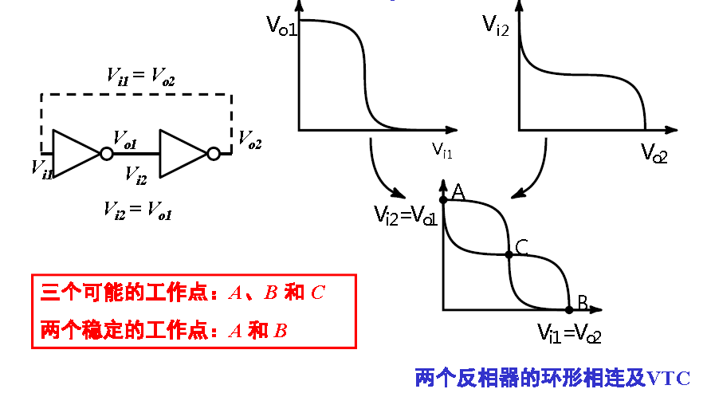

*两端的交点分别对应一高一低的两种状态，中间交点位于反相器的翻转区。*

在一高一低的状态附近，反相器的增益幅值较小。一个节点受到小扰动后，经过环路返回的扰动更小，电路会恢复到原来的状态。因此 A、B 是稳定工作点，可以分别表示一个二进制值。

中间交点处，两只反相器都位于翻转区。若小信号增益分别为 $A_1$、$A_2$，两次反相后的环路增益为正；当 $|A_1A_2|>1$ 时，小的差分扰动会被放大，使两个节点向相反方向变化，最终落入某个稳定状态。中间点是亚稳态（Metastability）工作点。接近该点时，电路可能长时间不能给出可靠的逻辑电平，这也是采样时序失效的物理原因之一。

这种环路持续补偿节点上的微小电荷损失，所以保持数据不依赖一个孤立电容能保存多久。两个 CMOS 反相器由四只晶体管构成，但还没有提供外部数据的写入选择。构成锁存器时，要增加控制通路，使环路既能保存旧值，也能接收新值。

### 切断反馈环路后写入

第一种方法是在输入通路与反馈通路之间加入二选一多路选择器。静态锁存器因此可以看作二选一多路选择器与双稳态环路的组合。对正电平锁存器，其逻辑关系可以写为

$$
Q^{+}=CLK\cdot D+\overline{CLK}\cdot Q,
$$

其中 $Q^{+}$ 表示更新后的值，$Q$ 表示原来的值。$CLK=1$ 时选择输入，$CLK=0$ 时选择反馈。

晶体管级电路可以用两个传输门实现这一选择。透明阶段，输入传输门导通，反馈传输门关断，外部数据通过反相器建立新状态；保持阶段，输入传输门关断，反馈传输门导通，两个反相器重新形成闭环。

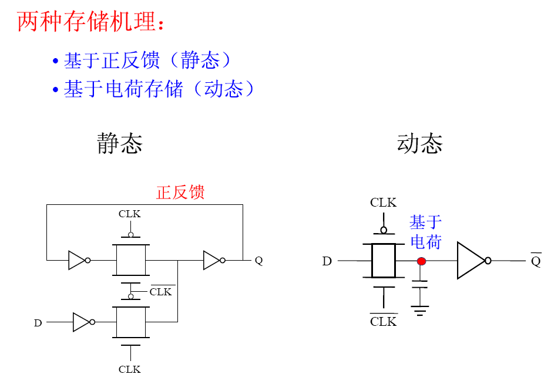

*左侧通过输入与反馈通路的切换实现静态锁存；右侧断开输入后依靠节点电容保持电压，输出为输入的反相。*

切断反馈后，输入不用持续对抗旧状态，属于无比逻辑：正确写入不依赖输入驱动和反馈驱动之间的强弱比。代价是输入与反馈两条通路都需要时钟控制的器件，时钟负载较大。

### 保留反馈环路并强制写入

第二种方法始终保留反馈，只在写入时把外部数据接到存储节点。输入通路足够强时，可以把原节点电压推过反相器的翻转点，正反馈随后完成状态翻转。

此时反馈反相器通常做得较弱。若它太强，输入通路可能无法改写状态，或者需要较长时间才能完成写入；若输入驱动足够强，旧状态就会被覆盖。这属于有比设计（Ratioed Design），器件尺寸比直接影响写入能力。

强制写入可省去反馈通路的时钟开关，减少时钟端电容，但写入期间可能存在输入与反馈的竞争电流。减小反馈反相器可以减轻竞争，却也削弱保持期间的恢复能力，因此尺寸选择同时影响速度、功耗和抗扰动能力。

### 用 NMOS 传输管换回一半时钟负载

NMOS 传输管是切断反馈这条路线上最节省的一版：把 CMOS 传输门替换为单只 NMOS，可以省去 PMOS 和一根时钟线，减少晶体管数量与时钟负载。NMOS 传低电平较好，传高电平时，随着被充电节点电压升高，栅源电压逐渐减小，最终充电能力明显下降。忽略体效应时，节点高电平近似为

$$
V_X\approx V_{DD}-V_{Tn},
$$

其中 $V_{Tn}$ 为 NMOS 阈值电压。

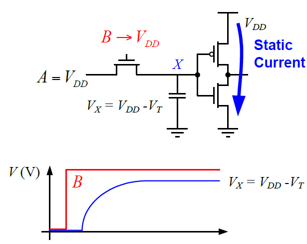

节点 $X$ 驱动后级反相器时，较低的高电平会降低噪声容限，并可能使 PMOS 不能充分关断；NMOS 已导通而 PMOS 仍有明显电流时，反相器产生静态直通功耗。后级反相器虽然可以恢复输出摆幅，它自身的输入电平和功耗仍受到影响。互补传输门利用 NMOS 与 PMOS 的互补传输能力，能更好地传递高、低电平。

### SR 锁存与直接置位复位

交叉耦合的或非门可以构成置位复位锁存器（Set-Reset Latch，SR Latch）。定义两个控制输入为 $S$、$R$，可写为

$$
Q=\overline{R+\overline Q},\qquad
\overline Q=\overline{S+Q}.
$$

| $S$ | $R$ | 输出行为 |
| --- | --- | --- |
| 0 | 0 | 反馈保持原状态 |
| 1 | 0 | 置位，$Q=1$ |
| 0 | 1 | 复位，$Q=0$ |
| 1 | 1 | 两输出都被强制为 0，不构成互补的有效存储状态 |

最后一种输入同时撤销时，电路的最终状态受两条路径的延迟和扰动影响。使用交叉耦合 NAND 时，置位与复位输入变为低有效，保持条件也变成两个控制输入都为高。额外加入时钟控制，可以只在允许的电平阶段接收置位、复位命令。

SR 结构展示了通过额外输入强制改变反馈状态的方法。单独的 SR 锁存器没有边沿采样行为，其输出可在控制信号变化时立即响应。

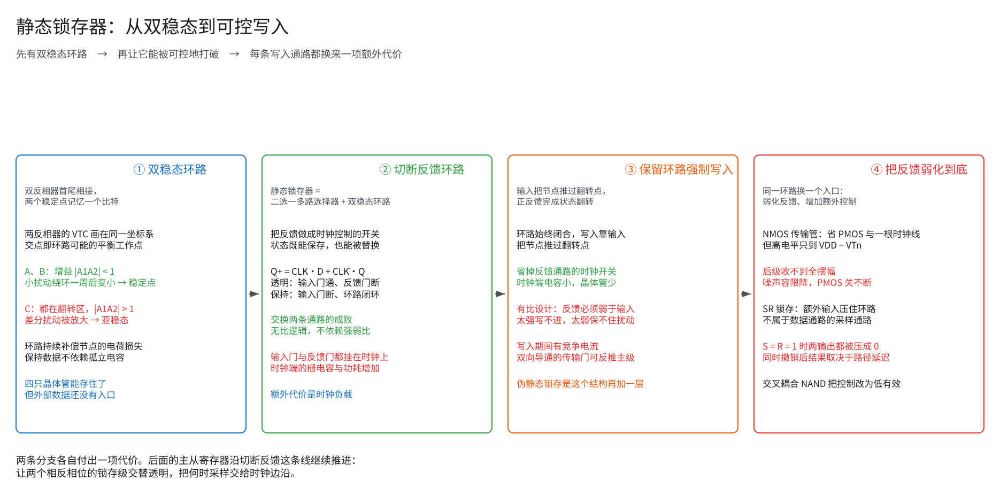

*四条通路都从一个双稳态环路出发：切断反馈换到无比逻辑，代价是时钟负载；保留反馈省下时钟开关，代价是需要有比设计；把开关换成单只 NMOS 只能省下一半时钟负载；SR 锁存则用额外控制端直接压住环路，不属于数据通路的时钟采样通路。*

## 主从寄存器与局部时序参数

### 两个相反电平的锁存器串联

上升沿触发的主从寄存器（Master-Slave Register）由负电平主锁存器和正电平从锁存器串联构成。主级输出记为 $Q_M$，从级输出为 $Q$。

| 时钟阶段 | 主级 | 从级 | 数据行为 |
| --- | --- | --- | --- |
| $CLK=0$ | 透明 | 保持 | $Q_M$ 跟随 $D$，$Q$ 保持旧值 |
| $CLK:0\to1$ | 关闭输入 | 开始透明 | 主级最后接收的数据传给从级 |
| $CLK=1$ | 保持 | 透明 | $Q$ 跟随已固定的 $Q_M$，外部 $D$ 被隔离 |
| $CLK:1\to0$ | 开始透明 | 关闭输入 | 从级保存本次输出，主级准备下一次采样 |

两个锁存器交替透明，理想情况下不存在从 $D$ 一直导通到 $Q$ 的通路。把主、从的有效电平互换，就得到下降沿触发寄存器。

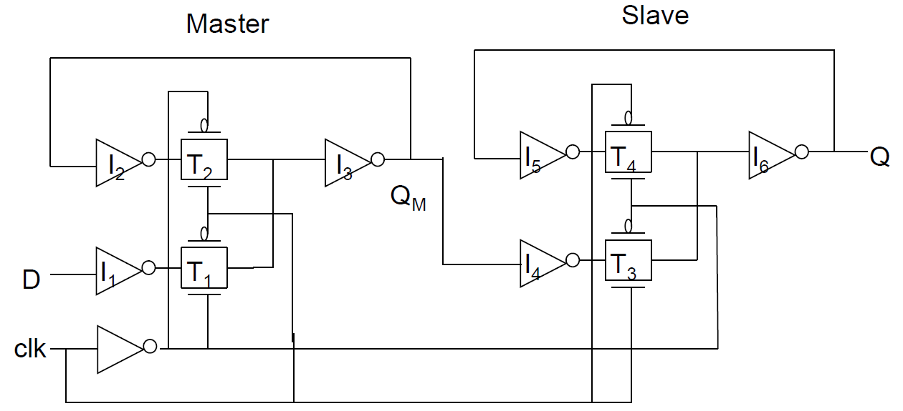

*主级和从级分别用输入、反馈传输门选择写入或保持，时钟反相器产生互补控制。*

在图中，低电平阶段 $T_1$ 导通、$T_2$ 关断，数据经 $I_1,T_1,I_3$ 到达 $Q_M$；从级输入门 $T_3$ 关断、反馈门 $T_4$ 导通。上升沿后，$T_1$ 关断、$T_2$ 导通，主级形成反馈；$T_3$ 导通、$T_4$ 关断，已保存的数据传到输出。

### 建立、保持与时钟到输出延迟

建立时间（Setup Time，$t_{su}$）规定有效时钟边沿到来前，输入数据至少要提前多久稳定。主级接收输入后，数据要经过若干器件传播，使环路中的相关节点形成一致的状态。如果反馈接通时这些节点仍在变化，反馈可能恢复旧值，或者使电路接近亚稳态。

对图中的结构，数据除了到达 $Q_M$，还要经过反馈反相器 $I_2$，使 $T_2$ 重新导通前两端的电压相容。忽略器件间的差别和时钟路径细节，粗略估算为

$$
t_{su}\approx3t_{pd,inv}+t_{pd,T},
$$

其中 $t_{pd,inv}$ 是一个反相器的传播延迟，$t_{pd,T}$ 是一个传输门的传播延迟。该式表达的是主级内部的建立过程。

保持时间（Hold Time，$t_h$）规定有效时钟边沿之后，输入数据还要维持多久，才能避免影响本次采样。只要输入开关尚未完全关闭，边沿后到达的新数据就可能改变内部节点。图示静态主从结构在理想匹配的路径估算中，可以得到接近零的保持时间；实际数值还受时钟反相路径、数据路径和开关关断过程影响。

时钟到输出延迟（Clock-to-Q Delay，$t_{cq}$）从有效时钟边沿量到输出发生相应变化。主级已经建立正确状态时，从级的 $I_4$ 输出可在边沿前稳定，上升沿后主要经过 $T_3$ 和 $I_6$：

$$
t_{cq}\approx t_{pd,T}+t_{pd,inv}.
$$

锁存器透明期间还使用输入到输出延迟 $t_{dq}$，描述数据经过透明锁存器所需的传播时间。锁存器的建立与保持要求围绕关闭透明窗口的边沿定义。

### 减少时钟负载与反向传导

主从寄存器包含多个受时钟控制的传输门。如果把其中一部分换成常开弱反馈，可以减少时钟所驱动的栅电容。

这种改动会带来两处尺寸约束。首先，主级输入通路及其前级驱动要能够覆盖主级弱反馈；其次，从级输入开关导通时，传输门可以双向传输，从级原状态可能反向作用于主级。主级输出驱动与级间通路要足够强，使从级正确更新，而主级保存的数据不被破坏。

因此，减少器件数和时钟电容的收益，伴随着写入竞争与级间耦合的分析。静态多路选择器结构虽然器件较多，但透明与反馈两条通路分离，功能更容易控制。

### 互补时钟重叠与数据穿通

物理反相器产生的 $CLK$ 与 $\overline{CLK}$ 具有有限延迟，两者不会在同一瞬间完全互补。跳变附近可能出现短暂的同高或同低区间。

对于使用 NMOS 开关的主从结构，同高重叠可能使两个输入开关同时导通，形成 $D$ 到 $Q$ 的直接通路。重叠足够长时，数据可能越过原本的采样边界。对于 CMOS 传输门，即使只有其中一种管型部分导通，也可能造成电荷传递，因此还要考虑非理想边沿中的实际导通状态。

非重叠时钟能在相邻透明阶段之间留出间隔，减少竞争，但也缩短有效采样时间，并可能让某些节点暂时浮置。静态反馈、输入开关与级间通路怎样交替工作，决定重叠和非重叠各自带来的影响。

## 动态时序单元与其他寄存器结构

### 动态节点的保存时间

去掉静态反馈后，输入开关关断时，节点电容可以暂时保存原电压。反相器的栅输入具有高阻抗，读出主要依靠感知电压，理想情况下不会像低阻负载那样持续抽走存储电荷。

设存储电容为 $C_X$，漏电流近似为 $I_{leak}$，则节点电压变化量约为

$$
|\Delta V_X|\approx\frac{|I_{leak}|t}{C_X}.
$$

若允许的电压偏移为 $\Delta V_{allow}$，电荷保持时间的简单估算是

$$
t_{ret}\approx\frac{C_X\Delta V_{allow}}{|I_{leak}|}.
$$

例如，$C_X=10$ fF、$\Delta V_{allow}=0.2$ V、$I_{leak}=1$ nA 时，

$$
t_{ret}\approx\frac{10\times10^{-15}\times0.2}{10^{-9}}
=2\ \mu\mathrm{s}.
$$

这个数值说明：动态节点的刷新或更新间隔受电荷损失限制。实际漏电随电压变化，单一常数电流只是用于解释机制的近似。

浮置节点也容易受电容耦合影响。相邻时钟或信号跳变时，耦合电容会注入电荷，使原本保存的电压偏移。电源变化时，浮置电压又不能像静态反馈节点那样主动恢复到新的电源轨，噪声容限可能减小。

### 动态主从寄存器

把两个相反相位工作的动态锁存级串联，可以构成动态主从寄存器。低电平时主级采样、从级保持；高电平时主级保持、从级传送，仍可得到上升沿触发行为。

简化结构的数据路径可表示为 $D\to T_1\to I_1\to T_2\to I_2\to Q$。主级电容只需经 $T_1$ 完成采样，因此一阶估算为

$$
t_{su}\approx t_{pd,T},\qquad
t_{cq}\approx2t_{pd,inv}+t_{pd,T}.
$$

后一式把采样边沿后主级反相器尚需完成的响应也计入最坏路径。理想开关假设下保持时间可接近零，但两相时钟重叠会重新引入保持要求。例如，同高重叠期间若新数据仍能进入主级，就可能传至从级；数据在该重叠区间保持稳定，可以避免本次采样被后续变化覆盖。

对于互补控制的传输门动态主从结构，两相同低期间，两级传输门中的 PMOS 仍可能传递数据。一个简单的防穿通条件是

$$
t_{ov,00}<t_{pd,T_1}+t_{pd,I_1}+t_{pd,T_2},
$$

其中 $t_{ov,00}$ 为两相同低的重叠宽度：重叠要在新数据经输入开关、主级反相器和级间开关穿过之前结束。两相同高期间，两级 NMOS 通路也可能同时工作，常用

$$
t_h\ge t_{ov,11}
$$

估算数据在上升沿后还要保持的时间，$t_{ov,11}$ 为同高重叠宽度。这两式分别从限制额外透明窗口、维持输入稳定的角度处理重叠。

动态结构省去反馈器件，电路较简单，也有利于缩短部分数据路径。由于保持时间有限，时钟不能无限期停止，否则电荷会泄漏到无法辨认原状态。

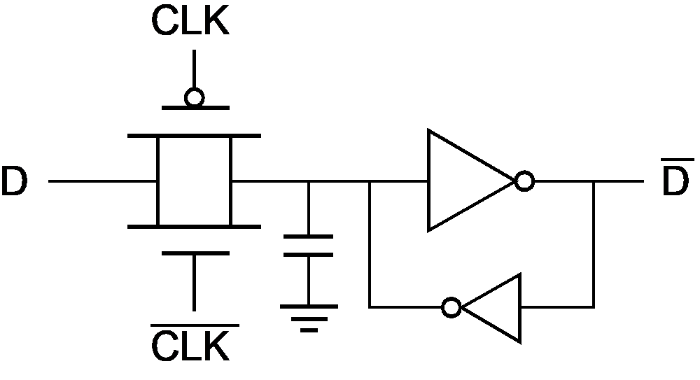

在动态节点上增加弱反馈反相器，可以补偿漏电并恢复受扰动后的电压，形成伪静态锁存器（Pseudo-Static Latch）。保持阶段不再完全依赖孤立电容，写入阶段则由较强输入覆盖弱反馈。这样，伪静态传输门锁存器与前面的强制写入型静态锁存器具有相同的基本结构。

弱反馈提高保持能力，但会增加节点电容与写入竞争，所以可能增大写入延迟。若系统要通过停止时钟来降低功耗，这种可静态保持的结构比纯动态结构更容易保存原状态。

### 时钟控制 CMOS 寄存器

时钟控制 CMOS（Clocked CMOS，$C^2MOS$）把时钟开关串入反相器的上拉和下拉支路。两级不再依赖互补时钟的正确配合，只靠本级的使能相位决定是否导电。主、从两级使用相反的使能相位，每级在工作时执行反相，关闭时由节点电容保存状态。

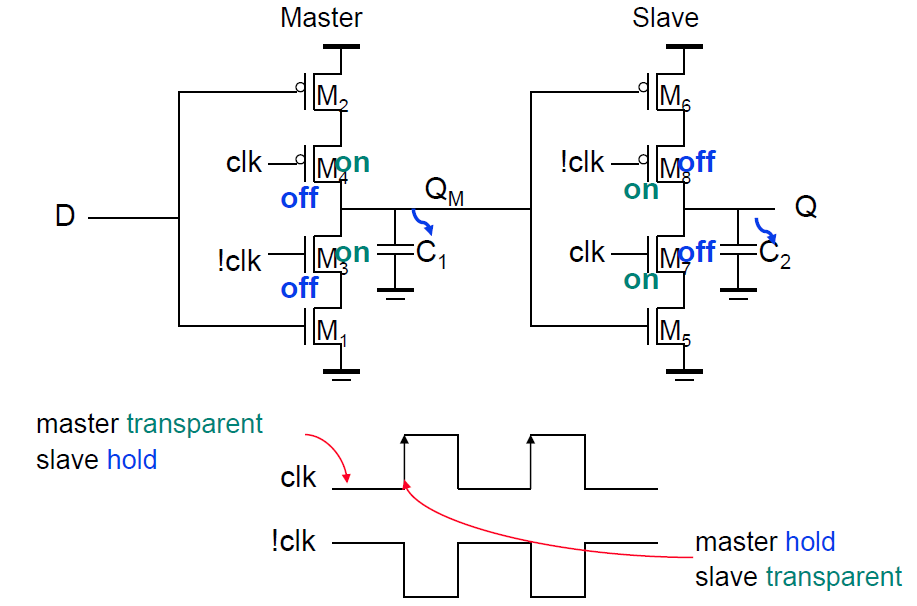

低电平阶段，主级上下支路的时钟控制管导通，$Q_M$ 接收 $\overline D$；从级关闭并保存 $Q$。高电平阶段，主级关闭，从级对已保存的 $Q_M$ 再次反相，最终得到与 $D$ 同相的输出。

这种结构对某些互补时钟重叠比传输门主从结构更不敏感。两相都为高时，时钟 PMOS 关闭，两个级主要只剩下拉能力；两相都为低时，时钟 NMOS 关闭，两个级主要只剩上拉能力。输入经过一级反相后，要继续改变下一级输出就需要相反方向的充放电能力，因此难以形成完整的两级穿通。

这种抗重叠能力仍建立在合适的时钟边沿和输入稳定性上。重叠期间数据若改变了主级动态节点，该变化可能在下一阶段从级恢复工作时传出去。缓慢时钟边沿还会使上下控制管在较长区间内部分导通，所以 $C^2MOS$ 仍有建立、保持和时钟转换时间要求。

动态逻辑与时钟控制锁存级还可以组合成无竞争流水线 NORA（No-Race）结构，通过相位安排把逻辑求值和状态传递隔开。其运行同样依赖各级在规定相位内完成求值与保持。

### 单时钟：真单相时钟与脉冲寄存器

真单相时钟（True Single-Phase Clock，TSPC）结构只分布一种时钟极性，通过不同位置、类型的时钟管实现相应的透明与保持行为，减少互补时钟布线及局部相位重叠的负担。

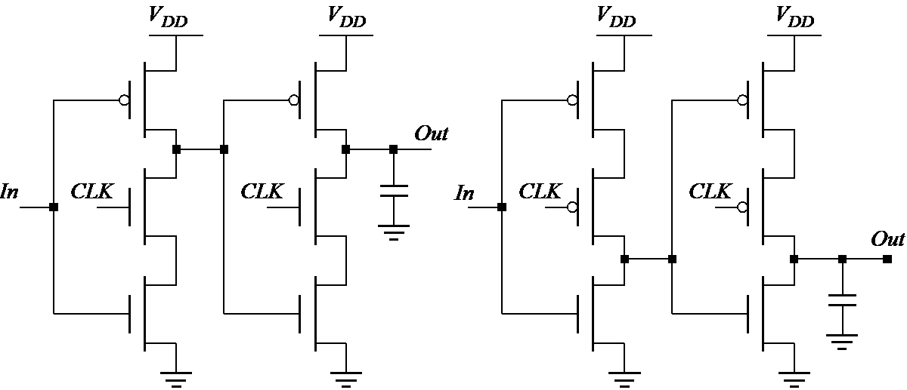

图左的正锁存结构在高电平阶段像两个串联反相器一样传播数据；低电平阶段，上下支路的受控状态使输出保持。图右以 PMOS 时钟管实现相反的使能极性。这类结构的动态内部节点仍可能浮置，受到耦合与漏电影响，可通过隔离反相器和弱保持反馈改善状态保存。

脉冲寄存器在有效时钟边沿附近产生一个短透明窗口，让数据通过锁存级。它可以减少主从结构中的部分时钟控制器件，但透明脉冲既要足够宽，使数据写入完成，又要足够短，避免后续数据继续穿通。

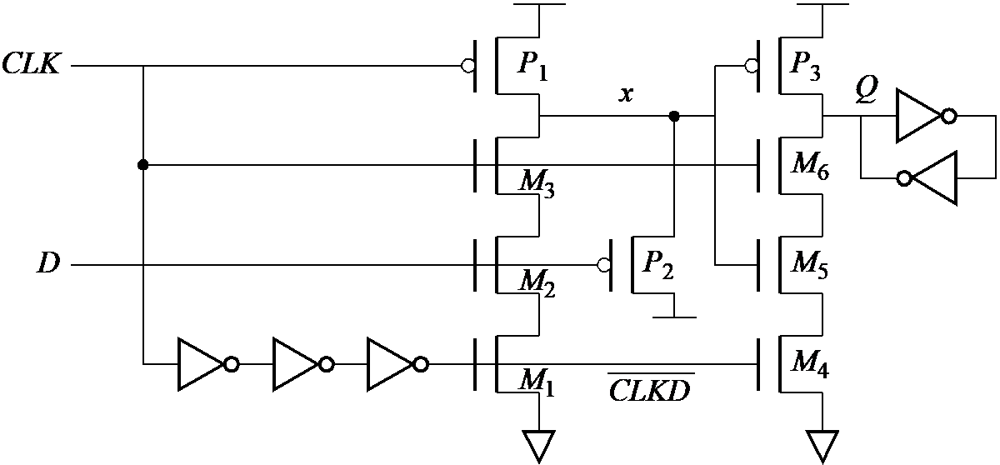

混合锁存触发器（Hybrid Latch Flip-Flop，HLFF）利用时钟及其延迟信号形成局部求值窗口。图中，时钟刚上升时，延迟链输出尚未翻转，相关串联支路能在短时间内共同导通；延迟信号到达后关闭该窗口，输出由反馈保存。

由于窗口延伸到外部时钟边沿之后，输入在边沿后稍晚到达也可能被接收，表征出的建立时间可以为负。同时，新数据也可能在边沿后继续影响存储节点，保持要求相应更严格。负建立时间反映的是采样窗口的位置，内部仍然需要足够的写入时间。

### 灵敏放大器型寄存器

灵敏放大器型寄存器（Sense-Amplifier-Based Flip-Flop）使用差分输入与再生反馈，先把输入差异转换为快速的内部判决，再由后级锁存结果。

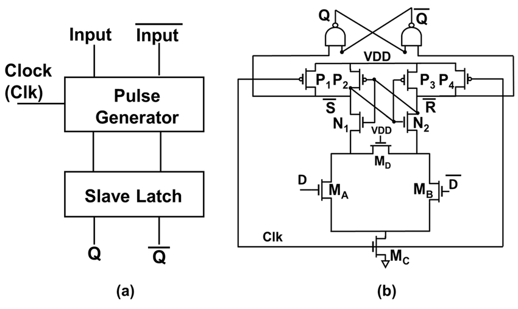

图中的前级在时钟控制下产生 $\overline S$、$\overline R$，上方交叉耦合 NAND 保存输出。差分支路首先形成不对称的放电速度，正反馈再放大这个差异，使一侧优先完成翻转。与单纯让大负载等待弱输入逐级驱动相比，再生过程可以更快地形成可用逻辑电平。

这种结构适合需要快速判决的场合，但输入差异、支路失配和时钟控制都会影响判决结果。后级锁存把短暂的前级求值结果转为可持续保持的状态。

## 采样窗口与约束相关性

### 数据接近边沿时的内部过程

建立时间充裕时，主级节点已接近完整高、低电平。时钟到来后，只需把已确定的数据传到输出，$t_{cq}$ 基本不随输入提前量变化。

逐渐把数据变化推向时钟边沿，主级可用于充放电的时间缩短。关闭输入时，存储节点可能还没有达到电源轨；反馈仍可能把它恢复到正确状态，但再生过程需要更多时间，输出延迟开始增加。再继续靠近，内部电压差可能太小，反馈会进入很慢的判决过程，或者恢复到旧状态，产生采样失败。

保持过程也有类似变化。如果输入在边沿后维持足够久，主级完成隔离，后续数据不再影响采样。若把输入的下一次变化逐渐提前，新数据可能在输入通路尚未完全关闭时扰动存储节点，先表现为输出变慢，再发展为错误状态。

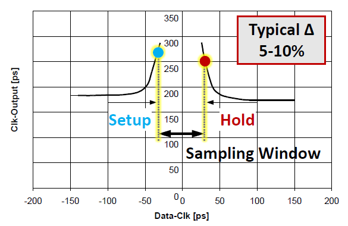

*数据变化远离采样窗口时，输出延迟接近稳定值；靠近窗口边界时，输出延迟会明显增加。*

因此，建立、保持时间的表征通常与允许的 $t_{cq}$ 增量相关。例如，可以按相对于充分稳定输入时的输出延迟增加一定比例来提取边界。图中的 5%～10% 展示了这种表征思路，具体数值对应相应单元及表征条件。

### 很小的时间差也可能改变最终状态

在一个主从寄存器示例中，数据比时钟提前 0.21 ns 时，主级节点 $Q_M$ 在反馈闭合后继续向正确方向发展，输出维持在预期高电平。

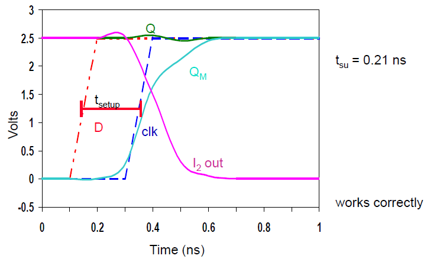

把提前量缩短为 0.20 ns，主级反馈支路尚未建立足够的电压差，环路随后恢复了错误的状态，输出最终变成低电平。

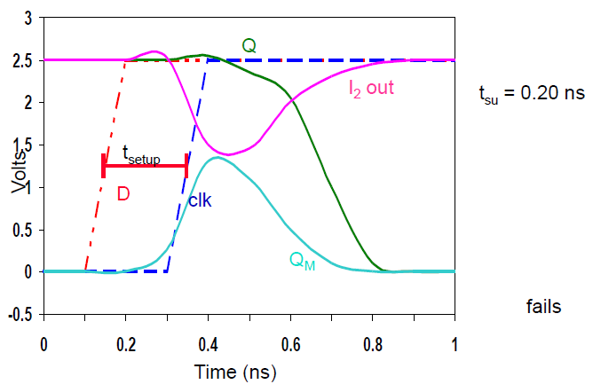

两者只相差 10 ps，但反馈具有再生作用：内部节点位于判决边界的哪一侧，会影响最终落入哪个稳定状态。亚稳态还可能使输出很晚才完成翻转，因此时序失效既可能表现为错误的逻辑值，也可能表现为超出预算的传播延迟。

### 建立与保持时间的二维边界

建立和保持都影响采样瞬间的内部节点状态。输入在边沿前更早稳定，通常能让节点形成更充分的电压差；边沿后维持更久，则能减少输入通路关闭过程中受到的扰动。两者共同决定能否在给定输出延迟内完成采样。

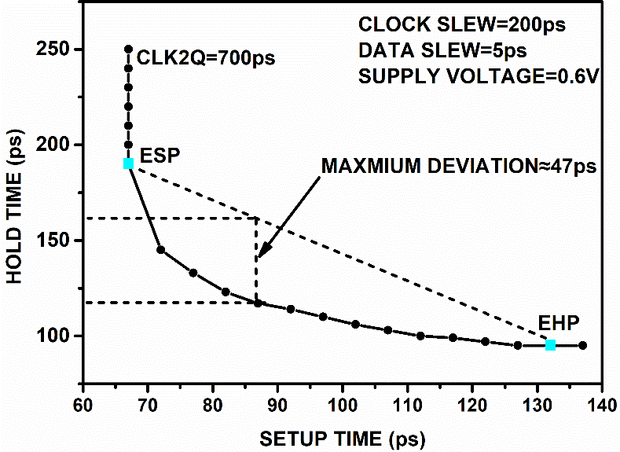

图中在 0.6 V 供电、规定时钟与数据转换时间下，以 $CLK2Q=700$ ps 为条件画出边界。建立时间较短的一端需要较长保持时间，保持时间较短的一端则需要更长建立时间。连接两个端点的直线与实际边界并不重合，图示最大偏离约 47 ps。

因此，把分别提取的最小建立时间和最小保持时间拼成一个组合，可能落在实际可用区域之外。单元表征可以使用建立、保持与输出延迟的相关模型；在固定输出延迟要求下，这个模型给出一条可接受的建立—保持边界。电源电压、时钟边沿和数据边沿改变后，边界也会移动。

## 同步路径的最大与最小延迟约束

### 发射、传播与接收

同步时序电路用公共时钟规定状态更新时刻。一次典型的数据传输从发射寄存器 $R_1$ 开始，经过组合逻辑和互连，最后到达接收寄存器 $R_2$ 的数据输入端。

发射边沿到来后，$R_1$ 不会立即改变输出，而要经过时钟到输出延迟；数据随后经过组合逻辑，再在接收边沿附近被 $R_2$ 采样。即使逻辑功能完全正确，数据过晚到达或者过早覆盖旧值，都可能使接收失败。

对同一条路径，分别定义以下延迟，单位可统一使用 ps。

| 参数 | 含义 | 用于约束 |
| --- | --- | --- |
| $t_{cq,max}$ | 发射寄存器最晚完成输出响应的延迟 | 建立检查 |
| $t_{cq,min}$ | 发射寄存器输出最早可能变化的延迟 | 保持检查 |
| $t_{logic,max}$ | 组合逻辑与互连的最大传播延迟 | 建立检查 |
| $t_{logic,min}$ | 组合逻辑与互连的最小污染延迟 | 保持检查 |
| $t_{su}$ | 接收寄存器的建立时间 | 建立检查 |
| $t_h$ | 接收寄存器的保持时间 | 保持检查 |

最大传播延迟描述输出最晚何时稳定，污染延迟（Contamination Delay）描述输入改变后输出最早何时可能受到影响。两者分别对应最慢的数据到达和最快的数据污染，不能用同一个典型延迟替代。

### 建立约束与最高频率

先假设两个寄存器接收完全同时的时钟，周期为 $T$。$R_1$ 在时刻 0 发射的数据，最晚在

$$
t_{arrival,max}=t_{cq,max}+t_{logic,max}
$$

到达 $R_2$。$R_2$ 在下一周期的边沿 $T$ 采样，数据必须在 $T-t_{su}$ 前稳定，所以

$$
t_{cq,max}+t_{logic,max}\le T-t_{su},
$$

即

$$
T\ge t_{cq,max}+t_{logic,max}+t_{su}.
$$

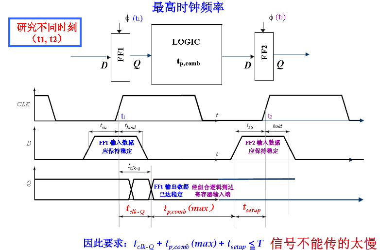

整个时钟域包含很多条路径，周期要满足每一条路径的要求。对于普通的相邻周期寄存器路径，

$$
T_{min}=\max_{\text{paths}}
\left(t_{cq,max}+t_{logic,max}+t_{su}\right),
\qquad f_{max}=\frac1{T_{min}}.
$$

使右侧最大的路径就是建立检查中的关键路径。关键程度既取决于组合逻辑，也取决于发射单元和接收单元的时序开销。

### 保持约束与最短路径

在时刻 0 的同一个时钟边沿，$R_2$ 正在采样上一周期送来的旧数据，$R_1$ 开始发射下一份新数据。为保护 $R_2$ 的保持窗口，新数据最早到达的时间不能早于 $t_h$：

$$
t_{cq,min}+t_{logic,min}\ge t_h.
$$

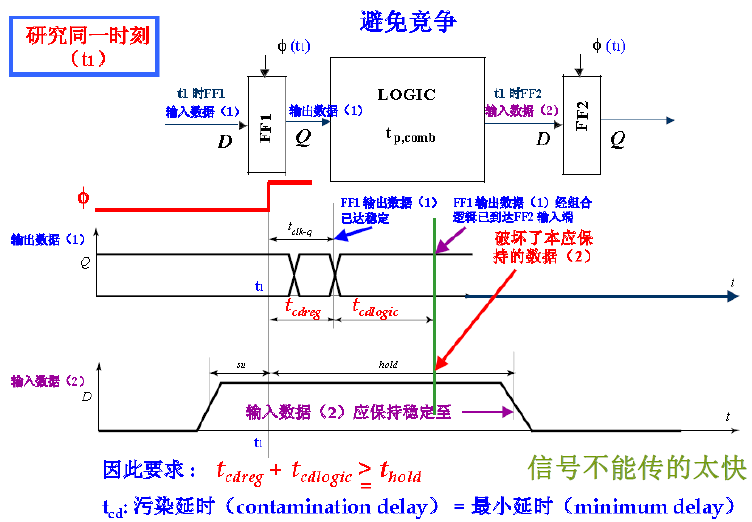

保持检查比较的是同一次边沿附近的两个事件，所以公式中没有周期 $T$。降低时钟频率可以增加下一次采样前的计算时间，因而有助于建立检查；它不会推迟同一次边沿后新数据的最早到达时间，无法直接修复保持失效。

建立失败通常通过缩短最大路径、选用更合适的单元、减小负载或增加流水级改善。保持失败则可以在过短的数据路径上加入延迟单元，或者调整单元和时钟相对到达时间。新增延迟也会增大该路径的最大延迟，因此修改后仍要考虑建立预算。

### 余量与数值例子

余量（Slack）表示约束还剩下多少时间。理想时钟下，定义

$$
Slack_{setup}=T-t_{su}-t_{cq,max}-t_{logic,max},
$$

$$
Slack_{hold}=t_{cq,min}+t_{logic,min}-t_h.
$$

非负余量表示满足相应约束，负余量的幅值表示缺少的时间。

例如，一条路径具有

$$
\begin{aligned}
t_{cq,max}&=80\ \mathrm{ps},&t_{logic,max}&=620\ \mathrm{ps},\\
t_{cq,min}&=35\ \mathrm{ps},&t_{logic,min}&=25\ \mathrm{ps},\\
t_{su}&=100\ \mathrm{ps},&t_h&=70\ \mathrm{ps}.
\end{aligned}
$$

建立要求给出

$$
T_{min}=80+620+100=800\ \mathrm{ps},
\qquad f_{max}=1.25\ \mathrm{GHz}.
$$

但保持路径只有 $35+25=60$ ps，小于 70 ps，保持余量为 $-10$ ps。即使把周期放宽到 850 ps，建立余量变成 50 ps，保持余量仍为 $-10$ ps。这条路径还要增加至少 10 ps 的最小延迟，才能达到理想模型中的保持边界。

## 时钟偏差与时钟抖动

### 空间偏差与时间变化

理想时钟在各寄存器处同时到达，实际时钟经过不同缓冲器、互连和负载后，到达时刻会有差异。

时钟偏差（Clock Skew）描述同一参考边沿在不同位置的到达时间差；时钟抖动（Clock Jitter）描述同一位置的边沿相对理想时间随时间发生的变化。公共时钟源到某个寄存器的传播延迟称为插入延迟（Insertion Delay）。插入延迟很大但所有端点都相同，仍可能有很小的偏差；各端点延迟差异大，才会直接压缩某些路径的时间预算。

设发射寄存器的时钟到达时间为 $t_L$，接收寄存器为 $t_C$，定义

$$
\delta=t_C-t_L.
$$

$\delta>0$ 表示接收时钟晚到，$\delta<0$ 表示接收时钟早到。以下所有偏差公式都使用这个符号定义。

### 时钟偏差下的建立约束

发射时刻取为 $t_L$，下一周期的接收边沿为 $t_C+T$。数据最晚到达时刻与建立截止时刻分别为

$$
t_L+t_{cq,max}+t_{logic,max},
\qquad t_C+T-t_{su}.
$$

两者比较得到

$$
T+\delta\ge t_{cq,max}+t_{logic,max}+t_{su},
$$

或者

$$
T_{min}=t_{cq,max}+t_{logic,max}+t_{su}-\delta.
$$

接收时钟晚到时，下一次采样也更晚，数据多出 $\delta$ 的传播时间，因此正偏差改善这条路径的建立余量。负偏差则提前下一次接收边沿，缩短可用计算时间。

### 时钟偏差下的保持约束

保持检查保护的是当前接收边沿。新数据最早到达时刻为

$$
t_L+t_{cq,min}+t_{logic,min},
$$

旧数据要一直稳定到 $t_C+t_h$，因此

$$
t_{cq,min}+t_{logic,min}\ge t_h+\delta.
$$

正偏差把当前保持窗口也向后推，新数据更容易提前侵入，保持要求变严格。负偏差让接收寄存器更早完成采样和保持过程，通常增加保持余量。两种检查因此对同一个偏差有相反的反应。

沿用前面最大延迟和为 700 ps、最小延迟和为 60 ps 的例子：

| 偏差 $\delta$ | 建立要求的最短周期 | 保持要求的最小延迟 | 实际保持余量 |
| --- | --- | --- | --- |
| $-40$ ps | $800-(-40)=840$ ps | $70-40=30$ ps | $60-30=30$ ps |
| 0 | 800 ps | 70 ps | $-10$ ps |
| $+40$ ps | $800-40=760$ ps | $70+40=110$ ps | $60-110=-50$ ps |

如果时钟沿着数据流方向逐级到达，后级时钟常比前级晚，可能改善建立性能并加重保持竞争；反向分布则常有相反效果。实际网络包含分支和多条数据路径，某个寄存器还可能同时是前一条路径的接收端和后一条路径的发射端，因此偏差调整会同时改变多处预算。

### 抖动压缩有效的边沿间隔

设第 $k$ 次发射边沿和第 $k+1$ 次接收边沿相对各自标称时刻的误差分别为 $\epsilon_L[k]$、$\epsilon_C[k+1]$。两边沿之间真正可用的时间为

$$
T+\delta+\epsilon_C[k+1]-\epsilon_L[k].
$$

发射边沿晚到、接收边沿早到会同时缩短这个间隔。如果每个边沿都可能相对标称时间偏移 $\pm t_j$，并按两者独立取最坏组合估算，则最小间隔为

$$
T+\delta-2t_j.
$$

建立条件随之变为

$$
T\ge t_{cq,max}+t_{logic,max}+t_{su}-\delta+2t_j.
$$

例如 $t_j=20$ ps 时，最坏有效周期比标称周期少 40 ps；前面零偏差路径的周期预算从 800 ps 增加到 840 ps。

这里的 $2t_j$ 来自两个边沿各有一个正负偏移界限。如果给出的指标已经是可用间隔相对标称值的最大缩短量，这个缩短量就是建立预算中的抖动项。时钟误差的公共部分可能互相抵消，相关性也会改变最坏差值。

保持检查使用同一周期发射、接收边沿之间的相对误差。若用 $U_h$ 表示接收边沿相对发射边沿额外晚到的最坏变化量，则

$$
t_{cq,min}+t_{logic,min}\ge t_h+\delta+U_h.
$$

公共时钟源的一次整体相移可同时移动两个边沿，对这次保持检查的影响可能很小；两条本地时钟路径分别产生的噪声和延迟变化则会改变相对间隔。

### 电源、串扰与温度的影响

时钟缓冲器的延迟随供电和温度变化。电源电压降低，缓冲器驱动减弱，边沿可能晚到；开关活动造成的动态压降随周期变化，就会转成时间抖动。不同区域的温度或静态压降不同，又会形成空间偏差。

相邻数据线跳变可通过互连耦合改变时钟电压，造成与数据活动相关的边沿移动。时钟线旁布置电源、地屏蔽线，可以减轻这类耦合；时钟驱动器附近的去耦电容可以在短时间内提供局部电荷，减小高频电源波动。金属密度填充有助于减小制造过程中的厚度与寄生参数不均匀，热分布和供电网络设计则影响整片的延迟差异。

门控时钟减少不工作模块的翻转，但也让负载活动随使能变化，可能改变局部电流和时钟路径延迟。因而节省时钟功耗的同时，电源噪声与分支延迟仍属于时钟网络设计的一部分。

## 流水线与时序单元的能量代价

### 用寄存器分割组合运算

考虑运算

$$
Y=\log(|a+b|),
$$

其数据通路依次经过加法、绝对值和对数运算。若三个模块之间没有寄存器，它们的延迟都要放进同一个周期。设三个组合延迟分别为 $d_1,d_2,d_3$，寄存器开销 $h=t_{cq,max}+t_{su}$，理想时钟下要求

$$
T_{unpipe}\ge d_1+d_2+d_3+h.
$$

在三个运算之间加入两个寄存器后，形成三级流水线，每一级只完成一部分运算，周期下限变为

$$
T_{pipe}\ge\max(d_1,d_2,d_3)+h.
$$

流水线填满后，三个模块可以同时处理三份不同的数据：

| 周期 | 加法级 | 绝对值级 | 对数级 |
| --- | --- | --- | --- |
| 1 | 第 1 份数据 | 空 | 空 |
| 2 | 第 2 份数据 | 第 1 份数据 | 空 |
| 3 | 第 3 份数据 | 第 2 份数据 | 第 1 份数据 |
| 4 | 第 4 份数据 | 第 3 份数据 | 第 2 份数据 |

例如 $d_1=300$ ps、$d_2=150$ ps、$d_3=450$ ps，$h=100$ ps，则未流水化的周期下限为 1000 ps；三级流水线的周期下限为 $450+100=550$ ps，理想吞吐率提高为原来的 $1000/550\approx1.82$ 倍。

单份数据则要经过三个周期，在这个例子中延迟为 $3\times550=1650$ ps，大于原来的 1000 ps。增加寄存器提高了连续数据的吞吐能力，也增加了状态存储、时钟负载和启动等待。各级不均衡时，最长一级仍决定周期；继续细分时，每级重复付出的寄存器开销还会限制收益。

### 时钟电容与能量—延迟折中

时序单元的时钟端即使没有接收新数据，也可能每周期翻转。对每周期完成一次充放电的等效时钟电容，动态功耗近似为

$$
P_{clk}\approx C_{clk}V_{DD}^{2}f,
$$

其中 $C_{clk}$ 包括时钟布线、缓冲器以及被驱动的时钟栅电容，单位为 F；$V_{DD}$ 为供电电压，单位为 V；$f$ 为频率，单位为 Hz。减少时钟管数量和尺寸、关闭空闲分支，都能减少这一项功耗。

时序单元优化还要计入数据切换、内部节点充放电和漏电。加宽器件通常能增强驱动并减小延迟，也会增大输入与内部电容；脉冲结构可减少部分时钟负载，却引入脉冲生成开销和更紧的保持要求。

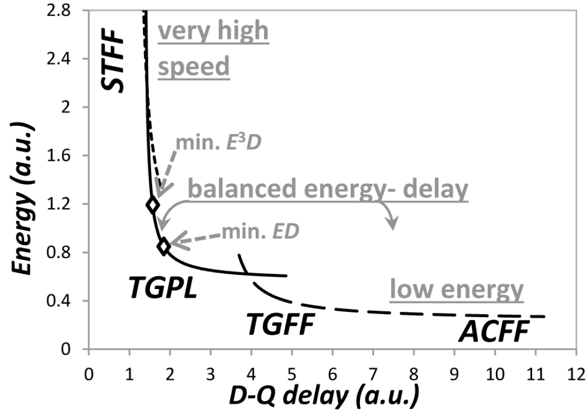

*横纵坐标均为相对单位，曲线展示特定比较条件下的可选设计点。*

若以 $E$ 表示一次操作能量、$D$ 表示延迟，能量延迟积 $ED$ 同时惩罚两者。增加对延迟的权重，会让最优点更靠近高速端；增加对能量的权重，则更倾向低能量端。高速端的小幅延迟改善可能要求较大能量增加，低能量端则允许较长传播时间。

比较寄存器时，输入数据到达要求、$t_{cq}$、时钟电容和保持约束共同影响整条路径。单独比较某一项最小延迟，不能反映插入实际数据通路后的全部代价。

### 非易失时序单元

普通静态与动态 CMOS 寄存器都依赖供电保存状态。非易失寄存器在 CMOS 时序单元旁加入断电后仍能保存信息的器件，使关断电源前的状态可以备份，并在恢复供电后读回。

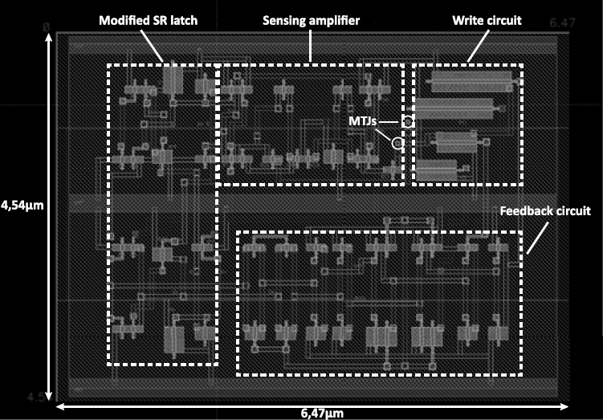

图中的结构包括改进的 SR 锁存器、灵敏放大器、写电路、反馈电路，以及磁隧道结（Magnetic Tunnel Junction，MTJ）。正常工作时由 CMOS 锁存路径承担逻辑状态更新，非易失支路负责保存与恢复状态。

这类结构把低漏电休眠与状态恢复联系起来，但需要额外写入、检测和控制电路。普通时钟门控只停止开关活动，寄存器仍由电源维持；非易失备份则允许进一步关断相关电源，代价转为备份、恢复所需的时间和能量。

## 时钟分布网络

### H 树与等延迟路径

时钟源通常不能直接驱动整片寄存器。大量时钟栅电容和长互连组成分布 RC 网络，需要分支与缓冲把时钟送到各个区域。

H 树（H-Tree）通过对称的层次分叉，让时钟源到各叶节点具有相同的几何路径长度。在理想规则阵列中，如果每条路径的线宽、寄生参数、缓冲器与负载也相同，就能得到接近相等的到达延迟。

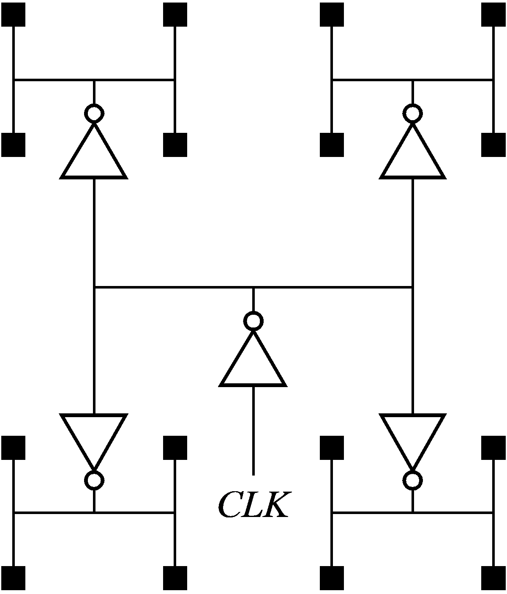

对真实芯片，宏单元位置、布线障碍和寄存器密度往往不均匀，因此几何对称只能作为起点。路径的等效电阻、电容和驱动负载共同影响延迟；等长线连接到不同负载，仍会产生偏差。

### 层次缓冲与 RC 匹配

一种分布方法是先把芯片分成若干负载近似均衡的区域，由全局网络驱动区域入口，再由本地缓冲树驱动内部寄存器。这样，全局驱动器不必直接承担所有末端负载，各区域也可以局部调节路径。

缓冲器隔离前后级负载，把长互连分段，并恢复因 RC 充放电而变缓的时钟边沿。与前面的[缓冲器链](C03.md)相同，分级驱动可以减少大负载的传播时间；时钟树还额外要求不同分支之间具有接近的延迟。

缓冲层数、器件尺寸和线宽可以同时调整。驱动太弱会产生慢边沿，影响寄存器内部的开关重叠；驱动过强则增加电容、功耗和电源冲击。局部器件与互连的变化仍然存在，匹配后的偏差通常保留一个有限范围。

### 网格分布

时钟网格（Clock Mesh）在末端形成相互连接的金属网络，由多个驱动点共同供给寄存器。局部负载可以从多条路径获得时钟，因而有助于减轻单条分支延迟和局部负载变化的影响，也能容纳一定的后期布局调整。

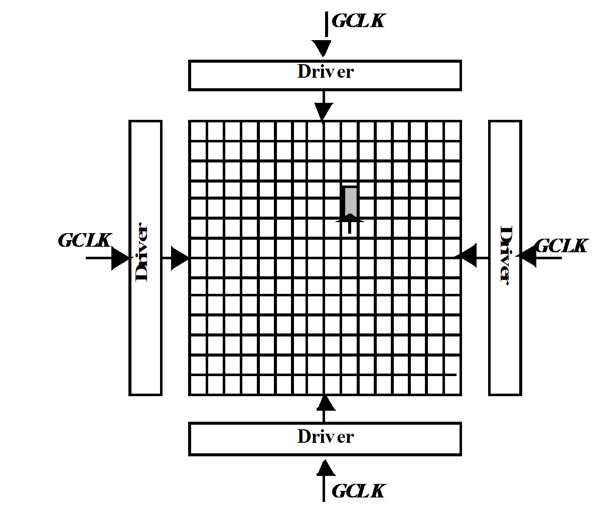

网格使用大量金属和并行连接，互连电容通常较大，每周期充放电消耗更多能量。树与网格因而具有不同的功耗、偏差和布局适应性，也可组成上层树分配、下层网格连接的混合网络。

### 大型处理器的时钟开销

历史处理器实例展示了时钟负载的量级：

| 参数 | Alpha 21164 示例 | Alpha 21264 示例 |
| --- | --- | --- |
| 总时钟负载 | 3.75 nF | 2.8 nF |
| 末级驱动晶体管总宽度 | 58 cm | 40 cm |
| 分布方式 | 全局分布与本地时钟反相 | 多个带条件缓冲的本地时钟分支 |
| 功耗控制 | 控制分布负载与本地使用 | 空闲本地分支可以关闭 |

总宽度是许多驱动器宽度的累加值。Alpha 21164 示例中的时钟功耗约 20 W，约占总功耗的 40%，说明即使时钟不承担数据运算，它仍可能是芯片内很大的开关负载。这些数值属于相应历史实现，主要用来说明分布网络的规模。

关闭部分时钟分支可以节省动态功耗，但不同本地时钟之间的边沿关系和竞争检查也更复杂。全局路径、局部缓冲、寄存器时钟端和供电噪声共同构成最终的时钟质量。

## 异步信号与自定时数据通路

### 异步输入的同步

外部输入或其他独立时钟域产生的信号，可能在本地时钟的任意时刻变化。这样的信号不保证满足本地寄存器的建立、保持窗口，直接采样时可能使寄存器进入亚稳态。

一种处理方式是先在本地时钟下采样，再给中间结果额外的稳定时间，之后才进入正常同步数据流。串联同步寄存级可以让前一级的再生过程在被后一级使用前获得更多时间，从而降低亚稳态继续传播的概率；代价是增加若干周期的等待。

这种方法不会使第一次采样永远满足建立、保持要求，作用在于延后使用不确定的采样结果。窄脉冲可能在两次采样之间出现并消失，多位数据也可能在不同位上被采到不同次更新，因此这两类传输还会使用脉冲保持、握手或相应的跨域数据协议，让信息持续到接收端可以完整接收。

### 取消全局固定周期

另一种方式是采用自定时（Self-Timed）数据通路，让模块之间通过请求、完成和应答确定操作顺序。

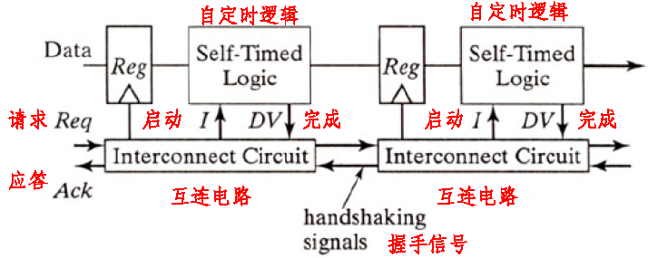

上游准备好数据后发出请求，控制逻辑启动本级运算；本级产生完成信号后，再允许下游接收，并向上游应答。模块何时接收下一份数据，取决于前一份数据是否完成传递，而不是统一时钟周期是否结束。

同步流水线用覆盖各级最坏延迟的周期安排所有操作。自定时结构可以按实际完成情况推进，但要增加握手和完成控制，电路正确性还依赖数据有效与控制事件之间的顺序。面积、验证复杂度和性能收益随具体结构变化。

## 锁相环与片上时钟产生

### 反馈生成与同步时钟

片外晶体参考源可以提供稳定时基，片内数据通路则常需要更高频率的时钟。锁相环（Phase-Locked Loop，PLL）通过比较参考时钟与反馈时钟的相位，调节内部振荡器，使两者形成稳定的频率和相位关系。

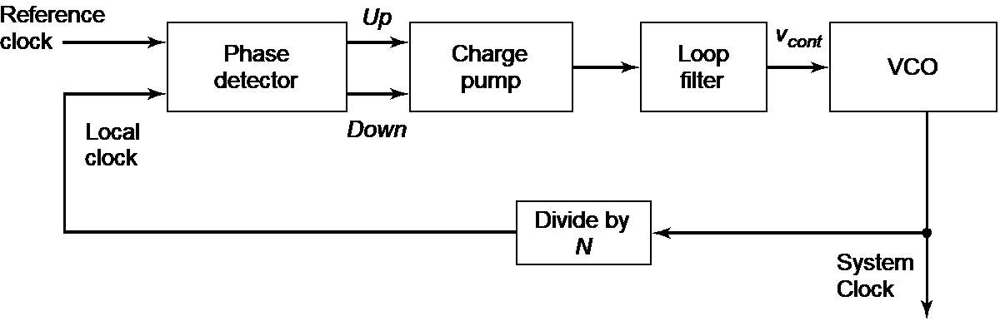

图中的主要环节依次是相位检测器、电荷泵、环路滤波器和压控振荡器（Voltage-Controlled Oscillator，VCO）。反馈支路把输出时钟除以 $N$，再送回检测器。

如果反馈边沿落后于参考边沿，检测器产生增加频率方向的控制脉冲；电荷泵把脉冲转换为充放电电流，环路滤波器积累并平滑控制电压 $V_{cont}$，VCO 再改变振荡频率。输出变化经分频反馈后继续修正误差，形成闭环。

锁定时，反馈频率与参考频率相同，因此

$$
\frac{f_{out}}N=f_{ref},\qquad f_{out}=Nf_{ref}.
$$

例如，参考频率为 25 MHz、分频比为 40 时，锁定后的输出频率为 $40\times25=1000$ MHz，即 1 GHz。改变分频比可以改变目标输出频率。

除倍频外，PLL 还可以用于芯片间时钟同步，以及补偿特定反馈路径中的相位延迟。环路的锁定范围、锁定时间和输出抖动取决于检测、滤波、振荡和反馈各环节；工艺、电压、温度变化会改变它们的响应。

### 异或相位检测器

两个相同频率的方波相位不同时，异或门只在两者电平不同的时间内输出高。相位差越大，高电平占据的时间越长，低通滤波后的平均值就能表示相位差。

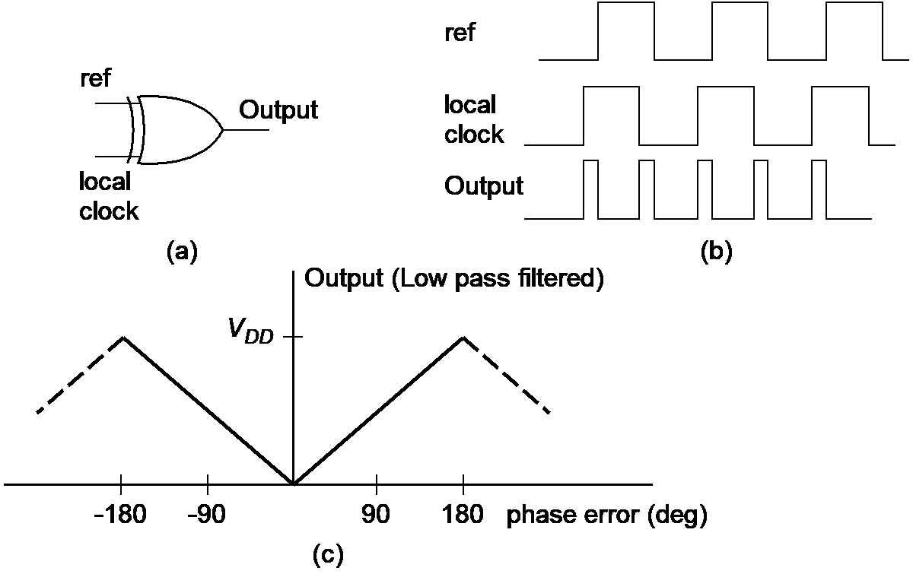

对相同频率、50% 占空比的输入，在 $0\le\Delta\phi\le\pi$ 内，两个不重合区间的总时长占一个周期的比例为 $\Delta\phi/\pi$，所以

$$
\overline V_{XOR}=V_{DD}\frac{\Delta\phi}{\pi}.
$$

零相差时平均值为 0，$\pi/2$ 相差时为 $V_{DD}/2$，$\pi$ 相差时为 $V_{DD}$。若相位差带符号，零附近呈 $|\Delta\phi|$ 的关系，因此只看平均值不能直接辨别谁超前、谁落后；闭环要在选定的工作区间内建立正确的反馈方向。异或检测也不具备独立的频差方向判别能力。

### 三状态相位频率检测器

相位频率检测器（Phase-Frequency Detector，PFD）通过记录两个输入边沿的先后顺序，产生 UP 与 DN 控制。它可以用两个 D 输入固定为 1 的触发器和共同复位逻辑实现。

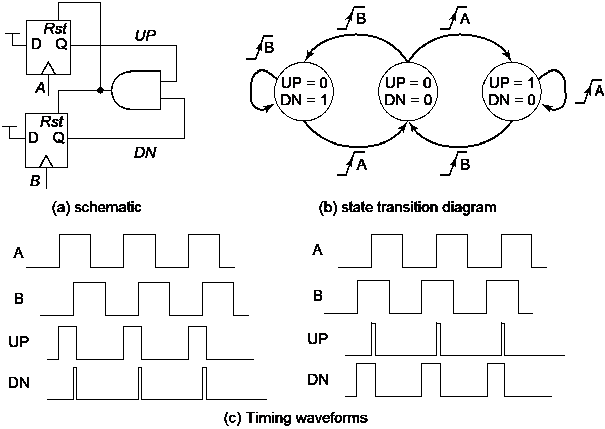

设输入 A 是参考时钟，B 是反馈时钟。两输出初始都为 0；A 上升沿先到，使 UP 变为 1，并保持到 B 上升沿到达；B 到来后，两个触发器都置位，复位逻辑把它们清零。于是 UP 脉冲宽度反映 A 领先 B 的时间。

若 B 先到，过程相反，DN 脉冲保持到 A 到来。三个主要状态为

| 状态 | UP | DN | 含义 |
| --- | --- | --- | --- |
| 等待 | 0 | 0 | 暂无一侧等待另一侧 |
| UP | 1 | 0 | 参考边沿先到，等待反馈边沿 |
| DN | 0 | 1 | 反馈边沿先到，等待参考边沿 |

两个输出短暂同时为高会立即触发复位，不作为持续工作状态。频率不同时，边沿的反复先后关系会使一类控制脉冲占主导，从而给振荡器提供频率调整方向。环路接近锁定后，主要通过较短脉冲继续修正相位误差。

## 从单元延迟到整条数据通路

组合逻辑的级数、单元内部延迟、输入电容、驱动能力、扇出和互连都会改变数据到达时间。寄存器又增加采样窗口与时钟到输出延迟，时钟网络则改变各端点真正可用的时间。

| 设计层次 | 可调整的内容 | 直接影响 |
| --- | --- | --- |
| 器件与工艺 | 驱动能力、阈值、互连参数 | 单元速度、漏电、布线延迟 |
| 标准单元 | 电路拓扑、晶体管尺寸、时钟管数量 | 延迟、电容、建立与保持要求 |
| 逻辑与结构 | 逻辑重组、扇出分配、流水级划分 | 组合深度、周期、吞吐率与等待时间 |
| 物理实现 | 单元选择、布局、缓冲、布线 | 实际负载、最大与最小路径延迟 |
| 时钟系统 | 树或网格、分支缓冲、门控、供电与屏蔽 | 偏差、抖动、边沿质量与时钟功耗 |

对一条普通同步路径，建立检查给出最慢数据在下一次采样前必须到达的上界，保持检查给出最快数据在当前采样后才能覆盖旧值的下界。优化逻辑、寄存器或时钟时，两个边界会一起变化；可实现的运行频率和数据可靠性来自完整路径同时满足这两类约束。
