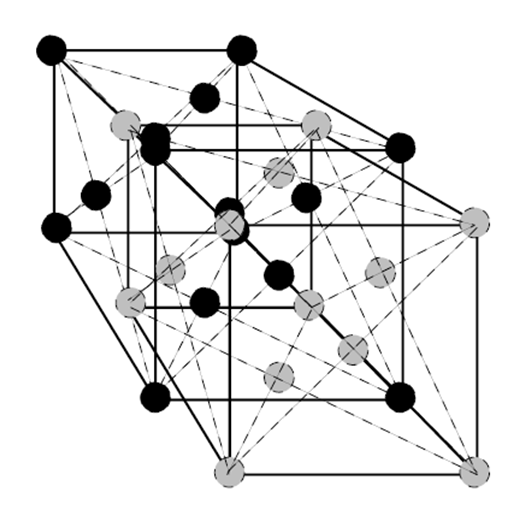
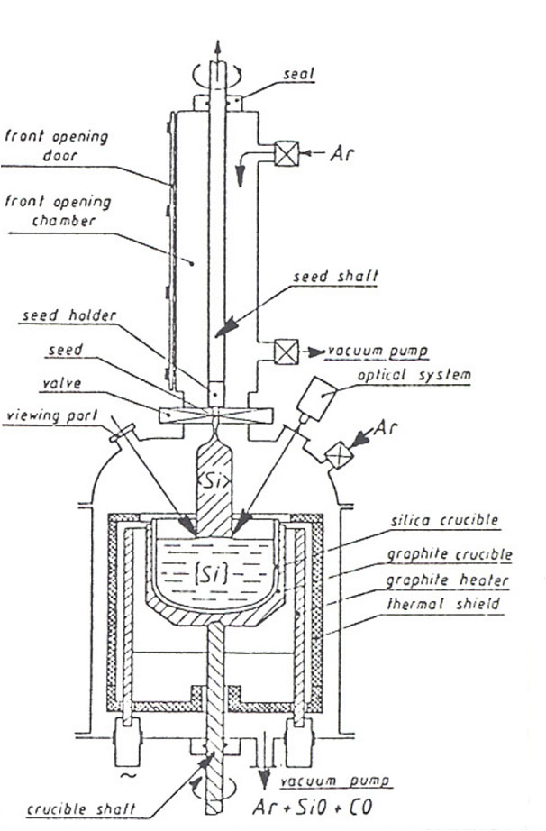
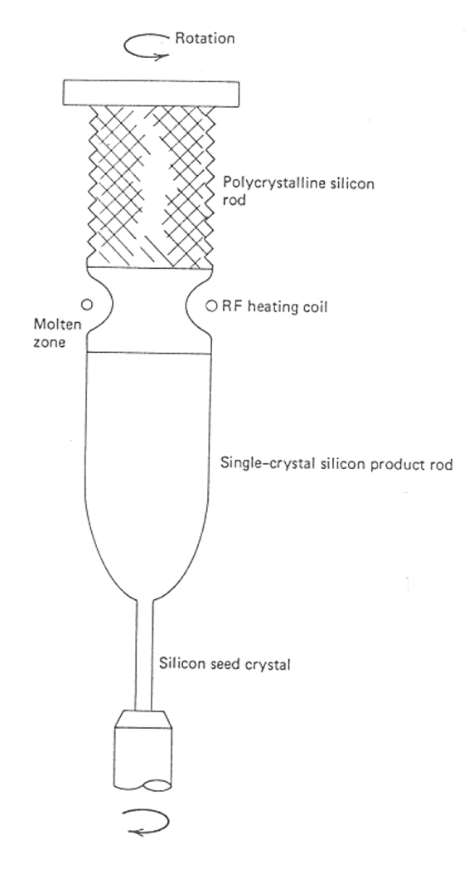
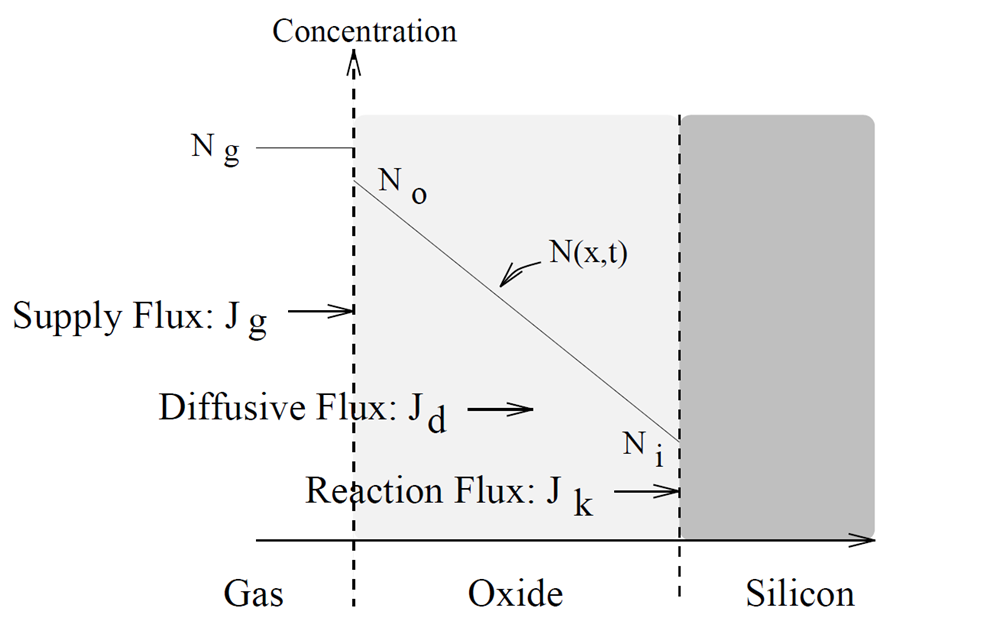
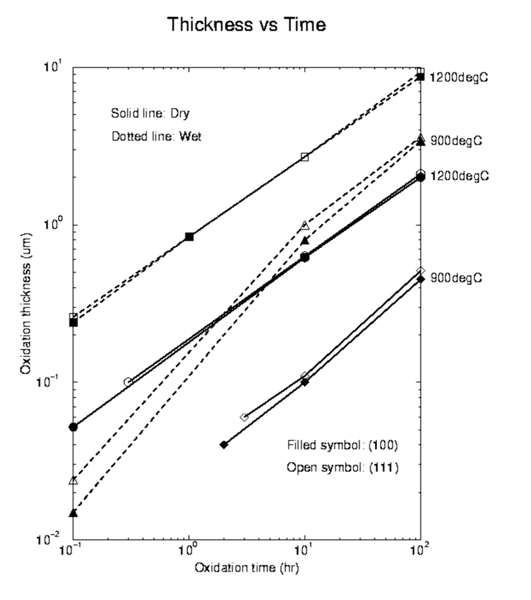
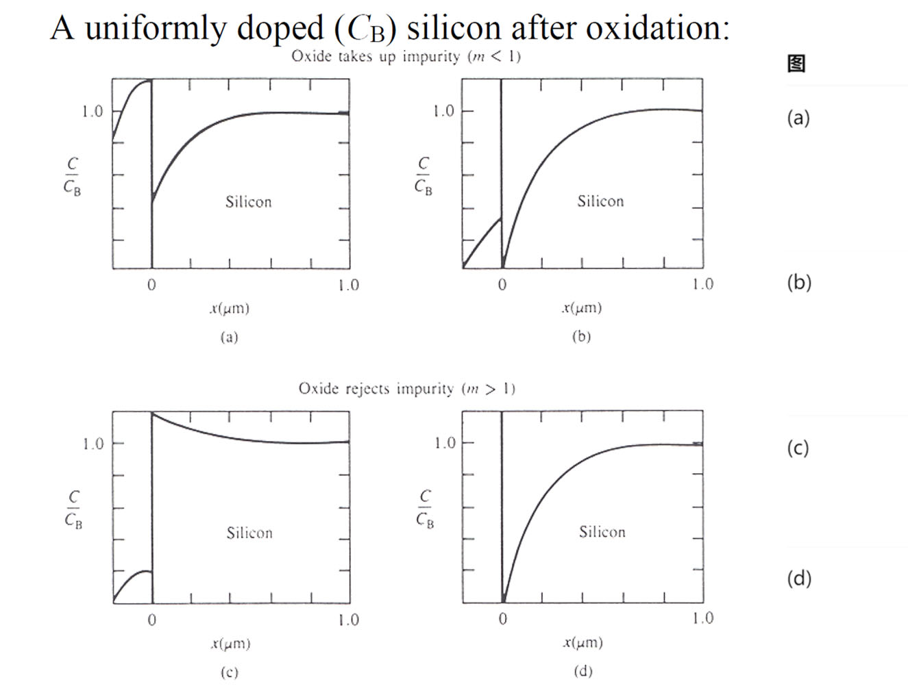
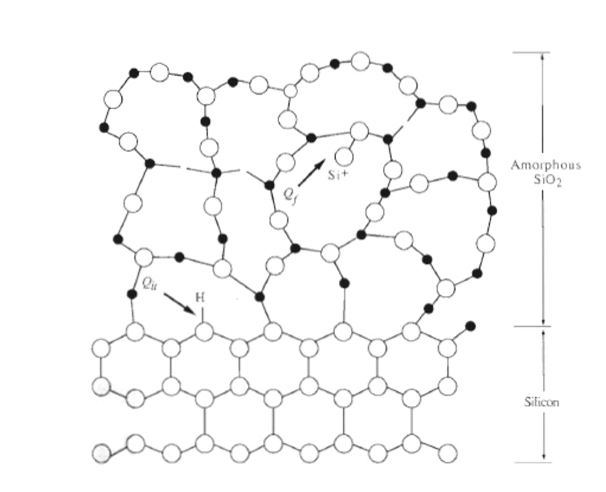
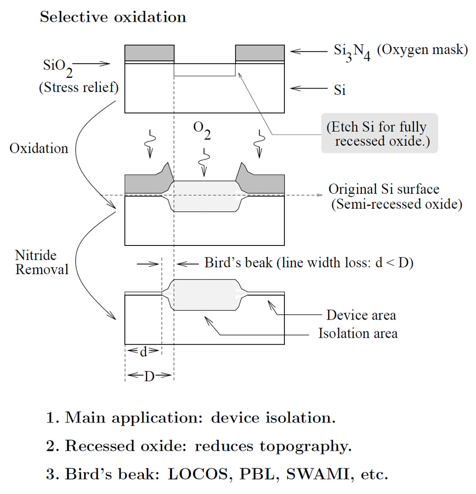
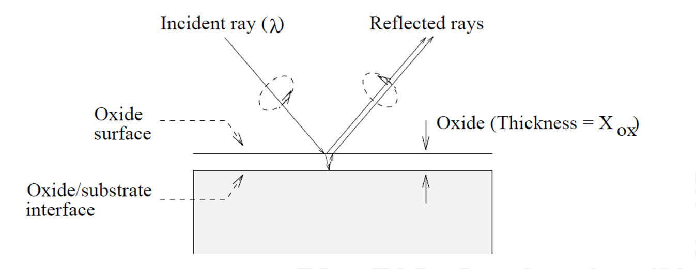
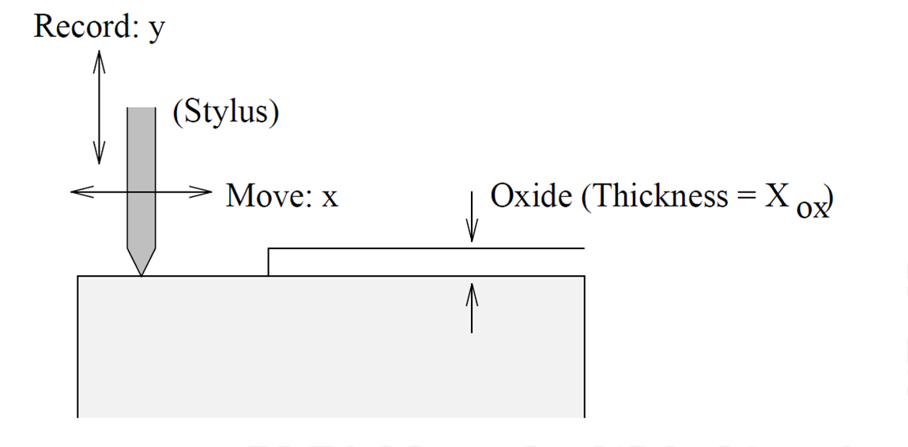

硅基集成电路的制造，需要先获得杂质含量、晶体结构和表面状态都满足要求的硅片，再在其上反复形成薄膜、转移图形和改变局部材料性质。半导体提供可调控的载流子，导体连接器件，绝缘体隔离不同电位。一个晶体管的结构，最终落实为这些材料的空间分布与界面。

硅适合这一制造体系，除了能够通过掺杂调节电学性质，还因为它可以直接生长出性能良好的二氧化硅。热氧化一边消耗硅、一边形成绝缘层，把晶圆材料、界面结构、杂质分布和高温工艺联系起来。因此，学习热氧化之前，需要先明确硅的原子排列和硅片的制备过程。

## 硅的材料形态与晶体结构

### 单晶、多晶与非晶

单晶硅具有在较大范围内连续一致的晶格取向，适合作为器件的衬底和有源材料。多晶硅由许多不同取向的晶粒组成，晶粒之间存在晶界；非晶硅则缺少晶体的长程周期性，但仍可以具有局部成键秩序。材料的化学成分相同，原子排列不同，载流子输运和工艺行为仍会改变。

| 材料形态 | 原子排列特征 | 在制造中的相关用途 |
| --- | --- | --- |
| 单晶硅 | 晶格在器件尺度内保持连续取向 | 衬底、有源区、外延层 |
| 多晶硅 | 多个晶粒组成，存在晶界 | 高纯拉晶原料，以及部分电极、电阻和结构薄膜 |
| 非晶硅 | 无长程周期性 | 部分薄膜器件与显示工艺中的半导体层 |

导电性由电子和空穴共同贡献，低场欧姆近似下有

$$
\sigma=q(n\mu_n+p\mu_p),
\qquad \rho=\frac{1}{\sigma}.
$$

$q$ 为元电荷，$n,p$ 为电子与空穴浓度，$\mu_n,\mu_p$ 为相应迁移率。硼是常见受主，磷、砷、锑是常见施主。掺杂改变载流子浓度，温度、缺陷和杂质散射又会影响迁移率，因此电阻率既与掺杂有关，也与材料和测试条件有关。

### 晶格、基元与晶胞

晶格是描述平移周期性的抽象点阵。若三个不共面的原始平移矢量为 $\mathbf a_1,\mathbf a_2,\mathbf a_3$，晶格点位置可写为

$$
\mathbf R=n_1\mathbf a_1+n_2\mathbf a_2+n_3\mathbf a_3,
\qquad n_1,n_2,n_3\in\mathbb Z.
$$

在每个晶格点放置相同的原子基元，才得到具体晶体结构。原始晶胞包含一个晶格点，但其原子数取决于基元；为了显示对称性，通常还会选用更大的常规晶胞。

| 理想结构 | 常规立方晶胞内原子数 | 最近邻配位数 |
| --- | --- | --- |
| 简单立方（Simple Cubic，SC） | $8\times\tfrac18=1$ | 6 |
| 体心立方（Body-Centered Cubic，BCC） | $8\times\tfrac18+1=2$ | 8 |
| 面心立方（Face-Centered Cubic，FCC） | $8\times\tfrac18+6\times\tfrac12=4$ | 12 |
| 金刚石立方 | $4+4=8$ | 4 |

前三行采用一个相同原子占据每个格点的单原子结构。金刚石结构则可描述为面心立方晶格配上两个原子的基元，基元的分数坐标为 $(0,0,0)$ 与 $(1/4,1/4,1/4)$。

*两套子晶格相差位移 $\tfrac a4(1,1,1)$，每个原子有四个最近邻。*

硅采用金刚石立方结构。以常规立方晶胞边长 $a$ 为晶格常数，其中一套子晶格在晶胞内的代表位置为

$$
(0,0,0),\quad
(0,\tfrac12,\tfrac12),\quad
(\tfrac12,0,\tfrac12),\quad
(\tfrac12,\tfrac12,0).
$$

将这些位置全部加上 $(1/4,1/4,1/4)$，得到另外四个内部原子。两套子晶格的位移沿 $[111]$ 方向，其长度为 $\sqrt3a/4$；这个距离也是硅的最近邻距离。常规晶胞中的八个原子与最近邻配位数四，分别描述晶胞计数和局部成键关系。

### 晶向与晶面的表示

晶向用从一个晶格位置指向另一个位置的矢量描述。将其在晶轴上的分量化为最小整数比，记为 $[uvw]$；负分量用上划线表示。晶向只给出方向，同向的平移矢量具有相同晶向。

晶面取向使用米勒指数 $(hkl)$：先把各轴截距写成晶格常数的倍数，再取倒数并化为最小整数比。平行于某轴时，该方向的倒数为零。例如截距比例为 $(1/2,1/4,1/2)$，倒数为 $(2,4,2)$，对应取向可写为 $(121)$。经过原点的平面，可以先选择同族平行平面再确定指数。

| 记号 | 含义 |
| --- | --- |
| $[uvw]$ | 一个具体晶向 |
| $\langle uvw\rangle$ | 对称等价的晶向族 |
| $(hkl)$ | 一个晶面取向 |
| $\{hkl\}$ | 对称等价的晶面族 |

对立方晶体，$[hkl]$ 垂直于 $(hkl)$，方向 $[uvw]$ 位于 $(hkl)$ 面内的条件为 $hu+kv+lw=0$。例如，$(100)$ 面内有 $[010]$、$[001]$ 和 $[011]$ 方向，$(111)$ 面内有 $[1\bar10]$ 方向。晶面指数相同的三个数字可以分别出现在晶面或晶向记号中，具体含义由括号确定。

晶向影响表面原子排列、各向异性腐蚀、弹性性质和界面反应。选择晶圆取向时，需要同时考虑器件和工艺要求；同一片晶圆上的版图方向，也应与实际晶轴建立对应。

## 从石英原料到单晶硅片

### 化学提纯与电子级多晶硅

石英原料中的二氧化硅首先通过高温碳热还原转化为冶金级硅（Metallurgical-Grade Silicon，MGS）。把中间反应合并后，可用总反应表示为

$$
\mathrm{SiO_2+2C\longrightarrow Si+2CO}.
$$

实际炉内还涉及碳化硅等中间产物。冶金级硅中仍含有铁、铝、钙等杂质，距离器件制造要求还有很大差距。

继续提纯时，可将硅转化为三氯氢硅，也称三氯硅烷（Trichlorosilane，TCS）：

$$
\mathrm{Si+3HCl\longrightarrow SiHCl_3+H_2}.
$$

挥发性含硅化合物可以利用冷凝和精馏分离杂质。随后在合适条件下通过氢还原沉积硅，主反应可写为

$$
\mathrm{SiHCl_3+H_2\longrightarrow Si+3HCl}.
$$

得到的是高纯电子级多晶硅（Electronic-Grade Silicon，EGS）。纯度指标需要说明受控杂质种类和测量口径；制造还要对有意掺入的施主、受主与不希望存在的金属污染分别控制。化学纯度合格以后，仍需通过晶体生长建立连续的单晶结构。

### 直拉法与悬浮区熔法

直拉法（Czochralski，CZ）将高纯多晶硅熔化在石英坩埚内，使具有所需晶向的晶种接触熔体，再控制温度、提拉速度和旋转条件，让硅沿晶种取向凝固。晶棒直径和缺陷状态与固液界面附近的热场及生长条件有关。

*晶种确定生长取向，熔体在受控热场中持续凝固为单晶。*

石英坩埚会向熔体引入一定的氧，碳及其他杂质也需要控制。生长过程中还可以加入掺杂剂，以设置晶棒的导电类型和电阻率。

悬浮区熔法（Float Zone，FZ）以多晶硅棒为起点，用射频加热在硅棒中形成局部熔区。熔区沿棒移动，经过晶种引导，后方凝固成单晶。由于熔体不接触坩埚，可以减少坩埚来源的污染，特别是氧的引入。

*局部加热形成熔区，凝固界面随熔区移动，不需要容纳整池熔体的坩埚。*

两种方法都需要控制热场、界面稳定性和杂质分布。外延生长则以已有晶体表面为模板继续形成晶体层，可通过化学气相沉积等方式实现；它解决的是衬底上的晶体层生长，与从熔体制备整根晶棒所处的工艺环节不同。

### 晶体生长中的杂质偏析

在固液界面处，新凝固硅中的杂质浓度 $C_s$ 与熔体浓度 $C_m$ 通常不同，偏析系数定义为

$$
k_{\mathrm{seg}}=\frac{C_s}{C_m}.
$$

| 掺杂剂 | B | P | As | Sb |
| --- | --- | --- | --- | --- |
| 代表性固液偏析系数 | 0.8 | 0.35 | 0.30 | 0.023 |

表中为常用近似值，实际有效分配还受生长速度和熔体输运影响。当 $k_{\mathrm{seg}}<1$ 时，新凝固的固体吸收杂质的比例较低，剩余熔体会逐渐富集杂质。

在熔体充分混合、固相扩散可忽略、偏析系数恒定且无杂质损失的理想模型中，设初始熔体体积为 $V_0$，已经凝固的比例为 $f$，则剩余熔体体积为 $V_m=V_0(1-f)$。忽略固液密度差带来的修正，杂质守恒可写为

$$
d(C_mV_m)=C_s\,dV_m
=k_{\mathrm{seg}}C_m\,dV_m.
$$

注意 $dV_m<0$。展开并积分，得到

$$
\frac{dC_m}{C_m}
=(k_{\mathrm{seg}}-1)\frac{dV_m}{V_m},
$$

$$
C_m(f)=C_0(1-f)^{k_{\mathrm{seg}}-1},
\qquad
C_s(f)=k_{\mathrm{seg}}C_0(1-f)^{k_{\mathrm{seg}}-1}.
$$

$C_0$ 为初始熔体浓度，$C_s(f)$ 是该时刻新形成固体的局部浓度。对 $k_{\mathrm{seg}}<1$ 的杂质，晶棒后段的浓度会升高，因此电阻率可能沿轴向变化；同时存在施主和受主时，还要分别计算两者，再比较净掺杂 $N_D-N_A$。

当 $f$ 接近 1 时，理想公式可能给出很大的浓度，但末端生长的混合、溶解度和界面条件通常已需要额外考虑，不能将该极限直接作为实际工艺结果。

### 切片、抛光与表面准备

晶棒经过定径、晶向识别和定位标记加工后切成硅片。随后通过研磨、损伤层去除、边缘处理、化学机械抛光和最终清洗，控制厚度均匀性、表面粗糙度和颗粒污染。晶圆的平边或缺口用于工艺定位，具体标记含义应以硅片规格为准。

镜面粗糙度与整片平整度是不同指标：局部表面足够光滑，仍需要控制翘曲和厚度变化。颗粒、金属污染及残留有机物会影响后续氧化、光刻和器件电学性能，洁净控制因而贯穿晶圆加工与器件制造。

## 二氧化硅的结构与工艺作用

### 热氧化层与沉积氧化层

二氧化硅中的硅原子通常与四个氧原子相连，形成局部四面体；理想网络中的桥接氧连接相邻硅原子。石英具有长程有序结构，热生长的氧化硅则通常为非晶网络。非晶并不意味着局部成键完全无序，缺陷也需要与网络本身的结构特征分别讨论。

热氧化直接消耗衬底硅，在硅与氧化物界面处生成新的氧化层。沉积氧化硅则由外部含硅前驱物提供硅源，可以覆盖在不同材料上。两种方法都能形成绝缘薄膜，但其界面形成过程、热预算和可覆盖的表面不同。

| 氧化层用途 | 所承担的功能 | 关键要求 |
| --- | --- | --- |
| 栅介质、电容介质 | 隔开电极并通过电场耦合 | 厚度、漏电、击穿与界面质量 |
| 场氧化层 | 隔离相邻器件区域 | 隔离能力、寄生效应与表面形貌 |
| 扩散或注入掩模 | 阻挡不希望进入硅的杂质 | 杂质种类、温度、时间或注入能量对应的阻挡能力 |
| 屏蔽氧化层 | 保护硅表面、调节注入过程 | 薄膜均匀性、表面损伤与离子输运 |
| 表面钝化层 | 降低表面缺陷及污染影响 | 界面态、固定电荷与环境稳定性 |
| 垫氧化层 | 缓和硅与上层氮化硅之间的应力作用 | 厚度、应力传递与后续侧向氧化 |

用氧化硅作掺杂掩模，需要给出能阻挡目标杂质的足够厚度。某些杂质在氧化硅中扩散较快，阻挡作用就较弱。氧化剂本身也能穿过氧化层，因此选择性氧化通常还要利用氮化硅等抗氧化掩模。

传统薄栅氧与厚隔离氧化层采用不同的生长条件，原因也不同：前者对厚度和界面电学性质敏感，后者更关注足够的绝缘厚度、形貌与处理效率。沉积氧化物可用于层间绝缘等环节，具体工艺仍需结合结构和热预算选择。

### 干氧与湿氧

干氧氧化以氧气为氧化剂：

$$
\mathrm{Si+O_2\longrightarrow SiO_2}.
$$

湿氧氧化以水蒸气为主要氧化剂，其总反应为

$$
\mathrm{Si+2H_2O\longrightarrow SiO_2+2H_2}.
$$

在常见热氧化条件下，湿氧生长较快，适合较厚氧化层；干氧生长较慢，常用于对薄膜和界面电学质量要求较高的氧化步骤。湿氧的速率优势由氧化剂在氧化硅中的平衡溶解浓度、扩散和界面反应共同决定。

实际配方也可组合干氧、湿氧和后续退火。每一段都会继承前一段形成的氧化层和界面状态，整体效果取决于完整的温度、气氛和时间历程。

## 氧化层厚度与硅消耗量

设原始硅表面上面积为 $S$ 的区域，消耗硅的厚度为 $x_{\mathrm{Si}}$，最终形成的平面氧化层厚度为 $x_{\mathrm{ox}}$。每个 $\mathrm{SiO_2}$ 化学式单位含有一个硅原子，因此硅原子守恒给出

$$
\frac{\rho_{\mathrm{Si}}Sx_{\mathrm{Si}}}{M_{\mathrm{Si}}}
=\frac{\rho_{\mathrm{ox}}Sx_{\mathrm{ox}}}{M_{\mathrm{SiO_2}}}.
$$

$\rho$ 为质量密度，$M$ 为摩尔质量。取 $\rho_{\mathrm{Si}}\approx2.33\ \mathrm{g/cm^3}$、$\rho_{\mathrm{ox}}\approx2.20\ \mathrm{g/cm^3}$，以及 $M_{\mathrm{Si}}\approx28.09\ \mathrm{g/mol}$、$M_{\mathrm{SiO_2}}\approx60.08\ \mathrm{g/mol}$，可得

$$
\frac{x_{\mathrm{Si}}}{x_{\mathrm{ox}}}
=\frac{\rho_{\mathrm{ox}}M_{\mathrm{Si}}}
{\rho_{\mathrm{Si}}M_{\mathrm{SiO_2}}}
\approx0.44.
$$

因此，热生长 $100\ \mathrm{nm}$ 氧化硅大约消耗 $44\ \mathrm{nm}$ 硅，氧化物外表面相对原始硅表面升高约 $56\ \mathrm{nm}$。相同数量的硅原子转化为氧化物以后，所占体积约为原来的 $1/0.44\approx2.27$ 倍。[^consumption]

对平面结构，这一关系决定界面位置和表面台阶；对掩模边缘或曲面结构，体积膨胀还会与机械约束共同产生应力。热氧化和随后去除氧化层，也可以组成一次可控的硅表面消耗过程。

## Deal–Grove 热氧化模型

### 氧化剂的输运与界面反应

已有氧化层覆盖硅以后，氧化剂需要从气相到达氧化层外表面，再穿过氧化层，最后在硅—氧化物界面反应。新生成的氧化物使扩散路径进一步增长，生长速率随之改变。

*图中的 $N_o$、$N_i$ 分别对应氧化层外表面与反应界面附近的氧化剂浓度。气相浓度与氧化物中的溶解浓度通常不同。*

设当前氧化层厚度为 $x$，氧化剂在氧化层外表面的浓度为 $C_s$，反应界面处为 $C_i$，在氧化硅中的扩散系数为 $D$。进一步用 $C^*$ 表示与主体气氛平衡时，氧化剂在氧化物表面能够达到的溶解浓度。$C^*$ 与气相中的实际分子数密度属于不同相中的浓度。

采用一维、准稳态近似，假设氧化层内部没有显著氧化剂生成或消耗，则通量沿厚度近似不变。三个环节可分别表示为

$$
J_g=h_g(C^*-C_s),
$$

$$
J_d=-D\frac{dC}{dz}
=D\frac{C_s-C_i}{x},
$$

$$
J_r=k_sC_i.
$$

$h_g$ 为折算到上述浓度定义下的气相传质系数，$k_s$ 为一级界面反应速率常数，二者单位为长度/时间。若浓度单位为 $\mathrm{cm^{-3}}$，$D$ 为 $\mathrm{cm^2/s}$，则 $J$ 的单位为 $\mathrm{cm^{-2}s^{-1}}$。

由准稳态通量连续条件 $J_g=J_d=J_r=J$，得到

$$
J=\frac{C^*}
{\dfrac1{h_g}+\dfrac{x}{D}+\dfrac1{k_s}}.
$$

分母中的三项分别反映气相供给、穿过氧化层的扩散、界面反应所形成的传输限制。当气相供给足够快时，$1/h_g$ 可以忽略，模型主要由扩散与界面反应竞争决定。[^deal-grove]

### 由通量得到线性—抛物线关系

令 $N_1$ 表示生成单位体积氧化硅需要消耗的氧化剂分子数，则

$$
\frac{dx}{dt}=\frac{J}{N_1}.
$$

若按 $\mathrm{O_2}$ 分子计数，每形成一个 $\mathrm{SiO_2}$ 单位需要一个氧分子；若按 $\mathrm{H_2O}$ 分子计数，则需要两个水分子。因此 $N_1$ 必须与通量所计数的物种一致，不能对干氧和湿氧混用同一计数口径。

定义

$$
A=2D\left(\frac1{k_s}+\frac1{h_g}\right),
\qquad
B=\frac{2DC^*}{N_1},
$$

可将生长方程写成

$$
\frac{dx}{dt}=\frac{B}{2x+A}.
$$

这里 $A$ 的单位为长度，$B$ 为长度平方/时间，$B/A$ 为长度/时间。气相供给充分时，进一步有

$$
A\approx\frac{2D}{k_s},
\qquad
\frac BA\approx\frac{k_sC^*}{N_1}.
$$

设 $t=0$ 时已有厚度为 $x_i$ 的氧化层，积分得到

$$
x^2+Ax=x_i^2+Ax_i+Bt
=B(t+\tau),
$$

$$
\tau=\frac{x_i^2+Ax_i}{B}.
$$

因此

$$
x(t)=\frac A2
\left[\sqrt{1+\frac{4B(t+\tau)}{A^2}}-1\right].
$$

$\tau$ 是在当前模型与工艺条件下，由初始厚度换算的等效时间偏移。改变温度或气氛后，$A,B$ 也会改变，应以已有厚度作为新阶段的初值，重新计算时间关系。

### 反应控制与扩散控制

当 $2x\ll A$ 时，生长速率近似为常数：

$$
\frac{dx}{dt}\approx\frac BA,
\qquad
x-x_i\approx\frac BA t.
$$

在气相供给充分的前提下，这对应界面反应控制，因此 $B/A$ 称为线性速率常数。氧化剂较容易穿过薄氧化层，生长主要受界面消耗速度限制。

当 $2x\gg A$ 时，扩散路径形成主要限制：

$$
\frac{dx}{dt}\approx\frac{B}{2x},
\qquad
x^2-x_i^2\approx Bt,
$$

其中平方差近似要求所考察区间均已处于厚氧化层极限。初始层影响可忽略时，有 $x\approx\sqrt{Bt}$，因此 $B$ 称为抛物线速率常数。

若从接近裸硅的状态开始，在线性极限下将目标厚度加倍，所需时间约增加为两倍；在抛物线极限下，时间约增加为四倍。过渡过程由完整方程描述，$x\sim A/2$ 只是两项量级接近的尺度。

### 已有氧化层上的继续生长

给定某一温度和气氛下标定的 $A,B$，从厚度 $x_1$ 生长到 $x_2$ 所需的时间为

$$
\Delta t=
\frac{x_2^2-x_1^2+A(x_2-x_1)}{B}.
$$

这一形式直接用于分段工艺：每段以实际进入该段时的膜厚为初值，并使用该段对应的参数。总工艺时间是各段持续时间之和，每段的终厚度则需按其自身参数计算。

Deal–Grove 模型还假定扩散、界面反应和氧化物性质可以用给定参数描述。超薄氧化层的初始生长、强应力、复杂曲面、重掺杂或快速变化的温度场可能偏离这一近似；这时应采用相应修正模型或实测工艺数据。

## 氧化温度、气氛、晶向与掺杂

### 温度和氧化剂分压

温度会改变扩散与反应，常用 Arrhenius 形式分别拟合 $B$ 和 $B/A$：

$$
B=B_0\exp\left(-\frac{E_B}{k_BT}\right),
\qquad
\frac BA=K_0\exp\left(-\frac{E_L}{k_BT}\right).
$$

$T$ 用 K，$E_B,E_L$ 分别对应经验激活能，需与玻尔兹曼常数 $k_B$ 采用一致的能量单位。$B_0$ 与 $K_0$ 具有不同单位，拟合参数也与气氛和晶向等条件有关。

在适用亨利定律的范围内，溶解浓度近似满足 $C^*=H p_{\mathrm{ox}}$，其中 $p_{\mathrm{ox}}$ 是氧化剂分压。因而提高氧化剂分压通常会加快生长。在 $D,k_s,h_g$ 近似不变的理想模型下，$B$ 和 $B/A$ 都随 $C^*$ 增大；实际压强依赖需要根据氧化剂和工艺条件标定。

### 晶向与干湿氧差异

*实线为干氧，虚线为湿氧；实心点为 $(100)$ 面，空心点为 $(111)$ 面。曲线的差异随生长阶段变化。*

晶面不同，表面原子的排列与反应条件不同，因而线性速率常数存在晶向依赖。在常用近似中，$(111)$、$(110)$ 与 $(100)$ 面的线性速率常数相对值可取约 $1.68:1.45:1$，具体数值仍需对应所用模型和条件。

进入厚氧化层的扩散控制阶段后，氧化剂主要穿过已形成的非晶氧化层，衬底晶向对厚度的相对影响通常减弱。湿氧的平衡溶解浓度和传输、反应参数与干氧不同，因此两种气氛的 $A,B$ 应分别取值。

### 重掺杂改变生长与杂质分布

很高的掺杂浓度可能改变界面反应和氧化层性质。重掺磷的某些条件下，线性速率常数明显增大，而抛物线常数变化较小；重掺硼则可能通过改变氧化层成分和网络结构增强氧化剂输运。其影响随温度、浓度和生长阶段变化，需要与轻掺杂硅分别标定。

氧化过程也会反过来改变掺杂分布。硅被消耗，反应界面持续向内部移动，杂质又在硅和氧化物之间重新分配。定义界面附近的分配系数为

$$
m_{\mathrm{seg}}=\frac{C_{\mathrm{Si}}}{C_{\mathrm{ox}}}.
$$

它比较的是硅相与氧化硅相中的浓度，与前文固液生长时的 $k_{\mathrm{seg}}$ 对应不同的两相。按这个定义，$m_{\mathrm{seg}}<1$ 表示氧化物侧的平衡浓度较高，$m_{\mathrm{seg}}>1$ 表示硅侧较高。

*横坐标零点为界面，右侧为硅。上下两行分别表示不同的分配倾向，左右两列还体现氧化层内输运速度的差异。*

硼通常较易进入氧化物，在硅表面形成耗尽；磷在氧化物中输运较慢、又更倾向留在硅中时，可能在硅侧形成堆积。具体剖面还受两侧扩散、氧化层外表面的杂质损失和界面移动共同影响。即使平衡分配倾向硅，若杂质能快速穿过氧化层并从外表面流失，硅侧仍可能耗尽。[^redistribution]

因此，氧化步骤不只增加绝缘层厚度，还可能改变表面净掺杂、结位置和片电阻。工艺设计需要同时计算氧化和杂质再分布。

## 硅—氧化物界面与缺陷电荷

### 界面成键与电荷分类

单晶硅的周期结构与非晶氧化物网络在界面处相接，实际界面可能存在未饱和键、非理想配位和偏离完整化学计量的局部结构。这些缺陷可能形成电荷或允许载流子占据的能级，影响表面电势与器件特性。

*界面与氧化物内部的缺陷所处环境不同，其电荷是否移动、能否交换载流子以及响应时间也不同。*

| 电荷类型 | 常用记号 | 位置与行为 | 主要影响 |
| --- | --- | --- | --- |
| 固定氧化物电荷 | $Q_f$ | 靠近界面的氧化物区域；在所考察条件下位置固定，常表现为正电荷 | 表面电势、平带与阈值电压偏移 |
| 可动离子电荷 | $Q_m$ | 氧化层中的 Na、K 等离子污染；可随电场和温度发生迁移 | 随偏压、温度和时间变化的电学漂移 |
| 界面陷阱电荷 | $Q_{it}$ | 硅—氧化物界面的缺陷态，可与硅交换电子或空穴 | 界面复合、频率相关响应及器件参数变化 |
| 氧化物陷阱电荷 | $Q_{ot}$ | 氧化物内部缺陷俘获的电子或空穴，可由注入或辐照等形成 | 阈值漂移、局部电场及可靠性变化 |

界面硅悬键是界面陷阱的重要来源之一，固定氧化物电荷则与近界面的结构、成分缺陷有关。陷阱电荷与离子污染也有不同的形成和变化机制，因此要分别评价。

### 电荷对电学性质的影响

对平面金属—氧化物—半导体（Metal–Oxide–Semiconductor，MOS）电容，单位面积氧化层电容为

$$
C_{\mathrm{ox}}=\frac{\varepsilon_{\mathrm{ox}}}{x_{\mathrm{ox}}}.
$$

若氧化物电荷可以折算为界面附近的等效面电荷 $Q_{\mathrm{eff}}$，其造成的平带电压变化近似为

$$
\Delta V_{\mathrm{FB}}=-\frac{Q_{\mathrm{eff}}}{C_{\mathrm{ox}}}.
$$

这里 $Q_{\mathrm{eff}}$ 的单位是电荷/面积，需要与单位面积电容对应。对于氧化层内分布的电荷，折算还应考虑距界面的位置。界面陷阱的占据情况又随表面电势和测量时间尺度变化，往往需要结合电容—电压特性评价。

减少电荷缺陷需要从来源入手。清洗和高纯工艺材料可以减少可动离子污染，优化氧化与退火过程可以改善氧化物及界面状态，含氢退火可以通过钝化部分悬键降低界面陷阱。具体处理效果需要在目标电场、温度和时间条件下验证。

## 氧化前清洗与局部氧化

### 清洗控制初始表面

氧化从硅表面开始，表面的颗粒、有机物、金属污染和原生氧化层都会影响成核、均匀性及界面质量。常见的两类标准清洗溶液承担不同任务：

| 环节 | 典型组成 | 主要目的 |
| --- | --- | --- |
| 标准清洗1（Standard Clean 1，SC-1） | $\mathrm{NH_4OH:H_2O_2:H_2O}$ | 去除颗粒与部分有机污染 |
| 标准清洗2（Standard Clean 2，SC-2） | $\mathrm{HCl:H_2O_2:H_2O}$ | 去除金属离子污染 |
| 稀 HF 处理 | 氢氟酸与水 | 去除需要移除的氧化层 |

传统配方示例中，SC-1 与 SC-2 的体积比分别为 $1:1:5$ 和 $1:1:6$。这些比例需要与原液浓度和具体工艺配合，清洗顺序、温度及是否保留表面氧化层，也随后续步骤改变。

HF 去除氧化层后，表面状态会随后续暴露与环境再次变化，因此清洗到氧化之间的等待、转运和污染控制也属于工艺的一部分。氧化层的初始厚度应采用实际表面状态，而不是统一假定为零。

### 氮化硅掩模与 LOCOS

局部硅氧化（Local Oxidation of Silicon，LOCOS）利用抗氧化掩模，使暴露区域生成较厚氧化物，用于器件隔离。典型叠层是在硅上先形成较薄的垫氧化层，再覆盖并图形化氮化硅。

*垫氧化层缓和应力作用，氮化硅阻挡大部分氧化剂；掩模边缘仍可能发生侧向氧化。*

氧化剂在暴露区到达硅表面，也会从边缘向掩模下方输运，使氧化层在边缘逐渐变薄并横向延伸，形成鸟嘴结构。图中的有效有源区宽度 $d$ 小于原先定义的宽度 $D$，反映了侧向氧化带来的面积损失。

垫氧化层的厚度同时影响应力缓冲和边缘输运。隔离区域也可先刻蚀一定深度，再氧化以减小最终表面起伏。掩模边缘存在二维扩散、界面移动与应力耦合，平面一维 Deal–Grove 关系只能作为远离边缘区域的近似。

## 氧化层厚度的测量

### 干涉颜色与椭偏测量

光在氧化层表面与硅—氧化物界面反射后发生干涉，反射颜色会随厚度变化。颜色可以用于快速判断厚度范围和明显的不均匀，但还依赖照明光谱、观察角度和材料光学性质，定量测量通常需要仪器。

椭偏法（Ellipsometry）测量反射前后偏振状态的变化。用 $r_p,r_s$ 表示平行和垂直入射面的复反射系数，常写为

$$
\frac{r_p}{r_s}=\tan\Psi\,e^{i\Delta}.
$$

$\Psi$ 描述振幅比，$\Delta$ 描述相位差。结合氧化层和衬底的光学模型、入射角和测量波长，可以拟合膜厚与折射率等参数。

*测量偏振变化后，通过薄膜光学模型反演厚度；结果依赖所选材料与叠层模型。*

对超薄膜、表面粗糙层或多层结构，参数之间可能存在相关性。多波长、多角度数据或独立的光学参数有助于减少反演歧义。

### 台阶高度与真实膜厚

台阶仪（Profilometer）用探针扫描表面，记录高度随横向位置的变化。测量薄膜厚度时，需要先形成已知上下参考面的台阶，例如在一片均匀氧化的硅片上，选择性去除部分氧化层，再扫描保留区和去除区。

*台阶高度只有在参考表面确定后，才能换算为膜厚。*

若一侧保留氧化层，另一侧仅去掉同一层氧化物、且未继续刻蚀硅，理想台阶高度就是 $x_{\mathrm{ox}}$。若比较的是局部氧化区外表面与原本未氧化硅表面，理想平面关系下的高度差则约为 $0.56x_{\mathrm{ox}}$，因为另有约 $0.44x_{\mathrm{ox}}$ 对应向下消耗的硅。

因此，测量结果应同时记录样品结构、刻蚀历史和参考面。边缘曲率、探针半径和表面粗糙度也会影响台阶轮廓的解释。

## 氧化设备与热预算

### 批量炉与快速热氧化

批量炉把多片晶圆装入石英舟，在水平或垂直管式炉中加热，并控制氧气、水蒸气及其他工艺气体。稳定热区适合批量处理，装片、升温、恒温和冷却共同构成完整热历程。

快速热处理（Rapid Thermal Processing，RTP）通常采用辐射加热，使单片晶圆快速升降温；在氧化气氛中使用时，可形成快速热氧化（Rapid Thermal Oxidation，RTO）工艺。它能缩短高温停留时间，但仍需控制温度分布、测温和气氛切换。

| 设备形式 | 主要特点 | 工艺上需要关注的因素 |
| --- | --- | --- |
| 常规批量炉 | 多片同时处理，恒温段稳定 | 片间与片内均匀性、装片效应、较长升降温历程 |
| 单片快速热处理 | 升降温快，可进行短时氧化和退火 | 晶圆温度均匀性、辐射率、测温与节拍 |
| 小批量快速升温炉 | 同时处理一定数量晶圆并提高升降温速度 | 批量能力、热惯性和均匀性之间的协调 |

传统氧化示例常处于约 $900\sim1100\ ^\circ\mathrm C$ 的温区，实际温度、处理时间和装片量由膜厚、设备与器件结构决定。氧化和退火是不同的处理目标：前者有意形成氧化物，后者主要调整材料或缺陷状态，二者有时组合在同一热处理流程中。

### 生长速率与其他高温效应

提高温度可以加快氧化，也可能加快掺杂扩散、界面反应和缺陷演化。对扩散系数随温度变化、但在空间上近似均匀的一维扩散，温度历程造成的均方根扩散距离尺度为

$$
\ell_D=\sqrt{2\int D_{\mathrm{dop}}[T(t)]\,dt}.
$$

其中 $D_{\mathrm{dop}}$ 是相应杂质的扩散系数。这个积分说明，扩散相关的热预算取决于完整温度历程，尤其受高温段影响。计算等温氧化时间以后，还需要把升降温期间的额外生长与其他高温效应纳入工艺评价。

最终的氧化工艺需要同时满足膜厚与均匀性、硅消耗量、杂质分布、界面电荷和热预算要求。测得厚度以后，再结合电学与表面状态评价，才能判断这层氧化物是否满足其具体用途。

## 资料与延伸阅读

基础材料为课程讲义《硅》和《热氧化》。配图采用材料中的原始图及已有导出图；文中统一了晶格与原子计数、两类偏析系数和氧化剂分子计数的定义。

[^consumption]: University of Alberta nanoFAB，[Silicon thermal oxidation calculator](https://toolbox.nanofab.ualberta.ca/sithox/)：热氧化层厚度与硅消耗量的换算，以及初始氧化层的计入。

[^deal-grove]: Deal, B. E.; Grove, A. S. [General Relationship for the Thermal Oxidation of Silicon](https://doi.org/10.1063/1.1713945). *Journal of Applied Physics*, 36, 3770–3778, 1965。可参阅[原论文全文](https://www.lithoguru.com/scientist/CHE323/Deal_Grove_Model_JApplPhys_36_3770.pdf)，核对三段通量、速率常数及模型假设。

[^redistribution]: Hollauer, C. [Dopant Redistribution](https://www.iue.tuwien.ac.at/phd/hollauer/node23.html)，维也纳工业大学学位论文相关章节：硅—氧化物界面的杂质分配与浓度剖面。
