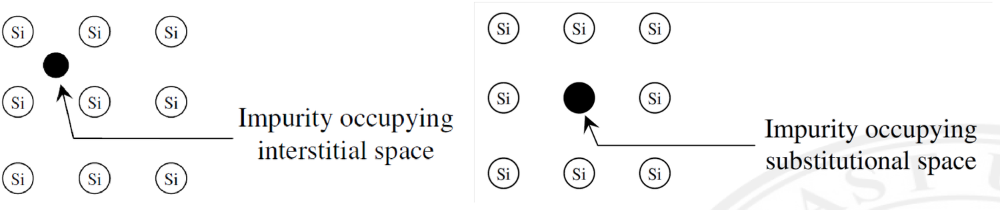
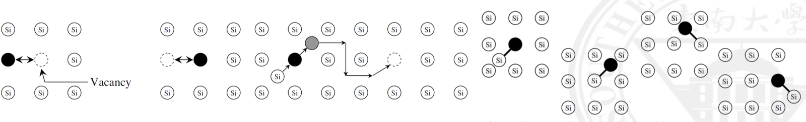
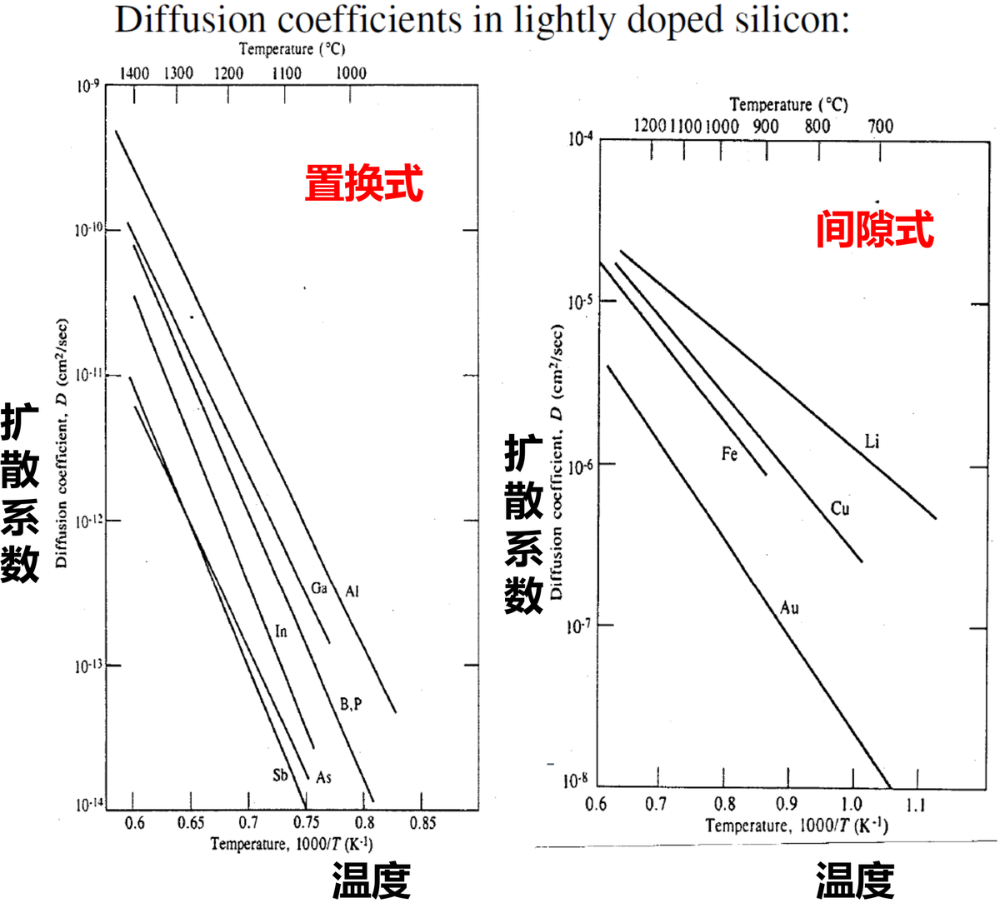
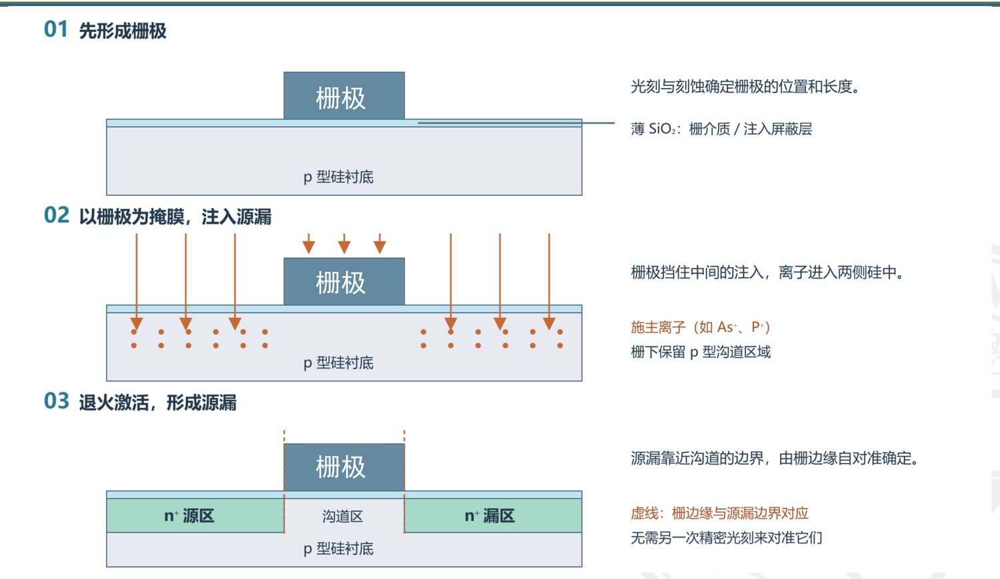
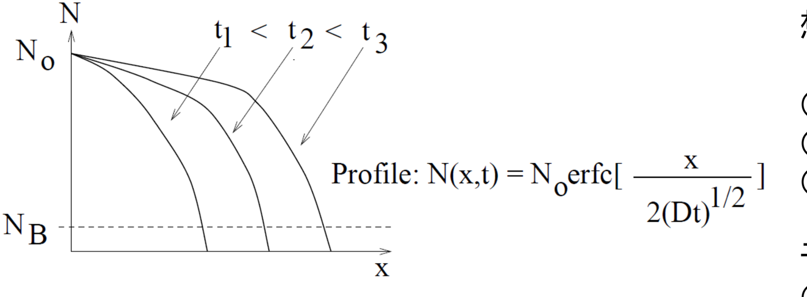
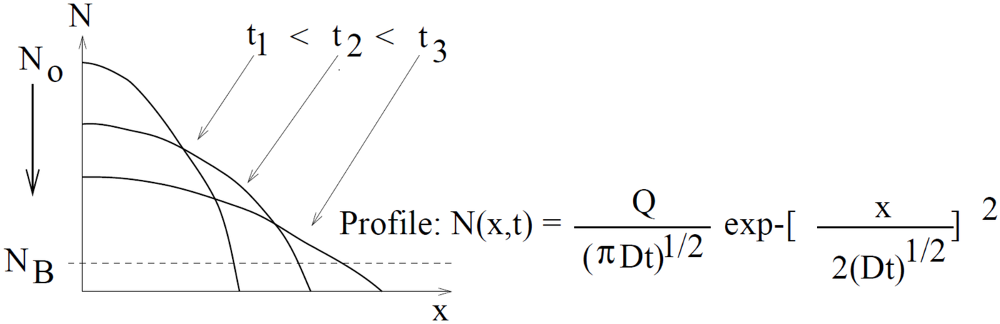
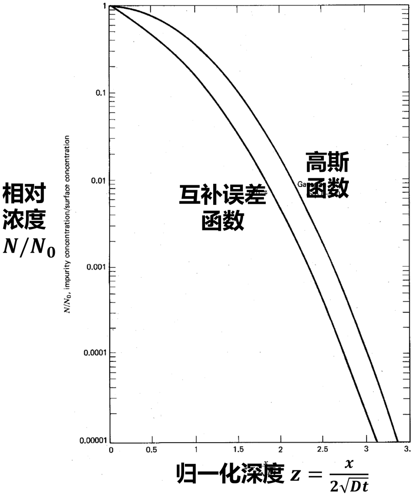
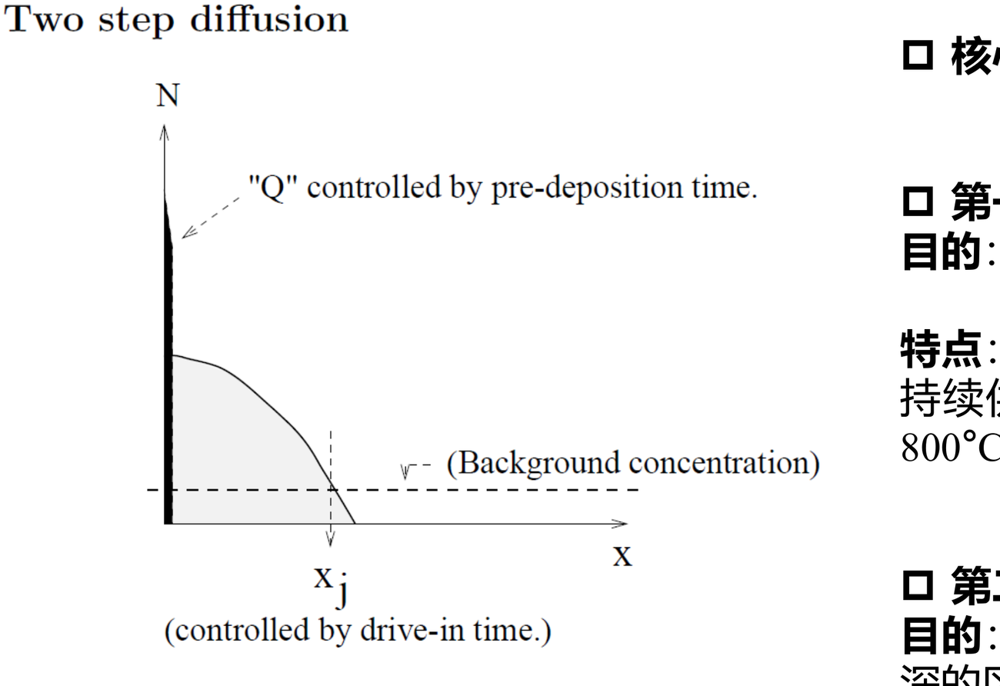
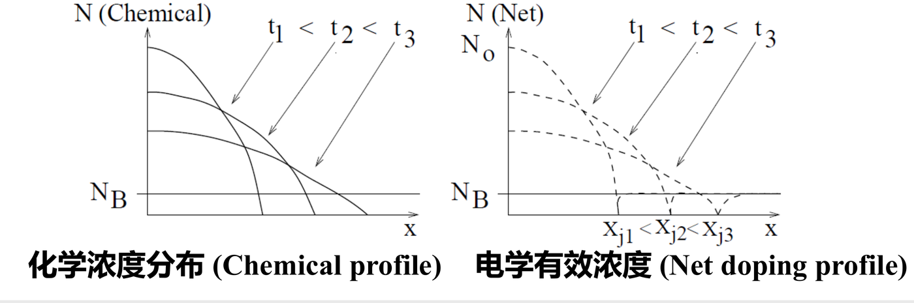
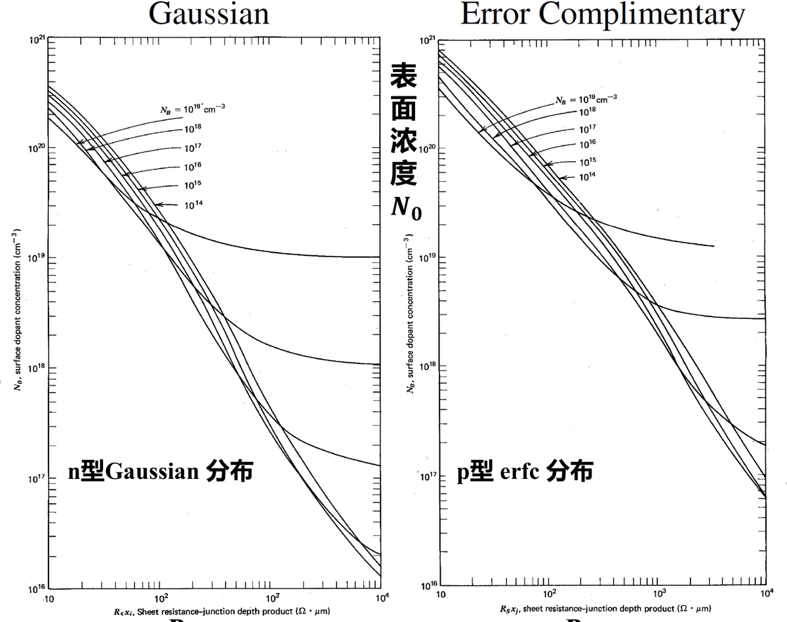

上一节讨论的掺杂集中在整根晶棒的平均水平：偏析系数决定晶棒轴向的电阻率变化，热氧化再改变表面附近的杂质分布。器件需要的却是同一片硅上分区、分层、深度可控的掺杂：源漏是高浓度浅区，沟道是低浓度区，阱是覆盖较深范围的反型背景。把杂质精确地放进指定位置并控制其深度，依赖高温下杂质在硅中的迁移。

温度梯度驱动热流，浓度梯度驱动物质流。半导体工艺所说的扩散指后一种：杂质原子在浓度梯度的驱动下从高浓度区向低浓度区迁移，把初始的分布逐渐抹平。温度决定迁移的快慢，时间决定迁移的远近，工艺用这两个量把扩散深度和浓度分布调整到设计值。

## 杂质在硅中的位置与迁移方式

金刚石结构的硅原子占据格点，格点之间还留有空隙。杂质原子可以停在格点上取代一个硅原子，也可以停在空隙里。两种位置对应两条迁移路径，速率相差许多个数量级。

*左为间隙式占位，右为替位式占位。*

停在间隙位置的杂质不必等待晶格缺陷，直接从一处空隙跳到相邻空隙，跃迁势垒低。金、铜、铁、锂这类金属污染物走这条路径，在 $1000\ ^\circ\mathrm C$ 附近的扩散系数可达 $10^{-5}\sim10^{-7}\ \mathrm{cm^2/s}$。它们移动得远，进入有源区以后即使后续温度不高也能扩散到深处，成为污染控制的对象。

掺杂剂多数占据格点，成为替位式杂质。替位原子要迁移，前方先得出现空位或其他晶格缺陷，原子才能跳进那个位置，迁移因此慢得多。硼、磷、砷、锑、镓、铝都属于这一类，$1000\ ^\circ\mathrm C$ 附近的扩散系数在 $10^{-13}\ \mathrm{cm^2/s}$ 量级，比金属低六到八个数量级。慢使扩散深度在给定时间内停留在微米上下，掺杂区的边界才被工艺约束得住。

替位式迁移按所借缺陷分成三种。

空位辅助式迁移中，晶格内热激发产生的少量空位提供一个可跳入的位置。杂质原子占据一个格点，相邻格点出现空位时跳进去，原来的位置变成新的空位，空位相当于朝反方向移动。砷、锑这类原子较大，难以挤进间隙，主要走这条路。

踢出式（kick-out）迁移中，杂质原子从间隙位置把一个硅原子挤到间隙里去，自己占据腾出来的格点。被挤出的硅原子成为新的移动体，继续挤走下一个格点上的原子。硼、磷这类轻原子容易进入间隙，这种交替踢出的过程让杂质原子沿同一方向逐步前移。

间隙对式（interstitialcy）迁移中，杂质与一个硅自间隙原子结合成杂质—缺陷对，整个对一起移动，到达新位置后再分离。杂质借自间隙原子作为载体间接迁移，高浓度磷在氧化气氛下的异常快扩散常被这样解释。三种机制在同一材料中可以并存，各自的比例随温度、浓度和气氛改变。[^fahey]

*左：杂质跳入相邻空位；中：杂质把硅原子踢入间隙并占据其格点；右：杂质与硅自间隙原子结成对整体迁移。*

扩散系数随温度的变化写成 Arrhenius 形式：

$$
D=D_0\exp\left(-\frac{E_a}{k_BT}\right).
$$

$D_0$ 为指前因子，$E_a$ 为激活能，$k_B$ 为玻尔兹曼常数，$T$ 取热力学温度。以 $1000/T$ 为横轴作 $\lg D$ 图得到直线，斜率给出 $-E_a/(k_B\ln10)$。

*横轴为 $1000/T$，上方另标摄氏温度。左图替位式杂质的 $D$ 低到 $10^{-14}\sim10^{-13}\ \mathrm{cm^2/s}$，右图间隙式金属杂质高到 $10^{-7}\sim10^{-5}\ \mathrm{cm^2/s}$，两组的斜率也不同。*

两组的差别来自激活能。间隙式迁移只需要原子在两处空隙之间越过势垒，$E_a$ 在 $1\sim2\ \mathrm{eV}$；替位式迁移还要先形成空位或缺陷对，形成能一并计入，$E_a$ 升到 $3\sim5\ \mathrm{eV}$。指数因子把这点差别放大成若干数量级，因此在同一温度下间隙式扩散都远快于替位式扩散。

## 自对准 MOSFET 中的扩散

自对准金属—氧化物—半导体场效应晶体管（Self-Aligned MOSFET）的源漏形成，把扩散放进了器件流程中需要精确控制深度的位置。

*先做栅极，再以栅极为掩模向两侧引入施主离子，退火后源漏边界与栅边缘重合。*

流程的第一步就形成栅极，用光刻和刻蚀确定它的位置与栅长。第二步以栅极本身作掩模向硅中引入杂质，栅极挡住中间的区域，离子只进入两侧；栅极下方的硅保持原来的导电类型，成为沟道。第三步退火，让杂质进入晶格位置并被激活，同时向四周扩散一段距离。源漏靠近沟道的边界因此落在栅边缘上，不需要另一次对准：栅极在哪里，源漏边界就在哪里，两者之间的套刻误差不再进入器件尺寸。

这一步能成立，前提是栅极材料经受得住后续高温。铝的熔点约 $660\ ^\circ\mathrm C$，低于激活退火所需的 $900\sim1100\ ^\circ\mathrm C$，用铝做栅极就无法在栅极成形之后再走高温步骤。多晶硅的熔点远高于此，掺杂后电阻率足够低，可以充当栅电极，于是栅极改为掺杂多晶硅。

多晶硅的掺杂有两条路：在 $\mathrm{BBr_3}$ 或 $\mathrm{POCl_3}$ 气氛中退火，让硼或磷从气相进入多晶硅；或直接注入 $\mathrm{B^+}$、$\mathrm{P^+}$、$\mathrm{As^+}$，再在 $900\sim950\ ^\circ\mathrm C$ 退火激活并让杂质在多晶硅内部分布均匀。源漏一侧则先在硅表面注入，再用 $900\sim1100\ ^\circ\mathrm C$ 的驱入退火（drive-in）把杂质向下推进，浓度梯度同时把杂质向栅极下方作少量横向扩散。

有了这条流程，工艺需要回答的问题变成一个定量问题：给定温度和时间，杂质分布是什么形状，结有多深，方块电阻多大。

## 描述扩散的三个量

浓度 $N(x,t)$ 是单位体积内的杂质原子数，单位 $\mathrm{cm^{-3}}$。它随位置和时间改变，梯度 $\partial N/\partial x$ 是扩散的驱动来源。

通量 $J$ 是单位时间通过单位面积的粒子数，单位 $\mathrm{cm^{-2}s^{-1}}$。它同时带有大小和方向，正负号表示净流动朝向哪一侧。

扩散系数 $D$ 描述杂质在固体中迁移的难易，单位 $\mathrm{cm^2/s}$。$D$ 越大，同样的浓度梯度下通量越大，分布被抹平得越快。

## Fick 第一定律

稳态扩散指各处浓度不随时间变化的状态。此时每个位置流入的杂质与流出的杂质相等，通量沿位置也不变，浓度梯度与通量之间成立

$$
J=-D\frac{\partial N}{\partial x}.
$$

负号表示通量方向与浓度梯度方向相反，杂质从高浓度一侧流向低浓度一侧。$D$ 为常数时，把 $\partial N/\partial x$ 在厚度 $L$ 的两侧固定为 $N_1$ 与 $N_2$，稳态解是线性分布，通量化为

$$
J=D\frac{N_1-N_2}{L}.
$$

这一形式把扩散看成一种“电导”：浓度差是驱动势，$L/D$ 相当于阻力。温度升高使 $D$ 增大，同样的浓度差给出更大的通量。

## Fick 第二定律

实际工艺中浓度随时间变化，属于非稳态扩散。取一段长度为 $\mathrm dx$ 的体积元，左端流入通量为 $J(x)$，右端流出通量为 $J(x+\mathrm dx)$，单位时间单位面积净增加的杂质为 $J(x)-J(x+\mathrm dx)$。这段体积内的杂质总量变化率与净流入相等：

$$
\frac{\partial N}{\partial t}=-\frac{\partial J}{\partial x}.
$$

这一式只用了粒子数守恒。把第一定律代入，得到

$$
\frac{\partial N}{\partial t}
=\frac{\partial}{\partial x}\left(D\frac{\partial N}{\partial x}\right),
$$

$D$ 与位置无关时进一步化为

$$
\frac{\partial N}{\partial t}=D\frac{\partial^2 N}{\partial x^2}.
$$

浓度的时间变化率正比于浓度剖面的二阶导数。剖面在某处呈峰（$\partial^2N/\partial x^2<0$）时该处浓度下降，呈谷时上升，剖面近乎平直处几乎不变。分布因此被逐步抹平，峰变矮、变宽，面积保持不变。这一点决定了后面所有解的形态：没有外部补充时，总剂量是一个常数。

## 恒定源扩散

预沉积阶段的气相持续供给杂质，硅片表面维持在一个固定浓度，内部初始浓度近似为零。边界条件写成

$$
N(0,t)=N_0,\qquad N(\infty,t)=0,\qquad N(x,0)=0\ (x>0).
$$

满足这组条件的解是余误差函数（complementary error function，erfc）分布：

$$
N(x,t)=N_0\operatorname{erfc}\!\left(\frac{x}{2\sqrt{Dt}}\right),
\qquad
\operatorname{erfc}(u)=1-\frac{2}{\sqrt\pi}\int_0^u e^{-s^2}\,\mathrm ds .
$$

$\operatorname{erfc}(0)=1$ 给出表面浓度 $N_0$，$\operatorname{erfc}(\infty)=0$ 给出深处浓度趋于零，两个边界条件同时成立。$2\sqrt{Dt}$ 具有长度量纲，是这一问题的特征扩散长度：在 $x=2\sqrt{Dt}$ 处，浓度降到表面的 $\operatorname{erfc}(1)\approx0.157$ 倍。

*$t_1<t_2<t_3$，表面浓度固定为 $N_0$，剖面随时间向深处推进而形状保持相似。*

由于表面持续有杂质流入，总掺杂量随时间增加：

$$
Q(t)=\int_0^\infty N(x,t)\,\mathrm dx
=\frac{2N_0}{\sqrt\pi}\sqrt{Dt}
=2N_0\sqrt{\frac{Dt}{\pi}}.
$$

单位面积剂量 $Q$ 的量纲为 $\mathrm{cm^{-2}}$。$Q$ 与 $\sqrt t$ 成正比而非与 $t$ 成正比，因为表面附近的梯度在变缓：由解求导得 $-\partial N/\partial x\big|_{x=0}=N_0/\sqrt{\pi Dt}$，表面通量为

$$
J(0,t)=N_0\sqrt{\frac{D}{\pi t}}.
$$

通量本身按 $1/\sqrt t$ 衰减，累计剂量才是 $\sqrt t$ 的增长。

恒定源条件下的表面浓度并非自由参数。只要气相供给充足，表面浓度会停在该温度下掺杂原子在硅中的固溶度极限 $N_{\mathrm{sol}}(T)$；温度升高，固溶度随之上升。

进入晶格的原子数达到固溶度以后，继续引入的杂质的去向分化：一部分形成团簇、沉淀或复合缺陷，化学上仍存在于硅中，却不贡献载流子。于是化学浓度（总的掺杂原子数）大于电学活性浓度（能提供载流子的部分），两者在高浓度区明显分叉。分叉出现的浓度对不同杂质不同，硼和锑要到较高的浓度才分开。

这一限制造成一个结构性的困难。把表面浓度固定在 $N_{\mathrm{sol}}$，解中只剩一个可调参数 $\sqrt{Dt}$，剂量与结深都被它绑住：

$$
Q=2N_0\sqrt{\frac{Dt}{\pi}},
\qquad
x_j=2\sqrt{Dt}\cdot\operatorname{erfc}^{-1}\!\left(\frac{N_B}{N_0}\right),
$$

其中 $x_j$ 是浓度降到衬底背景浓度 $N_B$ 的深度，即结深。两者都与 $\sqrt{Dt}$ 成正比，比值 $Q/x_j=N_0/(\sqrt\pi\,z)$ 只取决于 $N_0$ 和 $N_B$（记 $z=\operatorname{erfc}^{-1}(N_B/N_0)$）。延长扩散时间会把剂量和结深一起推大，缩短时间则一起变小，无法在高剂量下保持浅结。提高温度看似提高 $N_0$，同时把 $D$ 指数式放大，结深反而长得更快。

以 $N_0=10^{20}\ \mathrm{cm^{-3}}$、$N_B=10^{16}\ \mathrm{cm^{-3}}$、$D=2\times10^{-13}\ \mathrm{cm^2/s}$（$900\ ^\circ\mathrm C$ 附近的量级）、$t=30\ \mathrm{min}=1800\ \mathrm s$ 为例：

$$
Dt=3.6\times10^{-10}\ \mathrm{cm^2},\qquad
\sqrt{Dt}=1.90\times10^{-5}\ \mathrm{cm}=0.19\ \mathrm{\mu m},
$$

$$
Q=2\times10^{20}\times\sqrt{\frac{3.6\times10^{-10}}{\pi}}
=2.1\times10^{15}\ \mathrm{cm^{-2}}.
$$

$N_B/N_0=10^{-4}$，$\operatorname{erfc}^{-1}(10^{-4})=2.75$，于是

$$
x_j=2\times0.19\ \mathrm{\mu m}\times2.75
=1.04\ \mathrm{\mu m}.
$$

## 恒定剂量扩散

驱入阶段停止供源，表面不再补充杂质，先前引入的剂量 $Q$ 在整个过程中保持不变。表面没有净流入流出，浓度梯度在 $x=0$ 处为零；深处浓度趋于零。边界条件改为

$$
\int_0^\infty N(x,t)\,\mathrm dx=Q,\qquad
\frac{\partial N}{\partial x}\bigg|_{x=0}=0,\qquad
N(\infty,t)=0.
$$

解是高斯分布：

$$
N(x,t)=\frac{Q}{\sqrt{\pi Dt}}
\exp\left(-\frac{x^2}{4Dt}\right).
$$

代入验证：高斯函数的积分为 $\sqrt{\pi Dt}$，归一化系数恰好使总面积等于 $Q$；$x=0$ 处导数为零，表面没有净流量。表面浓度随时间下降：

$$
N(0,t)=\frac{Q}{\sqrt{\pi Dt}}\propto\frac{1}{\sqrt t}.
$$

剂量固定而分布展宽，表面浓度只能一路走低，这是与恒定源扩散最直观的差别。

*$t_1<t_2<t_3$，三条曲线围出的面积相同，表面浓度依次下降。*

令 $N(x_j,t)=N_B$，得到高斯分布下的结深：

$$
x_j=2\sqrt{Dt}\sqrt{\ln\frac{N(0,t)}{N_B}}
=2\sqrt{Dt}\sqrt{\ln\frac{Q}{N_B\sqrt{\pi Dt}}}.
$$

结深仍与 $\sqrt{Dt}$ 成正比，但对数项随 $\sqrt{Dt}$ 缓慢减小，实际增长略慢于平方根律。

## 两种分布的形态比较

把深度用量纲为一的变量 $z=x/(2\sqrt{Dt})$ 归一化，两条曲线的形状差别就与具体参数无关：

$$
\frac{N}{N_0}=\operatorname{erfc}(z)
\quad\text{对恒定源},\qquad
\frac{N}{N_0}=e^{-z^2}
\quad\text{对恒定剂量}.
$$

*横轴 $z=x/(2\sqrt{Dt})$，纵轴浓度与表面浓度之比，纵轴为对数刻度。*

$z$ 较小时，$\operatorname{erfc}(z)\approx1-2z/\sqrt\pi$ 随 $z$ 线性下降，$e^{-z^2}\approx1-z^2$ 在原点处斜率为零。原点的斜率来自表面边界条件的差别：恒定剂量扩散在表面没有净流量，剖面在表面附近被压平；恒定源扩散在表面有持续流入，剖面保持有限的负梯度。

代入具体值，$z=1$ 处 $\operatorname{erfc}(1)=0.157$，$e^{-1}=0.368$；$z=2$ 处 $\operatorname{erfc}(2)=4.7\times10^{-3}$，$e^{-4}=1.8\times10^{-2}$。在 $z>0$ 的整个区间 $\operatorname{erfc}(z)<e^{-z^2}$，余误差函数剖面下降更快、边缘更陡。若把两条曲线画在一起比较结深，恒定源分布在相同表面浓度下给出更浅的结，代价是浓度随深度衰减得更急剧。

## 两步扩散

把预沉积与驱入分开，是解开剂量与结深耦合的办法。

*第一步的预沉积时间给出剂量 $Q$，第二步的驱入时间把结深推到 $x_j$，虚线为背景浓度。*

第一阶段预沉积（pre-deposition）在 $800\sim1000\ ^\circ\mathrm C$ 的含源气氛中进行，时间较短，表面浓度维持在固溶度附近，剂量按 $Q=2N_0\sqrt{D_1t_1/\pi}$ 随时间按平方根增长，深度较浅。

第二阶段驱入（drive-in）停止供源，在 $1000\sim1200\ ^\circ\mathrm C$ 下长时间处理。此时剂量固定，分布按高斯解展宽，表面浓度按 $N(0,t)=Q/\sqrt{\pi D_2t_2}$ 下降，结深随 $\sqrt{D_2t_2}$ 增长。

两个阶段各有一个独立的时间参数，剂量和结深因此可以分别设定。沿用前面的数值：预沉积给出 $Q=2.1\times10^{15}\ \mathrm{cm^{-2}}$，结深 $1.04\ \mathrm{\mu m}$。随后在 $1100\ ^\circ\mathrm C$、$D=2\times10^{-12}\ \mathrm{cm^2/s}$ 下驱入 $30\ \mathrm{min}$，$D_2t_2=3.6\times10^{-9}\ \mathrm{cm^2}$：

$$
N(0,t_2)=\frac{2.1\times10^{15}}{\sqrt{\pi\times3.6\times10^{-9}}}
=2.0\times10^{19}\ \mathrm{cm^{-3}},
$$

$$
x_j=2\sqrt{3.6\times10^{-9}}\times\sqrt{\ln\frac{2.0\times10^{19}}{10^{16}}}
=3.3\times10^{-4}\ \mathrm{cm}=3.3\ \mathrm{\mu m}.
$$

同样的剂量若靠单次恒定源扩散推到 $3.3\ \mathrm{\mu m}$，需要 $D_1t_1$ 增大到 $3.6\times10^{-9}\ \mathrm{cm^2}$，剂量会一起涨到 $6.8\times10^{15}\ \mathrm{cm^{-2}}$。两步扩散保持 $2.1\times10^{15}\ \mathrm{cm^{-2}}$ 不变，把结深从 $1.04\ \mathrm{\mu m}$ 推到 $3.3\ \mathrm{\mu m}$，表面浓度降到 $2.0\times10^{19}\ \mathrm{cm^{-3}}$。剂量、结深、表面浓度三个量中，前两个可以独立选择，第三个能用 $N(0,t)=Q/\sqrt{\pi Dt}$ 从它们直接算出。

## 多次热过程与热预算

一片晶圆在完成源漏以后还要经历氧化、退火、激活、金属化前清洗等多次高温步骤。没有新的掺杂引入，先前注入的杂质仍会在每一次高温中继续扩散，分布变宽、变浅、结深增加。

每一次高温步骤都可以按恒定剂量扩散处理，对应一次高斯展宽。高斯解的叠加有明确的形式：把两个方差分别为 $2D_1t_1$ 与 $2D_2t_2$ 的高斯函数卷积，结果仍是高斯函数，方差等于两者之和。因此连续多段扩散等价于一段总时间为 $\sum t_i$、系数按各段温度取值的过程：

$$
N(x)=\frac{Q}{\sqrt{\pi\sum_i D_it_i}}
\exp\left(-\frac{x^2}{4\sum_i D_it_i}\right).
$$

沿用前面的例子，把预沉积阶段的 $D_1t_1=3.6\times10^{-10}\ \mathrm{cm^2}$ 也计入，总 $\sum D_it_i=3.96\times10^{-9}\ \mathrm{cm^2}$，结深从 $3.3\ \mathrm{\mu m}$ 变为 $3.5\ \mathrm{\mu m}$，剂量不变。预沉积虽短，仍使 $\sum D_it_i$ 增加约百分之十。

乘积 $D_it_i$ 的求和称为热预算（thermal budget），它衡量一组高温步骤对杂质分布的总影响。由于 $D$ 随温度指数变化，各段的权重差别很大：以 $E_a\approx3.5\ \mathrm{eV}$ 代入 Arrhenius 形式，$1100\ ^\circ\mathrm C$ 与 $900\ ^\circ\mathrm C$ 的扩散系数之比为

$$
\frac{D(1373\ \mathrm K)}{D(1173\ \mathrm K)}
=\exp\left[\frac{3.5\ \mathrm{eV}}{k_B}
\left(\frac{1}{1173}-\frac{1}{1373}\right)\mathrm K^{-1}\right]
\approx1.6\times10^{2}.
$$

高温段的十分钟相当于低温段的一天多。想要浅结，缩短总时间不如压低峰值温度有效；反过来，用快速升温把高温停留压缩到秒级，可以在完成激活的同时把 $\sum D_it_i$ 控制得很小，这正是快速热处理在浅结工艺中的位置。

热预算不只在扩散中出现。硅在氧化时被消耗、界面持续向内移动，杂质在硅与氧化层之间重新分配，表面附近的净掺杂随氧化步骤改变；每一次高温又在这个和上再加一项。器件电学参数对应的，正是这些步骤累积出的净掺杂剖面，方块电阻、结深与阈值电压是检验同一个累积结果的不同侧面。

## 结深、薄层电阻与 Irvin 曲线

扩散区在电路里承担两类角色，参数也分两类。掺杂浓度决定电阻率：浓度越高，载流子越多，方块电阻越低。源漏要求低电阻以减小串联电阻和电压降，沟道与扩散电阻则要求较高的电阻值。结深决定掺杂区在纵向延伸多远，它由 $D$ 和 $t$ 通过 $\sqrt{Dt}$ 控制。

*化学浓度是总的掺杂原子数，净掺杂浓度是施主与受主之差中真正提供载流子的部分，两者在高浓度区分离。*

方块电阻（sheet resistance）是扩散层的标准表征量。设电流沿平面方向流动，电阻率为 $\rho(x)$ 随深度变化，取宽度为 $W$、长度为 $L$、结深为 $x_j$ 的扩散区，每一薄层的微分电导为 $\mathrm dG=\sigma(x)W\,\mathrm dx/L$，总电导是沿深度的积分：

$$
G=\frac{W}{L}\int_0^{x_j}\sigma(x)\,\mathrm dx
=\frac{W}{L}q\int_0^{x_j}\mu(x)N(x)\,\mathrm dx .
$$

电阻为 $R=L/(WG)$，写成 $R=R_sL/W$，得到方块电阻

$$
R_s=\frac{1}{q\displaystyle\int_0^{x_j}\mu(x)N(x)\,\mathrm dx}.
$$

$q$ 为元电荷，$\mu$ 为载流子迁移率，$N$ 为该深度处的有效掺杂浓度。$R_s$ 的单位是 $\Omega$，与方块尺寸无关，常记作 $\Omega/\square$。若把迁移率取为常数、浓度沿深度近似均匀，并用 $Q\approx Nx_j$ 代替积分，则有

$$
R_s\approx\frac{1}{q\mu Q}.
$$

沿用量级：$Q=2.1\times10^{15}\ \mathrm{cm^{-2}}$，取 $\mu_n=80\ \mathrm{cm^2/(V\cdot s)}$，得

$$
R_s\approx\frac{1}{1.6\times10^{-19}\times80\times2.1\times10^{15}}
\approx3.7\times10^{1}\ \Omega/\square .
$$

这个估算是把迁移率当常数处理的，实际迁移率随浓度升高而下降，靠近表面的高浓度区贡献的薄层电导小于估算值，实测 $R_s$ 会比它大。

把 $R_s$ 与 $x_j$ 相乘，可以得到一个只依赖表面浓度和分布形状的量。令 $u=x/x_j$，

$$
R_sx_j=\frac{1}{qN_0\displaystyle\int_0^{1}\mu\,\frac{N}{N_0}\,\mathrm du},
$$

表面浓度 $N_0$ 被提到分母之外，剩下的归一化形状 $N/N_0$ 取决于分布类型和 $N_0/N_B$ 的比值。于是 $R_sx_j$ 只随 $N_0$ 变化，以衬底浓度 $N_B$ 为参数画成曲线族，就是 Irvin 曲线。[^irvin]

*左为高斯分布（n 型），右为 erfc 分布（p 型），横轴为 $R_sx_j$（$\Omega\cdot\mathrm{\mu m}$），纵轴为表面浓度，曲线族按背景浓度 $N_B$ 区分。*

曲线把三个量联系起来：已知分布类型和背景浓度，测得方块电阻后，从 $R_sx_j$ 对应的横坐标出发读出表面浓度，再用 $x_j=(R_sx_j)/R_s$ 换算出结深；反过来，已知目标表面浓度与结深也能查出应有的方块电阻。曲线中折叠了完整的 $\mu(N)$ 依赖，比上面把迁移率当常数的估算更接近实测。

工艺上，扩散区的电阻和深度往往同时被规定。剂量的量级是 $Q$，深度的量级是 $Dt$，两者又共同决定表面浓度，调整其中一个会牵动另外两个。两步扩散把剂量与深度分到两段时间里，正是为了在电阻和结深之间留出各自可调的余地。

## 扩散设备

扩散在管式炉中进行，$800\sim1200\ ^\circ\mathrm C$ 的恒温区内放置石英舟，杂质源按形态分为三类。

固体源扩散把 $\mathrm{B_2O_3}$ 或 $\mathrm{P_2O_5}$ 涂在铂舟或石英舟上，炉内通入 $\mathrm{N_2}$ 与 $\mathrm{O_2}$ 的混合气体。氧气把固体源氧化成气态的硼氧化物或磷氧化物，随气流输运到晶圆表面沉积，再向硅中扩散。

液体源扩散使用 $\mathrm{BBr_3}$、$\mathrm{POCl_3}$ 等液体，$\mathrm{N_2}$ 载气经过恒温浴中的液体源，把蒸气带进炉管，高温下在晶圆表面分解并形成掺杂层。恒温浴的温度决定蒸气压，蒸气压决定气相中的源浓度，这一环节是液体源工艺控制剂量的关键。

气体源扩散直接通入 $\mathrm{BF_3}$、$\mathrm{PH_3}$、$\mathrm{AsH_3}$ 等气态杂质，通常与 $\mathrm{N_2}$、$\mathrm{O_2}$ 混合，掺杂原子从气相吸附到表面后进入硅中。流量计直接给出气体量，浓度控制比前两类更直接。

## 资料与延伸阅读

基础材料为课程讲义《扩散》。文中统一了恒定源与恒定计量两类边界条件的表述，并把高斯解、热预算与方块电阻的关系写成可直接代入的形式。

[^irvin]: Irvin, J. C. Resistivity of bulk silicon and of diffused layers in silicon. *Bell System Technical Journal*, 41(2), 387–410, 1962。Irvin 曲线的原始文献，曲线按背景浓度与分布类型分别给出。

[^fahey]: Fahey, P. M.; Griffin, P. B.; Plummer, J. D. Point defects and dopant diffusion in silicon. *Reviews of Modern Physics*, 61(2), 289–384, 1989。替位式扩散的缺陷机制、踢出与间隙对模型，以及高浓度下的异常扩散。
