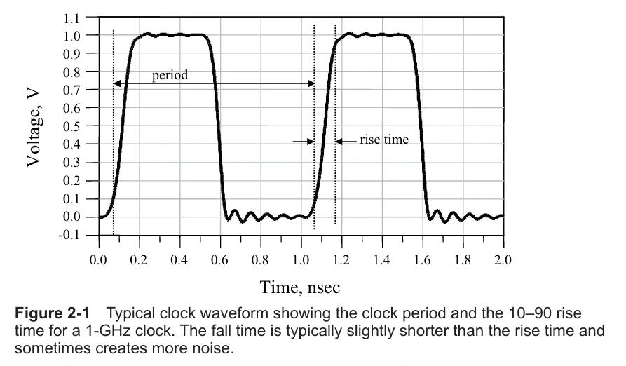
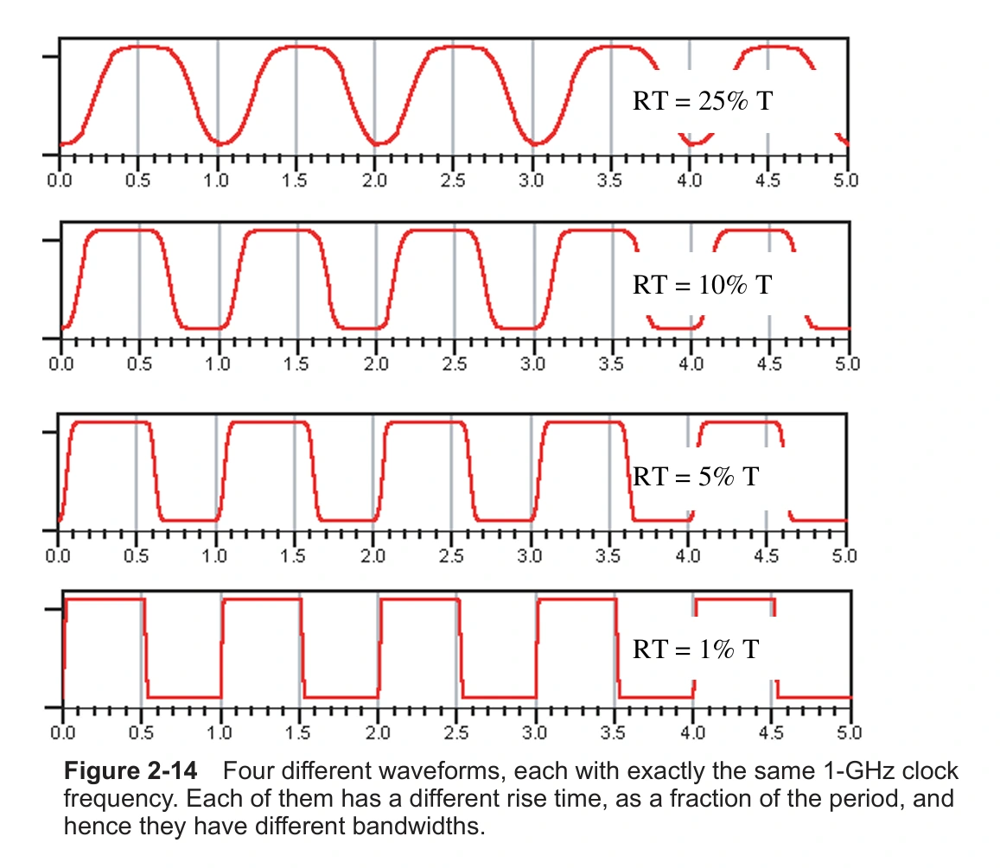
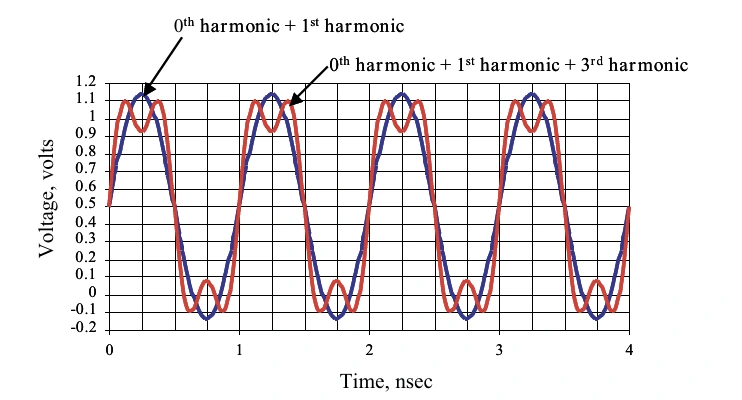
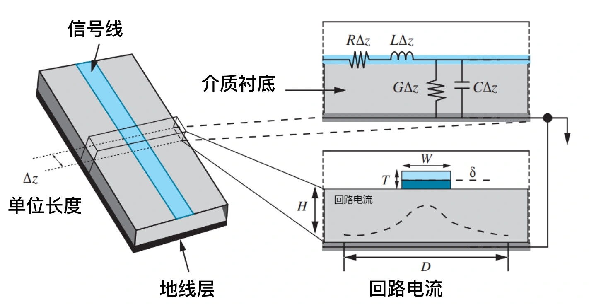
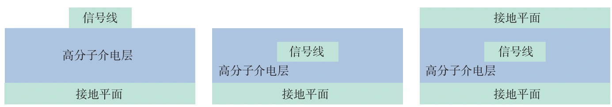
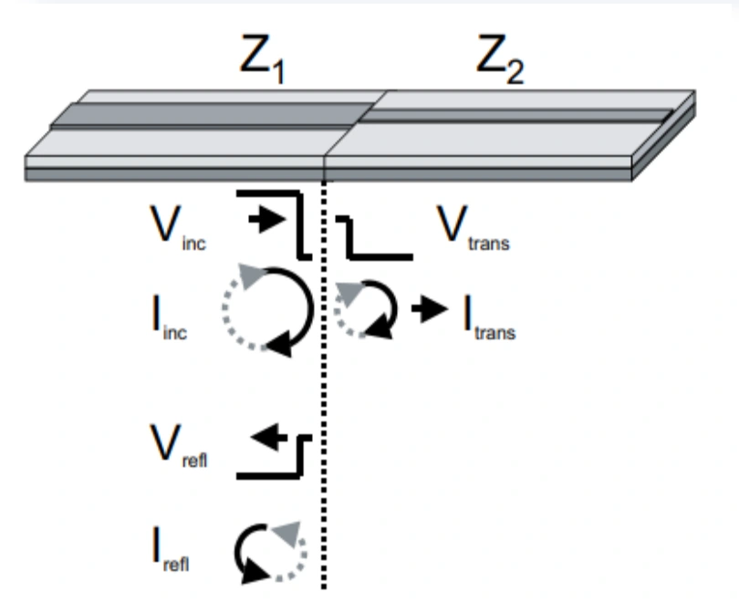
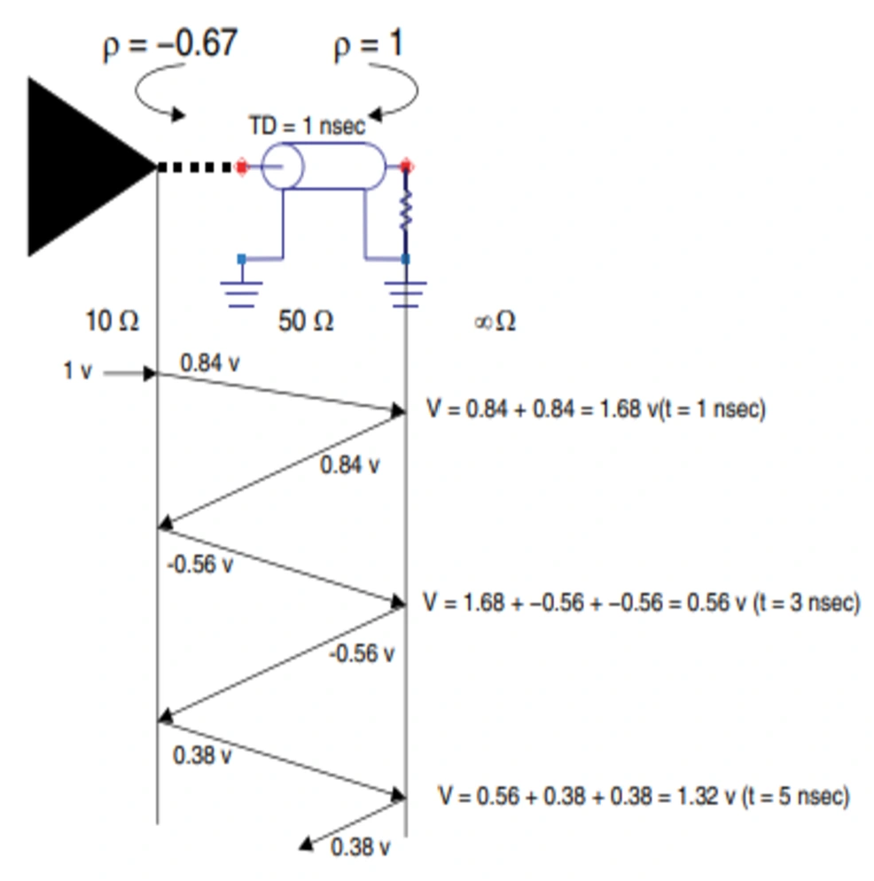
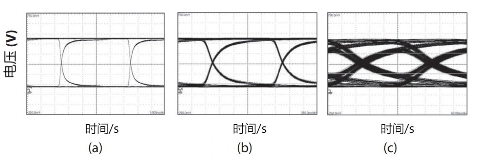

芯片中的驱动器发出一个电压跳变，接收器并不会立刻得到一个完全相同的跳变。信号要经过凸点或键合线、封装基板的走线与通孔，再进入印制电路板。这些结构有电阻、电感和电容，信号需要时间传播，也会在传播过程中衰减、反射，并受到相邻互连的影响。

信号完整性（Signal Integrity，SI）研究的就是这段传输过程。接收端的电压必须落在正确的逻辑范围内，同时在规定的采样时刻之前稳定下来。因此，信号完整性包含两个相互关联的要求：波形满足电压裕量，时序满足时间裕量。线路已经导通，只能说明存在电气连接，还不能说明高速信号能够可靠传输。

## 从互连结构到电路模型

封装电路设计的最终结果，是导体与介质的几何布局和材料参数。线宽、铜厚、介质厚度、通孔尺寸看起来是制造参数，但它们同时决定电阻、电感、电容和信号的传播速度。信号完整性分析需要把这些物理结构转化为可计算的电路模型。

当一段互连的传播时间远小于信号的上升时间时，可以近似把它看成集总元件，用少量电阻、电容、电感描述其行为。简单 RC 电路的时间常数为 $RC$，简单 RL 电路的时间常数为 $L/R$。这两个时间常数各自描述相应电路的响应，不能直接代替任意互连的传播延迟。

当信号边沿已经快到与互连的传播时间相当，沿线不同位置的电压和电流就不能再视为同时变化。此时需要采用传输线模型：将电阻、电感、电容和电导分布在整条线上，而不是集中放在某一个节点。判断是否需要传输线分析，首先比较边沿时间与传播时间，时钟频率本身不足以作出判断。[ADI 的高速互连说明](https://www.analog.com/en/resources/technical-articles/interfacing-highspeed-signals.html)也以这一比较作为建模依据。

这同样适用于封装架构的选择。较长的键合线容易引入较大的电感；倒装互连通常能缩短芯片到基板的路径；多芯片封装可以缩短芯片之间的连接。但路径缩短后，仍然要处理凸点、焊盘、通孔和布线层之间的阻抗变化。不同结构的电性能最终都要落实到具体尺寸与材料上。

## 上升时间决定有效带宽

一个时钟信号有两个容易混淆的时间参数：周期 $T$ 和上升时间 $t_r$。周期决定重复频率 $f_0=1/T$；10%～90% 上升时间，则是电压从此次跳变幅度的 10% 上升到 90% 所经历的时间。

*图 1：时钟周期与上升时间。*

周期相同，边沿仍然可以很不相同。下面四个信号的时钟频率都是 1 GHz，但上升时间分别占周期的 25%、10%、5% 和 1%。从上到下，重复速度没有改变，电压跳变却越来越陡。

*图 2：相同周期、不同上升时间的波形。*

这种差别可以从频域解释。对于幅度在 0 与 $V$ 之间变化、占空比为 50% 的理想方波，选取适当的时间原点后，其傅里叶级数为

$$
v(t)=\frac{V}{2}+\frac{2V}{\pi}
\sum_{n=1,3,5,\ldots}\frac{1}{n}\sin(2\pi n f_0t).
$$

其中 $V/2$ 是直流分量，其余为基波和奇次谐波。只保留基波，得到的是平缓的正弦变化；逐渐加入更高次的谐波，边沿才会变陡。理想方波的跳变时间为零，需要无限带宽，实际驱动器和互连都无法实现这一点。

*图 3：直流分量、基波与三次谐波叠加后的波形。*

有效带宽 $BW$ 与上升时间之间常用下面的经验关系：

$$
BW\approx\frac{0.35}{t_r}.
$$

当 $t_r$ 用秒表示时，$BW$ 的单位是 Hz；当 $t_r$ 用 ns 表示时，结果就是 GHz。这里的 0.35 是模型相关的近似系数。对于单极点低通系统，10%～90% 上升时间与 3 dB 带宽的乘积约为 0.35；不同响应形状会有不同系数，不能把它当成所有数字波形的严格频谱边界。[ADI 对带宽与上升时间的说明](https://www.analog.com/cn/resources/technical-articles/driving-video-lines.html)也给出了随波形而变化的近似范围。

例如，1 GHz 时钟的周期为 1 ns。若上升时间为周期的 10%，则 $t_r=0.1\ \mathrm{ns}$，对应的有效带宽约为 3.5 GHz。若周期保持不变，上升时间缩短到 10 ps，带宽估计就变为 35 GHz。互连需要处理的频率范围，可能远高于时钟的基频。

## 互连带宽与边沿展宽

信号的带宽描述信号含有哪些有效频率分量；互连的带宽描述互连能以多大损耗传递这些分量。这是两个不同的概念。

对于响应近似低通且幅度随频率下降的互连，常用幅度传输比相对低频值下降 3 dB 的频率定义带宽。若参考值归一化为 1，则

$$
20\log_{10}|H(f)|=-3\ \mathrm{dB},
\qquad |H(f)|\approx0.708.
$$

在相同参考阻抗下，这对应传输功率降为约一半。3 dB 频率并不是一道硬截止：超过它之后信号仍会传输，只是衰减与相位变化可能已经明显影响波形。如果互连具有谐振峰或陷波，单独一个带宽数值也无法完整描述它。

高频分量衰减后，接收端边沿变缓。输入边沿与互连响应共同造成的展宽，可以用以下近似关系估算：

$$
t_{r,\mathrm{out}}\approx
\sqrt{t_{r,\mathrm{in}}^2+t_{r,\mathrm{interconnect}}^2}.
$$

其中 $t_{r,\mathrm{interconnect}}$ 是互连自身的阶跃响应上升时间。这个平方和关系适合响应接近高斯型等情况的工程估算；存在明显反射或振铃时，应直接分析实际时域波形。

以一条 4 英寸长、特性阻抗为 50 Ω、3 dB 带宽约为 8 GHz 的互连为例。根据前面的近似式，互连本征上升时间为

$$
t_{r,\mathrm{interconnect}}\approx\frac{0.35}{8\ \mathrm{GHz}}
=43.75\ \mathrm{ps}.
$$

若输入边沿为 50 ps，则输出边沿估计为

$$
t_{r,\mathrm{out}}\approx\sqrt{50^2+43.75^2}\ \mathrm{ps}
\approx66.4\ \mathrm{ps}.
$$

边沿展宽约 32.9%。如果要求展宽不超过 10%，则应满足

$$
\sqrt{t_{r,\mathrm{in}}^2+t_{r,\mathrm{interconnect}}^2}
\leq1.1t_{r,\mathrm{in}},
$$

从而得到

$$
t_{r,\mathrm{interconnect}}
\leq\sqrt{1.1^2-1}\,t_{r,\mathrm{in}}
\approx0.458t_{r,\mathrm{in}}.
$$

对于 50 ps 输入边沿，本征上升时间应不超过约 22.9 ps，对应互连带宽至少约 15.3 GHz。如果将系数粗略取为 0.5，可以得到“互连带宽约为信号带宽的两倍”这一经验规则；按同一模型严格执行 10% 的要求，倍数约为 2.18。

## 阻抗描述电压与电流的关系

在正弦稳态下，阻抗是电压相量与电流相量之比：

$$
Z(\omega)=\frac{\widetilde V(\omega)}{\widetilde I(\omega)},
\qquad \omega=2\pi f.
$$

阻抗包含幅值与相位，单位为 Ω。一般不能把任意时域信号的瞬时 $v(t)/i(t)$ 当作一个固定元件参数；电容、电感的时域关系本身就涉及微分。

| 元件 | 时域关系 | 频域阻抗 | 随频率升高的变化 |
| --- | --- | --- | --- |
| 理想电阻 | $v=Ri$ | $Z_R=R$ | 幅值不变 |
| 理想电容 | $i=C\,dv/dt$ | $Z_C=1/(j\omega C)$ | 幅值减小 |
| 理想电感 | $v=L\,di/dt$ | $Z_L=j\omega L$ | 幅值增大 |

一个看似很小的电感，也可能在高频下形成显著阻抗。例如，2 nH 电感在 1 GHz 下的阻抗幅值为

$$
|Z_L|=2\pi fL
=2\pi\times10^9\times2\times10^{-9}
\approx12.6\ \Omega.
$$

因此，不能只凭直流电阻很小，就认为键合线或通孔对高速信号没有影响。电容也不始终呈容性，实际电容的寄生电感会使其在自谐振频率以上呈感性；这一点会在[电源完整性和电磁干扰](集成电路封测之电源完整性和电磁干扰.md)中进一步展开。

### 导体电阻与方块电阻

对长度为 $\ell$、宽度为 $w$、厚度为 $t$ 的均匀导体，直流电阻为

$$
R=\rho\frac{\ell}{wt},
$$

其中 $\rho$ 为电阻率，单位为 $\Omega\cdot\mathrm m$；电导率 $\sigma=1/\rho$，单位为 S/m。电阻率是材料属性，电阻还取决于几何尺寸。

同一金属层上的导体厚度相同，可以定义方块电阻

$$
R_{\square}=\frac{\rho}{t},
\qquad R=R_{\square}\frac{\ell}{w}.
$$

$\ell/w$ 表示沿电流方向包含多少个方块。对于同一均匀薄膜，正方形导体无论边长多大，其相对两边之间的电阻相同，因为长度和宽度的变化恰好抵消。$\Omega/\square$ 是常用记法，实际量纲仍是 Ω。长度变为两倍、宽度不变，电阻变为两倍；长度与宽度同时变为两倍，电阻不变。

## 特性阻抗来自分布参数

传输线必须包括信号导体和返回导体。电流沿信号路径流向接收端，还要通过参考平面或其他返回路径形成完整回路。只讨论一根线的尺寸，而忽略它与返回路径的关系，无法确定传输线的电性能。

*图 4：传输线的导体、介质和分布参数模型。*

对单位长度参数 $R'$、$L'$、$G'$、$C'$，传输线的特性阻抗为

$$
Z_0(\omega)=\sqrt{\frac{R'+j\omega L'}{G'+j\omega C'}}.
$$

其中 $R'$ 描述导体损耗，$G'$ 描述介质损耗，$L'$ 和 $C'$ 描述磁场、电场储能。在低损耗近似下，

$$
Z_0\approx\sqrt{\frac{L'}{C'}},
\qquad v_p\approx\frac{1}{\sqrt{L'C'}},
\qquad t_d=\frac{\ell}{v_p}.
$$

特性阻抗不是线路的直流电阻，也不是把整条线的电阻相加得到的数值。对一条均匀传输线，长度增加会增加传播延迟和总损耗，但不会改变由横截面与材料决定的特性阻抗。

从行波的角度看，在反射尚未返回源端之前，驱动器看到的是传输线的特性阻抗。信号前沿不断向前传播，给新的单位长度电容充电，同时在信号与返回路径之间建立磁场。$Z_0$ 表征的就是这个传播过程中电压波与电流波的比例。

### 微带线、嵌入式微带线与带状线

*图 5：从左到右为微带线、嵌入式微带线和带状线。*

微带线位于介质表面，通常以其下方的金属平面作为参考。电场一部分在介质内，一部分在空气中，因此传播速度由有效介电常数 $\varepsilon_{\mathrm{eff}}$ 决定，近似为 $c/\sqrt{\varepsilon_{\mathrm{eff}}}$。嵌入式微带线被介质覆盖，周围电场分布随覆盖层厚度和材料变化。带状线则位于上下两个参考平面之间，场更多地被约束在介质内部。

在其他条件保持不变时，增加线宽通常使特性阻抗降低；增大信号线到参考平面的距离通常使阻抗升高；提高介电常数通常使阻抗降低，同时减慢传播。这些趋势可以指导初步设计，最终数值仍需使用与具体横截面相符的公式或场求解器确定。

50 Ω 是常见的单端设计目标，但不是所有封装互连的统一最优值。目标阻抗取决于接口标准、驱动能力、功耗和布线条件；差分阻抗也不能与单根线的单端阻抗混用。

## 损耗使高频分量更难传输

实际传输线中，导体和介质都不是理想材料。导体损耗来自有限电导率；介质损耗来自交变电场中的能量耗散。这些损耗随频率变化，会改变信号的幅度和边沿。

直流时，电流在导体截面内的分布较为均匀。频率升高后，趋肤效应使电流更多地集中在导体表面。对于良导体，趋肤深度近似为

$$
\delta\approx\sqrt{\frac{2\rho}{\omega\mu}},
$$

其中 $\mu$ 为磁导率。随着频率增加，有效导电截面减小，交流电阻增大；附近导体造成的邻近效应以及表面粗糙度，还会进一步改变电流分布和损耗。

介质损耗常用损耗角正切 $\tan\delta$ 描述。在简单模型下，$G'\approx\omega C'\tan\delta$。当高频分量比低频分量衰减得更严重，接收端边沿变缓，一个码元的响应还可能延伸到后续码元，形成码间干扰（Inter-Symbol Interference，ISI）。因此，等长布线主要改善路径间的时序差异，不能直接解决带宽不足或损耗过大的问题。

## 阻抗突变引起反射

当行波从阻抗为 $Z_1$ 的区域进入阻抗为 $Z_2$ 的区域，如果两者不匹配，就会产生反射。阻抗变化既可能出现在终端，也可能出现在焊盘、通孔、连接器、分支和参考平面发生变化的位置。

*图 6：信号经过阻抗界面时的反射。*

以入射方向作为电流正方向，反射波向相反方向传播，所以界面处的连续性条件为

$$
V_i+V_r=V_t,
\qquad \frac{V_i}{Z_1}-\frac{V_r}{Z_1}=\frac{V_t}{Z_2}.
$$

由此得到电压反射系数

$$
\Gamma=\frac{V_r}{V_i}=\frac{Z_2-Z_1}{Z_2+Z_1},
$$

以及电压透射系数

$$
\frac{V_t}{V_i}=1+\Gamma=\frac{2Z_2}{Z_1+Z_2}.
$$

电压透射系数大于 1 并不表示能量增加，因为透射区的电流与阻抗也发生了变化。对无损实阻抗界面，功率透射比还需要包含两侧阻抗的比例。

对特性阻抗为 $Z_0$、负载阻抗为 $Z_L$ 的传输线，负载反射系数为

$$
\Gamma_L=\frac{Z_L-Z_0}{Z_L+Z_0}.
$$

| 终端条件 | 电压反射系数 | 负载端行为 |
| --- | --- | --- |
| 开路，$Z_L\to\infty$ | $+1$ | 电压同相反射，首次到达时端电压为入射电压的两倍 |
| 短路，$Z_L=0$ | $-1$ | 电压反相反射，端电压为零 |
| 匹配，$Z_L=Z_0$ | $0$ | 不产生负载端反射 |

这里“两倍”指两倍的入射波电压，不一定是两倍的理想信号源电压。入射波的大小还受源端阻抗影响。

## 源端阻抗与多次反射

将驱动器近似为理想电压源 $V_s$ 串联输出电阻 $R_s$，则反射返回之前，初始发射的电压为

$$
V^+=V_s\frac{Z_0}{R_s+Z_0}.
$$

反射波回到源端时，遇到的反射系数为

$$
\Gamma_s=\frac{R_s-Z_0}{R_s+Z_0}.
$$

只要两端都没有完全吸收反射，信号就会往返传播。在接收端，每次到达的电压变化都与已有电压叠加，产生阶梯、过冲或振铃。反弹图按传播时间记录这些往返过程。

*图 7：开路负载的多次反射，图中数值为近似值。*

设 $V_s=1\ \mathrm V$、$R_s=10\ \Omega$、$Z_0=50\ \Omega$，单程延迟 $t_d=1\ \mathrm{ns}$，负载开路。于是

$$
V^+=\frac{50}{10+50}=\frac56\ \mathrm V,
\qquad \Gamma_L=1,
\qquad \Gamma_s=-\frac23.
$$

在 1 ns 时，入射波第一次到达负载，端电压为 $2V^+=5/3\ \mathrm V$。反射波再经过 1 ns 到达源端，产生 $\Gamma_sV^+=-5/9\ \mathrm V$ 的新行波；它在 3 ns 时到达负载，带来两倍该值的电压变化。

| 时刻 | 到达负载的新行波 | 负载端累计电压 |
| --- | --- | --- |
| 1 ns | $5/6\ \mathrm V$ | $5/3\approx1.667\ \mathrm V$ |
| 3 ns | $-5/9\ \mathrm V$ | $5/9\approx0.556\ \mathrm V$ |
| 5 ns | $10/27\ \mathrm V$ | $35/27\approx1.296\ \mathrm V$ |
| 7 ns | $-20/81\ \mathrm V$ | $65/81\approx0.802\ \mathrm V$ |

后续电压围绕 1 V 交替变化，并逐渐收敛。对这个理想开路模型，第 $n$ 次到达负载后的电压可以写成

$$
V_{L,n}=2V^+\sum_{k=0}^{n-1}\Gamma_s^k
=V_s\left(1-\Gamma_s^n\right).
$$

计算反射序列时，最好保留分数或足够的小数位，最后再取整，避免误差在多次反射中累积。

## 端接让反射在合适的位置被吸收

端接的目的，是让行波在边界处看到合适的阻抗。常见方案分别从源端和负载端处理反射，其代价和适用拓扑并不相同。

| 方案 | 匹配条件与工作方式 | 主要取舍 |
| --- | --- | --- |
| 驱动器内部匹配 | 驱动器输出阻抗近似等于 $Z_0$ | 无需外加电阻，但应考虑工艺、电压和温度变化 |
| 源端串联端接 | $R_{\mathrm{driver}}+R_{\mathrm{series}}\approx Z_0$，吸收返回源端的反射 | 适合点对点、高阻接收端；中途接收节点可能先看到半幅平台 |
| 负载端电阻端接 | 负载端的等效阻抗近似为 $Z_0$ | 在负载处抑制反射，但可能产生持续功耗并影响电平 |
| 负载端交流端接 | 电阻与电容串联形成端接支路，边沿期间提供近似匹配 | 降低直流功耗，但需按边沿、码型和保持时间选择 RC 参数 |

仍用前面的例子，如果在输出电阻为 10 Ω 的驱动器旁串联 40 Ω，源端总阻抗就变为 50 Ω。初始发射电压为 0.5 V，在开路负载处同相反射，负载第一次到达后的电压为 1 V；返回波被匹配源端吸收，不会继续往返。

这一方案允许负载端发生反射，再由源端吸收，因此“使用端接”不等于整条线上任何位置都没有反射。源端串联电阻应靠近驱动器放置，使返回波在源端看到匹配阻抗。

实际端接设计还要把驱动器非线性输出特性、接收器输入电容、封装寄生参数和线路分支纳入模型。一个名义上满足 $R_s=Z_0$ 的电阻，并不能消除互连内部的所有阻抗不连续。

## 用眼图同时检查电压与时间裕量

单个跳变便于观察反射，但数据链路传输的是不同码型的连续序列。眼图将大量波形按照码元周期对齐并叠加，显示接收端可能出现的电压与过零时间分布。

*图 8：数字信号通过 40 英寸互连后的眼图，左至右为 200 Mbit/s、800 Mbit/s 和 3200 Mbit/s。*

眼高反映采样附近的电压裕量，眼宽反映可用采样时间范围。噪声、串扰和电平波动会压缩眼高；抖动、路径时延差异以及码间干扰会压缩眼宽；损耗和反射通常同时影响两者。图中数据速率升高后，码元间隔缩短，互连损耗造成的边沿展宽占比变大，眼图逐渐闭合。

对于二进制 NRZ 信号，单位间隔 $UI=1/R_b$，其中 $R_b$ 为比特率。例如，3.2 Gbit/s 对应 $UI=312.5\ \mathrm{ps}$。接收端不仅需要达到正确电平，还需要在这个时间尺度内完成稳定与采样。眼图是否通过，应结合接口规定的眼图模板和误码率要求判断，不能只凭视觉上“眼睛张开”就认为链路合格。

## 从电性能要求落实到封装布局

信号完整性设计通常从接收端需求出发：先确定电平、速率、边沿、允许抖动和噪声裕量，再选择阻抗目标、材料、层叠与互连拓扑。随后通过参数提取与电路仿真，判断实际波形能否满足这些要求。

布局中的调整应对应明确的物理原因。缩短路径可以减小传播延迟与损耗；保持横截面和参考平面连续，可以减少阻抗突变；端接可以处理边界反射；合理间距与返回路径可以减少耦合；材料与导体尺寸则决定带宽和损耗。这些措施往往需要一起权衡，例如增加线宽可以降低电阻，却也会改变特性阻抗。

最终验证应覆盖芯片、封装和电路板构成的完整路径。驱动器的电源波动会改变输出波形，共享返回路径会引入地弹，相邻互连还会带来串扰。它们把信号完整性与供电、电磁场问题联系起来，相关机制接着在[集成电路封测之电源完整性和电磁干扰](集成电路封测之电源完整性和电磁干扰.md)中讨论。
