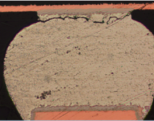
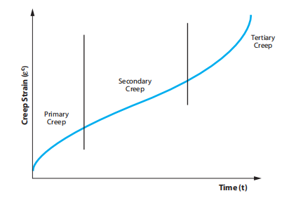
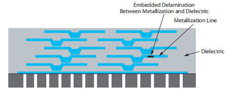
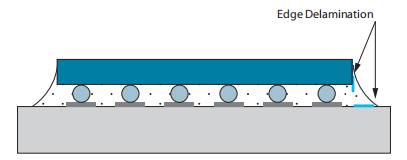
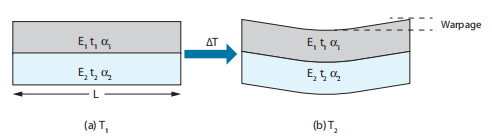
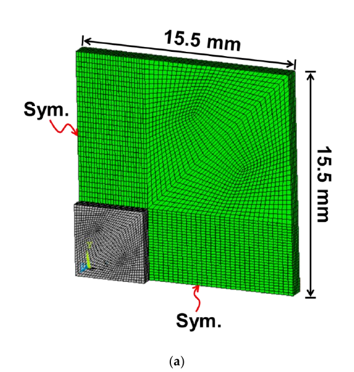
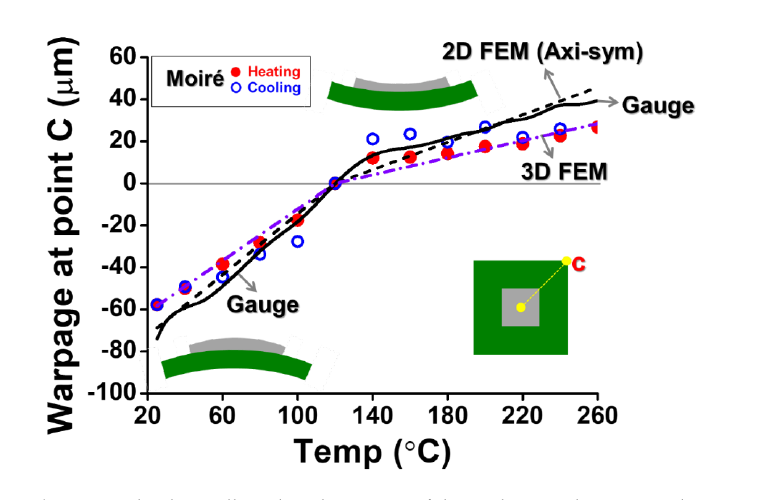

芯片通电后，电功耗转化为热量，芯片、焊点、基板和塑封料随之升温。不同材料的热膨胀程度不同，却又通过焊接和黏结相互连接，原本可以自由发生的伸缩因此受到约束。温度变化最终转化为封装内部的应力、应变与翘曲；反复开关机、环境温度循环和机械振动，则使这些变形不断重复。

热机械可靠性研究的是：在规定的热载荷、机械载荷和使用时间内，封装保持规定功能的概率。它既涉及一次跌落或热冲击造成的突然破坏，也涉及焊点经过许多次循环后才出现的疲劳裂纹。电气连接在出厂时已经合格，仍然需要判断这些连接能否承受之后的制造、运输和长期工作。

## 可靠性指标与寿命分布

### 可靠性函数、失效概率与失效率

用随机变量 $T_f$ 表示产品首次失效的时间。可靠性函数表示产品工作到时刻 $t$ 仍未失效的概率：

$$
R(t)=P(T_f>t).
$$

相应的累积失效函数为

$$
F(t)=P(T_f\le t)=1-R(t).
$$

若一开始有 $N$ 个相同条件下的试样，到 $t$ 时已有 $n(t)$ 个失效，在没有中途退出试验等删失情况时，可以用 $[N-n(t)]/N$ 估计 $R(t)$。这里的总体还需要限定材料、结构、工艺批次和试验条件；不同总体的数据混在一起，可能掩盖真正的失效规律。

当寿命分布连续时，失效概率密度为

$$
f(t)=\frac{dF(t)}{dt}=-\frac{dR(t)}{dt}.
$$

失效率 $\lambda(t)$ 则是在已经存活到 $t$ 的条件下，单位时间内发生失效的概率强度：

$$
\lambda(t)=\frac{f(t)}{R(t)},
\qquad
R(t)=\exp\left[-\int_0^t\lambda(u)\,du\right].
$$

$R$ 和 $F$ 无量纲，$f$ 和 $\lambda$ 的单位为时间的倒数。热循环试验中，也可以把自变量换成循环数 $N$，此时失效率的单位相应变成“每循环”。$F(t)$ 描述从开始到现在一共失效了多少，$\lambda(t)$ 描述仍在工作的产品此刻面临的失效强度。

产品的失效率常用浴盆曲线概括。早期失效阶段可能由制造缺陷、污染或装配不良主导，较脆弱的个体先失效，失效率逐渐下降；稳定服务阶段的失效率较低，在一定区间内可以近似为常数；耗损阶段中，疲劳裂纹、蠕变损伤等逐渐积累，失效率再次上升。实际产品是否呈现完整的浴盆形状，取决于主导机理、筛选措施和观察时段。

### 平均寿命与分位寿命

对不可修复产品，平均失效前时间（Mean Time To Failure，MTTF）为

$$
\mathrm{MTTF}=E[T_f]
=\int_0^\infty t f(t)\,dt
=\int_0^\infty R(t)\,dt.
$$

平均失效间隔时间（Mean Time Between Failures，MTBF）用于可修复系统，描述相邻故障之间的平均正常工作时间。中位寿命 $t_{50}$ 满足 $F(t_{50})=0.5$；低失效比例对应的分位寿命，则更适合表达“运行到某个时刻，最多允许多少比例失效”的要求。

寿命指标总要与失效判据对应。焊点电阻超过阈值、出现间歇性开路、界面裂纹达到某个长度和整个器件完全失去功能，会得到不同的寿命数据。

| 分布模型 | 典型表达 | 适用含义与限制 |
| --- | --- | --- |
| 指数分布 | $R(t)=e^{-\lambda_0t}$ | 对应恒定失效率，可近似描述某些稳定服务阶段 |
| 正态分布 | $f(t)=\dfrac{1}{s\sqrt{2\pi}}\exp[-(t-\mu)^2/(2s^2)]$ | 描述围绕均值近似对称的寿命数据；只有负时间概率可忽略时才适合作寿命近似 |
| 韦布尔分布 | $R(t)=\exp[-(t/\eta)^\beta]$ | 可通过形状参数描述递减、恒定或递增的失效率 |

表中的 $\mu$ 为均值、$s$ 为标准差，二者具有时间单位。选择分布需要结合失效机理和数据拟合，浴盆曲线的三个阶段也未必能用同一组分布参数覆盖。

### 韦布尔分布与供应商选择

两参数韦布尔（Weibull）分布的累积失效函数与失效率为

$$
F(t)=1-\exp\left[-\left(\frac{t}{\eta}\right)^\beta\right],
\qquad
\lambda(t)=\frac{\beta}{\eta}
\left(\frac{t}{\eta}\right)^{\beta-1}.
$$

其中，$\beta>0$ 为无量纲的形状参数，$\eta>0$ 为尺度参数，也称特征寿命。当 $\beta<1$、$\beta=1$ 和 $\beta>1$ 时，失效率分别随时间下降、保持恒定和上升。特征寿命处有 $F(\eta)=1-e^{-1}\approx63.2\%$，平均寿命则为

$$
\mathrm{MTTF}=\eta\,\Gamma\left(1+\frac{1}{\beta}\right),
$$

其中 $\Gamma$ 为伽马函数。若引入位置参数 $t_s$，则将分布中的 $t$ 换成 $t-t_s$，平均寿命也相应增加 $t_s$。以下采用 $t_s=0$ 的模型。[^weibull]

假设某电容器需要在 $-40\sim125\ ^\circ\mathrm C$ 的热循环下承受 1000 次循环，且累计失效比例不超过 1%。两家供应商提供的寿命分布为：供应商 1 的平均寿命为 5000 次、$\beta_1=3$；供应商 2 的平均寿命为 7000 次、$\beta_2=2$。

先由平均寿命换算尺度参数：

$$
\eta_1=\frac{5000}{\Gamma(4/3)}\approx5599.2,
\qquad
\eta_2=\frac{7000}{\Gamma(3/2)}\approx7898.7.
$$

再计算规定循环数处的失效概率：

$$
F_1(1000)=1-e^{-(1000/5599.2)^3}\approx0.568\%,
$$

$$
F_2(1000)=1-e^{-(1000/7898.7)^2}\approx1.590\%.
$$

因此，按给定分布参数，供应商 1 满足要求。供应商 2 的平均寿命更长，但其分布在 1000 次循环以前的失效比例更高。这项选择依据的是任务规定处的失效概率；工程验收还需要考虑参数估计的置信区间、样本数量，以及供应商试验波形与实际要求是否一致。

## 热膨胀失配产生封装应力

### 材料模量与结构刚度

均匀受拉直杆中，平均正应力和工程应变分别为

$$
\sigma=\frac{F}{A},
\qquad
\varepsilon=\frac{\delta}{\ell_0}.
$$

其中 $F$ 是轴向力，$A$ 是横截面积，$\delta$ 是伸长量，$\ell_0$ 是初始长度。应力单位为 Pa，应变无量纲。在线弹性、小变形且单轴受力的范围内，有 $\sigma=E\varepsilon$，其中 $E$ 是杨氏模量。

结构刚度 $k=F/\delta$ 的单位为 N/m。对同一根直杆，$k=EA/\ell_0$：材料模量相同，截面和长度不同，结构抵抗变形的能力仍然不同。封装中增加基板厚度、改变引线长度或增加支撑，改变的是整个结构的变形响应。

### 自由热应变与约束热应力

线膨胀系数（Coefficient of Thermal Expansion，CTE）描述单位温升产生的相对长度变化。在温区内可以将 $\alpha$ 视为常数时，自由热应变为

$$
\varepsilon_{\mathrm{th}}=\alpha\Delta T.
$$

$\alpha$ 的单位为 $\mathrm{K^{-1}}$，也常写成 ppm/K，其中 $1\ \mathrm{ppm/K}=10^{-6}\ \mathrm{K^{-1}}$。若 CTE 随温度明显变化，则应使用 $\varepsilon_{\mathrm{th}}=\int_{T_0}^{T}\alpha(\theta)\,d\theta$。

以拉应力为正，单轴线弹性热膨胀模型可写成

$$
\sigma=E\left(\varepsilon_{\mathrm{tot}}-\varepsilon_{\mathrm{th}}\right).
$$

自由伸缩时，$\varepsilon_{\mathrm{tot}}=\alpha\Delta T$，没有由这一均匀温变产生的热应力。完全限制轴向伸缩时，$\varepsilon_{\mathrm{tot}}=0$，因此 $\sigma=-E\alpha\Delta T$；升温产生压应力，降温产生拉应力。这个一维结果需要完全约束、线弹性和均匀温度等条件。

封装中更常见的是两种材料互相约束。它们的自由热应变差为

$$
\Delta\varepsilon_{\mathrm{th}}
=(\alpha_b-\alpha_c)\Delta T.
$$

实际应力还取决于两者的模量、厚度、连接层的柔顺性与边界条件。结构可以通过弯曲释放一部分失配变形，聚合物和焊料也可能通过黏弹性、塑性或蠕变改变应力分布。温度在空间上不均匀时，即使同一种材料内部也会因伸缩不协调而产生应力。

### 焊点剪切应变与中性点距离

考虑芯片通过焊点连接在基板上。假定芯片和基板温度均匀、均不弯曲，且主要由焊点承受两者之间的面内失配位移。设某焊点到组件中性点的距离为 $L$，焊点高度为 $h$，基板和芯片的 CTE 分别为 $\alpha_b$、$\alpha_c$。

温度相对无应力参考温度 $T_0$ 变化时，焊点两端的相对位移近似为

$$
\delta(T)=L(\alpha_b-\alpha_c)(T-T_0).
$$

对于最高、最低温度分别为 $T_{\max}$ 和 $T_{\min}$ 的循环，位移范围与工程剪切应变范围为

$$
\Delta\delta=L|\alpha_b-\alpha_c|(T_{\max}-T_{\min}),
$$

$$
\Delta\gamma\approx\frac{\Delta\delta}{h}
=\frac{L}{h}|\alpha_b-\alpha_c|\Delta T.
$$

这里 $\Delta T=T_{\max}-T_{\min}>0$。$L$ 也称中性点距离（Distance to Neutral Point，DNP）。在这一简化模型中，外缘和角部焊点的 DNP 最大，因此承受的剪切应变最大；减小 CTE 差、减小 DNP 或适当增加连接高度，都有利于减小该应变。

以一块 $15\ \mathrm{mm}\times20\ \mathrm{mm}$ 的矩形硅芯片为例，设其中心为中性点，角部有焊点，焊点高度为 $75\ \mathrm{\mu m}$；有机基板和硅的 CTE 分别为 15 ppm/K 与 3 ppm/K。将 $215\ ^\circ\mathrm C$ 近似作为无应力参考温度，冷却至 $25\ ^\circ\mathrm C$，则

$$
L_{\max}=\sqrt{7.5^2+10^2}=12.5\ \mathrm{mm},
\qquad |\Delta T|=190\ \mathrm K,
$$

$$
|\delta_{\max}|=12.5\times12\times10^{-6}\times190
=0.0285\ \mathrm{mm}=28.5\ \mathrm{\mu m},
$$

$$
|\gamma_{\max}|\approx\frac{28.5}{75}=0.38.
$$

这个 38% 是失配位移除以连接高度得到的名义剪切应变估计，已经提示焊点会发生明显的非弹性变形。实际残余变形需要考虑焊料凝固、冷却过程中的应力松弛、芯片与基板弯曲，以及底部填充材料的承载。无应力参考温度也应由材料与工艺历史确定，不能仅凭炉温峰值确定。

## 循环载荷与疲劳失效

疲劳是循环载荷作用下的损伤累积。一次循环产生的载荷可能不足以使整个结构断裂，但局部反复滑移、塑性变形和裂纹扩展可以逐步降低承载能力。封装中，环境温度循环、功率循环和板级振动都可能形成疲劳载荷，球栅阵列（Ball Grid Array，BGA）焊点便是需要关注的位置之一。

*焊点内的裂纹扩展会逐步削弱有效承载截面，并可能造成电阻增加或间歇性开路。*

### 高周疲劳与低周疲劳

以弹性变形为主、塑性应变较小的循环，通常采用应力—寿命方法，研究应力幅与失效循环数的关系，常用于高周疲劳分析。循环中存在明显非弹性变形时，通常采用应变—寿命方法，常用于低周疲劳分析。二者的区分主要服务于主导变形机制和模型选择，具体循环数的分界随材料与应用而变。

高周疲劳常用 S—N 曲线描述，其中 S 为应力幅，N 为失效循环数。某些材料在规定环境与试验范围内表现出疲劳极限，但对焊料、聚合物和复合基板，是否存在可用的疲劳极限需要试验支持。设计中仍需给定目标循环数、应力比、温度和环境条件。

锡基焊料的屈服强度较低，在温度循环中容易出现塑性与蠕变变形，因此焊点热疲劳经常需要非弹性应变或能量模型。

### Coffin–Manson 应变寿命关系

经典 Coffin–Manson 关系用塑性应变幅预测低周疲劳寿命：

$$
\frac{\Delta\varepsilon_p}{2}
=\varepsilon_f'(2N_f)^c.
$$

$\Delta\varepsilon_p$ 为一个稳定循环中塑性应变的最大值与最小值之差，$\Delta\varepsilon_p/2$ 为应变幅；$N_f$ 为失效前循环数，$2N_f$ 为反向次数。$\varepsilon_f'$ 是疲劳延性系数，$c$ 是疲劳延性指数，通常为负值。系数必须与所用的应变定义、材料状态和失效判据对应。

整理可得

$$
N_f=\frac12
\left(\frac{\Delta\varepsilon_p}{2\varepsilon_f'}\right)^{1/c}.
$$

因为 $1/c<0$，塑性应变范围增大时，寿命下降。若改写为 $N_f=C(\Delta\varepsilon_p)^{-m}$，则 $m=-1/c>0$。采用应变范围还是应变幅，会改变常数的数值，代入时需要保持一致。

针对焊点，也可以用非弹性剪切应变范围建立类似的幂律关系。由几何失配得到的 $\Delta\gamma$ 包含总变形，进一步用于疲劳计算时，需要确定其中的非弹性部分，并使用相应剪切模型的参数。若模型用等效应变，还要按照其定义完成剪切应变与等效应变之间的转换。

Solomon 模型利用特定铅锡共晶焊料的试验数据拟合塑性剪切应变与循环寿命；Engelmaier 模型进一步考虑平均循环温度和循环频率。它们反映出焊料的时间与温度依赖性：相同的温差和应变范围，若高温停留时间不同，每个循环内发生的蠕变与应力松弛也可能不同。经验参数需要在相应合金、温区和循环条件下使用，换成无铅焊料后应重新标定。

### 应变能模型与疲劳设计

非弹性应变能密度可以由一个循环内的应力—非弹性应变关系计算：

$$
\Delta W_{\mathrm{in}}
=\oint\boldsymbol{\sigma}:d\boldsymbol{\varepsilon}_{\mathrm{in}}.
$$

其单位为 $\mathrm{J/m^3}$，与 Pa 等价；在单轴稳定循环中对应滞回环的面积。能量型模型将每循环耗散能与裂纹萌生、扩展或总寿命联系起来。还可以采用断裂力学模型直接计算裂纹扩展，或用连续损伤模型描述损伤变量的演化；这些方法都需要材料试验确定参数。

降低疲劳风险首先要减少传递给关键互连的非弹性变形。材料选择应尽量减小有效 CTE 失配，布局可在条件允许时将敏感互连布置在较小 DNP 位置，热路径设计则应同时控制温度摆幅与温度梯度。对倒装芯片，底部填充胶通过扩大载荷传递面积，分担原本集中在凸点上的载荷，但它的模量、CTE、玻璃化转变温度和界面黏附性也会改变芯片与基板的应力。

机械振动还需要考虑结构的动态响应。单自由度近似下，固有频率为 $f_n=(2\pi)^{-1}\sqrt{k/m}$。改变质量、刚度、支撑位置和阻尼，可以调整共振位置与响应幅值；是否增加刚度，需要结合激励频谱判断。冲击试验关注短时间内的峰值载荷与板弯曲，振动疲劳则关注许多次循环中的应力幅和累计损伤。

## 脆性断裂与塑性变形

### 裂纹尺寸决定脆性材料的允许应力

硅、玻璃和陶瓷通常在出现显著宏观塑性变形之前断裂。切割崩边、表面划痕和内部缺陷会使局部应力集中，因此，同一种材料的实际断裂强度也会随表面状态和缺陷分布改变。

没有显式建模裂纹时，可以将最大主拉应力与相应材料、工艺状态下的强度数据比较，进行初步筛选。已知缺陷尺寸并满足小范围屈服等条件时，可采用线弹性断裂力学（Linear Elastic Fracture Mechanics，LEFM）。对张开型裂纹，常见表达为

$$
K_I=Y\sigma\sqrt{\pi a},
\qquad K_I\ge K_{IC}.
$$

$K_I$ 是Ⅰ型应力强度因子，$Y$ 为由裂纹和构件几何、加载方式决定的无量纲系数，$\sigma$ 为模型对应的名义拉应力，$a$ 为按该裂纹几何定义的特征尺寸。$K_{IC}$ 是满足平面应变等有效性条件的Ⅰ型断裂韧度，常用单位为 $\mathrm{MPa\sqrt m}$。达到临界值后，裂纹可能发生不稳定扩展。

在 $Y$ 可以近似视为常数的条件下，临界缺陷尺寸为

$$
a_c=\frac{1}{\pi}
\left(\frac{K_{IC}}{Y\sigma_{\max}}\right)^2.
$$

这给出了应力控制与缺陷控制之间的联系：其他条件不变，最大拉应力降低一半，临界缺陷尺寸增大到原来的四倍。设计上既要控制热梯度、机械夹持和局部几何造成的拉应力，也要通过切割、研磨、抛光和搬运工艺减少缺陷；表面处理后的缺陷状态与残余应力仍需确认。

### 屈服、永久变形与累积损伤

金属等延性材料达到屈服条件后，会留下卸载后不能恢复的塑性变形。对单轴加载，可以将应力与屈服强度比较；多轴加载则需要选择适合材料的屈服准则。对近似各向同性、压力不敏感的延性金属，常用 von Mises 等效应力：

$$
\sigma_{\mathrm{vm}}
=\sqrt{\frac{(\sigma_1-\sigma_2)^2+
(\sigma_2-\sigma_3)^2+(\sigma_3-\sigma_1)^2}{2}},
$$

其中 $\sigma_1$、$\sigma_2$、$\sigma_3$ 为三个主应力。$\sigma_{\mathrm{vm}}$ 达到相应温度与材料状态下的屈服强度时，模型开始产生塑性流动。

局部屈服与功能失效之间，还需要一个与结构有关的判据。过大的永久变形会改变互连形状、接触压力或装配尺寸；循环中的塑性应变持续累积，则可能导致棘轮变形和疲劳破坏。经典率无关塑性模型用当前应力和加载历史描述塑性响应；焊料在实际温区还可能具有明显的应变率依赖性，需要进一步采用黏塑性本构。

## 蠕变与高温停留时间

蠕变是持续载荷作用下随时间发展的变形。它取决于应力、温度、持续时间和微观组织。焊点在温度到达高温平台以后，虽然外部温度暂时不变，内部仍可能继续发生蠕变；如果总位移受到约束，应力还会随时间下降，表现为应力松弛。

判断温度对金属蠕变的重要性，常用同系温度 $T/T_m$，其中工作温度 $T$ 和熔点 $T_m$ 都使用 K。对于许多金属，进入约 $0.4\sim0.5\,T_m$ 以上的温区后，蠕变更值得关注，但这一范围只是经验尺度，具体行为还取决于应力、时间和组织。

铅锡共晶焊料的熔点约为 $183\ ^\circ\mathrm C$，即 456 K。在 $25\ ^\circ\mathrm C$、约 298 K 下，其同系温度已经达到 $298/456\approx0.65$。因此，室温下的焊料也可能表现出明显的时间依赖变形。[^creep]

*初始阶段的应变率下降，第二阶段近似稳定，第三阶段随损伤发展而加速。*

初始蠕变阶段，材料的强化与组织调整使应变率逐渐下降；第二阶段中，强化与回复等过程趋于平衡，应变率近似保持稳定；第三阶段则可能出现空洞长大、裂纹扩展或截面缩小，应变率上升直至断裂。具体焊点在有限的热循环停留时间内，未必完整经历这三个阶段。

稳态蠕变的一种常用近似是幂律与 Arrhenius 温度项的组合：

$$
\dot{\varepsilon}_{\mathrm{cr}}
=A\sigma^n\exp\left(-\frac{Q}{\mathcal RT}\right).
$$

$\dot{\varepsilon}_{\mathrm{cr}}$ 为蠕变应变率，单位通常为 $\mathrm{s^{-1}}$；$n$ 为应力指数，$Q$ 为激活能，单位为 J/mol；$\mathcal R$ 为摩尔气体常数，$T$ 为绝对温度。$A$ 的数值和单位取决于应力采用 Pa 还是 MPa。该式描述给定应力、温区和组织状态下的稳态行为，不自动覆盖初始与加速蠕变。

在这一模型中，应力升高或温度升高，蠕变速率都会增加。降低工作温度、减少持续机械载荷，以及选择在目标温区更耐蠕变的材料，都有助于降低风险。对焊点，还要同时考虑疲劳与蠕变：延长高温停留会改变每循环的非弹性变形，应力松弛后重新升降温又会建立新的循环应力。

## 界面分层与吸湿回流失效

分层是原本黏结的两种材料沿界面脱开。它既可能发生在封装内部的金属—介质界面，也可能从芯片、底部填充胶或基板的自由边缘开始。几何不连续、CTE 失配和界面污染会影响局部载荷及黏结能力。

*内嵌分层改变层间的机械连接，也可能破坏导电与散热路径。*

*自由边缘附近的剥离与剪切载荷可以共同驱动界面裂纹。*

### 界面强度与断裂韧度

界面的法向拉应力会使两侧张开，切向应力会使两侧滑移。没有初始裂纹的强度分析，可以分别比较法向拉应力、剪切应力与对应的界面强度；多种载荷同时作用时，还需要采用经过试验确定的相互作用准则。

已经存在分层裂纹时，常用能量释放率 $G$ 描述裂纹扩展的驱动力：

$$
G=-\frac{\partial\Pi}{\partial A},
\qquad G\ge G_c.
$$

这里 $\Pi$ 是按给定加载条件定义的系统总势能，$A$ 是按所用断裂力学约定计算的裂纹面积，$G_c$ 是界面临界能量释放率，单位为 $\mathrm{J/m^2}$。界面强度与界面断裂韧度分别用于评价破坏起始和已有裂纹扩展，二者需要不同的材料参数。

在主要由Ⅰ型张开和Ⅱ型剪切组成的混合载荷下，总能量释放率为 $G=G_I+G_{II}$，而临界值通常还依赖两种模式的比例。温度、湿度、加载速率和界面处理也会改变测得的 $G_c$。有限元中的内聚区模型通过“牵引力—界面分离量”关系描述起始、软化和分离，曲线下的面积对应所设定的断裂能。

### 湿气与爆米花现象

塑封料和部分聚合物会吸湿。回流升温时，封装内部的水分迁移和汽化可以在已有空洞、裂纹及界面附近产生压力；同时，温度升高会改变树脂的模量与界面黏附能力。蒸汽压力与热失配应力共同推动分层和封装体开裂，严重时表现为爆米花失效。

控制措施包括按器件湿敏要求管理暴露时间、存储和干燥，必要时依照材料与器件规范预烘，并控制回流曲线。改善表面清洁度、表面活化和固化过程，可以提高界面黏结质量；减少自由边缘附近的锐角、优化黏结层厚度和材料匹配，则可以降低局部剥离驱动力。烘烤条件需要兼顾器件、载带和后续可焊性，不能任意提高温度或延长时间。

分层还可能提高局部热阻，使芯片温度进一步上升；裂缝也可能成为湿气进入的路径。因而，分层、过热、腐蚀与机械损伤可能在同一个样品中先后出现，分析时需要区分起因与后果。

## 多层结构翘曲与薄膜残余应力

### 双层结构的弯曲

两层 CTE 不同的材料牢固黏结后，整体弯曲可以协调一部分伸缩差异。封装翘曲是面外位移的空间分布，受到各层模量、厚度、CTE、温度场和工艺残余应力共同影响。过大的翘曲会影响共面性，增加焊接开路、桥连、焊点受拉和界面分层的风险。

*热膨胀失配使双层结构产生曲率，各层厚度和弹性模量共同决定弯曲程度。*

对窄条形、两层完全黏结、温度均匀且小变形的线弹性双层梁，取层厚为 $t_1,t_2$，杨氏模量为 $E_1,E_2$，可用下式估计曲率的大小：

$$
|\kappa|=
\frac{6|\alpha_1-\alpha_2|\,|\Delta T|(t_1+t_2)}
{4t_1^2+6t_1t_2+4t_2^2+
\dfrac{E_1t_1^3}{E_2t_2}+
\dfrac{E_2t_2^3}{E_1t_1}}.
$$

$\kappa=1/R$ 的单位为长度的倒数。若曲率近似均匀，长度为 $\ell$ 的条带中点相对两端连线的挠度大小近似为

$$
w\approx\frac{|\kappa|\ell^2}{8}.
$$

这里明确采用“中点相对端点弦线”的定义。若以中点为参考、计算距中心 $x$ 处的面外位移，则对应 $|w(x)|\approx|\kappa|x^2/2$。参考点和测量跨度不同，报告出的翘曲数值也会不同。

对同样的层厚和材料，横向尺寸增大会明显放大面外位移。对宽板、多层封装、局部芯片覆盖或复杂加强结构，还要考虑泊松效应、非均匀曲率和面内约束，通常需要层合板分析或有限元。增加某一层厚度会同时改变弯曲刚度与热失配弯矩，需要结合整个叠层判断结果。

### Stoney 公式与曲率测应力

当薄膜远薄于基底，薄膜应力可以通过基底曲率变化间接求出。各向同性基底、均匀等双轴薄膜应力与小变形条件下，Stoney 公式写成

$$
\sigma_f=
\frac{E_st_s^2}{6(1-\nu_s)t_f}
\left(\frac{1}{R_{\mathrm{after}}}
-\frac{1}{R_{\mathrm{before}}}\right).
$$

其中 $E_s$、$\nu_s$、$t_s$ 分别是基底的杨氏模量、泊松比和厚度，$t_f$ 是薄膜厚度；两个带符号曲率分别对应薄膜形成后的状态与基底初始状态。计算应统一长度单位，并按曲率方向约定拉、压应力符号。[^stoney]

该近似要求薄膜对整体弯曲刚度的贡献可以忽略，通常以 $t_f\ll t_s$ 为基础，同时还要检查模量差异与厚度比的影响。单晶硅存在弹性各向异性，定量分析时应使用与晶向对应的双轴模量或各向异性形式。

对于总厚度仍很小、各层共同满足上述近似的多层薄膜，曲率变化主要约束应力与厚度的加权和：

$$
\sum_i\sigma_i t_i
\approx\frac{E_st_s^2}{6(1-\nu_s)}\Delta\kappa.
$$

因此，一次曲率测量通常只能得到薄膜叠层的合成作用。若要区分每一层的残余应力，还需要逐层测量、额外工艺信息或更完整的力学模型。沉积形成的本征应力和后续热处理造成的失配应力，也需要根据工艺历史分别考虑。

### 翘曲测量的物理量

不同光学方法对位移的敏感方向不同。常规云纹干涉法利用试件表面的光栅与相干光场，在典型面内测量配置下有

$$
U=\frac{N_x}{2f_g},
\qquad V=\frac{N_y}{2f_g}.
$$

$N_x,N_y$ 为条纹级数，$f_g$ 为试件光栅空间频率；若 $f_g$ 用线/mm 表示，$U,V$ 的单位为 mm。这一配置获得的是两个方向的面内位移，需要专门的面外敏感光路或其他测量方法，才能获得表面高度。

| 方法 | 主要测量量 | 用于封装时需要关注的条件 |
| --- | --- | --- |
| 阴影莫尔法 | 面外高度与高度等值线 | 光栅和光路标定、热环境以及表面可见性 |
| 光学轮廓法、白光干涉法 | 表面三维形貌 | 量程、斜率、反射条件与有效测量面积 |
| 二维数字图像相关法 | 主要为面内位移与应变 | 散斑质量、相机标定及面外运动误差 |
| 双目或三维数字图像相关法 | 三维表面位移 | 双相机标定、立体重建及温度环境下的成像稳定性 |
| 激光曲率测量 | 曲率及曲率变化 | 光路几何、初始曲率与所用薄膜力学模型 |

数字图像相关法（Digital Image Correlation，DIC）通过匹配变形前后的散斑图像追踪位移。由位移得到翘曲量时，应说明参考平面、支撑方式、测量温度和正负方向；还应区分仪器分辨率、测量准确度与重复性。对回流过程，室温下的一次形貌测量不足以代表整个温区内的共面性。

## 加速试验与寿命外推

产品可能需要工作多年，而开发周期通常不足以等待全部样品在使用条件下失效。加速试验通过提高温度、温差、湿度、电流密度或机械载荷，在更短时间内获取退化和失效数据，再通过与失效机理对应的模型外推寿命。

这要求加速条件和使用条件下的主导失效机理保持一致。例如，试验温度使焊料熔化，或使聚合物进入实际使用中不会经历的材料状态后，测出的破坏过程便可能改变。加速强度、试验时间和样本量需要一起设计，并通过失效分析确认外推依据。[^acceleration]

### 热循环、功率循环与湿热试验

| 试验方式 | 主要施加载荷 | 常关注的封装风险 |
| --- | --- | --- |
| 温度循环 | 环境温度在高低平台间重复变化 | CTE 失配、焊点疲劳、界面裂纹与封装开裂 |
| 热冲击 | 更快的温度变化和明显的瞬态温度梯度 | 瞬态应力、脆性开裂及界面损伤 |
| 功率循环 | 器件通断电或功率变化引起的自发热 | 结温摆幅、局部温度梯度、互连疲劳 |
| 高温存储 | 无电偏置的持续高温暴露 | 材料老化、界面反应、金属间化合物演化 |
| 温湿度偏置试验 | 温度、湿度与电偏置共同作用 | 腐蚀、绝缘退化、电化学迁移 |
| 高加速应力试验 | 加压环境下的高温高湿，可分有偏置和无偏置 | 湿气相关的材料、界面及电气退化 |
| 跌落、机械冲击与振动 | 冲击脉冲或规定频谱的动态载荷 | 板弯曲、焊点与键合线断裂、振动疲劳 |

高加速应力试验（Highly Accelerated Stress Test，HAST）与温湿度偏置试验（Temperature Humidity Bias，THB）需要区分偏置条件。压力锅试验（Pressure Cooker Test，PCT）还涉及其规定的饱和湿热条件，不能与所有 HAST 条件等同。具体温湿度、压力、偏置、持续时间和判定标准应按适用规范与产品要求选定。

温度循环和功率循环也会形成不同的温度场。环境温度变化可使整个组件随之升降温，功率循环则由芯片内部热源开始，芯片与封装其他部位可能有明显温差。即使测得的最高、最低结温相同，焊点的应变历程仍可能不同。

每个循环除了最高、最低温度，还要记录升降温速率、高低温停留时间和循环周期。对存在蠕变的焊点，这些时间参数会改变每循环损伤；把温度范围相同的试验视为完全等效，需要额外的模型或数据支持。

### 常用加速模型

对由单一热激活过程主导、且参数在所考察温区内近似不变的退化，Arrhenius 寿命关系常写为

$$
L(T)=A_L\exp\left(\frac{E_a}{k_BT}\right).
$$

$L$ 是所选择的同一种寿命统计量，$A_L$ 为系数，$E_a$ 为该失效机理的激活能；若 $E_a$ 用 eV 表示，玻尔兹曼常数取 $k_B\approx8.617\times10^{-5}\ \mathrm{eV/K}$。$T$ 使用 K。反应速率与寿命采用相反的温度指数符号，是因为退化速率越高，达到同一失效阈值所需时间越短。

定义加速因子为使用条件寿命与试验条件寿命之比，则

$$
AF=\frac{L_{\mathrm{use}}}{L_{\mathrm{test}}}
=\exp\left[
\frac{E_a}{k_B}
\left(\frac{1}{T_{\mathrm{use}}}
-\frac{1}{T_{\mathrm{test}}}\right)
\right].
$$

当 $T_{\mathrm{test}}>T_{\mathrm{use}}$ 且 $E_a>0$ 时，$AF>1$。激活能随机理和材料变化，需要试验或可信的同类工艺数据确定。

| 模型 | 常用寿命关系 | 主要自变量与用途 |
| --- | --- | --- |
| Arrhenius | $L=A_L e^{E_a/(k_BT)}$ | 绝对温度；热激活退化 |
| Coffin–Manson 类幂律 | $N_f=C(\Delta\varepsilon_{\mathrm{in}})^{-m}$ | 非弹性应变范围；低周疲劳 |
| Peck | $L=A_H H^{-n_H}e^{E_a/(k_BT)}$ | 相对湿度与温度；经标定的湿热退化机理 |
| Black | $L=A_J J^{-n_J}e^{E_a/(k_BT)}$ | 电流密度与温度；电迁移寿命 |

表中的 $H$ 是相对湿度，使用 0～1 的比例还是百分数，需要与系数 $A_H$ 的标定方式一致；$J$ 是电流密度，单位同样应与 $A_J$ 对应。$n_H$、$n_J$ 和 $m$ 为经验指数。Black 模型对应的电迁移，是持续电子流驱动金属原子迁移并形成空洞或堆积的过程；湿热偏置下的电化学迁移还涉及水分、离子和电场，应选择对应模型。[^wearout]

若热循环的非弹性应变范围在限定条件下与温差成比例，可进一步使用 $N_f\propto(\Delta T)^{-m}$ 的近似，从而得到循环数加速因子

$$
AF_N=\frac{N_{f,\mathrm{use}}}{N_{f,\mathrm{test}}}
\approx\left(\frac{\Delta T_{\mathrm{test}}}
{\Delta T_{\mathrm{use}}}\right)^m.
$$

该关系还隐含材料状态、约束和时间效应等没有显著改变的条件。若循环频率不同，将循环数转换成日历时间时，还需要分别使用各自的循环周期。稳定循环下可写 $t_f=N_f\tau_{\mathrm{cycle}}$，其中 $\tau_{\mathrm{cycle}}$ 为单次循环用时。

寿命分布与加速模型承担不同作用：韦布尔分布描述相同条件下个体寿命的离散性，Arrhenius 或疲劳模型描述条件改变后寿命如何变化。完成寿命外推，需要同时确定这两部分，并对未失效样品的删失信息和外推不确定性作统计处理。

## 从失效现象追查物理机理

开路、短路、接触电阻增加和参数漂移，是电气上观察到的失效模式。疲劳裂纹、界面脱粘、腐蚀和电迁移，则是使这些现象发生的物理或化学机理。制造时留下的空洞、污染和划痕属于缺陷，可能成为后续损伤的起点，也可能加快其他机理的发展。

从载荷历程看，过应力失效由一次或少数几次超过结构承受能力的事件触发，耗损失效则由重复或持续载荷下的损伤累积造成。例如，焊点开路既可能来自跌落时的快速断裂，也可能来自长期热循环后的疲劳扩展。两种情形对应的载荷、模型和改进措施不同。因此，失效分析需要结合样品历史、位置和断口证据，确认失效位置、破坏形式与驱动载荷。

分析通常先保留现场与履历信息，记录温度、功耗、机械事件和失效出现方式；随后用电特性测试复现异常并缩小范围，再进行外观、X 射线、扫描声学等非破坏性检查。X 射线适合观察金属互连、空洞和装配结构，扫描声学显微镜可辅助识别内部界面分层。之后才根据证据选择开封、截面制备、扫描电子显微镜观察和成分分析等破坏性手段。

先外部、后内部，先非破坏性、后破坏性的顺序，有助于保存失效发生时的结构证据。切片、开封和清洗也可能引入新的裂纹或改变界面状态，因此需要将制样痕迹与原始损伤区分开。

| 主导机理 | 有代表性的分析量 | 改进设计时关注的因素 |
| --- | --- | --- |
| 疲劳 | 循环非弹性应变、耗散能、裂纹扩展 | CTE 差、DNP、连接高度、温度循环波形 |
| 脆性断裂 | 最大主拉应力、$K_I/K_{IC}$ | 缺陷尺寸、拉应力、切割与搬运工艺 |
| 蠕变 | 蠕变应变率、累计应变、持载时间 | 工作温度、持续应力、焊料组织与老化 |
| 界面分层 | 界面牵引力、$G/G_c$ | 黏附质量、湿气、自由边缘与混合型载荷 |
| 塑性变形 | 等效应力、塑性应变及循环累积 | 屈服强度、局部应力集中、尺寸容差 |
| 翘曲相关失效 | 曲率、面外位移、温区内共面性 | 叠层厚度、材料性质、固化与回流历史 |

这些机理可以同时存在。一次冲击可能先产生小裂纹，之后由热循环继续扩展；分层也可能先改变热路径，再提高局部温度。设计改进应与确认的主导过程对应，随后用相同失效判据和代表性条件验证。

## 基于失效物理的设计与有限元建模

失效物理（Physics of Failure，PoF）方法从材料、结构、载荷与退化过程出发，在制造样品前识别薄弱位置。输入信息包括任务寿命、工作与存储环境、功率和温度历程、安装约束、材料参数、几何尺寸及工艺状态；输出则是能够落实到设计和验收的要求，例如结温上限、焊点循环寿命、允许翘曲、界面黏附性能与缺陷控制水平。

材料选择、结构设计、工艺控制和热管理相互关联。降低热阻可以减小工作温度，但散热器、紧固件和热界面材料也会引入机械约束；提高底部填充胶刚度可以分担凸点变形，同时可能增加芯片或界面的应力。设计优化需要同时观察与各类失效有关的量。

### 几何、材料与工艺参考状态

有限元法（Finite Element Method，FEM）将连续结构离散为通过节点连接的单元，通过数值求解得到位移、应变和应力。封装模型首先需要保留影响载荷传递的几何：芯片和基板厚度、焊点高度、黏结层、材料界面、自由边缘及关键缺口。大系统可先采用较粗的全局模型，再把关键区域的位移或温度结果传递给精细局部模型。

材料本构应与所研究的机理对应。小变形翘曲可以先用温度相关的线弹性模型；焊点热疲劳通常需要弹塑性、蠕变或统一黏塑性模型；聚合物可能需要温度相关和时间相关性质；已知裂纹或分层则需要断裂力学或界面损伤模型。

无应力温度、固化收缩和装配次序决定计算的初始状态。把所有零件简单设置为室温无应力，可能漏掉固化、回流和冷却时已经产生的残余应力。材料跨越玻璃化转变温度后，模量和 CTE 可能明显变化，相关参数应覆盖实际分析温区。

### 载荷、边界条件与求解

温度场可以由热分析得到，也可以由实测温度作为输入。热分析需要功耗、材料导热率、接触热阻与对流等边界条件；结构分析再使用温度场计算热应变。若变形和分层明显改变接触或散热路径，还可能需要进一步处理热与力的相互影响。

在小变形热弹性模型中，本构关系可写为

$$
\boldsymbol{\sigma}
=\mathbf C:
\left(\boldsymbol{\varepsilon}
-\boldsymbol{\varepsilon}_{\mathrm{th}}\right),
$$

其中 $\mathbf C$ 是弹性刚度张量。离散后的线性平衡方程可表示为

$$
\mathbf K\mathbf u
=\mathbf F_{\mathrm{mech}}+\mathbf F_{\mathrm{th}},
$$

$\mathbf K$ 为总体刚度矩阵，$\mathbf u$ 为节点位移向量；右侧分别为机械外载荷与热应变形成的等效节点载荷。热载荷对应温度引起的自由应变受到结构协调和约束后的作用。

约束应反映真实安装条件，同时消除无物理意义的刚体运动。过度固定会人为增大热应力；对称模型也要求几何、材料、载荷和约束共同满足对称性。引入接触、塑性、蠕变或大变形后，问题通常变为非线性，需要按时间或温度分步加载，并使用牛顿—拉夫逊等迭代方法求解。

### 网格、后处理与验证

焊点边缘、界面裂纹附近和材料交界处通常需要更细网格，但网格数量本身不能代表可信度。应围绕设计判据进行收敛分析，观察角点位移、曲率、有限区域平均非弹性应变或能量释放率等量，判断继续加密后结果是否稳定。

理想尖角和不同材料的界面边缘可能产生应力奇异性，局部峰值随网格加密持续增大。此时应结合真实圆角、规定的空间平均方法或适用的断裂参数进行评价。用于寿命拟合的平均区域和后处理方法，也应与模型标定时保持一致。

计算收敛以后，还需要与实测温度、应变、翘曲或失效位置比较。材料参数、初始状态和边界条件若不准确，即使求解器已经收敛，也可能得到偏离实际的结果。模型验证应优先比较能够直接测量、且与所预测失效相关的物理量。

### 倒装芯片热翘曲实例

一个 $31\ \mathrm{mm}\times31\ \mathrm{mm}\times1.94\ \mathrm{mm}$ 的倒装芯片封装，可利用对称性建立边长 15.5 mm 的四分之一模型，以温度相关材料参数进行等温线弹性分析，并与 $25\sim260\ ^\circ\mathrm C$ 范围内的测量结果比较。[^warpage]

*两个对称面分别施加相应约束；图片引自 Tsai、Wang 与 Liu，2021，原文 Figure 3(a)，CC BY 4.0。*

*角点 C 的面外位移以封装中心为参考，对比三维有限元、二维轴对称、应变片推算和阴影莫尔测量；图片引自同一论文 Figure 13，CC BY 4.0。*

图中三维模型更接近阴影莫尔测量，而二维轴对称结果与应变片结合梁模型推算的结果存在相应偏差。约 $120\ ^\circ\mathrm C$ 处的近零曲率与该样品的底部填充材料状态有关，室温起始时已有翘曲。因此，模型应保留工艺与材料参考状态，温度扫描的起点和无应力状态需要分别确定。

## 资料与延伸阅读

[^weibull]: NIST/SEMATECH, [Weibull](https://www.itl.nist.gov/div898/handbook/apr/section1/apr162.htm)：两参数韦布尔分布的可靠性、失效率、均值与中位数。

[^creep]: NIST, [Sn-Pb Properties and Models](https://www.msed.nist.gov/solder/clech/Sn-Pb_Creep.htm)：铅锡焊料的同系温度、蠕变与应力松弛模型，以及小尺寸焊点和块体试样的区别。

[^stoney]: Injeti, S. S.; Annabattula, R. K. [Extending Stoney's equation to thin, elastically anisotropic substrates and bilayer films](https://doi.org/10.1016/j.tsf.2015.12.015). *Thin Solid Films*, 598, 252–259, 2016：Stoney 近似的条件及薄基底、各向异性修正。

[^acceleration]: NIST/SEMATECH, [What is physical acceleration and how do we model it?](https://www.itl.nist.gov/div898/handbook/apr/section1/apr14.htm)；[Arrhenius](https://www.itl.nist.gov/div898/handbook/apr/section1/apr151.htm)；[Other models](https://www.itl.nist.gov/div898/handbook/apr/section1/apr153.htm)：保持失效机理一致的加速外推、热激活寿命关系与多应力模型。

[^wearout]: ECSS-Q-HB-30-02A 数字可靠性手册草案，[Wear-out failures of EEE components](https://nrpmhandbook.reliability.space/en/stable/eee/handbook/reliability_prediction/wear_out_failures.html)：温度、湿度、电流密度和热循环相关的常用耗损模型。

[^warpage]: Tsai, M.-Y.; Wang, Y.-W.; Liu, C.-M. [Thermally-Induced Deformations and Warpages of Flip-Chip and 2.5D IC Packages Measured by Strain Gauges](https://pmc.ncbi.nlm.nih.gov/articles/PMC8269881/). *Materials*, 14(13), 3723, 2021. DOI: 10.3390/ma14133723，CC BY 4.0。
