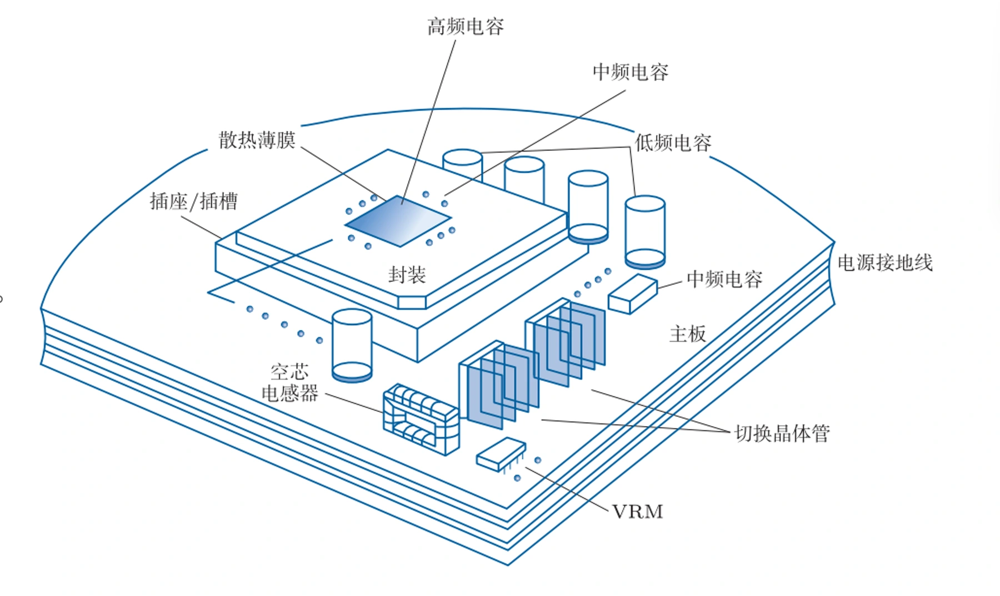
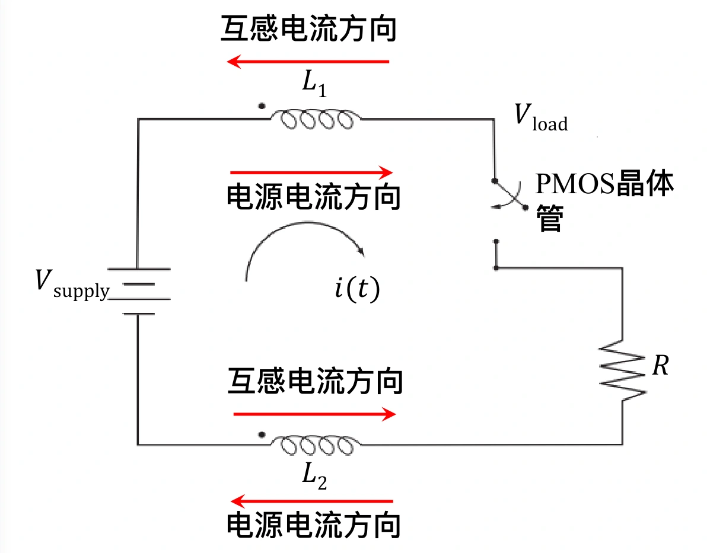
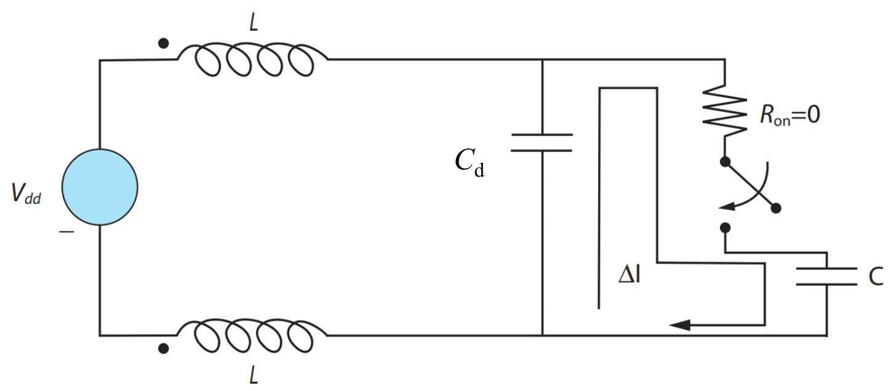
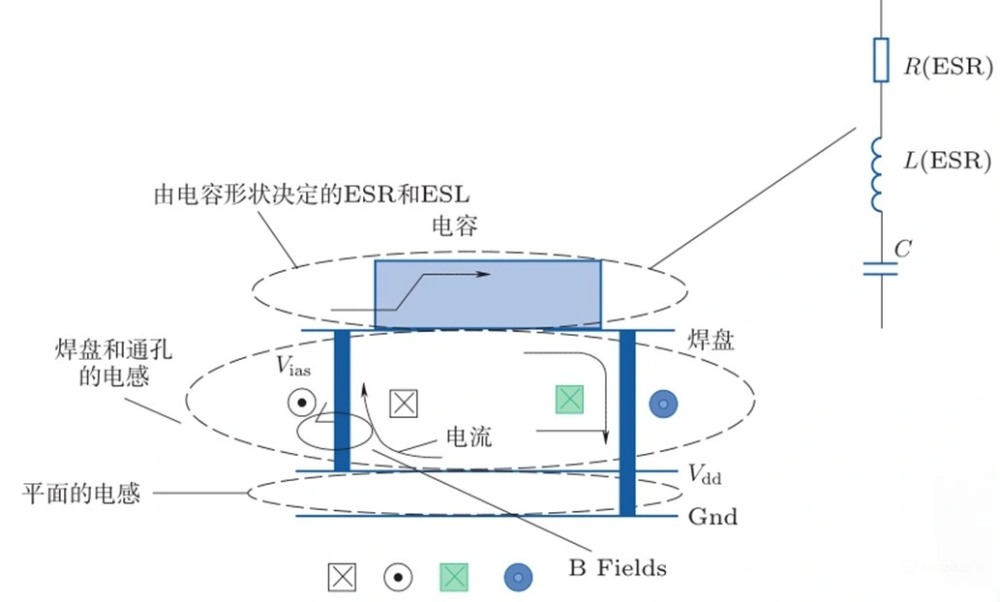
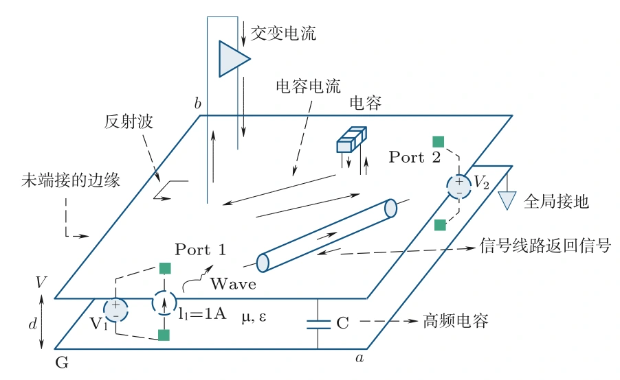
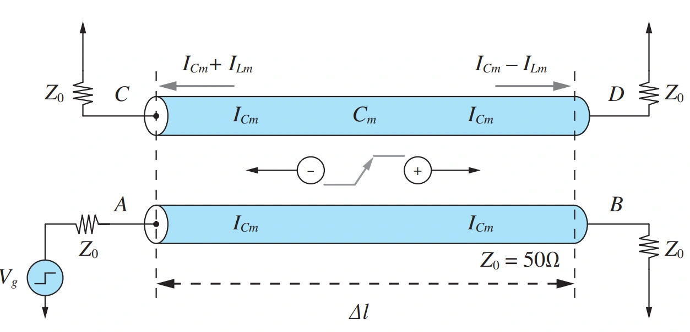
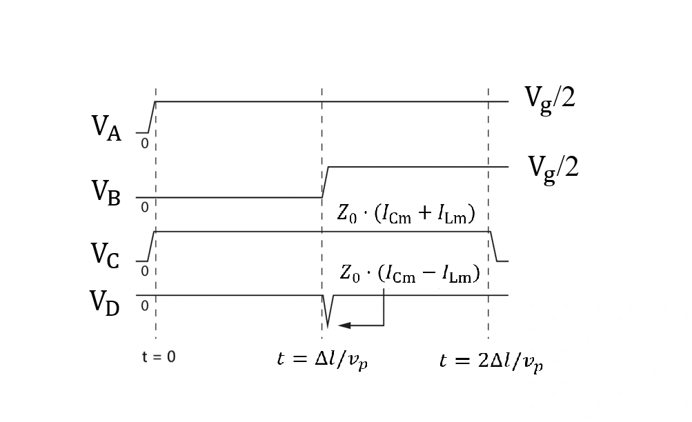

数字电路的供电并不是一个恒定负载。晶体管切换状态时，需要给节点电容充电或放电；大量电路同时切换，电源电流就会在很短的时间内发生变化。即使稳压模块的输出电压准确，经过电路板、封装和片上互连以后，晶体管实际得到的电压也可能已经偏离目标值。

电源完整性（Power Integrity，PI）关注的是负载位置的供电：在需要的时间尺度上，电压是否处于允许范围内，电流能否及时供应。电磁干扰（Electromagnetic Interference，EMI）则关注电路产生的电磁能量如何通过导体或空间耦合到其他电路。二者都与电流的流动方式有关，因此必须同时考虑去程、返回路径和互连周围的电磁场。

## 从直流压降到瞬态供电噪声

供电路径首先具有电阻。若供电去程和返回路径的总电阻为 $R_{\mathrm{path}}$，负载电流为 $I$，则负载两端的直流电压近似为

$$
V_{\mathrm{load}}=V_{\mathrm{source}}-IR_{\mathrm{path}}.
$$

这就是 IR 压降。大电流、细长导体和较高的材料电阻率都会加重压降，同时产生 $I^2R$ 损耗。增加导体截面积、缩短路径、合理分配电源与地连接，可以降低这部分影响。

供电路径还具有电感。电流变化时，电感上的电压为

$$
v_L=L\frac{di}{dt}.
$$

因此，瞬态噪声不只取决于电流有多大，还取决于电流变化有多快。对于电流增量 $\Delta I$、变化时间 $\Delta t$，可作一阶估算：

$$
|\Delta V_L|\approx L_{\mathrm{eff}}\frac{\Delta I}{\Delta t}.
$$

供电去程上的电感可能使芯片电源电位下降，返回路径上的电感则可能使芯片的局部地电位相对板级地发生变化，通常称为地弹（ground bounce）。接收器判断的是相对于自身参考地的电压，地电位移动也会改变其看到的逻辑电平。

当多个输出或内部电路同时切换，共享供电路径上的电流变化会叠加，形成同步开关噪声（Simultaneous Switching Noise，SSN）。这会同时影响多个信号节点，也说明电源完整性与信号完整性并不能完全分开处理。

## 电源分配网络承担不同时间尺度的供电

电源分配网络（Power Distribution Network，PDN）包括稳压模块、供电与返回互连、板级和封装级去耦电容、片上电源网络与电容。它既要传递平均功率，也要处理电路切换时的短时电流需求。

*图 1：跨越主板、封装和芯片的 PDN。*

电压调节模块（Voltage Regulator Module，VRM）利用参考电压与反馈回路调节输出。常见降压应用采用 Buck 拓扑，大电流供电也可采用多相结构。它能够维持长期平均电压，并响应一定范围内的负载变化，但控制带宽与输出互连阻抗有限，不能在任意短的时间内把任意大小的电流送到芯片。

在 VRM 尚未完成响应的时间内，负载附近的电容提供部分瞬态电流。随后，电源再通过较慢的过程补充这些电容释放的电荷。这里的“附近”不是只看直线距离，还要看实际供电回路经过的走线、通孔和参考平面。

| PDN 部分 | 主要作用 | 限制其快速响应的因素 |
| --- | --- | --- |
| VRM | 调节输出电压，供应平均电流和较慢的负载变化 | 控制回路带宽、输出阻抗与供电路径 |
| 板级电容 | 提供较长时间尺度的电荷，支撑板级负载变化 | 封装 ESL、连接通孔与板到芯片的路径电感 |
| 封装级电容 | 为芯片提供更近的瞬态电流来源 | 封装内布线、通孔、凸点和电容自身寄生参数 |
| 电源与地平面 | 传输电流，承载信号返回电流，形成分布电容 | 平面间距、形状、开口及分布谐振 |
| 片上网络与电容 | 在更短的路径上支持快速切换 | 片上电阻、可用面积、漏电与芯片—封装谐振 |

这些部分的工作范围会重叠，共同构成一个网络。电容越接近负载、连接回路电感越低，通常越能支持快速电流变化，但安装位置并不决定固定的频率分界。实际频率响应必须把电容和连接路径一起计算。

### 目标阻抗把电压预算转化为网络要求

若允许的电源波动为 $\Delta V_{\mathrm{allow}}$，需要支持的电流变化为 $\Delta I$，常用

$$
Z_{\mathrm{target}}=\frac{\Delta V_{\mathrm{allow}}}{\Delta I}
$$

作为 PDN 的目标阻抗。例如，1 V 电源允许波动 5%，负载电流变化为 10 A，则目标阻抗为 $50\ \mathrm{mV}/10\ \mathrm A=5\ \mathrm{m\Omega}$。

在频域中，小信号关系为 $\Delta V(f)=Z_{\mathrm{PDN}}(f)\Delta I(f)$。需要检查的是负载端在相关频率范围内看到的阻抗，而不只是 VRM 的直流输出电压。某个频率附近的阻抗峰，如果与负载电流频谱重合，就可能产生明显噪声。

目标阻抗适合建立初始设计约束，但不能替代实际瞬态分析：电流变化的持续时间、重复方式和频谱不同，产生的电压波形也不同。直流压降、开关纹波和瞬态变化还需要共享同一份电压容差预算。

## 有效电感取决于完整电流回路

电感描述电流产生磁通并储存磁场能量的能力。对于封装供电，除了每一段导体的自感，还要考虑不同导体之间的互感。将供电去程与返回路径分别表示为 $L_1$ 和 $L_2$，在相应方向约定下，相等且反向的回路电流对应

$$
L_{\mathrm{eff}}=L_1+L_2-2M,
$$

其中 $M$ 为两段导体的互感。这里的减号来自去程与返回电流的方向关系；换用其他参考方向时，互感项的符号也应相应调整。

*图 2：将供电与返回路径一起考虑的电感模型。*

在同一回路中，将去程和返回路径靠近，通常可以增强两者的磁场抵消，减小回路有效电感。因此，减小电感并不只是选择“自感较小的一根线”，还包括让相应的返回电流沿着邻近路径流动。

这一点落实到封装结构上，就是让电源引脚与地引脚合理相邻，让电源通孔与地通孔形成紧凑回路，并减小电源平面与地平面的间距。并联多个连接也有帮助，但由于互感与共享路径的存在，总电感一般不能简单按连接数量等比例降低。

与平行导线相比，对于相近的传输尺度，紧密耦合的平面对可以提供较低电感。宽度为 $w$、长度为 $\ell$、间距为 $h$ 的理想平行平面，在边缘效应较小的近似下有

$$
L_{\mathrm{loop}}\approx\mu\frac{h\ell}{w}.
$$

减小层间距离、增加有效电流通道宽度，都有利于降低这部分电感。但供电还要经过焊球、凸点和通孔，平面本身低电感，并不意味着整个供电路径都低电感。

### 电感造成的供电响应延迟

将供电回路简化为理想电源、封装电感与开关电阻负载，可以分析电感对瞬态响应的影响。设开关在 $t=0$ 闭合，初始电流为零，负载电阻为 $R$，则

$$
V_s=L_{\mathrm{eff}}\frac{di}{dt}+Ri(t).
$$

解得

$$
i(t)=\frac{V_s}{R}\left(1-e^{-t/\tau}\right),
\qquad \tau=\frac{L_{\mathrm{eff}}}{R},
$$

负载电阻两端的电压为

$$
V_{\mathrm{load}}(t)=V_s\left(1-e^{-t/\tau}\right).
$$

电感限制了电流的建立速度，负载电压不能立即达到理想电源电压。这个模型用于隔离电感的作用，实际芯片还包含电容、互连电阻和非线性开关，不能直接用一个 RL 响应描述全部供电行为。

例如，取 $V_s=5\ \mathrm V$、$R=50\ \Omega$、$L_1=L_2=1\ \mathrm{nH}$。忽略互感时，$L_{\mathrm{eff}}=2\ \mathrm{nH}$，因此

$$
\tau=\frac{2\ \mathrm{nH}}{50\ \Omega}=40\ \mathrm{ps}.
$$

经过 $5\tau=200\ \mathrm{ps}$，负载电压约为 $5(1-e^{-5})=4.966\ \mathrm V$，接近稳态值。若考虑 $M=0.5\ \mathrm{nH}$，有效电感降为 1 nH，时间常数变为 20 ps。这说明改变去程与返回路径的耦合，也能改变供电响应速度。

## 去耦电容提供局部瞬态电流

晶体管给负载电容 $C_{\mathrm{load}}$ 充电时，所需电荷为 $Q=C_{\mathrm{load}}\Delta V$。若只能通过远处电源和较大封装电感获得这些电荷，快速切换就会引起较大的供电波动。将电容放在负载附近，可以让一部分瞬态电流从局部电容直接流向负载，再通过邻近地路径返回。

*图 3：去耦电容为开关负载提供瞬态电流，图中局部回路的寄生电感被理想化忽略。*

旁路电容与去耦电容在实际用语中常有重叠。强调“旁路”时，关注的是为高频电流提供低阻抗通路；强调“去耦”时，关注的是减少负载变化通过共享供电网络影响其他部分。在这里，两者都需要通过局部电流回路发挥作用。[TI 的去耦说明](https://www.ti.com.cn/zh-cn/video/6313253251112)也强调电容到器件电源、地引脚的连接电感。

容量的初步要求来自电荷守恒：

$$
\Delta Q=\int_0^{\Delta t}i_C(t)\,dt,
\qquad \Delta V_C=\frac{\Delta Q}{C}.
$$

若在这段时间内，电容近似提供恒定的额外电流 $\Delta I$，则

$$
C\geq\frac{\Delta I\Delta t}{\Delta V_C}.
$$

它回答的是“需要储存并释放多少电荷”，还没有回答“这些电荷能否通过实际路径足够快地送达”。后一个问题取决于电容与负载之间的电感和电阻。

### 实际电容具有 ESR 与 ESL

实际电容器可以用电容 $C$、等效串联电阻（Equivalent Series Resistance，ESR）和等效串联电感（Equivalent Series Inductance，ESL）的串联模型近似描述：

$$
Z_C(\omega)=R_{\mathrm{ESR}}+j\omega L_{\mathrm{ESL}}+
\frac{1}{j\omega C}.
$$

在这个模型中，自谐振频率为

$$
f_{\mathrm{SR}}=\frac{1}{2\pi\sqrt{L_{\mathrm{ESL}}C}}.
$$

低于自谐振频率时，容性项占主导；接近谐振时，容性与感性项抵消，阻抗接近 ESR；超过谐振频率后，电容呈感性，阻抗随频率增加。这里的“呈感性”不等于完全失去作用，而是说明其阻抗已经不再按理想电容规律下降，需要检查它是否仍满足目标阻抗。[TI 的高速系统设计指南](https://www.ti.com/lit/ug/spru889/spru889.pdf)采用的也是这一串联等效模型。

在使用这个模型分析安装后的电容时，还应计入焊盘、短走线、通孔和平面路径的附加电感。忽略这些连接，只比较电容标称容量，会高估高频去耦能力。

*图 4：电容内部和外部连接的寄生参数，电感项对应 ESL。*

在一阶估算中，负载电压波动可分解为

$$
\Delta V\approx L_{\mathrm{loop}}\frac{di_C}{dt}
+R_{\mathrm{ESR}}i_C
+\frac{1}{C}\int i_C(t)\,dt.
$$

三项分别反映回路电感、电阻和释放电荷造成的压降。实际波形中它们未必同时达到峰值，但这个分解说明：增加容量主要改善电荷不足，不能直接消除电流快速变化造成的电感压降。

### 容量与布局需要共同满足要求

电容应优先靠近需要支撑的电源—地连接，缩短两端到相应平面的路径，并减小完整回路面积。电源过孔与地过孔相邻、减少焊盘引出的细长走线、采用合适的多过孔连接，通常比单纯增加一只大容量电容更能改善最快的瞬态响应。

电容的有效容量还可能随直流偏置、温度和器件公差变化。因此，电荷预算应使用实际工作条件下的容量，而非只使用器件名称上的标称值。所需数量与安装位置也应由负载、目标阻抗和连接寄生参数决定；“每一个电源线与地线的交点都放电容”并不是可直接套用的通用布局规则。

## 反谐振使并联电容出现阻抗峰

多个电容并联，可以增加电荷储备，却不保证在所有频率下降低阻抗。当较大电容已经进入感性区域，而另一个电容仍呈容性时，两条支路的无功导纳可能相互抵消，使总导纳减小，形成阻抗峰。这称为反谐振（antiresonance）。

因此，把多个不同容量机械地并联，并不能保证获得平坦的宽带低阻抗。器件自身 ESL、连接电感、容量搭配和阻尼都会改变峰值位置与高度。[村田的电源噪声抑制手册](https://e2e.ti.com/cfs-file/__key/communityserver-discussions-components-files/14/1030.c39e.pdf)给出了不同容量及较长连接路径引起反谐振的例子。

控制反谐振时，电感与电阻的作用需要分别考虑。减小连接电感通常有利于高频供电，而 ESR 同时提供阻尼。在其他条件相同的情况下，过低的 ESR 可能让谐振更尖锐。因此，设计时应结合容量和连接方式调整谐振位置，并采用适当阻尼，再检查整条 PDN 阻抗曲线。

片上电容与封装电感也可能构成谐振系统，其简化谐振频率为

$$
f_0\approx\frac{1}{2\pi\sqrt{L_{\mathrm{pkg}}C_{\mathrm{die}}}}.
$$

增加片上电容会降低这一谐振频率，但“降到时钟基频以下”不自动等于安全。负载变化仍可能包含低频分量，谐振峰的阻抗与阻尼也仍然重要。应检查噪声频谱与网络响应之间的关系。

## 电源与地平面同时影响 PI 与 SI

相邻电源平面与地平面构成分布电容，近似平行板时有

$$
C_{\mathrm{plane}}\approx\varepsilon_0\varepsilon_r\frac{A}{h},
$$

其中 $A$ 为重叠面积，$h$ 为介质厚度。减小 $h$ 可以增加平面电容，同时降低前面讨论的平面对回路电感。因此，紧密相邻的电源—地平面对，不仅储存电荷，也改善电流传输路径。

*图 5：电源与地平面承担的多种电气功能。*

普通层叠形成的平面电容未必很大。例如，$A=1\ \mathrm{cm^2}$、$h=100\ \mu\mathrm m$、$\varepsilon_r=4$ 时，电容约为 35.4 pF。它不能仅凭“面积大”就替代 nF 或 μF 级去耦电容，但短距离、低电感的分布结构可能使它在高频下具有作用。

随着平面尺寸相对于波长变大，电压与电流会呈现空间分布，单个集总电容模型不再充分。波传播到未端接的边缘后反射，可能形成驻波和腔体谐振。孔洞、开槽、平面形状和去耦位置都会改变这种行为。

平面还承担信号返回电流。高速信号的回流通常更集中于邻近信号路径的参考平面区域；如果信号跨越平面开缝，返回电流被迫绕行，回路面积、电感和耦合都会变化。信号换层时，也应考虑参考路径的连续性，例如在同一地参考的换层位置设置邻近回流过孔。供电布局和信号布局因此共享同一组平面约束。

## 瞬态噪声与电荷预算的计算

设封装电源有效电感为 10 pH，支持 1000 个片上电路切换，电流在 0.25 ns 内变化 10 A，允许噪声目标为 200 mV。

先按线性电流变化估算电感噪声：

$$
\Delta V_L\approx10\times10^{-12}
\frac{10}{0.25\times10^{-9}}
=0.4\ \mathrm V.
$$

只有 10 pH 的电感，仍然产生了 400 mV 的变化。这来自 $40\ \mathrm{A/ns}$ 的电流变化率。题目给出的 10 A 是这些电路的总电流变化，不应再乘以 1000。

接着，采用矩形电流脉冲近似，假设在 0.25 ns 内需要由电容提供 10 A，允许电容释放电荷造成的电压下降为 0.2 V，则

$$
\Delta Q=10\ \mathrm A\times0.25\ \mathrm{ns}
=2.5\ \mathrm{nC},
$$

$$
C_{\min}=\frac{2.5\ \mathrm{nC}}{0.2\ \mathrm V}
=12.5\ \mathrm{nF}.
$$

这个结果是理想电荷预算。若电容电流确实从零线性增加到 10 A，且这段时间电源不分担电流，则积分电荷只有矩形脉冲的一半，得到 6.25 nF。可见，容量应按电容实际承担的电流波形积分，而不能只凭一个电流峰值决定。

此外，12.5 nF 并不保证总噪声已经小于 200 mV。还要给 ESR 压降与局部回路电感留下预算，并保证电容有效容量足够。若把全部 200 mV 都用于电荷释放的压降，其他寄生项就没有余量。由电压与电流预算得到的 $Z_{\mathrm{target}}=0.2\ \mathrm V/10\ \mathrm A=20\ \mathrm{m\Omega}$，应作为进一步检查安装后网络阻抗的约束。

## 电磁干扰沿传导和辐射路径传播

封装内部的干扰不只沿预期电路路径传递。高速信号和供电电流周围都存在电场与磁场，这些场可能作用于相邻互连，也可能把能量传到电路板和外部电缆。分析 EMI 时，需要同时识别噪声源、耦合路径和受影响的电路。

传导干扰通过电源线、地线或信号线传播。比如多个负载共享一段返回路径，该路径上的 $Ri+L\,di/dt$ 电压变化会改变其他负载的参考电位，形成公共阻抗耦合。辐射干扰则通过空间电磁场传播，导体结构的尺寸、电流分布和频率共同决定辐射强度。

信号反射与振铃、开关电源的切换过程、芯片同步开关电流，都是可能的高频噪声来源。较小的封装通常不是整个系统中尺寸最大的辐射结构，但封装产生的噪声可以耦合到板上走线或电缆，再由这些结构辐射出去。因此，只看封装自身的尺寸，不能排除它对系统 EMI 的影响。

电磁兼容（Electromagnetic Compatibility，EMC）的要求还包括系统对外部干扰的承受能力。减小发射与提高抗扰能力有共同的布局基础，但应分别按系统的具体指标验证。

### 电流路径决定抑制措施

降低 EMI 的措施，应对应实际的噪声来源和传播路径：

- 保持信号阻抗连续，并采用合适端接，减少反射和振铃造成的额外高频分量。
- 为瞬态供电电流提供紧凑的局部回路，避免它经过较长的共享供电或地路径。
- 让信号与其返回路径靠近，避免跨越参考平面开缝，合理分配地引脚与回流过孔。
- 在接口时序允许的条件下，避免使用不必要的过快边沿，降低高频激励。
- 对已经识别出的电缆共模电流、接口传导噪声或空间耦合，再选择相应的滤波、屏蔽与连接措施。

这些措施并不是独立的元件清单。滤波器的实际效果依赖源、负载阻抗和安装寄生参数，屏蔽效果也依赖完整结构与连接方式；应先明确耦合路径，再验证措施是否切断或减弱了该路径。

## 串扰来自互电容与互感

串扰是一个线网的变化耦合到另一个线网。产生激励的线网称为干扰线或 aggressor，受到影响的线网称为受扰线或 victim。每个线网都包括信号路径与返回路径，键合线、通孔和基板走线之间都可能发生耦合。

电容耦合来自变化的电场。在简化模型中，若受扰节点电压变化较小，耦合电流可以估算为

$$
i_{C_m}\approx C_m\frac{dv_a}{dt},
$$

其中 $C_m$ 为互电容，$v_a$ 为干扰线电压。电感耦合来自变化的磁场，感应电压的幅值可估算为

$$
|v_M|\approx M\left|\frac{di_a}{dt}\right|.
$$

其极性取决于回路方向约定。两式共同说明：即使时钟重复频率不变，更快的边沿也可能产生更强耦合。

延伸到信号与返回路径之间空间以外的场称为边缘场。信号离参考平面较远、两条信号线较近、平行走线较长时，场更容易与相邻线网耦合。将参考平面靠近信号线，可以使场更多地集中于自身信号—返回路径之间。

在线性互连模型内，可以先计算受扰线原本的响应，再叠加干扰线产生的耦合噪声。这里的叠加只适用于线性模型；当接收器保护二极管导通或驱动器进入非线性工作区时，不能直接沿用简单线性相加。

### 近端与远端串扰

沿干扰信号的传播方向，将靠近发射端的一端称为近端，另一端称为远端。在受扰线近端观察到的是近端串扰（Near-End Crosstalk，NEXT），远端观察到的是远端串扰（Far-End Crosstalk，FEXT）。

*图 6：受扰线近端 C 与远端 D 的耦合分量，近端为相加，远端为相减。*

在图示方向约定和弱耦合传输线模型下，电容与电感耦合对近端噪声的贡献同向叠加；对远端噪声的贡献方向相反，其幅值取决于两种效应的差异。因此，同样两条线的近端与远端噪声形状并不相同。

理想均匀介质中的带状线，容性与感性耦合可以较好地平衡，从而减小 FEXT。微带线周围同时存在空气与介质，两种耦合不一定平衡，所以通常仍有明显 FEXT。带状线也仍有 NEXT，不能把“远端耦合抵消”理解为所有串扰都消失。[Intel 的连接器设计说明](https://cdrdv2-public.intel.com/655072/an596.pdf)给出了两类串扰的区别及带状线减小 FEXT 的结论。

### 飞行时间影响串扰波形

设平行耦合段长度为 $\ell_c$、传播速度为 $v_p$，飞行时间为

$$
t_f=\frac{\ell_c}{v_p}.
$$

这里的传播速度由传输线的分布参数与介质决定，相关模型见[信号完整性](集成电路封测之信号完整性.md)中的“特性阻抗来自分布参数”。

*图 7：干扰线 A、B 与受扰线 C、D 的时域响应。*

在匹配终端、足够快的阶跃和弱耦合模型下，沿途生成的反向耦合波在近端持续到达，因此 NEXT 的持续时间约为 $2t_f$；FEXT 在约 $t_f$ 后到达远端，脉冲持续时间主要与干扰边沿有关。边沿较慢或终端存在反射时，波形会相应改变。

增加耦合长度通常会加重串扰，但这种关系有条件：当耦合段已经足够长，使 $2t_f$ 大于边沿时间时，NEXT 峰值可能接近饱和，进一步增加长度主要延长噪声持续时间。FEXT 则还受两种耦合是否平衡影响。不能把两者都概括为“长度加倍，噪声一定加倍”。

### 减少串扰的布局取舍

拉开线间距离、缩短平行段、让参考平面靠近信号，以及为不同敏感线网选择合适层叠，都是直接减少耦合的方法。[Intel 的高速布线指南](https://cdrdv2-public.intel.com/654465/an224.pdf)也强调线间距、参考平面距离和平行长度的共同作用。

防护走线只有在具备合适接地方式时，才可能改善隔离。较长、浮空或只在远处接地的防护线本身可能形成新的耦合结构；即使使用接地过孔，也需要按工作频率检查其效果。降低特性阻抗、改变介电常数或增加层数，还会影响驱动电流、传播延迟和成本，不能脱离原有阻抗目标单独调整。

封装引脚分配同样重要。多个高速信号共用较长的返回引脚，会增加公共阻抗耦合；信号与地连接合理邻接，有利于形成较小回路。串扰分析因此不仅检查两条信号线之间的距离，也检查它们各自怎样返回。

## 将供电与电磁分析纳入封装设计流程

电源、电磁场和信号路径最终都落实到同一套封装布局。设计开始时，应同时明确电源电压、总电流与电流变化率、允许压降与噪声，以及信号速率、边沿、阻抗和接收端裕量，再选择材料与层叠。

随后通过电磁参数提取获得互连的 R、L、C、G 或网络参数，将 VRM、去耦电容、片上负载和信号接口加入模型。在版图成形前检查直流压降、PDN 阻抗峰、瞬态电源噪声、串扰和接收端波形；版图修改后，再用实际几何结构重新提取并验证。只有理想元件的仿真通过，还不足以证明安装后的封装通过。

| 验证项目 | 主要检查内容 |
| --- | --- |
| 直流供电分析 | 负载位置的 IR 压降、电流分布与导体损耗 |
| 频域与瞬态 PI 分析 | 目标阻抗、谐振与反谐振、电流切换造成的噪声 |
| SI 与耦合分析 | 反射、串扰、返回路径连续性、时序和眼图 |
| EMI 分析与测量 | 噪声源、传导及辐射耦合路径、措施的实际效果 |
| DRC 与 LVS | 制造几何规则，以及物理连接与设计网表的一致性 |

设计规则检查（DRC）和版图与原理图一致性检查（LVS）分别保证制造规则与电气连接符合设计。它们并不直接保证低电源噪声、低串扰或足够的眼图裕量。完整的封装研发流程还包括样件制造、测试与失效反馈：实际波形和噪声测量应回到模型中，用来修正寄生参数与布局选择。
